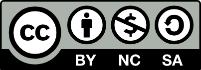

# Индустриальный C++

Добро пожаловать в репозиторий открытой книги "Индустриальный C++".  
Здесь вы найдете исходные материалы книги, набор утилит для запуска книги локально и возможность внести свой вклад в развитие проекта.  
В последнем случае я прошу вас крайне внимательно ознакомиться с [CONTRIBUTING.md](./CONTRIBUTING.md) и [CODE_OF_CONDUCT.md](./CODE_OF_CONDUCT.md) перед началом своей работы, а также заглянуть в [TODO.md](./TODO.md) для поиска задач, с которыми проекту требуется помощь.

## Предисловие

Данная открытая книга создана с целю распространения лучших индустриальных практик работы с языком программирования C++ и основана на опыте его применения в крупных и малых компаниях.  
Данная книга предназначена как для профессионалов так и для новичков, я думаю каждый сможет найти в ней новые элементы работы с C++ и его экосистемой.  

# Быстрый старт

Для работы с данной книгой необходимо или установить mdbook или использовать предоставленный docker образ.

## Самостоятельная установка mdbook

1. Поставьте cargo через rustup или системный менеджер зависимостей
2. `cargo install mdbook`
3. `mdbook serve`
4. Переходите на http://localhost:3000/ для просмотра книги

## Использование Docker образа

Предоставленный образ можно использовать или напрямую через:

```bash
docker build -t mdbook:alpine -f mdbook-alpine.dockerfile .
docker run -it --rm --user $(id -u):$(id -g) -p 3000:3000 -v $HOME/industrial-cpp-book:/home/user/industrial-cpp-book -w /home/user/industrial-cpp-book mdbook:alpine /bin/bash
mdbook serve -n 0.0.0.0
```

Или через docker compose:

```bash
docker compose build
docker compose up -d
```

# Лицензионные ограничения



industrial-cpp-book (c) by Demchenko Mikhail

industrial-cpp-book is licensed under a
Creative Commons Attribution-NonCommercial-ShareAlike 4.0 International License.

You should have received a copy of the license along with this
work. If not, see <https://creativecommons.org/licenses/by-nc-sa/4.0/>.
