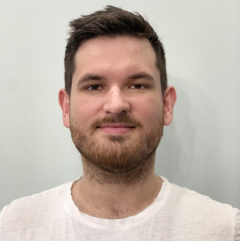

## Об авторе

Основной автор данной книги - Демченко Михаил Алексеевич, разработчик на C++ с разносторонним опытом в области разработки программ на C++. Книга во многом основана на личном опыте ознакомления с данным языком программирования, его экосистемой, а также на опыте помощи коллегам в понимании тонкостей работы с C++.

> Михаил:  
> За свою карьеру мне довелось поработать как в крупных компаниях, с большими кодовыми базами на C++, таких как Kaspersky и Align Technology, так и в малых стартапах, где вся кодовая базы могла быть разработана одним программистом. Также я не оставался долго в одной отрасли бизнеса, что помогло пролить свет на универсальные шаблоны использования C++ и идиоматический подход к написанию кода.  
> В этой книге я постарался собрать те аспекты C++, которыми мои коллеги интересовались в повседневной работе.

## Соавторы

Этот раздел пока пуст. Вы всегда можете предложить свой вклад в данную книгу и попасть сюда.

## Благодарности

### Благодарности от Демченко Михаила

Благодарю мою жену, Груздкову Екатерину Алексеевну, за свободное время, которое я мог посвящать написанию данной книги и её невероятную работу по оформлению презентаций, предававшую мне уверенности в материале.

Благодарю Новосибирский Государственный Университет, в лице заместителя декана кафедры ФИТ НГУ Власова Александра Алекандровича, за предоставленную возможность вести курс, одноименный данной книге, для студентов 3 и 4 года обучения. Данная возможность помогла мне с концентрацией на цели завершения книги, сроками, организацией моей работы и проработкой материалов книги со студентами.

Благодарю моих многочисленных коллег за возможность развиваться рядом с вами, за ваши вопросы и темы для споров, которые заставляли меня рыться в стандарте и поддерживали огонь интереса к теме развития C++.
