# Инженерный взгляд на С++

В данной главе дается обзор на инженерные практики работы с языком программирования C++ и его экосистемой.

## Области применимости C++ в современной разработке

В современном мире C++ чаще всего встречается в следующих областях

* Встраиваемые системы  
  * Близость к истокам \- можно вставлять asm, модели языка и реального оборудования довольно близки, легко портировать на новые платформы, туллинг позволяет тонко настраивать расположение данных и кода в памяти  
* Разработка игр и игровых движков ([Unreal Engine](https://dev.epicgames.com/documentation/en-us/unreal-engine/programming-with-cplusplus-in-unreal-engine))  
  * Скорость выполнения операций и обилие оптимизаций (высокая производительность)  
  * Исторические интерфейсы систем управления графикой (OpenGL, Vulkan) и звуком (OpenAL)  
  * Легкость в реализации программирования, ориентированного на данные (Data-Driven Programming / Data-Oriented Programming)  
* Операционный системы, драйверы и низкоуровневые библиотеки  
  * Близость к истокам  
  * Достаточная абстрактность для построения сложных правил управления  
  * Легкость реализации произвольных структур данных  
  * Низкие накладные расходы в языке (You don’t pay for what you don’t use \- принцип дизайна)  
* Системы управления базами данных ([ScyllaDB](https://github.com/scylladb/scylladb))  
  * Высокая производительность кода  
  * Легкость реализации произвольных структур данных  
* Приложения в области финансов ([C++ High Performance for Financial Systems: Build efficient and optimized financial systems by leveraging the power of C++](https://www.amazon.com/High-Performance-Financial-Systems-leveraging/dp/1805124528))  
  * Высокая производительность  
* Web-браузеры ([Chrome/Chromium](https://github.com/chromium/chromium))  
  * Высокая производительность  
* Сетевое оборудование  
  * Высокая производительность  
* Массированные научные вычисления  
  * Высокая производительность  
  * Большой объем стандартной библиотеки для научных вычислений  
* Высокопроизводительные бекэнд сервисы ([Яндекс\|Userver](https://userver.tech/))  
  * Высокая производительность

## Модель общения человека с машиной

Инженер разработчик программ достигает наиболее эффективных результатов своей работы, когда поимет как именно устроена та или иная система. Поскольку большая часть работы инженера будет происходить в непосредственном контакте с компьютерным интерфейсом, таким специалистам важно понимать, какие именно точки ваяния на работу машины им доступны.  
Следующая секция рассматривает на примере сравнения Java и C++ именно такие особенности. В данной книге берется за предположение, что читатель знаком хотя бы с одним языком высокого уровня, но может быть не знаком с языками системного уровня.

### Прикладные различия с точки зрения программиста

Прикладные действия выполняемые программистом будут отличаться для таких языков Java и C++ так как модель получения программы из исходного кода разная.

| Этапы работы инженера | Java | C++ |
| :---- | :---- | :---- |
| Написание кода | Текст в .java файлах | Текст в .cpp и .hpp файлах |
| Подготовка артефактов | AOT (Ahead Of Time) компиляция в байт-код (.jar) | AOT компиляция в нативный код целевой платформы и линковка в исполняемый файл (.exe, .dll и т.д.) |
| Подготовка окружения | Установить JVM | Установить C++ runtime библиотеку Подготовить зависимости от динамических библиотек |
| Запуск | Запускаем JVM с подготовленным байт-кодом | Запускаем исполняемый файл |
| Работа программы | JIT (Just In Time) компиляция в нативный код | Код уже нативный |

#### Модельные различия

Модельные различия это набор того как сам язык смотрит на своё окружение, какие вводные имеют авторы компиляторов, трансляторов и интерпретаторов языка

| Формализованная модель для программиста | Java | C++ |
| :---- | :---- | :---- |
| Исполнитель | Многопоточный процессор виртуальной машины в рамках процесса ОС | Определен абстрактный исполнитель. Даны определения потоков исполнения, последовательностей операций и синхронизации между ними |
| Память | Гомогенный доступ к памяти  | Гомогенность памяти не гарантируется |
| Управление памятью | Автоматическое, со сборкой мусора для объектов в динамической памяти  | Автоматическое для объектов в статической памяти и временных объектов, ручное для объектов в динамической памяти |
| Модель чтения / записи над элементами памяти | Определена | Определена (sequenced-before, happens-before) |

### Программа на C++ \- углубленный разбор

В большинстве случаев: Текст на человеко-читаемом языке программирования преобразуется в машинный код и данные, загрузив которые в оперативную память ОС может начать исполнение программы.  
Исключения:

- Вы разработчик сторонней библиотеки или SDK (например Qt, KasperskyOS SDK)  
- Вы разрабатывает прошивки под голое железо (вы сами себе ОС)  
- Вы очень модный и компилируете по WebAssembly для работы на C++ в вебе

Для того чтобы получить на выходе исполняемые программы происходит процесс компиляции (Ahead Of Time compilation, AOT) исходного кода в бинарные артефакты.  
Основной единицей компиляции является юнит трансляции

Юнит трансляции  
  : Один и более “склеенных” вместе файлов с C++ кодом, содержащие языковые определения. Мы называем такие файлы кодом (.c, .cpp, .cxx и т.д.)  
  : Ноль и более склеенных вместе файлов, содержащие языковые объявления. Мы называем такие файлы заголовками (.h, .hpp, .hxx и т.д.)

Типичным результатом компиляции является объектный файл

Объектный файл  
  : Результат компиляции одного юнита трансляции (ещё не готовая программа)

Результатом сборки проекта являются бинарные артефакты

Бинарный артефакт  
  : Исполняемый файл \- формат хранения машинного кода и данных, который понимает ОС и может запустить на исполнение на центральном процессоре  
  : Статическая библиотека \- формат переиспользования кода и данных, из которого можно получить исполняемый файл, при линковке AOT  
  : Динамическая библиотека \- формат переиспользования кода и данных, с возможностью динамической замены в момент исполнения

#### Процесс компиляции

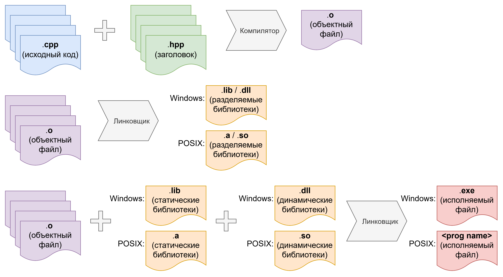  

Файлы с кодом \* H \+ Файлы заголовков \* K \=\[компилятор\]=\> Объектный файл  
Объектный файл \* L \+ Статическая библиотека \* M \+ Динамическая библиотека \* N \=\[линковщик\]=\> Исполняемый файл  
Объектный файл \* L \=\[линковщик\]=\> Статическая библиотека \| Динамическая библиотека

#### Специальные библиотеки для С/C++

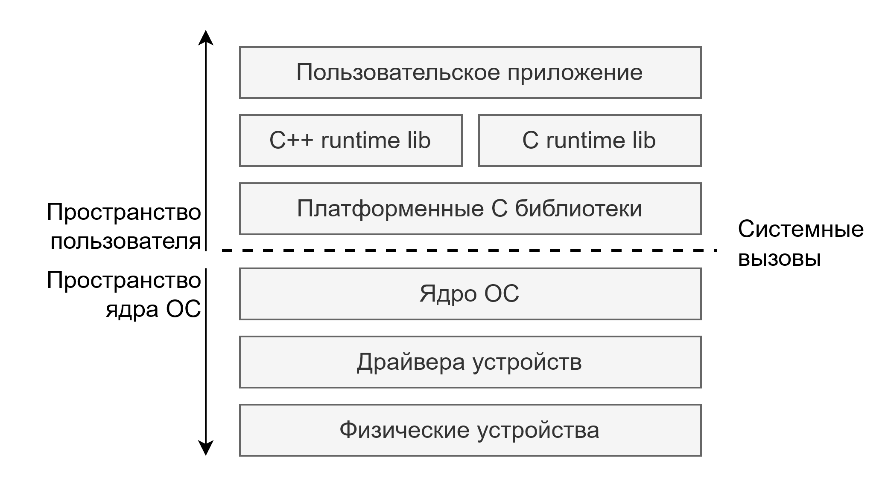  

Для С/C++ существуют 2 специальные библиотеки, они всегда являются частью поставки компилятора. Эти библиотеки отвечают за слой интероперабельности между стандартом С/C++ и платформой, реализующей программное окружение. Имея такой слой интероперабельности С/C++ может гарантировать переносимость программ (один и тот же код работает под разные платформы).

- lib C runtime \- организует слой абстракции, описанный в стандарте С поверх интерфейса ОС  
- lib C++ runtime  \- организует слой абстракции, описанный в стандарте C++ поверх интерфейса ОС и lib C runtime

Они присутствуют почти на всех платформах, поставляются с компилятором и имеют в большинстве случаев как статическую так и динамическую части.  
Имеют возможность тонкой настройки, например без динамической части или вообще без библиотеки (обычно в случае компиляции под железо).

### Запуск кода на исполнение

> [!IMPORTANT]
> Медиаконтент в данном месте ищет своего автора. Смотрите TODO.md

После компиляции у нас на руках остается исполняемый файл и операционная система, которая может запустить данный файл на исполнение.  
Исполняемый файл \- это формат данных, определяющий какие начальные области памяти процесса используются в каком объёме и для каких целей, а также где находится точка входа в исполняемый код (первая инструкция).  
Типичные области памяти (секции):

- Исполняемый машинный код  
- Область, инициализируемая нулями (для статических переменных)  
- Не инициализируемая область (для статических переменных без определенных начальных значений)  
- Область данных (для константных данных)  
- Область начальной кучи и стека

> [!IMPORTANT]
> Медиаконтент в данном месте ищет своего автора. Смотрите TODO.md

После загрузки файла в оперативную память (согласно описателю секций) ОС запускает линковщик времени исполнения для разрешения символов из динамических библиотек, которые будут располагаться по известным линковщику времени исполнения путям на диске.  
Линковщик времени исполнения не всегда работает на старте. Его можно вызывать платформенно специфическими функциями для поиска динамических символов в библиотеках (например `dlopen()`), реализую таким образом архитектурный паттерн плагинов.  
На некоторых платформах (Windows) линковщик времени исполнения работает при первом обращении к символу, а не на старте работы программы.  

> [!IMPORTANT]
> Медиаконтент в данном месте ищет своего автора. Смотрите TODO.md

После работы линковщика поток исполнения переходит к точке входа в приложение. Это ещё не всем известная функция main. До данной функции происходит инициализация рантайма C++, а также конструирование всех статических переменных. Уже после этого поток исполнения достигает функции main().

#### Окружение исполнения

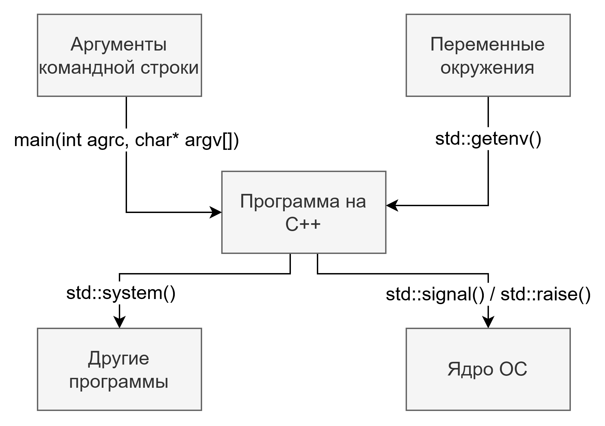  

Базовым окружением исполнения для программы являются: аргументы командной строки, переменные окружения, другие приложения, сигналы.

##### Аргументы командной строки

Для C++ существует много способов разобрать аргументы командной строки. Есть платформно-зависимые способы, такие как `getopt()`/`getoptlong()` на POSIX или `GetCommandLine()` на Windows, а также третье-сторонние библиотеки.

##### Переменные окружения

Это строковые пары ключ-значение. Для C++ определён переносимый способ получить значение переменной окружения `std::getenv()`. Некоторые платформы предоставляют третий аргумент для `main(int argc, char* argv[], char* env[])`. POSIX также предоставляет функции модификации переменных окружения `setenv()` / `unsetenv()` / `putenv()`.

##### Другие приложения

Для C++ определён переносимый способ вызвать другую программу `std::system()` позволяющий задать строку исполнения и выполнить любую доступную из строки исполнения программу. Для POSIX существует также способ получить файл ввода и вывода для запущенного процесса через функцию `popen()` [(man7)](https://man7.org/linux/man-pages/man3/popen.3.html).

##### Сигналы

Это примитивная форма межпроцессного взаимодействия при которой одно запущенное приложения может вызвать обработчик в другом запущенном приложении (или приложение само в себе через `std::raise()`). Для этого C++ поддерживает интерфейс установки обработчиков `std::signal()`. Сигналы очень опасны, поскольку могут исполняться в любой момент прерывая поток исполнения и используя его стек, а также в обработчиках сигналов разрешено делать только очень узкий круг действий.

#### Завершение работы приложения

К завершению приложения может прийти разными способами. Например: не обработать исключение или вызвать исключение в ходе обработки исключения, вернуться из функции main(), явно завершить приложение через `std::exit()` / `std::abort()` / `std::quick_exit()` / `_Exit()`.  
При этом в зависимости от выбранного метода выхода определено:

- Вызываются ли деструкторы глобальных переменных  
- Вызываются ли колбеки, установленные через `std::atexit()` и `std::at_quick_exit()`  
- Деинициализируется ли C++ рантайм библиотека  
- Какой код возврата передается системе

Для выхода из функции `main()` и через функции с явной передачей кода возврата определены константы `EXIT_SUCCESS` и `EXIT_FAILURE`.  

## C++ - язык, стандарт, компилятор?

> [!IMPORTANT]
> Медиаконтент в данном месте ищет своего автора. Смотрите TODO.md

C++ как язык программирования стандартизируется международным комитетом ISO. Данный комитет определяет как синтаксис и семантику языка, так и состав и полноту стандартной библиотеки. Комитет в ходе дизайна языка выпускает новый стандарт каждые 3 года, начиная с 2011. В комитет входят представители от стран участниц организации ISO и от индустриальных лидеров, заинтересованных в развитии языка.  
Предложения по изменению стандарта C++ принимаются открыто от всех желающих. Обычно сбор и доработку предложений реализуют люди, представляющие страну, подающего предложение, в комитете ISO.  
Таким образом раз в 3 года разработчики компиляторов (также называются вендоры) получают новое задание на реализацию в компиляторе и поставляемой с ним стандартной библиотеке набора функциональности, относящегося к стандарту определенного года.  
По мере реализации в компиляторе функций из соответствующего стандарта языка прикладные программисты могут начинать их использование.  
Так на данный момент существуют следующие актуальные стандарты языка C++: C++98, C++03, C++11, C++14, C++17, C++20, C++23, C++26, C++29 (на стадии обсуждения предложений).  
Язык С также следует подобному графику создания стандартов.  
Каждый стандарт может как добавить, так и убрать функционал из языка и стандартной библиотеки.

### Вендоры компиляторов

Разработчики компилятора могут выбрать поддерживать определённый стандарт полностью или частично, в виду чего не все программы написанные на C++ являются полностью переносимыми на все платформы.  
В данный момент лидерами среди вендеров компиляторов для C++ являются:

- Открытый проект GCC (Gnu Compiler Collection) с компиляторами gcc (для С) и g++ (для C++), и стандартной библиотекой libstdc++  
- Открытый проект LLVM с компиляторами clang (для С) и clang++ (для C++), и стандартной библиотекой libc++  
- Microsoft с компилятором MSVC, и стандартной библиотекой Visual C++

Вендор определенной аппаратной (железо) и / или программной (ОС) платформы обычно или добавляет свои конфигурации в открытые проекты GCC / LLVM или делает форк проекта и поставляет компилятор самостоятельно в рамках своей платформы (например Apple Clang, Android Clang, ATMega GCC и т.д.).

### Дополнительные программы

Каждый вендор компилятора также выпускает дополнительный софт, такой как:

- Линковщики  
- Ассемблеры  
- Наборы переносимых библиотек  
- Утилиты работы с абстрактным кодовым деревом  
- Санитайзеры  
- Аллокаторы  
- Профилировщики  
- Отладчики  
- IDE (Integrated Developer Environment)

Все эти средства так или иначе потребуются в ходе работы над проектами, включающими в себя языки С и C++, так как они отвечают на задачи, стоящие перед программистом. Навыки в обращении с данными инструментами во многом определяют уровень квалификации C++ разработчика.

## C++ проект с точки зрения разработчика ПО

Для любого проекта, использующего языки С и C++, актуально найти ответ на следующие вопросы:

- Как работать с проектом одному или множеству разработчиков? \- Модульность, Системы контроля версий (VCS), Стиль кодирования  
- Как управлять внешними зависимостями? \- Менеджер пакетов  
- Как получить готовую программу? Как ее упаковать для установки на целевую систему? \- Система сборки, тулчейн (toolchain)  
- Как тестировать код? И как понять что мы хорошо его тестируем? \- Тестовый фреймворк, оценка покрытия  
- Как реализовать в проекте области сквозной функциональности (cross-cutting concerns)? \- Внешние зависимости  
- Как понять что код безопасен? \- SSDLC, SAST/DAST, fuzzing и сканеры уязвимостей  
- Как вести документацию проекта? \- Генераторы документации  
- Как эффективно организовать время разработчика? \- CI/CD

### Модульность в проекте на С/C++

Можно конечно всё расположить в одном .cpp файле, но тогда проект будет состоять из одного исполняемого файла. По такой схеме например созданы множество утилит командной строки в POSIX совместимых системах.  
Так обычно не удобно организовывать командную работу над проектом, так как:

- Изменения неудобно отслеживать в VCS  
- Не удобно выделять законченные модули (стабилизировать), не удобно следить за статусом готовности модулей в проекте  
- Нет возможности собрать несколько программ (только если не использовать магию макросов для сбора нескольких программ из одного .cpp файла)  
- Нет возможности, кроме как копированием кода, добиться переиспользования кода в других командах и проектах

В таком проекте нет возможности управления связностью и сопряженностью модулей что влечёт за собой высокие накладные расходы на поддержку кода (хотя иногда такой подход оправдан). Поэтому код разделяют по логическим и физическим границам между модулями.

#### Физические границы

Физические границы \- это явно обозначенные области, разделение доступа между которыми контролируется программными средствами (например компилятором или линковщиком), при нарушении которых создать рабочую программу нельзя из\-за ошибок, возникающих в процессе ее создания.  
Одним типом физических границ между модулями в С / C++ служат бинарные артефакты (исполняемые файлы и библиотеки) \- поскольку линковщик может видеть или не видеть символы в библиотеке / объектном файле для их соединения с другими юнитами трансляции. Для контроля таких границ используются такие конструкции языка как:

- Неименованные пространства имен (для изоляции символов в одном юните трансляции)  
- Квалификатор объявления static  
- Некоторые атрибуты, зависимые от компилятора

```bash
system $ ldd /bin/ls
  linux-vdso.so.1 (0x00007bee17af5000)
  libselinux.so.1 => /lib/x86_64-linux-gnu/libselinux.so.1 (0x00007bee17a90000)
  libc.so.6 => /lib/x86_64-linux-gnu/libc.so.6 (0x00007bee178ae000)
  libpcre2-8.so.0 => /lib/x86_64-linux-gnu/libpcre2-8.so.0 (0x00007bee17814000)
  /lib64/ld-linux-x86-64.so.2 (0x00007bee17af7000)
```

Также система сборки за счет определения конечных бинарных артефактов определяет модульность проекта на С/C++ (поскольку сам язык и компилятор этим не занимаются).  
Другим видом физических границ в C++ выступают модификаторы уровня доступа к членам класса public / private / protected. Здесь компилятор имеют достаточно выразительную модель определения доступа к символам чтобы помогать программисту отлавливать нарушения доступа во время компиляции. Для этого кроме модификаторов уровня доступа используются следующие конструкции языка:

- Наследование  
- Ключевое слово friend

#### Логические границы

Логические границы отличаются от физических тем, что они не проверяются программными средствами по умолчанию, а работают на уровне договоренностей и проверок человеком. Некоторые команды / проекты реализуют программные проверки таких границ с целью сокращения ресурсов на поддержку кода.  
Логическими границами могут выступать пространства имён (namespaces) совместно с механизмом поиска имени. Они не отслеживаются компилятором, но помогают разработчикам сосредоточиться на ограничении объема кода в модуле. И на управлении версионированием ABI (Application Binary Interface) за счёт `inline namespaces`.  
Другой логической границей в проекте может выступать структура дерева папок / каталогов проекта. Так каждый проект может определить сам как именно он разделен на модули согласно физическим путям на диске. В С/C++ Компилятор и линковщик не обращают внимания на то где конкретно находится тот или иной файл (кода, заголовков или объектный) \- в отличие от таких современных ЯП как Golang или Rust.  
Существуют также модули C++, на практике они распространены плохо из\-за низкого уровня поддержки среди компиляторов. Модули C++ это способ со стороны стандарта C++ зафиксировать определение логических и физических границ модулей.

### Системы контроля версий (VCS) для проекта на C++

Подойдёт любая, специфики для С/C++ нет

### Стиль кодирования для проекта на C++

Как мы знаем компилятор не читает комментариев и не замечает пробелы с табуляциями. Но всё это видит человек. А по статистике вы будете намного больше читать кода чем писать, поэтому навык скоростного чтения кода является очень важным.  
Стиль кодирования \- это набор правил по которым формируется исходный код при его внесении в VSC. Единый стиль кодирования в проекте / команде / компании помогает эффективнее использовать время программиста за счёт увеличения скорости прочтения кода.  
На поддержание единого стиля кодирование требуются усилия, поэтому были разработаны утилиты форматирующие код согласно описанному стилю \- **clang-format**  
Формат кода задается файлом, а утилита, исправляет некорректное форматирование на корректное на стороне компьютера программиста (при сохранении, если настроено в IDE, или при коммите если настроить хук в git).

#### Стиль кодирования - соглашение о коде

Для большинства команд и проектов использующих С/C++ актуально ограничение функций, конструкций,  подходов и идиом языка, которые можно использовать на проекте в виду того что:

- Так принято в индустрии / компании / команде / проекте  
- Так будет проще поддерживать проект сложившимися силами  
- Функции языка объявлены не безопасными (вызываю много ошибок при использовании) или устаревшими

Часто такие ограничения не формализованы и существуют только в виде сопутствующей документации или проверяются глазами разработчиков на этапе код-ревью.  
Всё же некоторые подобные конструкции можно формализовать, отслеживать и исправлять их использование автоматически с помощью средств анализа кода.  
Наиболее распространённым таким средством выступает **clang-tidy**. Работает она так же как и clang-format читая файл с настройками и применяя или подсвечивая изменения по запросу программиста.  
Также есть альтернативы:

- [CppCheck](https://cppcheck.sourceforge.io/)  
- [Clang Static Analyzer](https://clang.llvm.org/docs/ClangStaticAnalyzer.html) \- часть проверок доступна в clang-tidy  
- [PVS Studio](https://pvs-studio.com/en/pvs-studio/) \- коммерческий вариант

#### Общепринятые и индустриальные стандарты кодирования

Помимо стандартов принятых в компаниях и командах есть также общеязыковые стандарты, такие как:

- [C++ Core Guidelines](https://github.com/isocpp/CppCoreGuidelines)  
- [Google C++ Style Guide](https://google.github.io/styleguide/cppguide.html)  
- [LLVM Coding standards](https://llvm.org/docs/CodingStandards.html)  
- [MISRA C++](https://misra.org.uk/misra-c-plus-plus/)  
- [AUTOSAR C++](https://www.autosar.org/fileadmin/standards/R17-10_R1.2.0/AP/AUTOSAR_RS_CPP14Guidelines.pdf)

### Управление внешними зависимостями

> [!IMPORTANT]
> Медиаконтент в данном месте ищет своего автора. Смотрите TODO.md

В определённый момент в проекте наступает понимание что не весь код целесообразно разрабатывать с нуля. Например, когда проект входит в фазу интеграции с другими проектами и должен поддерживать набор стандартов обмена информацией (например HTTP или JSON). Именно в этот момент перед командой встает вопрос о том как управлять внешними зависимостями.  
В исторической перспективе разработка на С и C++ началась за долго до того как внешние зависимости появились как вариант переиспользования кода. Ранее внешние зависимости просто копировались внутри организации из проекта в проект. Именно из этого факта исходит ситуация с отсутствием централизованного на уровне стандарта языка подхода к менеджменту зависимостей.  
Типы внешних зависимостей, встречающиеся в проектах на C++:

- Внешние библиотеки с открытым кодом (их можно собрать в бинарный вид своими силами)  
- Внешние заголовочные библиотеки (header-only, их не нужно собирать и достаточно иметь в виде файлов на диске при сборке)  
- Внешние проприетарные библиотеки с закрытым кодом и моделью бинарной дистрибуции (требуются заголовки для ввода, символов, экспортируемых библиотеками, и бинарные артефакты для подключения при AOT линковке или линковке времени исполнения, требуется совместимость по ABI)  
- Генераторы кода (утилиты для генерации кода на С/C++ типично из описателей на другом формальном языке, примеры: OpenAPI, gRPC)

#### Подходы к менеджменту зависимостей

Поскольку общего подхода у языка нет (в отличие от таких современных языков как Golang и Rust) то каждая компания, проект и команда могут выбирать свой подход.  
Наиболее распространёнными при этом являются:

- Копирование исходных кодов зависимостей в проект  
  - Под-форма: Саб-модулирование репозиториев зависимостей в VCS  
  - Под-форма: Получение кода зависимостей во время построения  
- Дистрибутив ОС как менеджер зависимостей  
  - Под-форма: Докеризированные зависимости  
- Использование менеджера зависимостей

```bash
system $ apt list lib* 2>/dev/null
Listing...
lib++dfb-1.7-7/oldstable 1.7.7-11 amd64
lib2geom-dev/oldstable 1.2.2-3 amd64
lib2geom1.2.0/oldstable 1.2.2-3 amd64
lib32asan6-amd64-cross/oldstable 11.3.0-11cross1 all
lib32asan6-s390x-cross/oldstable 11.3.0-11cross1 all
lib32asan6/oldstable 11.3.0-12 amd64
lib32asan8-amd64-cross/oldstable 12.2.0-14cross1 all
lib32asan8-ppc64-cross/oldstable 12.2.0-13cross1 all
lib32asan8-s390x-cross/oldstable 12.2.0-14cross1 all
lib32asan8-sparc64-cross/oldstable 12.2.0-13cross1 all
lib32asan8-x32-cross/oldstable 12.2.0-13cross1 all
lib32asan8/oldstable 12.2.0-14+deb12u1 amd64
lib32atomic1-amd64-cross/oldstable 12.2.0-14cross1 all
lib32atomic1-mips64-cross/oldstable 12.2.0-14cross5 all
lib32atomic1-mips64el-cross/oldstable 12.2.0-14cross5 all
lib32atomic1-mips64r6-cross/oldstable 12.2.0-14cross5 all
lib32atomic1-mips64r6el-cross/oldstable 12.2.0-14cross5 all
lib32atomic1-ppc64-cross/oldstable 12.2.0-13cross1 all
lib32atomic1-s390x-cross/oldstable 12.2.0-14cross1 all
...
system $ apt list lib* 2>/dev/null | wc -l
26451
```

#### Менеджеры зависимостей для C++

Так сложилось что в отсутствии единого стандарта стандарты плодятся, так как требования к системам меняются и принятые ранее решения становятся неудобны в новых обстоятельствах, а для перехода старых проектов обычно не существует достаточного ресурса для продолжения поддержки.  
Неким устоявшимся по функционалу и способам взаимодействия с экосистемой C++ менеджером зависимостей можно считать Conan.  
Он интегрирован с большим количеством систем сборок C++ проектов, поддерживает изолированные репозитории (для целей процесса безопасного менеджмента зависимостей в компании) и в него интегрирована функция ускорения процесса сборки за счет публикации бинарных артефактов в общие репозитории артефактов.

> [!IMPORTANT]
> Медиаконтент в данном месте ищет своего автора. Смотрите TODO.md

### Системы сборки проектов на C++

Мы уже ранее разобрали что для того того чтобы получить бинарный артефакт достаточно иметь: компилятор, линковщик, динамические библиотеки и тексты исходного кода приложения. Нескольких вызовов компилятора и линковщика будет достаточно для выполнения всех необходимых преобразований.  
На практике проекты состоят из значительного множества модулей, каждый из которых состоит из множества юнитов трансляции. Соответственно количество вызовов компилятора для сборки всего проекта растет линейно от количества юнитов трансляции, а количество вызовов линковщика \- линейно от количества модулей и бинарных артефактов.  
Система сборки проекта на C++ может начинаться с простого скрипта для командной оболочки, который явно перечисляет вызовы к компилятору и линковщику.  

> [!IMPORTANT]
> Медиаконтент в данном месте ищет своего автора. Смотрите TODO.md

На этом можно остановиться, но типично перед проектом возникают дополнительные задачи:

- Не однородность окружения у разработчиков  
- Детектирование компилятора и его возможностей (в т.ч. кросс-компиляция)  
- Оптимизация сборки (не пересобирать уже собранное)  
- Организация универсальной обработки флагов компилятора  
- Сбор и организация внешних зависимостей  
- Упаковка бинарных артефактов в установщики для доставки на конечную среду применения приложения  
- Вызов и организация результатов модульного тестирования

Большинство из этих задач решаются именно системой сборки проекта.

#### Типичная последовательность работы системы сборки проекта

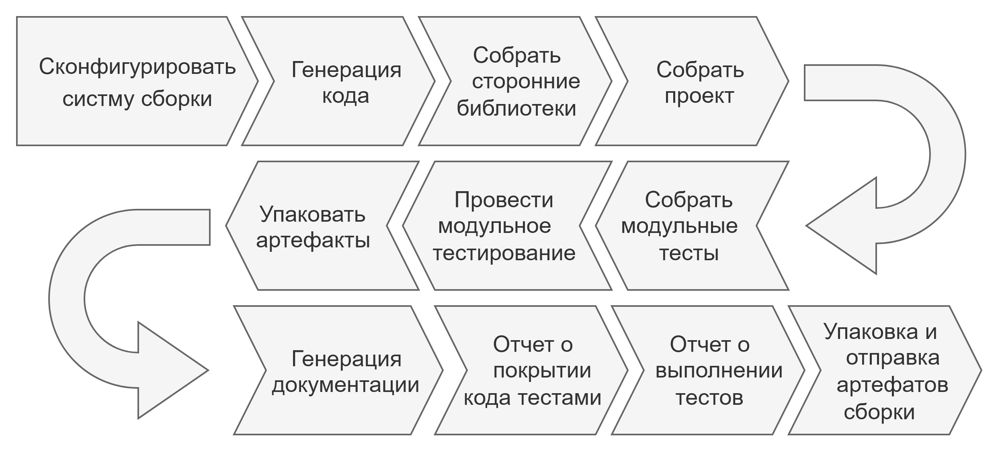  
Типичная система сборки проекта на C++ вызывается или из IDE или из командной строки и имеет следующие ключевые этапы:

- Сконфигурировать систему сборки  
- Сгенерировать код  
- Собрать зависимости, проект и модульные тесты  
- Провести модульное тестирование  
- Упаковать артефакты  
- Генерировать дополнительные артефакты  
  - Документация  
  - Отчеты о покрытии тестами  
  - Отчеты о выполнении тестов

#### Существующие системы сборки

На данный момент экосистема языка C++ обросла множеством систем сборки, но в индустрии всё же есть наиболее массово используемые лидеры данной сферы.  
Большинству программистов на практике предстоит столкнуться со следующими системами сборки проектов:

- [GNU Autoconf](https://www.gnu.org/software/autoconf/autoconf.html) \- встречается в основном в проектах на С с историей более чем в 20 лет  
- [MSBuild](https://learn.microsoft.com/en-us/visualstudio/msbuild/msbuild?view=vs-2022) \- система проектов и решений на основании XML (.proj, .sln), развиваемая компанией Microsoft для своей IDE Visual Studio и компилятора MSVC (и ЯП C\#, VC, VC++, F\# и др.), а также аналог GNU Make \- [NMake](https://learn.microsoft.com/en-us/cpp/build/reference/nmake-reference?view=msvc-170)  
- [B2](https://www.boost.org/doc/libs/1_86_0/tools/build/doc/html/index.html) \- система сборки библиотеки Boost  
- [GNU Make](https://www.gnu.org/software/make/) \- декларативная система вычисления правил, обычно использующаяся в качестве декларативной системы сборки проектов на произвольных ЯП  
- [Ninja](https://ninja-build.org/) \- современная промежуточная, декларативная система для сборки проектов (нацелена на то что её файлы будут сгенерированы системой сборки более высокого уровня абстракции, за счёт этого имеет высокую скорость сборки проектов)  
- XCode, Qt, CLion \- системы сборки проекта, специфичные для вендера IDE  
- [Meson](https://mesonbuild.com/) \- Одна из современных системы сборки полного цикла, удобна в использовании  
- [Bazel](https://bazel.build/) \- Современная система сборки полного цикла, нацелена на сборку гигантских кодовых баз (монорепозиториев)  
- [CMake](https://cmake.org/) \- Индустриальный фаворит, является системой сборки высокого уровня, для сборки проекта генерирует скрипты на системах сборки низкого уровня (Ninja, MSBuild, Make и т.д.)

##### Build in-source VS Build out-of-source

Так как ранние инструменты сборки были написаны на языках разрешения правил (таких как GNU Make), поддерживающих вложенность папок, исторически закрепился подход “build in-source”, т.е. построить рядом с исходниками. В данный момент этот подход считается архаичным, поскольку довольно сложно сделать “чистый билд” и следить за тем чтобы бинарные артефакты не попадали в VCS.  
Ввиду этих факторов большинство современных систем рассчитаны на подход “build out-of-source” \- это означает что все данные сборки и временные объекты (такие как объектные файлы) выносятся в выделенную папку в репозитории, которая полностью исключается из VCS. Такая папка обычно называется build. Всё же остаются библиотеки чьи системы построения настроены на “build in-source”, поэтому о таком подходе также нужно знать.

#### Система сборки CMake как дефакто стандарт индустрии

CMake это система сборки основанная на следующих принципах:

- Сборка производится согласно декларативному описанию целей сборки в файлах скриптов CMakeLists.txt на скриптовом языке CMake  
- Файл CMakeLists.txt располагающийся в папке отвечает за процессы сборки в данной папке и ее поддиректориях  
- Поддиректории могут определять свои файлы скриптов сборки CMakeLists.txt которые скрипт из родительской директории может игнорировать или включить в проект

С точки зрения разработчика взаимодействие со сборочной системой низкого уровня не требуется, так как интерфейс командной строки CMake предоставляет обёртки для всех стадий и этапов сборки  
Для программиста важно знать что CMake оперирует понятием сборочной цели. В большинстве случаев сборочная цель эквивалентна одному бинарному артефакту. У сборочной цели есть множество свойств, определяющих как именно она собирается (с каими флагами, стандартами и т.д.).  
Цели могут зависеть друг от друга, зависимая цель импортирует некоторые настройки из цели, от которой она зависит \- например путь до каталога с файлами заголовков или имя / путь до библиотеки для линковки.  
Одна из частей CMake это менеджмент зависимостей \- он реализован через набор модулей поиска зависимостей (`find_package()`), которые определяют специальные типы виртуальных целей, определяющих порядок включения каталогов с заголовками и линковки.

```bash
# Установка минимально требуемой версии Make
cmake_minimum_required (VERSION 3.22)
# Создание проекта
project (hello_cmake)
# Задание переменных
set (BINARY_NAME hello_cmake)
set (SOURCES src/${BINARY_NAME}.cpp)
# Добавление цели с результатом в виде исполняемого файла
add_executable (${BINARY_NAME} ${SOURCES})
# Поиск внешней зависимости
find_package (spdlog)
# Выстраивание зависимости сборки через линковку библиотеки
target_link_libraries (${BINARY_NAME} PRIVATE spdlog::spdlog)
# Определение стандарта С++
target_compile_features (${BINARY_NAME} PRIVATE cxx_std_20)
# Определение флагов компиляции
if (MSVC)
  # Условие выполняется для компилятора MSVC
  target_compile_options (${BINARY_NAME} PRIVATE /W4 /WX)
else ()
  target_compile_options (${BINARY_NAME} PRIVATE -Wall -Wextra -Wpedantic -Werror)
endif ()
# Подключение дополнительно модуля CMake
include (GNUInstallDirs)
# Определение параметров установки результата сборки цели
install (TARGETS ${BINARY_NAME} RUNTIME DESTINATION ${CMAKE_INSTALL_BINDIR})
```

##### Упаковка и установка и бинарных артефактов

Для проектов на C++ характерны два подхода к упаковке и установке результатов сборки:

- Установка из исходных кодов. Это установка собранных артефактов в систему непосредственно из директории сборки проекта. Для этого используется модуль CMake [GNUInstallDirs](https://cmake.org/cmake/help/latest/module/GNUInstallDirs.html) и встроенные функции установки из CMake ([install()](https://cmake.org/cmake/help/latest/command/install.html#command:install))  
- Упаковка в установщик. Для POSIX платформ стандартом упаковки считается deb-пакет и rpm-пакет, для Windows же используются технологии MSI / MSIX, обычно поверх фреймворка для их создания, такого как WIX. Данные технологии предполагают создание внешних файлов, описывающих процесс установки. В CMake есть поддержка сборки пакетов с использованием утилиты [cpack](https://cmake.org/cmake/help/latest/manual/cpack.1.html) из состава поставки CMake и встроенным модулем [CPack](https://cmake.org/cmake/help/latest/module/CPack.html#module:CPack) для написания правил упаковки внутри CMakeLists.txt.

### Тулчейны

```bash
system $ apt search gcc 2>/dev/null | grep 'gcc-12-' | head -15
gcc-12-aarch64-linux-gnu/oldstable 12.2.0-14cross1 amd64
gcc-12-aarch64-linux-gnu-base/oldstable 12.2.0-14cross1 amd64
gcc-12-alpha-linux-gnu/oldstable 12.2.0-13cross1 amd64
gcc-12-alpha-linux-gnu-base/oldstable 12.2.0-13cross1 amd64
gcc-12-arc-linux-gnu/oldstable 12.2.0-13cross1 amd64
gcc-12-arc-linux-gnu-base/oldstable 12.2.0-13cross1 amd64
gcc-12-arm-linux-gnueabi/oldstable 12.2.0-14cross1 amd64
gcc-12-arm-linux-gnueabi-base/oldstable 12.2.0-14cross1 amd64
gcc-12-arm-linux-gnueabihf/oldstable 12.2.0-14cross1 amd64
gcc-12-arm-linux-gnueabihf-base/oldstable 12.2.0-14cross1 amd64
gcc-12-base/oldstable,now 12.2.0-14+deb12u1 amd64 [installed]
gcc-12-cross-base/oldstable 12.2.0-14cross1 all
gcc-12-cross-base-mipsen/oldstable 12.2.0-14cross5 all
gcc-12-cross-base-ports/oldstable 12.2.0-13cross1 all
gcc-12-hppa-linux-gnu/oldstable 12.2.0-13cross1 amd64
system $ apt search gcc 2>/dev/null | grep 'gcc-12-' | wc -l
153
```

Многие проекты собираются для разных аппаратных, программных и программно-аппаратных платформ из единой кодовой базы. А значит их системы сборки должны быть готовы как к запуску в режиме компиляции под текущую платформу, так и в режиме кросс-компиляции под целевую платформу.  
Тулчейн \- это набор из компилятора, линковщика, ассемблера и экземпляров библиотек рантайма, предназначенных для сборки проекта под определенную аппаратную, программную и программно-аппаратную платформу.  
Бинарные артефакты, создаваемые тулчейном, запускаются только на целевой платформе (исключением являются универсальные платформы).

### Тестирование программных систем

Тестирование программных систем это направление инженерной деятельности, сфокусированное на определении соответствия реализации продукта заявленным функциональным и нефункциональным требованиям.  
Тестированием занимаются как инженеры-разработчики, так и инженеры-тестировщики, каждый на своем уровне ответственности.

#### Типы тестов

Существует большое множество классификаций как подходов к тестированию, так и видов тестов. Например, разделение на ручные и автоматизированные тесты \- будет являться классификацией по субъекту, выполняющему тест.  
Наиболее актуальными тестами для разработчика являются модульные тесты или юнит тесты.  

#### Модульные или юнит тесты

> [!IMPORTANT]
> Медиаконтент в данном месте ищет своего автора. Смотрите TODO.md

Разработчики пишут юнит тесты когда требуется проверять контракты и валидировать инварианты реализованного изолированного элемента функционала. Обычно целями таких действий являются:

- Самозащита от некорректной реализации (TDD \- Test Driven Development)  
- Самозащита от внезапного изменения внешних условий (например: регрессии при смене версии компилятора или платформы)  
- Фиксирование контракта и написание примеров для других разработчиков

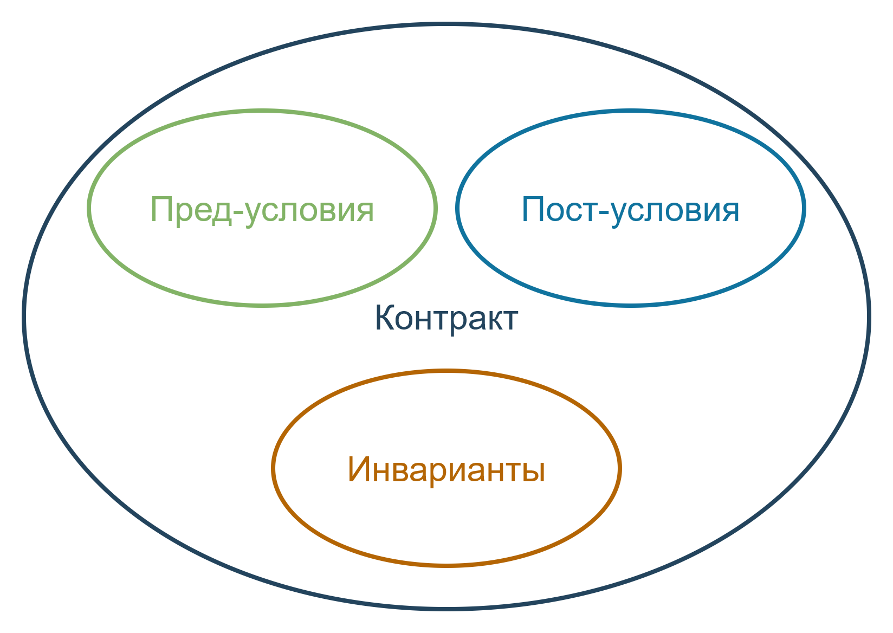

**Контракт** \- это условие, которое соблюдается до определённого действия (например \- вызова метода), и пост-условие, которое будет соблюдаться после данного действия.  
**Инвариант** \- это утверждение в отношении элемента функционала (класса, метода, функции, алгоритма, структуры и т.д.), являющееся верным всегда, вне зависимости от последовательности действий с данным элементом.

##### Как писать юнит тесты

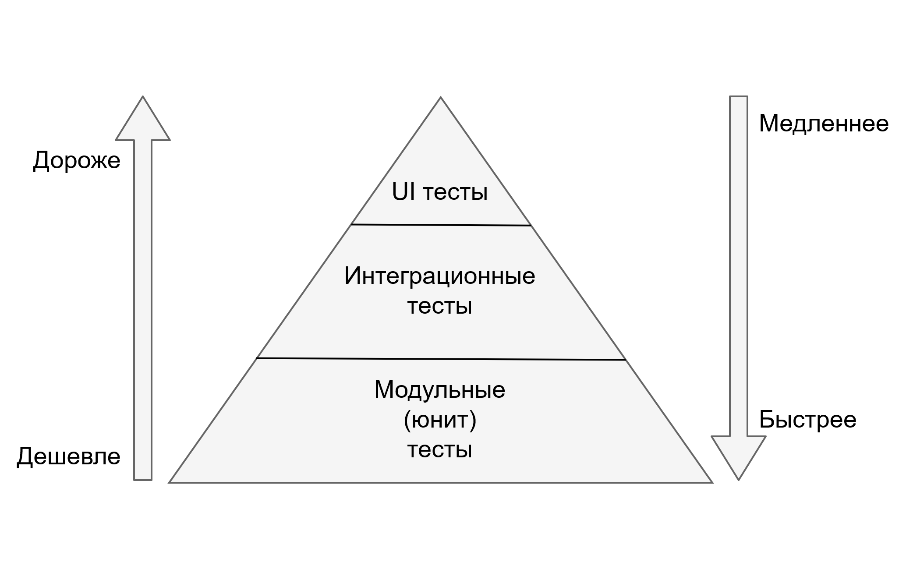

Написание хорошего юнит теста обычно коррелирует с объёмом опыта конкретного разработчика, а также с простотой дизайна и реализации функционала.  
Для написания хорошего набора юнит тестов можно следовать таким рекомендациям:

- Юнит тест проверяет одно утверждение (есть только 1 ассерт), это свойство атомарности  
- Не забывать об основных векторах проверок: Крайние и пустые значения, положительные и отрицательные исходы, частные случаи и общие закономерности  
- Юнит тест должен зависеть только от данных на входе, это свойство детерминированности  
- Юнит тест должен выполняться автоматизированным образом  
- Юнит тест, тестирует изолированную и независимую единицу функционала, все зависимости являются частью входных данных для юнит теста, это свойство изолированности  
- Юнит тест должно быть легко написать и запустить  
- Юнит тест должен быть быстрым

##### Типы двойников в модульных тестах

Так как функционала без внешних зависимостей встречается довольно мало то тесты почти всегда потребуют усилий для соблюдения свойств детерминированности и изолированности. Для того чтобы эти свойства достичь были придуманы двойники зависимостей.  
Выделяют следующие типы заместителей \[[1](https://blog.pragmatists.com/test-doubles-fakes-mocks-and-stubs-1a7491dfa3da), [2](https://stackoverflow.com/questions/346372/whats-the-difference-between-faking-mocking-and-stubbing)\]:

- **Моки** \- это гибко настраиваемые объекты, которые, типично, могут выполнять ассерты относительно вызовов к себе.  
- **Фейки** \- это реализации с сильно урезанным функционалом, буквально минимум функций чтобы казалось что работает.  
- **Стабы** \- это объекты, с предопределенным не изменяемым поведением и данными, а часто вообще без поведения и данных.  

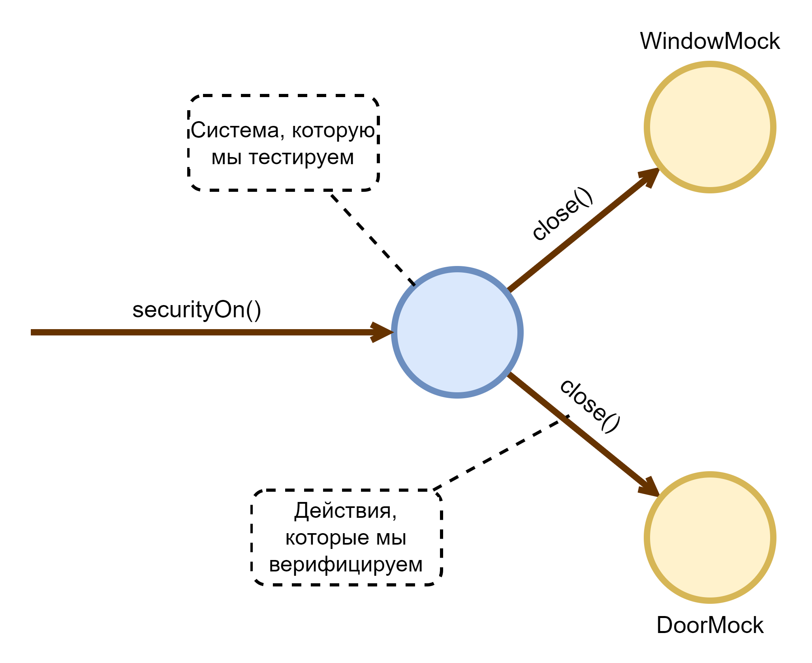
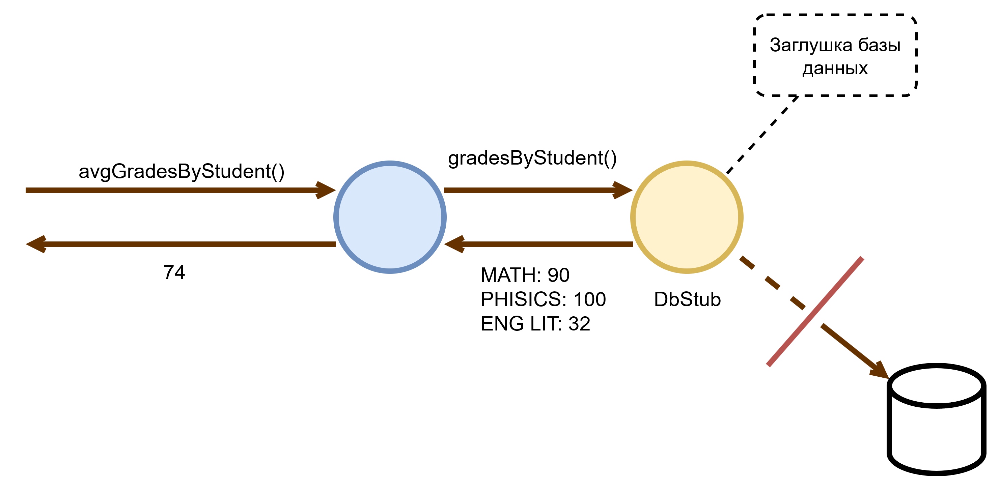
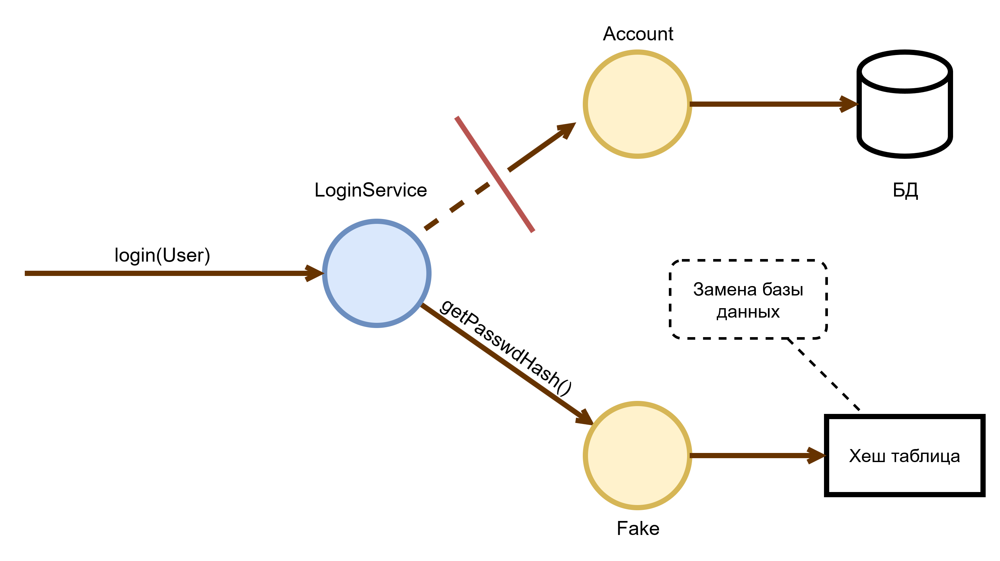

#### Популярные тестовые библиотеки в C++

В C++ не сложилось тестовой библиотеки / фреймворка, поддерживаемого на уровне стандарта ЯП (например, как это сделано в Golang). Большинство проектов используют одну из двух популярных открытых библиотек или пишут собственный фреймворк для тестирования.  
Так наиболее популярными библиотеками являются:

- [GTest](https://google.github.io/googletest/) \+ [GMock](https://google.github.io/googletest/gmock_for_dummies.html) от Google, базируется на архитектуре тестов xUnit  
- [Catch2](https://github.com/catchorg/Catch2)

##### Базовая номенклатура юнит тестов с библиотекой GTest

| Понятие | Значение | Как реализуется в GTest |
| :---- | :---- | :---- |
| Тесты | Бинарный артефакт, типично исполняемый файл, который предназначен для выполнения тестового набора | Предоставляет `main()`, парсинг аргументов командной строки, и множественные настройки прогона тестов. Собрать исполняемый файл должна система сборки |
| Тестовый набор (Test Suit) | Набор индивидуальных тестов, имеющих общий префикс имени | Тестовые наборы определяются именем набора или фикстуры при создании теста |
| Тестовая фикстура (Test Fixture) | Специальный класс, инстанс которого определяет действия по настройке до выполнения одного теста и по очистке, после выполнения одного теста. Члены данные и методы тестовой фикстуры доступны в теле теста | Любой класс, наследующий публично от `::testing::Test` |
| Табличные и инстанцируемые тесты (table tests) | Тесты, которые принимают на вход изменяемые данные | Создать тест: <br> `TEST_P(TestSuit, Test)` <br> Инстанцировать тест данными: <br> `INSTANTIATE_TEST_SUITE_P(InstantiationName,TestSuite,param_generator)` |
| Сетап (setup) | Функция, вызываемая в тестовой фикстуре, перед проведением теста | Класс, публично наследующий от `::testing::Test`, может определить метод `SetUp()` |
| Тирдаун (teardown) | Функция, вызываемая в тестовой фикстуре, после проведения теста | Класс, публично наследующий от `::testing::Test`, может определить метод `TearDown()` |
| Тест | Единица проверки функционала | Создаётся макросами <br> `TEST(TestSuit, Test)` <br> `TEST_F(TestFixture, Test)` <br> `TEST_P(TestSuit, Test)` |
| Ожидание (expectation) | Не критическая проверка, нарушение которой не приведет к немедленному прекращению теста, но он будет считаться проваленным | Наборы макросов `EXPECT_*()`  |
| Утверждение (assertion) | Критическая проверка, нарушение которой приведет к немедленному прекращению теста, и он будет считаться проваленным | Наборы макросов `ASSERT_*()` |
| Порядок выполнения тестов (test order) | Очередность в которой тесты будут выполняться при запуске | Очередность не определена |

#### Оценка покрытия тестами

С точки зрения разработчика полезно иметь понимание насколько тестирование эффективно. Для этого существуют два основных показателя \- прохождение тестов и покрытие тестами.

##### Отчеты о выполнении тестов

Каждый запуск тестов программы сопровождается выводом, обычно в этом выводе приводятся данные о том какие тесты были пройдены успешно, какие не были запущены, и какие прошли не успешно.  
Такой отчет можно формировать не только в виде консольного вывода, но и отчёта о прохождении тестов.  
В GTest данный отчёт формируется на основании значений параметра командной строки `--gtest_output` и переменной окружение `GTEST_OUTPUT`. Они поддерживают следующие значения:

- `xml:path_to_output_file` - формирует отчёт в формате junitreport XML  
- `json:path_to_output_file` - формирует отчёт в формате JSON

##### Отчеты о покрытии кода

Для программиста полезно знать какой код покрывается тестами, а какой нет. Для этого информация о покрытии собирается во время исполнения тестов, а далее по ней формируется отчёт о тестовом покрытии.  
Типичные составляющие такого отчёта, это покрытие по строка (line coverage) и по веткам (brunch coverage).  
Целевые показатели для очень хорошо тестированных проектов: 80% line coverage, 50% branch coverage.  
Общего подхода к получению покрытия кода для всех платформ не выработано. Наиболее популярными являются:

- Для POSIX систем: [gcc](https://gcc.gnu.org/onlinedocs/gcc-9.3.0/gcc/Instrumentation-Options.html)/[clang](https://clang.llvm.org/docs/ClangCommandLineReference.html#cmdoption-clang-coverage) \-coverage флаг \+ [gcov](https://gcc.gnu.org/onlinedocs/gcc/Gcov.html) \+ [lcov](https://wiki.documentfoundation.org/Development/Lcov) \+ [genhtml](https://linux.die.net/man/1/genhtml) \[[1](https://stackoverflow.com/a/36980590), [2](https://ps-group.github.io/cxx/coverage_gcc), [3](https://danielsieger.com/blog/2024/08/03/code-coverage-with-cmake.html)\]  
- Для Windows систем: msvc [/PROFILE флаг линковщика](https://learn.microsoft.com/en-us/cpp/build/reference/profile-performance-tools-profiler?view=msvc-170) \+ [OpenCppCoverage](https://github.com/OpenCppCoverage/OpenCppCoverage?tab=readme-ov-file)

Все этапы получения отчета можно реализовать в билд системе CMake с использованием функционала [add\_custom\_target()](https://cmake.org/cmake/help/latest/command/add_custom_target.html)

### Сквозная функциональность в проекте на C++

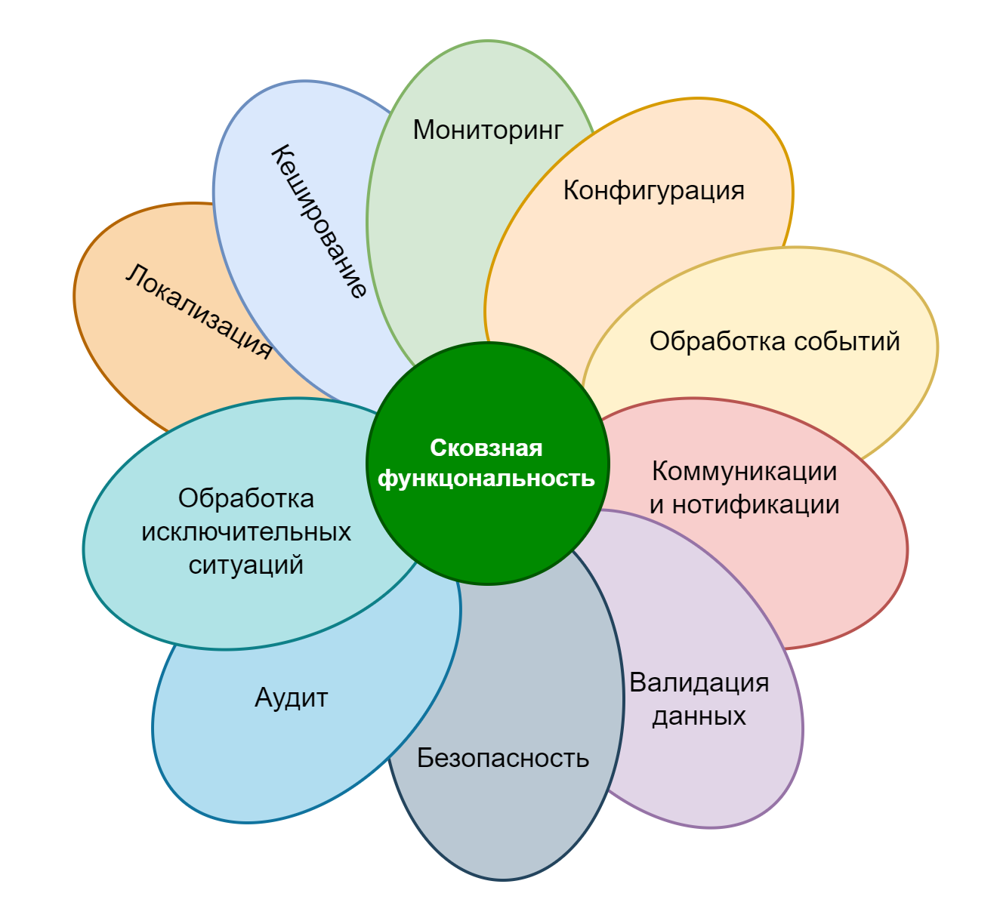

Сквозная функциональность (cross-cutting concern) это такая функциональность, которая решает общие вопросы, возникающие в каждом модуле программы / каждом проекте.  
К такой функциональности относится:

- Обеспечение наблюдаемости  
- Обеспечение конфигурируемости (как организовать, передавать и обновлять настройки приложения компонент, модулей)  
- Кэширование данных (в каком объёме и форме держать данные в оперативной памяти или на диске, в случае получения доступа к данным на другой системе)  
- Аудит действий (отслеживание важных действий пользователей системы)  
- Обеспечение безопасности (защита от атак и от повреждений)

#### Наблюдаемость как свойство программной системы

Наблюдаемость \- это свойство системы при котором заданный вопрос о параметрах и режимах её работы может получить ответ на основании данных, генерируемых системой.  
Наблюдаемость определяется тем как в системе реализован следующий функционал:

- Логирование  
- Сбор метрик  
- Реакция на исключительные ситуации  
- Трассировка процессов


##### Логирование

Логирование это процесс фиксации справочных данных в ходе выполнения программы на внешнем, относительно программы носителе информации.  
Различают структурное и неструктурное логирование.  
Записи лога как правило имеют идентификатор уровня логирования (log level), относящий запись к некоторой квоте внимания, уделяемой ей при анализе.  
На основании анализа логов производится отслеживание критических и не желательных состояний системы, производится оценка гипотез относительно качества выполнения системой функциональных и нефункциональных требований.

##### Сбор метрик

Метрики это агрегированные в системе показатели её работы. В отличие от логов, разбор которых идёт после записи во внешнее хранилище, над показателями метрик начальный анализ (обычно агрегирование и методы цифровой обработки сигналов) производится непосредственно в системе, до их записи во внешнее хранилище. На основании метрик производится процесс мониторинга состояния системы.

##### Реакция на исключительные ситуации

Это совокупность решений принятых в следующих областях:

- Стратегия обработки ошибок. В C++ поддерживаются несколько стратегий: специальные значения, исключения и монадический возврат ошибки  
- Наблюдаемость исключений \- как и куда собираются и обрабатываются стеки вызовов мест, где исключения были брошены, а также типы исключений и информация в них содержащаяся  
- Наблюдаемость падений \- как и куда собираются дампы памяти (core dumps) при неожиданном завершении потока или процесса  
- Модели ошибок. Это действия, которые предпринимает программа в случае наступления ситуации невосстановимой ошибки (когда программа экстренно завершается). Есть три модели поведения: падение без восстановления, падение с перезапуском, падение с последующим восстановлением

##### Трассировка процессов

Это процесс сбора детальной информации на каждом этапе выполнения законченного сегмента бизнес процесса. Имеет два вида: трассировка бизнес процессов (или запросов) и трассировка исполнения. В задачи первого вида трассировки обычно входит обеспечение прозрачности и наблюдаемости бизнес процесса и сбор аналитической базы для принятия бизнес решений. Он выполняется, в основном, за счёт сбора событий с единым сквозным идентификатором запроса на стороне аналитической системы, или же согласно стандартам общего трассирования, таким как [OpenTelemetry](https://opentelemetry.io/docs/concepts/signals/traces/).  
В задачи второго вида трассировки входит определение узких мест в производительности системы \- профилирование. Она осуществляется как за счёт сбора информации о покрытии (инструментированное профилирование), так за счет ручного или автоматического создания трейсов (пример стандарта сборки трейсов: [CTF](https://diamon.org/ctf/v1.8.3/) и [OpenTelemetry](https://opentelemetry.io/docs/concepts/signals/traces/)), а также за счёт использования внешних программ трассирующего профилирования (вызывают прерывание процессора и записывают стек-трейс) таких как [perf](https://man7.org/linux/man-pages/man1/perf.1.html).

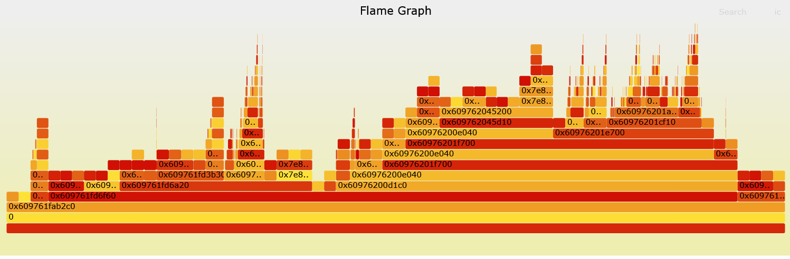

#### Логирование в проекте на C++

В C++ на уровне языка и стандарта нет общего подхода к логированию. Разные подходы по разному реализуются компаниями / командами / проектами.

##### Подходы к логированию в C++ проектах

Обычно логирование в C++ реализуется на основании использования макросов, так как в контексте макросов доступны мета переменные обозначающие имена функций (`__func__`, `__function__`, `__PRETTY_FUNCTION__`), файлов (`__FILE__`) и номера строк (`__LINE__`), помогающие определить происхождение записи лога.

##### Популярные библиотеки логирования

Наиболее популярной открытой библиотекой не структурированного логирования можно считать [SpdLog](https://github.com/gabime/spdlog). Она из коробки позволяет настраивать фильтрацию и вывод логов в различные потребители. Популярного решения для структурированного логирования на просторах открытых проектов нет, поэтому команды типично самостоятельно реализуют политику структурного логирования поверх используемой библиотеки не структурного логирования.

### Безопасная разработка

C++ печально известен тем, что дизайн языка не сконцентрирован на безопасности. В последнее время всё больше внешних факторов заставляют программиста думать о безопасности написанного кода и многие уходя в языки с гарантиями безопасности.  
Поэтому современному программисту на C++ необходимо знать какие средства имеются в его распоряжении для повышения уровня доверия к коду результирующей системы.

#### Понятия безопасности (Security vs Safety)

Термин безопасности на русском языке выражает два определения на английском:

- **Security** \- это безопасность от внешних воздействий на систему (например от взлома с целью кражи данных пользователей)  
- **Safety** \- это безопасность, внешних объектов от воздействий системы в случае её нештатного функционирования (например от открытия вентиля с отравляющим газом в случае исключения)

Поскольку вторая безопасность в основном будет относиться к проектированию и дизайну системы и её логики, то здесь мы будем говорить о первой безопасности \- от внешних воздействий.

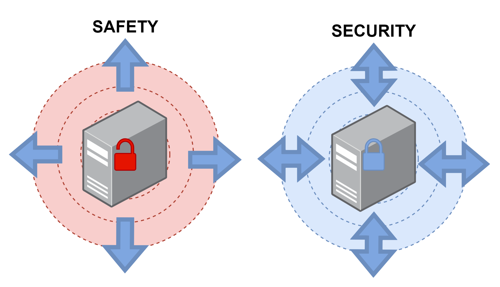

#### Цикл безопасной разработки ПО

Трудами многих индустрий, компаний и экспертов были выработаны ряд комплексных подходов к обеспечению безопасности программных систем:

- Формальная верификация, это доказательство определенных свойств системы при заданном наборе вводных и её состояний  
- Архитектура систем на основании множественных независимых слоёв обеспечения безопасности (Multiple Independent Layers of Security, MILS)  
- Цикл безопасной разработки программного обеспечения (Secure Software Development Life Cycle, SSDLC)

Большую роль в разработке последнего сыграла компания Microsoft и её стандарт [Microsoft Security Development Lifecycle](https://www.microsoft.com/en-us/securityengineering/sdl/?oneroute=true).  
К прикладному программисту наиболее близок именно цикл безопасной разработки программного обеспечения. Наиболее же близкими к разработчику частями этого цикла можно считать:

- Моделирования безопасности  
- Статического анализа кода  
- Динамического анализа кода  
- Усложнения бинарной эксплуатации  
- Фаззинг тестирования  
- Отслеживания безопасности в зависимостях  
- Безопасное кодирование и ревью  
- Тестирование на проникновение

##### Моделирование безопасности

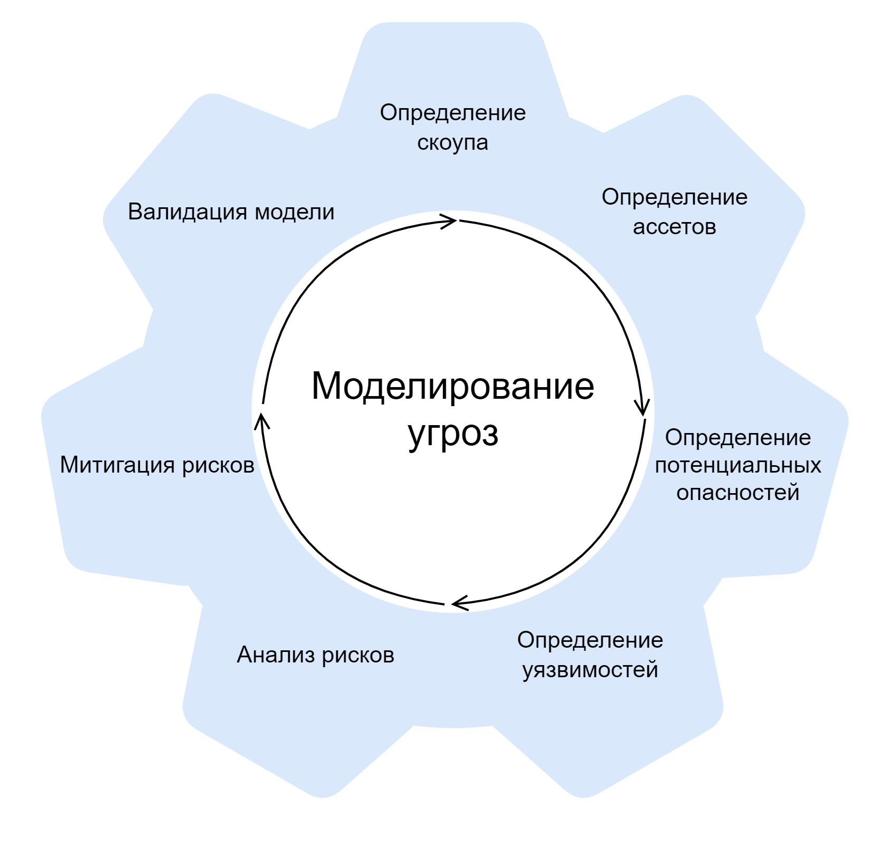

Внедрение безопасности начинается с проектирования приложения, благодаря такому подходу как [secure-by-design](https://www.cisa.gov/securebydesign) (проектирование, ориентированное на безопасность [ГОСТ](https://fstec.ru/tk-362/standarty/proekty/proekt-natsionalnogo-standarta-gost-r-14)). На этапе разработки данный пункт выражается в:

- Соблюдении лучших практик безопасности в отношении используемых инструментов и технологий. Например, использовать TLS / HTTPS для защиты трафика, а также ограничивать выбор шифронаборов только безопасными на данный момент; не выбирать слабые алгоритмы криптографических хешей, такие как MD5  
- Использование верифицированных подходов к управлению доступом (таких как Role-Based Access Control, [RBAC](https://en.wikipedia.org/wiki/Role-based_access_control) и Attribute-Based Access Control, [ABAC](https://en.wikipedia.org/wiki/Attribute-based_access_control)) вместо самостоятельной их реализации  
- Моделирования поверхности атаки (набора входных интерфейсов системы / программы, к которым у злоумышленника есть доступ) на систему / программу

##### Статический анализ (SAST)

Статический анализ \- это процесс, исследующий код программы, с целью выявления семантических конструкций, приводящих к нарушению безопасности программы или информации, которую программа обрабатывает.  
Ошибки \- это неотъемлемая часть человеческого поведения. ЯП это формальные системы, и неточности в изложении намерений программиста будут чётко интерпретированы формально системой как часть замысла.  
Почти все компиляторы C++ относятся к классу оптимизирующих компиляторов, это означает что программа не просто транслируется в машинные инструкции, а в отношении её производится ряд изменений, обычно, с целью увеличения ее производительности \- оптимизации (включаются флагами компилятора GCC/CLang: `-O0` … `-O4`, MSVC: `/O0` … `/O3`).  
Поэтому на уровне стандарта C++ зафиксировано правило **AS-IF**, а именно “в ходе своей работы компилятор может применять набор оптимизаций программы только так, чтобы (тот самый “as-if”) внешне наблюдаемое поведение программы оставалось неизменным”.  
Из этого правила есть три исключения, три ситуации в которых компилятор может пренебречь правилом “as-if”:

- Программа демонстрирует неопределённое поведение (Undefined Behavior, UB)  
- Оптимизация копирования объектов (Copy Elision)  
- Оптимизация возвращаемого значения (Return Value Optimization, RVO) и оптимизация именованного возвращаемого значения (Named Return Value Optimization, NRVO)

Первым эшелоном на поле статического анализа выступает компилятор. Всевозможные настройки уровней предупреждений часто спасают от расхождений в интерпретации кода человеком и компилятором.

| Типы флагов | MSVC | GCC | Clang |
| :---- | :---- | :---- | :---- |
| Флаги предупреждений | /W4 /Wal /sdll | \-Wall \-Weffc++ \-pedantic \-pedantic-errors \-Wextra \-Waggregate-return \-Wcast-align \-Wcast-qual \-Wchar-subscripts \-Wcomment \-Wconversion \-Wdisabled-optimization \-Werror \-Wfloat-equal \-Wformat \-Wformat=2 \-Wformat-nonliteral \-Wformat-security \-Wformat-y2k \-Wimplicit \-Wimport \-Winit-self \-Winline \-Winvalid-pch \-Wunsafe-loop-optimizations \-Wlong-long \-Wmissing-braces \-Wmissing-field-initializers \-Wmissing-format-attribute \-Wmissing-include-dirs \-Wmissing-noreturn \-Wpacked \-Wpadded \-Wparentheses \-Wpointer-arith \-Wredundant-decls \-Wreturn-type \-Wsequence-point \-Wshadow \-Wsign-compare \-Wstack-protector \-Wstrict-aliasing \-Wstrict-aliasing=2 \-Wswitch \-Wswitch-default \-Wswitch-enum \-Wtrigraphs \-Wuninitialized \-Wunknown-pragmas \-Wunreachable-code \-Wunused \-Wunused-function \-Wunused-label \-Wunused-parameter \-Wunused-value \-Wunused-variable \-Wvariadic-macros \-Wvolatile-register-var \-Wwrite-strings | \-Wall \-Wextra \-Weverything \-pedantic \-Wformat=2 |
| Превратить предупреждения в ошибки | /WX | \-Werror | \-Werror |

Следующими в очереди на использование идут статические анализаторы, поставляемые вместе с компилятором:

- MSVC флаг [/analize](https://learn.microsoft.com/en-us/cpp/build/reference/analyze-code-analysis?view=msvc-170)  
- [Clang Static Analyzer](https://clang.llvm.org/docs/ClangStaticAnalyzer.html) и проверки безопасности, реализованные на базе [clang-tidy](https://clang.llvm.org/extra/clang-tidy/index.html)

И завершают специализированные программы и платформы для проведения статического анализа проектов, такие как:

- [PVS Studio](https://pvs-studio.com/en/pvs-studio/)  
- [SonarQube](https://www.sonarsource.com/products/sonarqube/)  
- [Svace](https://www.ispras.ru/technologies/svace/)

Идеального ПО не существует, поэтому и статические анализаторы могут быть не правы. Программисту необходимо понимать на что именно ругается тот или иной анализатор, для этого у большинства из них имеется обильная документация по каждой проверке, а, иногда, и примеры исправлений, и взвешено выносить решение о разработке исправления или глушении предупреждения.

##### Динамический анализ (DAST)

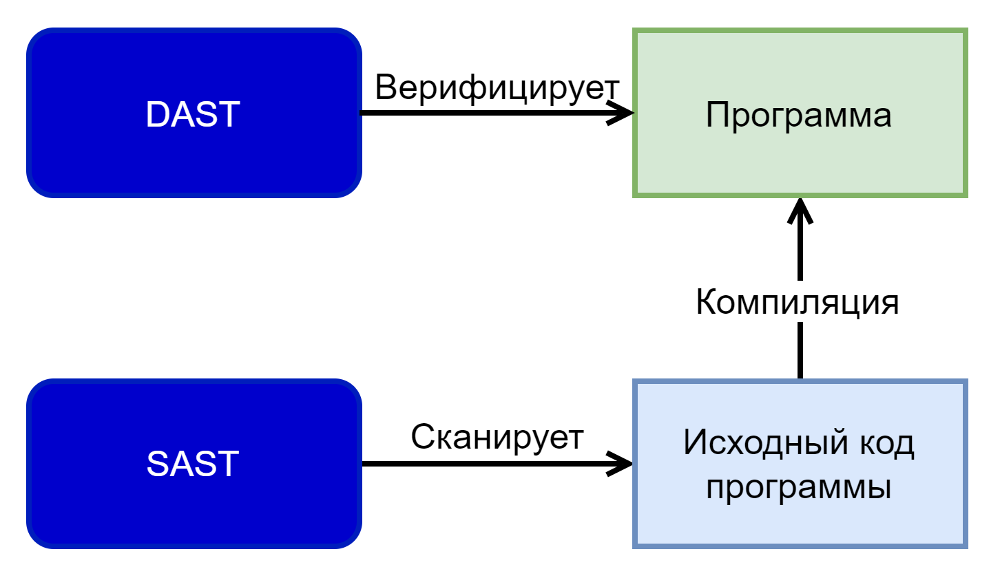

Если статический анализ оперирует над кодом, то динамический анализ работает во время исполнения программы.  
К динамическому анализу относят, как правило, четыре группы мер:

- Использование фортификаций и отладочных вариантов библиотек  
- Использование анализирующего аллокатора памяти (пример [dmalloc](https://dmalloc.com/docs/dmalloc.html))  
- Использование инструментирующих санитайзеров (“санитары”)  
- Внешние программы верификации поведения (такие как [valgrind](https://valgrind.org/docs/manual/quick-start.html#quick-start.intro), [Microsoft Application Verifier](https://learn.microsoft.com/en-us/windows-hardware/drivers/debugger/enable-application-verifier))

**Фортификации библиотек** \- это включение дополнительных проверок в стандартной библиотеке и рантайме, которые включены в обычном варианте работы в связи с влиянием на производительность.  
Инструментирующие санитайзеры \- это дополнительный код проверок, добавляемый компилятором, и библиотека анализа этих проверок, при провале которые программа экстренно завершается.

| Тип анализа | MSVC | GCC | Clang |
| :---- | :---- | :---- | :---- |
| Фортификации | [/GS](https://learn.microsoft.com/en-us/cpp/build/reference/gs-buffer-security-check?view=msvc-170) [/D \_ITERATOR\_DEBUG\_LEVEL=2](https://learn.microsoft.com/en-us/cpp/standard-library/checked-iterators?view=msvc-170) [/RTC](https://learn.microsoft.com/en-us/cpp/build/reference/rtc-run-time-error-checks?view=msvc-170)  | [\-D\_FORTIFY\_SOURCE=3](https://best.openssf.org/Compiler-Hardening-Guides/Compiler-Options-Hardening-Guide-for-C-and-C++.html) [\-D\_GLIBCXX\_ASSERTIONS](https://gcc.gnu.org/onlinedocs/libstdc++/manual/using_macros.html)  | [\-D\_LIBCPP\_HARDENING\_MODE=\_LIBCPP\_HARDENING\_MODE\_EXTENSIVE](https://libcxx.llvm.org/Hardening.html) `-D_FORTIFY_SOURCE=3`  |
| Санитайзеры | [/fsanitize=address](https://learn.microsoft.com/en-us/cpp/sanitizers/asan?view=msvc-170)  | [\-fsanitize=address](https://gcc.gnu.org/onlinedocs/gcc/Instrumentation-Options.html#index-fsanitize_003daddress) [\-fsanitize=pointer-compare](https://gcc.gnu.org/onlinedocs/gcc/Instrumentation-Options.html#index-fsanitize_003dpointer-compare) [\-fsanitize=pointer-subtract](https://gcc.gnu.org/onlinedocs/gcc/Instrumentation-Options.html#index-fsanitize_003dpointer-subtract)[\-fsanitize=thread](https://gcc.gnu.org/onlinedocs/gcc/Instrumentation-Options.html#index-fsanitize_003dthread) [\-fsanitize=leak](https://gcc.gnu.org/onlinedocs/gcc/Instrumentation-Options.html#index-fsanitize_003dleak) [\-fsanitize=undefined](https://gcc.gnu.org/onlinedocs/gcc/Instrumentation-Options.html#index-fsanitize_003dundefined) | [\-fsanitize=address](https://clang.llvm.org/docs/AddressSanitizer.html)[\-fsanitize=thread](https://clang.llvm.org/docs/ThreadSanitizer.html) [\-fsanitize=memory](https://clang.llvm.org/docs/MemorySanitizer.html) [\-fsanitize=undefined](https://clang.llvm.org/docs/UndefinedBehaviorSanitizer.html) [DataFlowSanitizer](https://clang.llvm.org/docs/DataFlowSanitizer.html) [\-fsanitize=leak](https://clang.llvm.org/docs/LeakSanitizer.html) [\-fsanitize=realtime](https://clang.llvm.org/docs/RealtimeSanitizer.html) |

- ASAN или санитайзер адреса, ищет обращения к памяти за пределами границ объектов.  
- TSAN или санитайзер потоков, ищет ситуации гонок (одновременного обращения на запись и чтение в память из разных потоков исполнения одной программы) и взаимных блокировок (deadlocks).  
- LSAN или санитайзер утечек, ищет “утечки памяти” в виду ошибок ручного управления динамической памятью.  
- UBSAN или санитайзер неопределённого поведения, ищет применения неопределённого поведения.

Важно что обычно со включёнными санитайзерами и фортификациями работают сборки проекта для разработчика и прогоны тестов, а не приложение для конечного пользователя.

##### Усложнение бинарной эксплуатации (Hardening)

Основной набор векторов атак на приложения на низкоуровневых языках программирования сосредоточен в области бинарной эксплуатации уязвимостей. Уязвимости, поддающиеся бинарной эксплуатации, это такие ошибки в работе программы или пути использование программы в нарушение её модели исполнения, которые используют знания о структуре программы (стеке, стеке вызовов, аллокаторе памяти и куче, расположению опкодов, расположения функций) для достижения цели атакующего.  
За долгую историю низкоуровневых языков программирования было выявлено много классов уязвимостей. Для борьбы с ними были придуманы методы изменения структуры конечной программы, так чтобы определенный вектор атаки был сильно затруднен или не эффективен, т.е. не давал результата никак, кроме как за очень долгое время и с низкой вероятностью.

| Класс векторов атак | MSVC | GCC | Clang |
| :---- | :---- | :---- | :---- |
| Исполнение данных | /NXCOMPAT | \- Wl,-z,noexecstack | \- Wl,-z,noexecstack |
| Атаки на известное положение функций в памяти (митигация путём включения [ASLR](https://en.wikipedia.org/wiki/Address_space_layout_randomization)) | /DYNAMICBASE | \-fPIE \-fPIC \-ffunction-sections | \-fPIE \-fPIC \-ffunction-sections  |
| Атаки на механизм виртуальных таблиц |  | \-fvtable-verify=\[std\|preinit\|none\] |  |
| Атаки на механизмы спекулятивного выполнения (зависят от аппаратной платформы процессора, в основном для Intel) | /Qspectre | \-mindirect-branch-register \-mindirect-branch=thunk-extern \-mfunction-return=thunk-extern | \-mlvi-hardening \-mlvi-cfi \-mspeculative-load-hardening \-mretpoline \-mretpoline-external-thunk |
| Атаки на механизм резолюции динамических библиотек (RELRO) | Windows не подвержена классу атак за счет другого механизма резолюции | \-Wl,-z,relro \-Wl,-z,now | \-Wl,-z,relro \-Wl,-z,now |
| ROP / COP / JOP | /guard:cf /RTC | \-fcf-protection=\[full\|branch\|return\|none\|check\] \-fharden-compares \-fharden-conditional-branches \-fharden-control-flow-redundancy \-fhardcfr-check-exceptions \-fhardcfr-check-returning-calls \-fhardcfr-check-noreturn-calls \-mmitigate-rop | \-fsanitize=cfi |
| Stack smashing | /GS /RTC | \-fstack-check \-fstack-clash-protection \-fstack-protector \-fstack-protector-strong \-fstack-protector-all | \-fsanitize=safe-stack \-fstack-clash-protection \-fstack-protector \-fstack-protector-strong \-fstack-protector-all |
| Защита от раскрытия данных о функционале | Windows не подвержена классу атак, за счёт вынесения символов в .pdb файлы | \-Wl,--strip-debug \-Wl,--strip-all  | \-Wl,--strip-debug \-Wl,--strip-all  |
| Атака на обработку структурных исключений (SEHOP, только на Windows) | /SAFESEHRTC |  |  |

Для GCC также есть общий флаг харденинга \-fhardened, он включает несколько опций харденинга из списка выше.

##### Фаззинг тестирование (fuzzing, fuzzy-testing)

Фаззинг тестирование \- это такой тип тестирования при котором функционал, находящийся на поверхности атаки, проверяют путем подстановки входных данных, с целью вызвать срабатывания механизмов динамической защиты или вызова нештатной ситуации.  
Фаззинг тестирование использует инструментированное профилирование с целью определения в какие строчки кода и ветки условий программа попала при определенных входных данных, для того чтобы менять входные данные для достижения лучшего покрытия кода.  
Фаззинг тестирование проводится совместно с разработчикам, так как требуется подготовить изолированный вариант определённого функционала. Обычно целью фаззинг тестирования становятся парсеры \- функционал аналитики и преобразования входных данных из общего протокола в бинарное представление в памяти.  
Фаззинг тестирование состоит из следующих этапов:

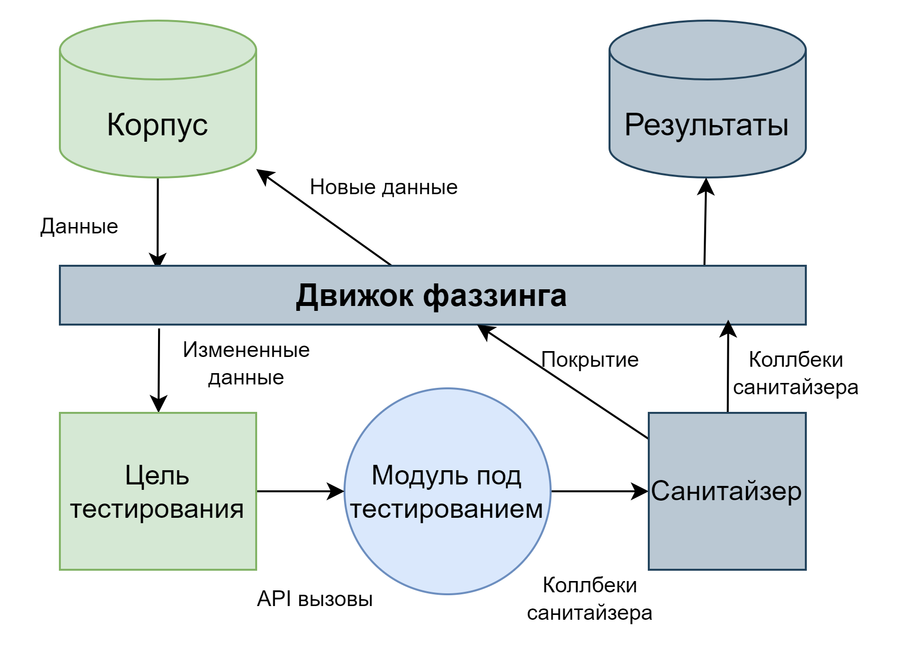

1. Подготавливается изолированный доступ к интерфейсу (например функции или классу) над которым будет проводиться тестирование, также как при юнит тестировании  
2. Производится обёртка интерфейса в функции фреймворка фаззинга. Обычно это означает что некоторые бинарные данные интерпретируется как реальные входные значение, например массив из 100 байт, как несколько int и строка  
3. Формируется исполняемый файл, принимающий на вход данные от фреймворка фаззинга  
4. Разработчиком формируется изначальный набор валидных входных данных (“корпус”) для передачи их на изменение (“мутацию”) фреймворку фаззинга  
5. Запускается процесс фаззинга, при котором фреймворк фаззинга мутирует данные и подсчитывает покрытие кода со временем достигая все большего количества строк и веток  
6. Если фреймворк фаззинга не справляется с достижением какого-то функционала, то разработчик добавляет дополнительные валидные данные руками в корпус  
7. Процесс продолжается до достижения заданного уровня покрытия (обычно более 80% по строкам)

Наиболее популярными фреймворками для фаззинг тестирования C++ приложения являются \[[1](https://github.com/Microsvuln/Awesome-AFL)\]:

- [libfuzzer](https://llvm.org/docs/LibFuzzer.html)  
- [AFL++](https://github.com/AFLplusplus/AFLplusplus)

##### Отслеживание безопасности в зависимостях

Обычно отслеживание уязвимостей происходит по международным классификаторам уязвимостей, таким как [CVE, NVD, OSV](https://blog.gitguardian.com/open-source-vulnerability-databases-comparison/). С точки зрения разработчика это наиболее простой пункт, так как отслеживание типично выполняется специалистами DevSecOps или отдела безопасности, а от разработчика требуется только предоставлять список третье сторонних зависимостей, обычно его можно создать в момент построения приложения, и своевременно обновлять их на на версии без уязвимостей.  
Иногда, к сожалению, приходится патчить зависимости самостоятельно и брать их дополнительное сопровождение. Также бывают ситуации, когда обновить зависимость в старом продукте не возможно, для этого от разработчиков требуется внимательно относиться к дизайну абстракций над зависимостями, чтобы можно было в будущем, например обеспечить динамическую линковку с зависимостью (и следовательно её можно будет заменить без выпуска новой версии приложения).

##### Безопасное кодирование и ревью

Не всем разработчикам по душе разбираться в информационной безопасности, но некоторые ценят и интересуются данным направлением. Команда безопасности в компании обычно реализует программу “Чемпионов безопасности” (Security Champion) \- это разработчик, который интересуется областью безопасности и осуществляет взаимодействие с командой безопасности в компании от лица проектов его команды. Такие разработчики проходят обучение о том как:

- Распознавать код с  возможными уязвимостями (проводить безопасное код ревью)  
- Какие паттерны и API считаются безопасными, а какие нет. Например использование безопасных вариантов исторически неправильно используемых функций при кодировании ([MSVC](https://learn.microsoft.com/en-us/cpp/c-runtime-library/security-enhanced-versions-of-crt-functions?view=msvc-170), Gcc/Clang \- обычно реализовано в платформенной библиотеке С или в рамках стандартов С/C++)  
- Как использовать инструменты анализа (SAST, DAST) и другие подходы в рамках SSDLC

##### Тестирование на проникновение (penetration testing) и программы вознаграждения за поиск багов (Bug-Bounty)

Последними важными для разработки этапами работы с безопасностью системы являются:

- Тестирование на проникновение, в рамках которого внешние специалисты будут искать уязвимости в работе системы и предоставят всесторонний отчет о возможности эксплуатации известных классов атак  
- А также обработка отчетов об уязвимостях в рамках программы вознаграждения за поиск багов от внешних специалистов

#### Методология и специалисты DevSecOps

На практике оказалось что реализовывать все описанные выше шаги только силами команды разработки очень затруднительно, поскольку требуется понимание зачем и навыки в области информационной безопасности, поэтому в индустрии выделилось направление специалистов, на грани безопасности и разработки DevSecOps \- Development Security Operations. В задачи, решаемые данными специалистами входит создание и налаживание процесса безопасной разработки ПО.

### Требования и документация программного продукта

#### Типы и виды требований к программным системам

Требования бывают функциональными и нефункциональными. Функциональные \- это требования к конкретному поведению системы. Нефункциональные требования определяют качественные характеристики работы системы.  
Традиционно принято различать требования:

- Бизнес требования, отвечают на вопросы: Кто получает выгоду от реализации? Какая выгода от реализации? Как мы будем измерять выгоду? Какой бизнес процесс мы реализуем / дополняем / изменяем? Какие шаги бизнес процесса будут затронуты?  
- Системные требования, отвечают на вопросы: Как мы видим себе роли людей в технической системе и бизнес процессе? Какие действия должны быть доступны ролям пользователей? Какие результаты ожидаются от шагов реализации бизнес процесса процесса? Какие эффекты должны наступать во внешних технических системах? Какие элементы взаимодействия с системой доступны пользователям (тут в то же время и про API, потому что внешний / внутренний разработчик это тоже пользователь системы)?  
- Требования к реализации и доставке или уточненные системные требования, отвечают на вопросы: Когда планируется доставить функционал и в каком объеме? Какие конкретные элементы реализации должны быть выполнены на данном этапе проекта / цикле продукта?  
- Задачи на разработку, отвечают на вопросы: Какой элемент функционала разработчик должен реализовать к некоторому конечному времени? Как планировался дизайн элемента?

#### Документация для разработчика

С учётом всего перечисленного выше, документация для разработчика относится к результирующим артефактам при создании программной системы у которого также есть потребитель \- разработчик.  
Потребителем такой документации может быть:

- Внутренний разработчик, в таком случае документация может быть выполнена в двух стилях: 1\) Комментарии в коде 2\) Документация, хранящаяся совместно с кодом (readme и doc-as-code)  
- Внешний разработчик, в таком случае обычно прибегают к использованию двух типов документации: 1\) Обучающие и ознакомительные материалы высокого качества 2\) Сгенерированная из кодовых описателей документация, фиксирующая публичное API и его контракты

##### Документация как код (Documentation-as-a-code)

Подход документация как код стал популярным довольно недавно в виду появления стандартов документов с форматированием ([AsciiDoc](https://asciidoc.org/), [Markdown](https://www.markdownguide.org/)), пригодных для хранения в системах контроля версий (VCS), в отличии от документальных форматов хранящих информацию в бинарном виде (таких как .docx и .rtf).  
Также на этом поле отличились системы формирования диаграмм из кодовых описателей, такие как [PlantUML](https://plantuml.com/), также перешедшие на текстовый формат хранения данных, пригодный для отслеживания изменений в VCS, и современные стандарты описания API, такие как [OpenAPI](https://www.openapis.org/).

##### Встроенная в код документация

На пресечении клиентов документации для разработчика мы имеем область фиксирования API модулей. Задача документирования API проще всего решается именно в ходе разработки продукта с подходом фиксирования документации в комментариях, таким как Doxygen.

##### Генератор документации Doxygen

[Doxygen](https://www.doxygen.nl/manual/index.html) \- это стандарт индустрии в области описания документации с использованием комментариев и утилита для генерации документации из такого описания.

### Эффективное использование времени разработчика за счет автоматизации процессов разработки

Ранее мы столкнулись с множество этапов и процессов, которые должны присутствовать в современном проекте на C++. Настройка всех процессов занимает достаточно долгое время и требует знания множества отдельных систем утилит языков и правил.

#### Подход CI/CD и методология DevOps

С целью повышения качества и повторяемости процессов разработки была придумана методология Continuous Integration (CI). В рамках данной методологии, процессы, сопровождающие разработку, автоматизируется, а программисту остается непосредственно заниматься планированием доставки, актом разработки и принятия изменений (чем большинство программистов и хочет непосредственно заниматься).  
Позже с развитием подходов к разработке была выработана методология Continuous Deployment (CD) предлагающая реализовать доставку программного продукта как непосредственно последний этап CI. Для этого используются многие новшества в доставке приложения и продукта до конечного пользователя или точки конечно эксплуатации.

Со временем образовались узкие специалисты, способные настроить автоматизацию процессов разработки в команде, а также релизных процессов, процессов организации ответственности за существующий и используемый софт (You build it \- You run it), названные DevOps или Development Operations.

#### Сборочное окружение

Типично, CI реализуется как последовательное выполнение шагов разработки, тестирования и сбора отчётов за счет использования набора виртуальных машин и/или кластера физических серверов для организации сборки под разные платформы. Наиболее распространенными системами, реализующими сборочное окружение являются:

- [Jenkins](https://www.jenkins.io/)  
- Решения от провайдеров VCS: [GitHub Actions](https://github.com/features/actions), [GitLab Pipelines](https://docs.gitlab.com/ee/ci/pipelines/), [BitBucket Pipelines](https://www.atlassian.com/software/bitbucket/features/pipelines)

## Сравнение инженерных подходов в C++ и других современных языках программирования

В C++ со стороны языка и его стандарта исторически не развивается туллинг для разработчика. Этим занимаются создатели компиляторов или третьи стороны. В современных же языках туллинг сразу создается вместе с языком и влияет на его развитие. Если посмотреть с другой стороны то C++ более свободен в выборе направления развития (оно не определяется ожиданиями от туллинга, а только от компилятора).

| Область деятельности | C++ | Golang | Rust |
| :---- | :---- | :---- | :---- |
| Установка среды компиляции | Вручную для каждой среды по разному. Также требуется установить систему сборки, менеджер пакетов, генератор документации и т.д. отдельно | Скачивается с офф-сайта или в менеджере пакетов дистрибутива | Предоставляется мультиплатформенный скрипт rustup который всё устанавливает за программиста |
| Сборка проекта | Написать систему сборки | go build \- часть языка | cargo build \- часть языка |
| Модульность | Нет ограничений, есть модель модулей, но она не распространена | Хорошая [модульная модель](https://go.dev/doc/modules/layout), есть [стандартный пример](https://github.com/golang-standards/project-layout) организации репозитория проекта | [Модульная модель](https://doc.rust-lang.org/rust-by-example/mod.html) \- часть языка, [организация проекта](https://doc.rust-lang.org/cargo/guide/project-layout.html) \- тоже часть языка |
| Управление зависимостями | Много разных подходов, есть сторонние для языка менеджеры зависимостей | go get \- часть туллинга языка | cargo \- часть туллинга языка |
| Сервер языковой поддержки | Для каждой платформы и IDE свой, есть общий clangd \- но он не во всех проектах хорошо настраивается | Часть туллинга языка | Часть туллинга языка |
| Форматирование | Внешняя программа clang-format | go fmt и часть языка и языкового сервера | cargo fmt \- часть туллинга языка  |
| Кодовый стандарт | Внешняя программа clang-tidy | Часть языка | Часть туллинга языка |
| Анализ кода | Внешняя программа clang-tidy и другие анализаторы | Внешние линтеры, есть аналитика уязвимостей в зависимостях | cargo clippy, есть аналитика уязвимостей в зависимостях |
| Тестирование | Есть общепринятые библиотеки | Модуль testing \- часть стандарта | cargo test \- часть туллинга языка |
| Отладка | Для каждой платформы свой отладчик | Часть туллинга языка | Часть туллинга языка |
| Логирование | Множество библиотек, согласия нет | slog \- часть стандарта | log \- часть стандарта |
| Сетевое взаимодействие | Множество библиотек и моделей | http и другие модули стандартной библиотеки | tokio \- популярный фреймворк |

## Набор инструментов инженера-разработчика на C++ на каждый день

[https\://en.cppreference.com/w/](https://en.cppreference.com/w/) \- “настольная книга” программиста на C++, этот сайт описывает стандарт языка, уровень поддержки компиляторами и стандартную библиотеку. Им пользуются все программисты на C++  
[https\://eel.is/c++draft/](https://eel.is/c++draft/) \- открытый для общего пользования последний черновик стандарта C++, обновляется регулярно  
[https\://godbolt.org/](https://godbolt.org/) \- среда для онлайн компиляции кода на C++ (и других ЯП), позволяющая сравнивать результаты работы компиляторов  
[https\://cppinsights.io/](https://cppinsights.io/) \- сайт позволяющая увидеть как именно компилятор видит ту или иную синтаксическую конструкцию C++  
[https\://quick-bench.com/](https://quick-bench.com/) \- сайт позволяет запустить бенчмарки кода для сравнения его производительности (на основании библиотеки [Google Benchmark](https://github.com/google/benchmark))  
[https\://cpp.libhunt.com/](https://cpp.libhunt.com/) \- сайт с поиском и сравнением сторонних библиотек
