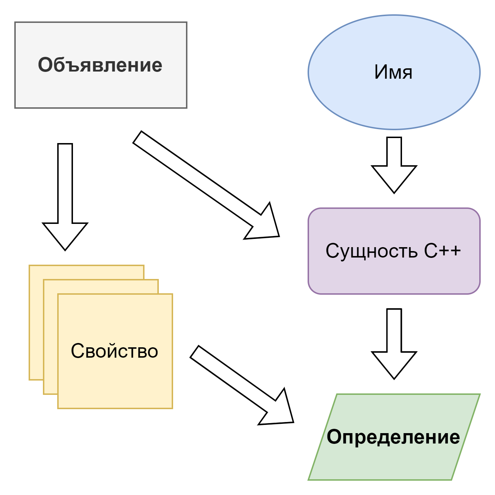

# Глава 2: Синтаксис языка C++

В данной главе собран материал по синтаксису C++. Опытные программисты могут без зазрения совести пропустить эту главу, так как она несет только ознакомительный характер и предназначена для тех, кто изучает C++ по данной книге.  

## Синтаксис программ на C++

С точки зрения синтаксиса языка \- программа на C++ это набор текстовых файлов, содержащих **объявления** (declarations). Семантическими **сущностями** в C++ являются: значения, объекты, ссылки, структурные связывания, функции, перечисления, типы, члены класса, шаблоны, специализации шаблонов, пакеты параметров и пространства имён. **Объявления** могут вводить **сущности**, связывать их с **именами** и задавать их свойства. Объявления определяющие все свойства, необходимые для использования, **сущности** называются **определениями**.  
**Определения** функций могут содержать последовательности **инструкций** (statements) некоторые из которых являются **выражениями** (expressions).  
Объявленные объекты и ссылки, не являющиеся не статическими членами данных класса, являются переменными.



## Синтаксис языка C++ совместимый с синтаксисом семейства языков С

### Базовые типы

Это типы вшитые в язык, в C++ многие из них являются ключевыми словами или зарезервированными идентификаторами. Это такие типы как:

- Булев тип  
- Целочисленные типы  
- Типы чисел с плавающей точкой  
- Тип void

#### Булевый тип

`bool`, размер задан имплементацией. Имеет два валидных значения: `true` и `false`

#### Целочисленные типы

Формируются набором ключевых слов: `[unsigned|signed] [[long [long]|[short]][int]|[char]]`  
Над такими типами разрешены математические операции.  
Для таких типов существует гарантия: `1 == sizeof(char) ≤ sizeof(short) ≤ sizeof(int) ≤ sizeof(long) ≤ sizeof(long long)`

#### Знаковые типы

Это типы, предназначенные для хранения последовательностей символов:

- `[unsigned|signed] char` \- используются для хранения последовательности кодов размером в 1 байт  
- `wchar_t` \- тип, определяемый платформой, для представления широких символов платформы  
- `char8_t` (C++20) \- тип для представления последовательностей кодовых юнитов UTF-8  
- `char16_t` (C++11) \- тип для представления последовательностей кодовых юнитов UTF-16  
- `char32_t` (C++11) \- тип для представления последовательностей кодовых юнитов UTF-32

Также исторически, типы `[unsigned|signed] char` используются для доступа к представлению объекта в памяти.

#### Типы чисел с плавающей точкой

Представлены для доступа к функционалу вычислений с плавающей точкой:

- `float` \- представляет чиста с единичной точностью, обычно IEEE-754 32 бита  
- `double` \- представляет чиста с двойной точностью, обычно IEEE-754 64 бита  
- `long double` \- представляет числа расширенной точности

#### Тип void

Это тип с пустым множеством валидных значений. Тип считается неполным, поэтому нельзя создавать его объекты, массивы или брать ссылки. А указатели на данный тип создавать можно, поскольку для этого не требуется полнота.  
Данный тип используется со следующими целями:

- Обозначить что функция является “процедурой” \- т.е. не возвращает значений  
- Обозначить в С стиле что функция не принимает аргументов  
- В метапрограммировании как тип, всегда являющийся не полным вне зависимости от контекста

```c++
// Булевы
bool i_am_true = true;
bool i_am_false = false;
// Целочисленные
unsigned long long int i_am_very_long = 0ULL;
// Знаковые
char i_am_simple_character = 'A';
char8_t i_am_UTF8_character = u8'B';
char16_t i_am_UTF16_character = u'C';
char32_t i_am_UTF32_character = U'D';
wchar_t i_am_wide_character = L'E';
// С плавающей точкой
float i_am_float = 1.0f;
double i_am_double = 1.0;
long double i_am_long_double = 1.01;
// void i_am_void = ?; - такую переменную создать нельзя
```

### Составные типы

Это такие типы, которые формируются из фундаментальных типов и правил языка.

#### Типы указателей

C++ предоставляет возможность создавать типы указателей. Тип имеет определенные свойства в языке:

- Зануляемость \- тип предоставляет выделенное значение, обозначающее пустоту  
- Реферальность \- тип предоставляет возможность обратиться к значению нижележащего типа, на которое указывает значение типа указателя (значение типа указателя обычно называется адрес)  
- Индексируемость \- тип предоставляет возможность обратиться к значению нижележащего типа, со сдвигом относительно значения указателя, равным размеру нижележащего типа умноженного на предоставленный индекс  
- Поддержка арифметических операций \- указатели поддерживают инкремент, декремент, сложение с интегральными типами, вычитание интегральных типов. Результат таких операций это новое значение типа указателя (арифметика указателей)  
- Поддержка сравнения значений указателей

Простые указатели бывают двух типов:

- Указатель на данные \- типы указателей, нижележащим типом для которых, является тип хранящий данные. Разыменование таких указателей предоставляет доступ к значениям нижележащего типа  
- Указатель на функцию \- типы указателей, нижележащим типом для которых, является тип сигнатуры функции. Для таких указателей значение является представлением произвольного исполняемого кода используя которое можно перейти к его исполнению (путем совершения непрямого вызова).

Указатели сами по себе являются типом данных, поэтому возможно создавать указатели на указатели.  

```c++
int some_variable = 1;
int some_function(int parameter);
/// Указатели
// На данные
int* i_am_pointer_to_int = &some_variable;
int** i_am_pointer_to_pointer_to_int = &i_am_pointer_to_int;
// На функции
int (*i_am_pointer_to_function)(int /*parameter*/) = some_function;
```

#### Простой синтаксис определения пользовательских типов

C++ совместим с С в области синтаксиса определения пользовательских типов для таких типов языка как: структуры, битовые поля, объединения, массивы и перечисления.

##### struct

Структура \- это способ языка C++ определить [тип-произведение](https://ru.wikipedia.org/wiki/%D0%A2%D0%B8%D0%BF-%D0%BF%D1%80%D0%BE%D0%B8%D0%B7%D0%B2%D0%B5%D0%B4%D0%B5%D0%BD%D0%B8%D0%B5). C++ имеет строго определённый алгоритм расположения элементов в типах-произведениях, ввиду чего их удобно использовать для представления значений в памяти.  
Структура состоит из последовательности объявлений именованных полей каждому из которых сопоставляется тип.  
Также структура может не содержать полей, в таком случае она является пустой и имеет байтовый размер 1\.

###### Битовые поля

Битовые поля \- это способ организации доступа к отдельным битам. В C++ минимально адресуемой единицей является байт, поэтому для доступа к отдельным битам, или точного управления их значениями (например в embedded разработке иногда требуется поменять только 1 бит специальными инструкциями процессора) требуется некий языковой механизм и именно им выступают битовые поля.  
Битовые не выражают дополнительный тип в системе типов C++, а лишь задают специальные правила обращения с членом данными. Они имеют обычно знаковый тип, заданный в объявлении.  
Уловка при работе с битовыми полями состоит в том, что компилятор может добавлять биты заполнения тем самым не очевидно сдвигая структуру полей, определенную программистом.

##### union

Объединение \- это способ языка C++ определить [тип-сумму](https://ru.wikipedia.org/wiki/%D0%A2%D0%B8%D0%BF-%D1%81%D1%83%D0%BC%D0%BC%D0%B0). C++ имеет строго определённый алгоритм расположения элементов в типах-суммах. Такие типы примечательны тем, что все члены данных занимают одно и тоже пространство в памяти, а всего они занимают памяти не более чем самый большой член данных (с учётом выравнивания).. Для таких типов C++ определяет строгие правила времени жизни членов данных объединения и критерии, когда можно обращаться к активному члену данных.  
Объединения в C++ не поддерживают тегирование активного члена данных, и программист должен сам следить за тем какой член данных является активным в данный момент.  

```c++
// Структура
struct IAmStruct {
  int i_am_int_data_member;
  long i_am_long_data_member;
};

// Структура с битовыми полями
struct IAmStructWithBitFields {
  short i_am_first_bit_field : 10,
       i_am_second_bit_field : 3;
};

// Объединение
union IAmUnion {
  int i_am_alternative_of_type_int;
  double i_am_alternative_of_type_double;
  IAmStruct i_am_alternative_of_type_iamstruct;
};
```

##### Массивы

Массивы \- представляют собой набор из известного количества последовательно расположенных в памяти объектов нижележащего типа. Типы массивов учитывают требования по выравниванию и размер нижележащего типа при определении размера и расположения объектов.  
Массивы с неопределенной длинной \- такое синтаксическое выражение можно часто встретить для создания массива из строкового литерала. Оно означает что размерность массива нужно посчитать компилятору в зависимости от количества элементов нижележащего типа в инициализаторе объекта.  
Тип массива приводим к указателю на первый объект в массиве. Только для таких указателей (и указателей на байтовое представление объектов через типы \[unsigned\|signed\] char) разрешено использование всех операций арифметики указателей.

##### Перечисления

Перечисления \- это способ задать именованные константы без введения переменной (т.е. без определения класса хранения). Перечисления в C++ поддерживают константы интегральных типов.  

```c++
// Одномерный массив фиксированной длинны
int one_dim_fixed_array[5] = {};
// Одномерный массив длинной, выведенной во время компиляции
int one_dim_open_extent_array[] = {1, 2, 3}; // int[3]
// Многомерный массив фиксированной длинны размером 3х2х5
int multi_dim_fixed_array[3][2][5] = {};

/// Перечисления
enum IAmASimpleEnum {
  Zero, // 0
  One, // 1
  Five = 5, // Явное задание 5
  Six, // 6
};
```

### Объявления и Определения

Синтаксис языка C++ выделяет два типа конструкций.

Объявления
  : Это способ введения имени в контекст программы.  

Определения
  : Это объявления, которые полностью определяют сущность вводимую объявлением.

#### Переменные

Переменная, это введенный в область **видимости идентификатор** имеющий тип и обозначенный и неявный класс хранения. Другими словами, это сочетание типа, класса хранения и идентификатора имени.

##### Квалификаторы типа CV

Тип переменной может быть дополнительно квалифицирован как константный (`const`) или волатильный (`volatile`). Для таких типов доступны только операции совместимые с квалификатором.

##### Классы хранения переменных

В объявлении переменных допустимы спецификаторы классов хранения: `static, thread_local, extern, mutable, static thread_local, extern thread_local`.  
На основании данных спецификаторов и области видимости объявления они определяют для переменной длительность жизни хранилища и тип линковки.  
C++ делит длительность жизни хранилища переменных на следующие:

- Автоматическое \- это хранилище для переменных в блоках исполнения и параметров функций. Такое хранилище выделяется на период действия блока, или вызова функции.  
- Статическое \- хранилище доступное в течении всего времени жизни программы  
- Динамическое \- хранилище, создаваемое и разрушаемое во время работы программы  
- Локальное для потока \- хранилище, уникальное для каждого потока программы и существующее пока существует поток

```c++
/// Квалификаторы типа
const int i_am_constant_of_type_int = 3;
volatile int i_am_volatile_of_type_int;

// Квалификаторы класса хранения
static int i_am_stored_statically_here = 2;
extern int i_am_stored_somewhere_else;
thread_local int i_am_initialized_for_each_thread = 10;

struct IAmStruct {
  int i_am_not_editable_when_iamstruct_instance_is_const = 1;
  mutable int i_am_editable_even_when_iamstruct_instance_is_const = 11;
};

const IAmStruct a{};
a.i_am_not_editable_when_iamstruct_instance_is_const = 2; // Ошибка
a.i_am_editable_even_when_iamstruct_instance_is_const = 11; // Ок
```

##### Единичные и множественные объявления переменных

До этого момента мы в основном разбирали единичные объявления/определения переменных, но C++ поддерживает и множественные объявления/определения. Особенностью таких объявлений/определений является то, что все переменные имеют один нижележащий тип, но каждая из них может быть составного типа над нижележащим (например указателем или массивом и даже сколь угодно глубоким указателем).  

```c++
// Единичное определение
int i_am_single_variable = 1;
// Множественное определение
int i_am_first = 1, t_am_second = 2, i_am_third = 3
// Множественное объявление с составными типами
int i_am_int, *i_am_pointer_to_int, i_am_array_of_int[10];
// Множественное объявление с несколькими типами указателей
int *i_am_pointer_to_int, **i_am_pointer_to_pointer_to_int;
```

#### Функции

Объявление функции состоит из типа возвращаемого значения, причем только одного, имени функции и списка её аргументов с соответствующими им типами.  
Особенностью C++ является процесс **разложения** типов аргументов перед назначением функции типа. Этот процесс:

1. Приводит типы массивов к типу указателя на первый элемент, а типы функций к типу указателя на функцию  
2. Удаляет квалификатор `const` и `volatile` на верхнем уровне вложенности

Определение функции может отличаться её объявления именами параметров.

##### Аргументы по умолчанию

Объявление функции может задавать значения по умолчанию для аргументов. Значения по умолчанию можно задавать только аргументам начиная с правой стороны (т.е. с последнего и до первого).

##### Функции с переменным числом аргументов

Допускается объявление функции, принимающей переменное число аргументов.  
```c++
// Помощники
struct IAmReturnType {};
struct IAmParameterType {};
// Объявление функции foo
IAmReturnType foo(IAmParameterType parameter);
// Определение функции
IAmReturnType foo(IAmParameterType parameter) {
  return IAmReturnType{};
}
// Ошибка так как при "разложении" тип аргумента будет IAmParameterType
// IAmReturnType foo(const volatile IAmParameterType parameter);
// Объявление с параметром, имеющим значение по умолчанию
IAmReturnType bar(int i_should_be_passed, int i_have_default_value = 1);
// Можно вызывать
bar(1); // Эквивалентно bar(1, 1);
bar(1, 10); // i_have_default_value == 10
// Функция принимает int и ещё сколько угодно аргументов
IAmReturnType buz(int i_am_first, ...);
```

#### typedef

Данное определение задает псевдоним типа для дальнейшего использования. Определение поддерживает синтаксис определения переменной, только за место имени переменной вводится имя псевдонима типа.  

```c++
// Объявление переменной
unsigned long i_am_variable;
// Объявление псевдонима типа unsigned long
typedef unsigned long IAmType, *IAmPointerType;
// Объявление переменной с использованием псевдонима i_am_type
IAmType i_am_variable_of_type_unsigned_long;
IAmPointerType i_am_pointer = &i_am_variable_of_type_unsigned_long;
// Объявление псевдонима типа структуры и указателя на неё
typedef struct { int a; long b; } IAmStructAlias, *IAmPointerToStruct;
// Использование псевдонимов структуры
TAmStructAlias t_am_struct {};
TAmPointerToStruct i_am_pointer_to_struct = &i_am_struct;
// Объявление псевдонима функции и указателя на функцию
typedef int (IAmFunction)(int, long);
typedef int (*IAmFunctionPointer)(int, long);
// Объявление функции: int t_am_function(int, long);
IAmFunction i_am_function;
// Получение указателя на функцию i_am_function
IAmFunctionPointer t_am_function_pointer = i_am_function;
```

#### Объявление встраиваемого ассемблера

Синтаксис встраиваемого ассемблера за исключением определения `asm` не стандартизирован и определяется компилятором  

```c++
// Пример мини программы на встроенном ассемблере
int src = 1;
int dst;
asm("mov %1, %0\n"
    "add $1, %0"
    : "=r" (dst)
    :  "r" (src));
// Пример системного вызова exit() на Linux
asm("movq $60, %rax\n"
    "movq $2,  %rdi\n"
    "syscall");
```

### Литералы

Литералы \- это выражения задающие константы в исходном коде приложения.

| Типы, представляемые литералами | Форматы определения | Особенности |
| :---- | :---- | :---- |
| Целочисленные | `0x[0-9a-fA-F]+` - в 16-ричной системе <br> `0[0-7]+` - в 8-ричной системе <br> `[1-9][0-9]*` - в 10-чной системе <br> `0b[0-1]+` - в 2-ичной системе | Есть возможность использовать разделитель разрядов `1‘000’000` Для задания результирующего типа используются суффиксы: `[uU]?([lL]?[lL]?\|[zZ])` |
| Числа с плавающей точкой | `[0-9]*\.[0-9]*([eE][-+]?[0-9]+)?` - в 10-чной системе <br> `[0-9a-fA-F]*\.[0-9a-fA-F]*([pP][-+]?[0-9a-fA-F]+)?` - в 16-ричной системе | Для задания результирующего типа используются суффиксы: `[fF]?(16\|32\|64\|128)?\|[lL]\|(bf\|BF)128` |
| Символьные |  | Для задания результирующего типа используются префиксы: `\|u8\|u\|U\|L` |
| Строковые | `\|u8\|u\|U\|L”[^”]”` | Для задания результирующего типа используются префиксы: `\|u8\|u\|U\|L` |

При компиляции программы соседствующие строковые литералы одного типа конкатенируют в один литерал. В отличии от других языков в C++ нет форматирующих строк. Также строковые и символьные литералы отличаются возможностью задания символов с использованием экранирующих последовательностей.

* Простые экранирования: `\[‘“?\abfnrtv]`  
* Числовые последовательности:  
  * 8-ричная: `\[0-7][0-7]?[0-7]?|\o{[0-7]+}`  
  * 16-ричная: `\x{?[0-9a-fA-F]+}?`  
* Последовательность универсального имени символа (UNICODE):  
  * `\u[0-9a-fA-F][0-9a-fA-F][0-9a-fA-F][0-9a-fA-F]`  
  * `\u{[0-9a-fA-F]+}`  
  * `\U[0-9a-fA-F][0-9a-fA-F][0-9a-fA-F][0-9a-fA-F][0-9a-fA-F][0-9a-fA-F][0-9a-fA-F][0-9a-fA-F]`  
  * `\N{.+}` - именованные символы

### Блоки исполнения

#### Составное выражение

Типичным элементом синтаксиса C++ является составное выражение или блок. Важность блока в C++ нельзя недооценивать, так как время жизни переменных, определенных в блоке, заканчивается в вместе с концом блока. Блок содержит любые выражения или объявления меток.

#### return

Инструкция возврата обеспечивает контроль программиста над потоком исполнения в ближайшем окружающем теле функции.  

```c++
int i_am_outside_of_block = 5;
{
  int i_am_inside_block = 273;
  i_am_outside_of_block *= i_am_inside_block;
} // Здесь i_am_inside_block разрушается
i_am_outside_of_block += 2;
i_am_inside_block /= 10; // ОШИБКА доступа к i_am_inside_block

int i_am_function(int a) {
  if (a < 10) {
    {
      {
         // Возврат даже через несколько блоков
        return 25;
      }
    }
  }
  return 10;
}
```

### Выражения циклов

Все петли своим телом могут содержать любое выражение (обычно это пустое выражение, блок или одно полное выражение). Все петли могут содержать выражения `continue` и `break`.

#### for

Типичная для С-образных языков петля содержащая: инициализацию, условие, действие. Условие первый раз проверяется до входа в тело петли. Все три компонента петли могут быть пустыми выражениями. В случае если условие является пустым выражением считается что оно всегда истинно.  
Выражение `continue` переносит поток управления к вычислению условия, выражение `break` безусловно выводит поток исполнения из петли.

#### while

Простейшая петля с проверкой условия до тела петли.  
Выражение `continue` переносит поток управления к вычислению условия, выражение `break` безусловно выводит поток исполнения из петли.

#### do-while

Простейшая петля с проверкой условия после тела петли.  
Выражение `continue` переносит поток управления к началу петли (без вычисления условия), выражение `break` безусловно выводит поток исполнения из петли.

#### goto

Выражение безусловного перехода может служить как для создания петель так и для выполнение единичных переходов. Хоть и считается что использование данного выражения в коде является признаком плохого дизайна, но для таких языков как С оно оправдано например, с целью реализации отчистки ресурсов в конце исполнения функции.  
Особенностью данного выражения является то, что оно подобно return может пропускать несколько окружающих его блоков при переходе на метку.  
Выражения `break` и `continue` не могут быть использованы в петлях, организованных через выражение goto.  

```c++
// Следующие записи эквивалентны по своему смыслу
for (int i = 0; i < 100; i = i + 1) {
  /* ... */
}

int i = 0;
while (i < 100) {
  /* ... */
  i = i + 1;
}

int i = 0;
if (i < 100) {
  do {
    /* ... */
    i = i + 1;
  } while (i < 99);
}

// Следующие записи эквивалентны по своему смыслу
for (;;) {
  /* ... */
}

while (true) {
  /* ... */
}

do {
  /* ... */
} while (true);

// Следующие записи эквивалентны по своему смыслу
volatile int i = 0;
for (; i < 100;)
  ;

volatile int i = 0;
while (i < 100)
  ;
```

### Выражения выбора пути исполнения

#### if / if-else

Данное выражение позволяет потоку исполнения выполнять ту или иную ветку кода в зависимости от условия во время исполнения.  

```c++
int a = 1, b = 10;
if (a < b) {
  /* ... */
}
// Использование else ветки
if (a < b) {
  /* ... */
} else {
  /* ... */
}
```

В C++ есть только выражение `if-else` (в других языках например есть выражения `if-elif-else` и аналоги), продолжение проверки условий выполняются за счёт того, что телом веток выражения `if-else` может быть любое выражение, в том числе и выражение `if-else`.  

```c++
int a = 1, b = 10;
if (a < b) {
  /* ... */
} else if (b < a) {
  /* ... */
} else {
  /* ... */
}
// Эквивалент
if (a < b) {
  /* ... */
} else {
  if (b < a) {
    /* ... */
  } else {
    /* ... */
  }
}
```

#### switch case

В C++ поддерживается сравнение значения в условии `switch` с выражениями в метках `case`. Выражения в метках должны быть константами типа, сравнимого с типом выражения в `switch`. Важно что в C++ `case` и `default` \- выражают только **метки**, такие же как метки для оператора `goto`. А значит тело `switch` может содержать обычные инструкции для исполнения, а поток исполнения явно переходит от одной метки к другой последовательно, сверху вниз.  

```c++
int a;
switch (a) {
  case 1:
    return 10;
    // Поток исполнения выходит из функции
  case 2:
    a = a + 10;
    // Поток исполнения идет дальше к case 3:
  case 3:
    return a;
  case 4:
    a = a * 2;
    break;
    // Поток исполнения выходит из switch()
  case 5: {
    // Типичная запись составного выражения в switch()
    a = a * 2;
    a = a + 17;
  } break;
  default:
    // Выбирается если не один вариант не подошел
    return a + a;
}
// Поток исполнения для case 4: и case 5: продолжается тут
```

Пример наполнения тела `switch` обычными инструкциями, в данном случае петлёй `do-while`.  

```c++
unsigned copy(int* output, int* input, unsigned size) {
  int* end = input + size;
  switch (size & 0x3)
  {
      do {
    case 0:
        *output++ = *input++;
    case 3:
        *output++ = *input++;
    case 2:
        *output++ = *input++;
    case 1:
        *output++ = *input++;
      } while (input != end);
  }
  return size;
}
```

Первый раз `switch` в зависимости от остатка от деления размера на 4 переводит поток исполнения на 4,3,2 или 1 копирование. После выполнение петли do-while продолжается как обычно и всё время выполняются 4 копирования подряд. Такая запись называется методом Даффа (Duff’s device)

### Синтаксис операторов в выражениях

Оператор в C++ это символьная запись операции выполняемой над аргументами. Здесь C++ не отходит от традиции языков перенимать операции из математики в виде операторов. В некоторых языках не вводят операторов. В таких языках примером арифметической операции сложения будет `Math.Add(a, b)` вместо `a + b`.

#### Арифметические операторы

Эта группа операторов выражает арифметические операции, как в математике (и дискретной математике).  

```c++
unsigned a, b;
+a;     // Унарный плюс
-a;     // Унарный минус. Результат имеет знак противоположный а
a + b;  // Сложение
a - b;  // Вычитание
a * b;  // Умножение
a / b;  // Деление. Для целых чисел - целочисленное деление
a % b;  // Остаток от деления.
~a;     // Побитовое инвертирование
a & b;  // Побитовое И
a | b;  // Побитовое ИЛИ
a ^ b;  // Побитовое Исключающее ИЛИ (ХОВ)
a << b; // Битовый сдвиг к верхним битам (с заполнением 0 битами)
a >> b; // Битовый сдвиг к нижним битам (с заполнением 0 битами )
```

#### Операторы инкремента и декремента

Эти операторы уникальны для языков программирования и выражают короткую форму записи увеличения или уменьшения значения переменной на единицу. Эти операторы имеют по два варианта, первый возвращает значение переменной после увеличения/уменьшения, второй значение переменной до увеличения/уменьшения.  

```c++
int a = 0;
++a; // Инкремент, a == 1, результат выражения 1
--a; // Декремент, a == 0, результат выражения 0
a++; // Пост-инкремент, a == 1, результат выражения 0
a--; // Пост-декремент, a == 0, результат выражения 1
```

#### Операторы действия с присвоением

Действия с присвоением определяют короткую форму записи математических операций где результат заменяет значение левого операнда выражения.  

```c++
unsigned a, b;
a = b;   // Присваивание, после операции a == b
a += b;  // т.с. a = a + b
a -= b;  // т.с. a = a - b
a *= b;  // т.с. a = a * b
a /= b;  // т.с. a = a / b
a %= b;  // т.с. a = a % b
a &= b;  // т.с. a = a & b
a |= b;  // т.с. a = a | b
a >>= b; // т.с. a = a >> b
a <<= b; // т.с. a = a << b
```

#### Логические операторы

Особенностью логических операторов в C++ является гарантируемый порядок выполнения операций под названием **short-circuiting** (короткое замыкание). Данное поведение позволяет не вычислять последующие операнды полной логической операции, если значение логического выражения уже полностью известно поле вычисления данного операнда. Так если текущий операнд в выражении логического ИЛИ, является истинным, или если в выражении логического И, является ложным, то последующие операнды не будут вычислены.  

```c++
bool a, b;
!a;     // Логическое отрицание. ~a != !a
a && b; // Логическое И
a || b; // Логическое ИЛИ
// Вычисление по сокращенной схеме
a || b || (/* большие вычисления */); // Если a || b, то большие вычисления не происходят
a && b && (/* большие вычисления */); // Если a == false или b == false, то большие вычисления не происходят
```


#### Операторы сравнения

Результаты всех операторов сравнения должны быть приводимы к типу bool и иметь значение `true` или `false`.  

```c++
a == b; // Проверка равенства
a != b; // Проверка неравенства
a < b;  // Проверка отношения меньше
a <= b; // Проверка отношения меньше или равно
a > b;  // Проверка отношения больше
a >= b; // Проверка отношения больше или равно
```

#### Операторы доступа к подобъектам

В число этих операторов входит: индексирование, получение адреса, разыменование, доступ по под-объекту, доступ к под-объекту по указателю.  

```c++
int i_am_array[10];

i_am_array[0]; // Доступ к 1-ому элементу массива. Оператор индексации
i_am_array[3]; // Доступ к 4-ому элементу массива

int *i_am_pointer = &i_am_array[2]; // Взятие адреса З-его элемента
// Разыменование указателя на З-ий элемент массива
*i_am_pointer; // По значению выражение равно i_am_array[2]

struct IAmStruct {
  int i_am_data_member;
} it_am_struct{10}, *i_am_pointer_to_struct;
i_am_pointer_to_struct = &i_am_struct;
// Получение доступа к члену данным
i_am_struct.i_am_data_member;
// Получение доступа к члену данным по указателю
i_am_pointer_to_struct->i_am_data_member;
```

#### Оператор вызова функции

Данный оператор определяет необходимость совершить функциональный вызов с использованием имени идентификатора как функции. В С такой оператор применим только к идентификаторам, типом которых является тип функции или указателя на функцию. Семантику оператора вызова в C++ мы разберем в следующих главах.  

```c++
// i_am_function имеет тип функции int(int)
int i_am_function(int param);
int (*i_am_function_pointer)(int) = i_am_function;

// Мы вызвали функцию i_am_function с аргументом 5
int result = i_am_function(5);
// Вызывали функцию i_am_function по указателю на неё.
result += i_am_function_pointer(10); // эквивалент (*i_am_function_pointer)(10)
```

#### Тернарный оператор ?:

Тернарный оператор выражает в себе встраиваемое условное выражение. Он во многом удобен для сокращения записи сложных выражений. Основным ограничением является необходимость обеих веток иметь возвращать значения приводимых типов.  

```c++
int a, b;

int minimal = a < b ? a : b;
// Лексический эквивалент
int minimal;
if (a < b) {
  minimal = a;
} else {
  minimal = b;
}
```

#### Оператор приведения типа

В С данный оператор просто называется **оператором приведения типа**, в C++ же он называется **оператор приведения типа в С стиле** (C-style cast). Его задача \- изменить тип выражения использовав последовательность преобразований, семантику данной последовательности мы узнаем позже. Этот оператор встречается в двух видах в С стиле `(type)expression` и в функциональном стиле `type(expression)`.  

```c++
int a = 10;
// С-стиль приведения типа переменной a к float
float b = (float)a;
// Функциональный стиль приведения типа переменной a к double
double c = double(a);
```

## Различия в синтаксисе языка C++ от синтаксиса семейства языков С

### Статическая проверка (C++11)

Ранее в С были введены проверки времени исполнения с использованием макроса `assert()`. Для того же чтобы проверить утверждение во время компиляции приходилось изощряться и использовать не возможные в языке сущности \- например массив с отрицательной длинной. На смену таким странным записям пришла явная проверка во время компиляции `static_assert()`.  
Это объявление используется для проверки выражения на истинность во время компиляции. В случае ложности выражения \- компиляция останавливается с ошибкой.  

```c++
// Для доступности макроса assert()
#include <cassert>

int a = 10, b = 3;
// Падение программы в рантайме!
// Такая запись не даёт информативный вывод
assert(a == b);
// Такая запись в выводе захватывала строку “a should be equal to b"
assert(a == b && "a should be equal to b");
// Почему работает:
//  && "a should be equal to b" <==> bool(char*(some value)) == true

// Остановка компиляции с заданным сообщением
static_assert(1 + 1 == 2, "basic math do not work");
// Короткая форма, сообщение генерируется компилятором
static_assert(1 + 1 == 2);
```

Начиная с C++26 строка сообщения об ошибке может быть не просто строковым литералом, а результатом consteval выражения.

### Пространства имён и оператор разрешения области видимости

Пространства имён и оператор разрешения области видимости работают совместно с целью предоставления инструментов модульной организации кодовой базы.

#### Пространства имён

Пространства имён это уникальная сущность C++ наполнение которой может быть указано в нескольких файлах с исходным кодом.

#### Встраиваемые пространства имен (inline namespace) (C++11)

```c++
int A= 0;
// Объявление пространства имён верхнего уровня
namespace i_am_namespace {
  // Объявление переменной в пространстве имён
  int X = 1;
  // Объявление пространства имён второго уровня
  namespace i_am_nested_namespace {
    int Y = 2;
  } // namespace i_am_nested_namespace

  // Объявление встраиваемого пространства имён второго уровня
  inline namespace i_am_nested_inline_namespace {
    int Z = 3;
  } // namespace i_am_nested_inline_namespace
} // namespace i_am_namespace

A; // Эквивалентно ::A;
X; // ОШИБКА, Х не виден в глобальном пространстве имен
i_am_namespace::X;
i_am_namespace::i_am_nested_namespace::Y;
// Имена из inline namespace доступны в окружающем пространстве имён
i_am_namespace::Z;
// А можно и так
i_am_namespace::i_am_nested_inline_namespace::Z;
```

С C++11 введено понятие встраиваемых пространств имен (inline namespace). Все идентификаторы в таком пространстве имён автоматически инжектируются в пространство имён, окружающее встраиваемое. Одной из целей введения встраиваемых пространств имен является упрощение бинарного версионирования кода (ABI versioning).  

```c++
// library.hpp
// Значение макроса USE_LATEST_VERSION задаётся из-вне во время компиляции
#if defined(USE_LATEST_VERSION)
# define USE_VERSION_1
# define USE_VERSION_2 inline
#else
# define USE_VERSION_1 inline
# define USE_VERSION_2
#endif

namespace library {
  USE_VERSION_1 namespace v1 {
    int some_function(int a, int b);
  }
  USE_VERSION_2 namespace v2 {
    int some_function(float a, float b);
  }
}

// code.cpp
#include <library.hpp>
// Какая функция будет вызвана зависит от USE_LATEST_VERSION
int result = library::some_function(value1, value2);
```

##### Неименованные пространства имен

В C++ файлах допускается объявлять неименованное пространство имен. Оно было введено с целью легкости ограничения видимости символов для связывания с другими элементами трансляции. Все идентификаторы в неименованном пространстве имён имеют внутреннюю видимость (internal linkage).  

```c++
// source.cpp
namespace {
  int A = 10;
} // namespace
// Семантически эквивалентно
static int A = 10;
```

##### Сокращённая запись вложенных пространств имен (C++17 / C++20)

Сокращенная запись пространств имен является удобством для больших проектов.  

```c++
namespace A::B::C {
  /* ... */
}
namespace A::B:: inline D {
  /* ... */
}
// Эквивалентно
namespace A {
  namespace B {
    namespace C {
      /* ... */
    }
    inline namespace D {
      /* ... */
    }
  }
}
```

##### Псевдонимы пространств имён

Когда вложенность или длина имени пространства имен становится помехой для читаемости кода можно использовать введение псевдоним идентификатора пространства имен.  

```c++
namespace i_have_a_looooooooooong_name {
  int X = 10;
}
i_have_a_looooooooooong_name::X; // Не удобно
namespace Ins = i_have_a_looooooooooong_name;
Ins::X; // Уже удобнее

namespace first_namespace {
  namespace second_namespace {
    namespace third_namespace {
      int Y = 200;
    }
  }
}
first_namespace::second_namespace::third_namespace::Y; // Не удобно
namespace ns = first_namespace::second_namespace::third_namespace;
ns::Y; // Уже удобнее
```

#### Оператор разрешения области видимости

Данный оператор встречается только между идентификаторами при спецификации имени сущности. Он может встречаться много раз или один, всё зависит от того какой процесс разрешения имени хочет запустить программист.  

```c++
// Оператор разрешения имён: operator::
int w = 25;
int x = 15;
namespace A {
  int x = 10;
  namespace B {
    // Пример разрешения конфликтующих имён
    // int y = x; // Ошибка разрешения имени, не достаточная квалификация
    int y = ::x;      // y == 15
    int yl = A::x;    // yl == 10
    int y2 = ::A::x3  // y2 == 10
  }
  namespace C {
    int z = B::y; // Относительное разрешение имени, operator::
  }
}
// Примеры разрешения, находясь в глобальном пространстве имён
::w         // Полная квалификация разрешение имени
w;          // Относительное разрешение имени
t:A::B::y;  // Полная квалификация разрешение имени
A::C::Z3    // Относительное разрешение имени
// C::z;    // Ошибка разрешения имени, не достаточная квалификация
```

Многие учебные пособия уделяют большое внимание разрешению имён и примерам коллизий имен, поскольку в данной области язык показывает высокую консистентность. В индустриальной практике коллизии имен встречаются чрезвычайно редко так как являются индикаторами не самого лучшего дизайна, а также компилятор предупреждает о коллизиях (“name shadowing”) что типично приравнивается к ошибке компиляции.  
Не рекомендуется уделять много времени заучиванию всех крайних случаев, допустимых в языке. Большинство правил будут понятны интуитивно \- имена при разрешении просматриваются изнутри наружу, от ближайшего окружающего блока к самому верхнему окружающему блоку вплоть до глобального пространства имён.

### Базовые типы

#### nullptr и std::nullptr_t (C++11)

Нововведением C++ стал тип нулевого указателя. Этот тип имеет единственное значение `nullptr` (это ключевое слово, также как `true` и `false`) и неявно приводится к любому типу сырого указателя (raw pointer, сырыми называются составные типы указателя).  
До введения данного базового типа в С, для обозначения схожего концепта, использовалось значение макроса `NULL`, типично раскрываемое в `((void*)(0))` или, что еще хуже, в `(0)`. Данные значения имеют тип указателя на `void` или числовой что не позволяло на уровне системы типов судить о передаваемом значении. В C++ же `nullptr` имеет тип `std::nullptr_t` который явно может быть задан как тип аргумента функции для выбора соответствующей ему перегрузки.  

```c++
void foo(int parameter);
void bar(int parameter);
void foo(void* parameter);
void bar(void* parameter);
// Добавлено в С++
void foo(std::nullptr_t parameter);
// Вызываемая функция зависит от типа NULL. Он может быть определен как (0) или как ((void*)(0))
foo(NULL);
// Вызываемая функция void foo(std::nullptr_t parameter)
foo(nullptr);
// Вызываемая функция void bar(void* parameter)
// Так как nullptr никогда не приводится к числовым типам
bar(nullptr);
```

### Составные типы

#### Ссылочные типы

В C++ помимо типа указателей также вводится вторая категория ссылочных типов \- ссылки. Ссылки бывают двух видов:

* На значение, имеющее имя, они называются левосторонними ссылками.  
* На значение, не имеющее имя (обычно временное), они называются правосторонними ссылками.

У этого правила есть одно исключение, сложилось оно исторически:

* Левая ссылка может ссылаться на значение, не имеющее имя, если нижележащий тип ссылки отличается от типа значения добавлением квалификатора `const`.

Сторону ссылки довольно легко запомнить:

- Левосторонние ссылки могут ссылаться на всё, что может находиться по **левую сторону** от оператора присваивания `operator=()`.  
- Правосторонние ссылки могут ссылаться только на временные объекты, такие как результаты вычисления выражения, типично находящиеся с **правой стороны** от оператора присвоения.

```c++
// foo() - возвращает временное значение результата вычислений
//         у этого результата нет имени
int foo(int a, int b);

// C - это имя для ячейки памяти
//     которая при инициализации будет иметь значение 20
int C = 20;

int &i_am_left_reference = C;
// int &i_am_left_reference = foo(10, 15); // Ошибка компиляции
// Исключение: левые ссылки на константный тип могут ссылаться
//             на временное значение
const int &i_am_const_left_reference = foo(10, 15);
int &&i_am_right_reference = foo(10, 15);

// int &&i_am_right_reference = C; // Ошибка компиляции
// Назначаем С значение, полученное при вычислении foo(10, 15)
i_am_left_reference = i_am_right_reference;
```

Оба типа ссылок обладают следующими свойствами в сравнении с указателями.

| Свойства | Ссылки | Указатели |
| :---- | :---- | :---- |
| Реферальность  | Обладают сами по себе. Никаких дополнительных синтаксических конструкций не требуется. Оператор доступа к члену класса работает сразу на объекте, на который ссылается ссылка | Обладают, с использованием оператора разыменования |
| Зануляемость  | Не зануляемы, не могут быть проинициализированы `0` или типом `std::nullptr_t` | Зануляемы, лучше всего через присвоение `nullptr` |
| Индексируемость  | Делегируют нижележащему типу | Можно применить оператор индексации к значению указателя. Языком предполагается что только для указателей, полученных на первый элемент массива |
| Поддержка арифметических операций | Делегируют нижележащему типу | Можно оперировать над значением указателя |
| Поддержка сравнения значений | Значения ссылок сравнить нельзя так как сравнение делегируется нижележащему типу | Можно сравнить значения указателей |
| Возможность получить адрес | Получить адрес ссылки нельзя так как получен будет адрес объекта на который ссылка ссылается | Можно получить адрес. Тип адреса будет указатель на указатель |
| Возможность получить ссылку | Нельзя, на уровне типов происходит “коллапс ссылок”, а на уровне значений, полученная ссылка будет ссылаться на тот же объект на который ссылается данная | Можно получить ссылку на указатель, такая ссылка будет оперировать над ячейкой памяти, где находится значение указателя |
| Изменяемость | Неизменяемые, ссылку нельзя завязать на другой адрес в памяти | Можно поменять адрес на который указатель указывает |

##### Ссылка на левостороннее значение

Ссылка на левостороннее значение синтаксически образуется также как и указатель, только вместо `*` используется `&`. Она также подчиняется правилам при множественном объявлении, за исключением что она всегда должна быть сразу определена (за исключением нестатических членов данных).

##### Ссылка на правостороннее значение (C++11)

Ссылка на правостороннее значение синтаксически образуется также как и указатель, только вместо `*` используется `&&`. Она также подчиняется правилам при множественном объявлении, за исключением что она всегда должна быть сразу определена (за исключением нестатических членов данных).  

```c++
int foo(int a, int b);
int a = 15;
// Ссылки во множественном объявлении
int i_am_value = 10, &i_am_left_reference = a, &&i_am_right_reference = foo(10, 15);
```

#### Типы указателей

C++ добавляет новый тип указателей \- указатели на члены функции и члены данные. Они отличаются от обычных указателей специальным поведением при работе с иерархией наследования. Такие указатели находят свое применение в различных нишах языка, например при реализации типов монад.  
Часто такие указатели реализуются не как адреса в памяти, они имеют размер равный двойному размеру обычного указателя \- одна часть для адреса объекта, а другая, в зависимости от типа, или смещение члена данных или позиция функции в виртуальной таблице.  
Также как и обычные указатели, указатели на члены класса можно const-volatile (CV) квалифицировать и создавать указатели на указатели.

##### Указатель на член данные

Такой указатель позволяет получить доступ к члену данных класса у любого объекта данного класса. Его можно взять только на не статические члены данных.

##### Указатель на член функцию

Такой указатель позволяет определить вызов функции над любым объектом данного класса. Его можно взять только на не статические челны функции.  

```c++
struct IAmStruct {
  int i_am_data_member;

  int add_func_member(int a) {
    return i_am_data_member += a;
  }

  int sub_func_member(int a) {
    return i_am_data_member -= a;
  }
};

IAmStruct instance{10}, *pointer = &instance;

// Создаём указатели на член данные
int IAmStruct::* t_am_data_pointer = &IAmStruct::i_am_data_member;
// Косвенно оперируем над значением i_am_data_member
instance.*i_am_data_pointer = 15; // i_am_data_member == 15
pointer->*i_am_data_pointer += 2; // i_am_data_member == 17

// Создаём указатели на член функцию
int (IAmStruct::* t_am_func_pointer)(int) = &IAmStruct::add_func_member;
// Косвенный вызов функций
(instance.*i_am_func_pointer)(30); // i_am_data_member += 30
(pointer->*i_am_func_pointer)(3);  // t_am_data_member += 3

// Меняем функцию для вызова
i_am_func_pointer = &IAmStruct::sub_func_member;
(instance.*i_am_func_pointer)(30); // it_am_data_member -= 30
(pointer->*i_am_func_pointer)(3); // t_am_data_member -= 3
```

#### Перечисления

C++ добавляет три новых синтаксиса для перечислений:

* Возможность указывать тип перечисления  
* Возможность указать перечисления, ограниченные по зоне видимости  
* Возможность задавать непрозрачные перечисления

##### Указание типа перечисления (C++11)

Данная возможность была введена в язык для того чтобы программист мог самостоятельно указать арифметический тип данных над которым построится перечисление, что задает требования к выравниванию и размер памяти под элемент перечисления. Ранее в С нижележащим типом для перечислений всегда выступал `int`. Если не указывать тип перечисления то такое поведение сохраниться.  
Получить нижележащий по типу перечисления можно с использованием метафункции `std::underlying_type_t()`, а значение в нижележащем типе с использованием функции `std::to_underlying()`.  

```c++
enum IAmUntypedEnum {
  A, B, C
};
// std::underlying_type_t<IAmUntypedEnum> == int
// Значение IAmUntypedEnum будет требовать
// 4 байта памяти с выравниванием на 4

enum IAmTypedEnum : unsigned char {
  X, Y, Z
};
// std::underlying_type_t<IAmTypedEnum> == unsigned char
// Значение IAmTypedEnum будет требовать
// 1 байт памяти с выравниванием на 1
```

##### Перечисления, ограниченные по области видимости (C++11)

В С все имена перечислителей инжектируются в окружающую область видимости. Такое поведение в C++ является не удобным в сочетании с классами и пространствами имён. Поэтому был предложен вариант синтаксиса объявления перечисления, который не инжектирует имена перечислителей в окружающую область видимости, в веду чего обращение к таким перечислителям должно быть квалифицировано.  

```c++
namespace a_ns {
  enum IAmUnrestrictedEnum {
    A, B, C
  };
  // Имена А, В, С инжектируются в a_ns
  IAmUnrestrictedEnum variable1 = A;
  // Неявное приведение к нижележащему типу int
  int int_variable1 = B;
  enum class IAmScopedEnum {
    D, E, F
  };
  // IAmScopedEnum variable2 = D; // Ошибка компиляции имя D не известно
  IAmScopedEnum variable2 = IAmScopedEnum::D;
  // int int_variable2 = IAmScopedEnum::E; // Ошибка, неявное приведение не разрешено
  // Явное приведение работает
  int int_variable3 = static_cast<int>(IAmScopedEnum::F);
}
```

Также такие перечислители перестали неявно приводиться к нижележащему типу, что иногда может быть не удобно. Альтернативой для C++98 и в случае когда поведение неявной приводимости желательно можно перечисления объявлять в своем пространстве имён.  

```c++
namespace a_ns {
  namespace IAmEnum {
    enum enum_t {
      A, B, C
    };
  } // namespace IAmEnum
  // IAmEnum::enum_t var1 = A; // Ошибка компиляции имя A не известно
  IAmEnum::enum_t var2 = IAmEnum::A;
  // Неявное приведение к нижележащему типу int
  int int_var = IAmEnum::B;
}
```

##### Непрозрачные перечисления (C++11)

Такие перечисления часто используются для идентификаторов объектов \- когда не требуется задавать перечислители, но требуется иметь типизированное значение.  

```c++
// Непрозрачное перечисление
enum MyIdType : unsigned int;
```

#### Синтаксис определения пользовательских типов

Такие пользовательские типы как `struct`, `class` и `union` могут быть объявлены и определены. Пока такой тип не определён он не считается полным. Объявление типа `struct`, `class`, `union` без определения называется **предопределением** (forward declaration).

##### Обобщённое определение struct / class / union типов

С точки зрения синтаксиса C++ структуры и классы объявляются одинаково. Различия возникают на семантическом уровне.  
На уровне объявления имени объекта допустимо использовать:

* Ключевые слова `struct` и `class`  
* Квалификатор требования к выравниванию  
* Спецификацию имени класса (квалифицированную или нет)  
* Ключевое слово `final`  
* Список наследования

Для объединений справедлив тот же список за исключением ключевого слова `final` и списка наследования (так как типы объединения не могу участвовать в иерархиях наследования).  

```c++
// Предопределение ITAmClass
class IAmClass;

// Структура IAmStruct
// выровнена на 8
// от неё нельзя наследоваться
// наследуется приватно от A, защищёно от B, и публично от C
struct alignas(8) IAmStruct final : private A, protected B, public C
{ /* ... */ };

// Определение класса IAmClass
// oT IAmClass можно продолжать наследоваться
// TAmClass наследует приватно от D
class IAmClass : private D { /* ... */ };

// Ошибка, union типы не могут участвовать в наследовании
// union alignas(16) IAmUnion final : public A { /* ... */ };
union alignas(16) IAmUnion { /* ... */ };
```

Тело определения классы и структуры состоят из последовательности квалификаторов доступа `private`, `protected`, `public` и объявлений. Объявлением в теле класса или структуры могут служить:

* Объявление не статических членов данных \- синтаксис соответствует объявлению переменных  
* Объявление статических членов данных \- синтаксис соответствует объявлению статических переменных и статических переменных с классом хранения `thread_local`  
* Объявление не статических членов функций \- за некоторыми исключением, соответствует синтаксису объявления функции, с набором дополнений  
* Объявление статических членов функций  \- соответствует синтаксису объявления функции  
* Директивы использования  
* Объявления типов  
* Объявления дружественных функций

Далее в этой секции под “классом” понимается сущность, объявленная ключевыми словами `class`, `struct` или `union` для краткости изложения материала.

###### Локальные классы

Классы, объявленные внутри определения функции называются *локальными классами* для таких классов существуют ограничения на объявления, которые могут встречаться в их теле. Мы разберем их позже.

###### Требование к выравниванию (C++11)

Выражаются ключевым словом `alignas()` и определяют минимальные требования к выравниванию для данного типа, которые должен соблюдать компилятор.

###### Синтаксис определения наследования

Определение наследования доступно для структур и классов и состоит из опционального ключевого слова `final` и списка наследования. Список наследования начинается с двоеточия, элементы в нём разделены запятой. Каждый элемент определяет тип наследования `private`, `protected` или `public` и имя (квалифицированное или нет) сущности от которой происходит наследования.  

###### Синтаксис объявления членов класса

Спецификация членов класса производится следующим образом. Ключевым словом `private`, `protected` или `public` с последующим двоеточием открывается секция спецификации доступа, которая продолжается до открытия следующей секции или конца определения класса. Все объявления и определения в данной секции имеют спецификацию доступа секции.  
Если вас это не затрудняет то, хоть это и излишне, секцию можно начинать для каждого отдельного члена класса, тогда код будет очень похож на Java.  

```c++
class IAmClass {
private:
  int m_private_data_member ;
  /* другие объявления */
protected:
  int protected_function_member(int a);
  /* другие объявления */
public:
  int public_data_member;
  static int static_public_data_member;
  /* другие объявления */
private:
  static thread_local int static_private_data_member;
  /* Секции далее идут в произвольном порядке */
};
```

###### *Спецификаторы доступа*

Спецификация доступа определяется тем какое ключевое слово было использовано в начале секции `private`, `protected` или `public`.  

###### *Объявления членов данных*

Помимо синтаксиса объявления переменных, который доступен в теле класса, также существует набор дополнительного синтаксиса.  
Члены данные можно:

* Специфицировать как `const` и `volatile`  
* Специфицировать как `mutable` \- обозначая что член данных может изменяться даже если переменная типа класса имеет квалификатор const  
* Специфицировать как `static` или `static thread_local` для задания статических членов данных, и членов данных, имеющих один экземпляр на каждый поток исполнения

```c++
class IAmClass {
private:
  int i_am_just_int;
  const int i_am_const;
  volatile int i_am_volatile;
  // i_am_mutable можно менять у const IAmClass переменной
  mutable int i_am_mutable;
  // Статические члены данных не входят в состав памяти
  // занимаемой экземпляром класса
  static int i_am_static;
  static thread_local int i_am_thread_local;
};
```

###### *Объявления членов функций*

Помимо синтаксиса объявления функций, который доступен в теле класса, также существует набор дополнительного синтаксиса.  
Члены функции можно:

* Специфицировать как `const` и `volatile`  
* Реферально квалифицировать (`&`, `&&`)  
* Определять как виртуальные (`virtual`), переписывающие (`override`), финальные (`final`), чисто виртуальные (`= 0`)  
* Определять как статичные (`static`)  
* Определять как генерируемые по умолчанию (`= default`) или удаленные (`= delete`)  
* Определять как явные (`explicit`)

```c++
class IAmClass {
public:
  int const_method() const;
  int volatile_method() volatile;
  int cv_method() const volatile;
  int lvalue_reference_method() &;
  int rvalue_reference_method() &&;
  virtual polymorphic_callable_method();
  virtual pure_virtual_method() = 0;
  virtual polymorphic_method_overridden_from_base_class() override;
  virtual polymorphic_method_that_cant_be_overridden_in_derived_classes() final;
  static int static_method();
  int defaulted_method() = default;
  int deleted_method() = delete;
  explicit int explicit_method();
  explicit virtual int monster_method() const volatile && final override = delete;
};
```

Для каждого квалификатора установлены семантические правила когда его можно совмещать с другими, а когда нет. Мы разберём их позже.

###### *Синтаксис специальных членов функций*

Специальные члены функции это такие функции, которым отведена специальная роль при взаимодействии с компилятором. Такими функциями являются: конструкторы и деструктор.  
Конструктор \- это метод класса, который вызывается для инициализации его экземпляра. Деструктор это метод класса, который вызывается для де\-инициализации экземпляра.  
Синтаксис объявления конструктора и деструктора использует имя определяемого класса в качестве имени функции.  

```c++
class IAmClass {
public:
  // Конструкторов может быть много. Они могут принимать разные аргументы
  IAmClass();                       // Конструктор по умолчанию
  IAmClass(int a);                  // Конвертирующий конструктор
  explicit IAmClass(float a);       // Конвертирующий конструктор может быть помечен как явный
  IAmClass(const IAmClass& other);  // Конструктор копирования
  IAmClass(IAmClass&& other);       // Конструктор перемещения
  ~IAmClass();                      // Деструктор всегда один
  // virtual ~IAmClass();           // Деструктор может быть виртуальным
};
```

Конструктор имеет специальную часть синтаксиса, которая называется списком инициализации членов.  

```c++
class A { /* ... */ };

class IAmClass : public A {
public:
  IAmClass(int a, long b) // Начало списка инициализации
    : A{}                 // Инициализация базового класса
    , first_member{a}     // Инициализация членов данных
    , second_member{b}
    , third_member{1.0f}  // Конец списка инициализации
  {
    /* ... */
  }

private:
  int first_member;
  long second_member;
  float third_member;
};
```

###### *Объявления друзей*

Дружественность \- это синтаксическая и семантическая конструкция, позволяющая модульно реализовать высокую связность (high cohesion). Другом класса можно определить внешнюю функцию или другой класс, причём класс может быть уже объявлен, а если нет то запись о дружбе объявляет его.  

```c++
class IAmClass {
  // Объявление функции друга
  friend void some_func(const IAmClass& a, const IAmClass& b);
  // Объявление класса друга
  friend class SomeOtherClass;
};
```

###### *Объявления типа*

В теле класса допустимы объявления псевдонимов типов используя `typedef` или `using` выражения. Также допустимо объявление типов данных (таким образом при объявлении класса можно объявить еще один класс на уровень ниже). Такие типы называются вложенными (nested).  

```c++
class IAmClass {
  // Ведение локального псевдонима через typedef
  typedef int IndexType;
  // Ведение локального псевдонима через using
  using Speed = float;
  // Объявление вложенного типа данных
  struct Node;
  // Объявление и определение вложенного типа данных
  class Position {
  public:
    float x, y;
  };
};
```

###### *Определения, допустимые в рамках определения пользовательского типа*

В рамках определения тела класса допустимы не только объявления, но и вложенные определения. Так:

* Для нестатических членов данных определение описывает инициализацию по умолчанию (default initializers).  
* Для статических членов данных определение доступно только если они объявлены встраиваемыми (модификатор `inline`) и константными (модификатор `constexpr`)  
* Для членов функций определение полностью доступно. Определенные таким образом функции являются встраиваемыми не явно (implicitly inline)  
* Типы объявленные внутри тела класса (вложенные), являются дружественными по умолчанию  
* Для дружественных функций определение полностью доступно

```c++
class IAmClass {
public:
  // Дружественный вложенный тип
  struct MyState {
    int static_state;
    int data_state;
  };
  // Статический челн данных с инициализацией
  inline static int static_data_member = 10;
  // Инициализация по умолчанию на строке 19
  int int_data_member = 20;
  // Член функция становится встраиваемой
  int sum(int a) {
    return int_data_member += a - static_data_member;
  }
  // Статическая член функция также становится встраиваемой
  static IAmClass reinit(int a) {
    static_data_member = 10;
    return IAmClass{}; // int_data_member инициализируется в 20
  }
  // Дружественная функция, становится встраиваемой
  friend void restore(IAmClass &a, MyState s) {
    static_data_member = s.static_state;
    a.int_data_member = s.data_state;
  }
};
```

###### Синтаксис определения челнов класса

Помимо объявления челнов класса (функций или данных) в теле объявления класса, их также требуется определить. Определения требуются, в случае использования членов в коде программы, для:

* Вложенных типов  
* Членов функций (статических и не статических)  
* Статических не встроенных членов данных

```c++
// lib.hpp
class IAmClass {
public:
  // Объявление вложенного класса
  class IAmNestedClass;
  // Объявление члена функции
  int add(int a);
  // Объявление статического члена функции
  static IAmClass clone(const IAmClass& to_copy);
  // Объявление статического члена данных
  static int CopyCount;
private:
  int my_state;
};

// lib.cpp
// Определение вложенного класса
class IAmClass::IAmNestedClass {
public:
  int a, b;
};
// Определение члена функции
int IAmClass::add(int a) { return my_state += a; }
// Определение статического члена функции
TAmClass IAmClass::clone(const IAmClass& to_copy) {
  ++CopyCount;
  return IAmClass{to_copy.my_state};
}
// Определение статического члена данных
int IAmClass::CopyCount = 0;
```

###### Синтаксис изменения уровня видимости наследуемых членов класса

Для тела определения класса доступен специальный синтаксис изменения квалификации видимости челнов базового класса.  

```c++
class A {
protected:
  int nobody_could_reach_me;
  int useful_func();
};

class B : private A {
public:
  // Заменяем видимость на public
  using A::nobody_could_reach_me;
  using A::useful_func;
};

A a;
// a.nobody_could_reach_me; // Ошибка компиляции
// a.useful_func(); // Ошибка компиляции

B b;
b.nobody_could_reach_me = 1;
int value = b.useful_func();
```

##### Ключевое слово this

Нововведением C++ для работы с классами является ключевое слово `this`. Оно раскрывается в тип указателя на данный класс и учитывает квалификаторы методов класса (`const, volatile, &, &&`).  
Данное ключевое слово доступно только в теле методов класса поскольку выражает адрес, переданный в качестве первого неявного аргумента члену функции (методу).

###### Явный параметр this (C++23)

Новая возможность C++ \- это вместо CV и ref квалификации использовать явный параметр this. У метода, использующего явный this первым параметром (и только первым) не может быть квалификаторов `const, volatile, &, &&`.  

```c++
class IAmClass {
public:
  // Семантика не явной передачи объекта первым параметром:
  // int implicit_this(IAmClass *this, int a)
  int implicit_this(int a) {
    // Тоже самое что: this->my_data += a;
    return my_data += a;
  }
  // Явная передача объекта первым параметром
  int explicit_this(this IAmClass &self, int a) {
    return self.my_data -= a;
  }
private:
  int my_data;
};
```

### Синтаксис инициализации

Инициализация \- это задание экземпляру типа значения при конструировании и, часто, вызов конструктора типа. C++ определяет множество типов инициализации, которые характеризуются разницей в:

* Том какое значение получит экземпляр типа  
* Какой конструктор будет вызван

Инициализация происходит везде где встречаются объявления переменных:

* Переменные, в том числе:  
  * В инициализаторах условий и петель  
  * В выражении new  
* Параметры функции  
* Значения, возвращаемого из функции инструкцией `return`  
* Инициализация членов данных в списке инициализации в конструкторе  
* Определение инициализаторов по умолчанию для членов данных  
* Инициализация значение в динамической хранилище с использованием выражения `new`  
* Список захвата лямбда функции

```c++
// Инициализация по умолчанию (default initialization)
int default_initialized;
// Инициализация по умолчанию
int* default_int = new int;
// int &def_ref; // Ошибка компиляции. Ссылки по умолчанию не инициализируются

// Инициализация значением (value initialization)
int(); new int(); int{}; new int{}; // Малоиспользуемые варианты
MyClass() : member1(), member2{} {} // В конструкторе
int value_initialized{};
int other = 10;

// Инициализация копированием (copy initialization)
int foo(int copy_initialized) {
  int some = copy_initialized * copy_initialized;
  return some; // Инициализация результата функции копированием
}
int copy_initialized1 = other;
int copy_initialized2 = {other};
foo(other);

struct MyClass {
  MyClass(int a, long b) { /* ... */ }
  MyClass(float a) { /* ... */ }
};

// Прямая инициализация (direct initialization)
MyClass direct_initialized1(1.0f);
MyClass direct_initialized1{1.0f};
MyClass direct_initialized2(1, 2);
MyClass(1.0f); MyClass(1, 2);
static_cast<MyClass>(1.0f);
new MyClass(1.0f);
new MyClass(1, 2);
// В конструкторе
SomeClass() : my_class_member1(1.0f), my_class_member2(1, 2) {}

struct MyAggregate {
  int a;
  long b;
  float c;
};
MyAggregate foo(MyAggregate a);

// Инициализация списком (list initialization)
// Примеры  direct-list initialization
MyAggregate list_initialized{1, 2, 1.0f};
MyAggregate list_initialized2{.a = 1, .b = 2, .c{1.0f}};
MyAggregate{1, 2, 1.0f};
MyAggregate{.a = 1, .b = 2, .c{1.0f}};
new MyAggregate{1, 2, 1.0f};
new MyAggregate{.a = 1, .b = 2, .c{1.0f}};
// Примеры copy-list initialization
MyAggregate list_initialized4 = {1, 2, 1.0f};
MyAggregate list_initialized5 = {.a=1, .b = 2, .c{1.0f}};
foo({1, 2, 1.0f});
foo({.a = 1, .b = 2, .c{1.0f}});
// При возврате из функции
return {1, 2, 1.0f};
return {.a = 1, .b = 2, .c{1.0f}};
```

### Директивы использования

#### Директива использования пространства имён

Такая директива экспортирует имена из пространства имён, указанной в ней, в область видимости, где директива обозначена, для целей разрешения имен.

#### Объявление об использовании имени

Объявление об использовании имени похоже на директиву использования пространства имен, за исключением, что экспортируется только одно имя.  

```c++
namespace ns_a {
  int X;
  int Y;
}

namespace ns_b {
  int foo(int a) {
    // Инжекция X и Y
    using namespace ns_a;
    return a + X + Y;
  }

  int bar(int b) {
    // Инжекция только X
    using ns_a::X;
    // ns_a::Y остаётся доступной только квалифицированно
    return b * X;
  }
}
```

### Объявления и Определения

#### Квалификаторы исполнения во время компиляции

В C++11 началась тенденция на отказ от подхода к генерации кода с использованием препроцессора и макросов. Для этого был предложен подход исполнения во время компиляции. Этот подход позволяет программисту определить какой код на C++ должен быть исполнен во время компиляции, а какой во время выполнения программы. С каждым стандартом объем выражений, которые компилятор может исполнить во время компиляции, увеличивается, но все еще не равен всей семантике C++.

##### Квалификатор возможного исполнения во время компиляции constexpr (C++11)

Квалификатор `constexpr` доступен для переменных и функций. Семантически он эквивалентен подсказке компилятору что данный код или инициализацию данной переменной программисту хотелось бы выполнить во время компиляции. Компилятор может не соблюдать эту подсказку, также как с классификатором `inline`.  
Условное выражение if в C++17 получило дополнительный синтаксис при использовании которого проверку можно совершить во время компиляции.

##### Квалификаторы принудительного исполнения во время компиляции consteval и constinit (C++20)

Квалификатор `constinit` может быть добавлен к определению переменной, а квалификатор `consteval` к определению функции чтобы обозначить, что инициализация переменной или исполнение кода должно быть выполнено во время компиляции иначе компиляция должна завершиться с ошибкой.  
Условное выражение if в C++23 получило дополнительный синтаксис используя который можно понять выполняется ли код во время компиляции.  

```c++
// Функция немедленного исполнения
consteval unsigned multiply(unsigned a, unsigned b) { 
  return a * b;
}
// Переменная, вычисляемая строго во время компиляции
constinit unsigned GreatValue = multiply(128215, 29161);
// Использование в константном контексте
int array1[GreatValue];
// Констэкспр функция
constexpr int add(int a, int b) {
  return a + b;
}
int array2[add(10, 23582)]; // Константный контекст
// Контекст времени исполнения
int main(int argc, char* argv[]) {
  // unsigned a = multiply(argc, 10); // Ошибка, все аргументы consteval функции должны быть константами
  // constexpr функцию можно использовать и в контексте времени исполнения
  return add(argc, 5382);
}
```

#### Объявление переменной с выводом типа (C++11)

Начиная с C++11 язык делал большие шаги в сторону удобства быстрого кодирования. Одним из таких шагов стала возможность вывода типа при определении переменной, а, как мы разберем далее и для возвращаемого функцией типа и типов аргумент.

##### auto (C++11)

Определение, использующее `auto` в качестве заместителя типа запускает процесс выведения типа, который используется при выводе типа аргументов функции шаблона. Исключением является форма записи copy-list initialization. Такая запись приводит к выводу типа `std::initializer_list<T>{}`.  
Заместитель типа также можно комбинировать с CV квалификацией, объявлением ссылки или указателя. Заместитель типа также можно использовать во множественных определениях, но только если выведенный тип будет одинаков для всех переменных.  

##### decltype(auto) (C++14)

Так как поведение заместителя типа `auto`, не всегда является желательным, был добавлен новый заместитель `decltype(auto)`. Данный заместитель выводит тип из инициализатора так, как если бы инициализатор был подставлен в оператор `decltype()`. К данному заместителю нельзя дописать квалификаторы.  

```c++
// auto
auto value = 1;                     // int
const auto &lvalue = value;         // const int&
auto other_value = value;           // int
auto *ptr = &value;                 // int*
auto other_ptr = &value;            // int*
const auto const_ptr = &value;      // int const *
const auto *ptr_to_const = &value;  // const int *
auto list = {13, 11};               // std::initializer_list<int>

// decltype(auto)
decltype(auto) dvalue = 1;   // int
decltype(auto) copy = value; // int
decltype(auto) ptr = &value; // int*
// decltype(auto) list = {13, 11}; // Ошибка компиляции
```

#### Объявление функции

Мы уже ранее разобрали набор квалификаторов, налагаемых на синтаксис объявления функции со стороны классов. C++ также добавляет несколько элементов квалификации и для простых функций.

##### Встраиваемые функции

Ключевое слово `inline` выполняет две роли, подсказывает компилятору что функцию можно встроить в тело другой функции, а также что безопасно выбрать только одно определение функции из всех юнитов трансляции при линковке. Спецификатор `inline` имеет смысл только для объявлений функции, являющихся определениями.

##### Спецификация исключений (C++11)

Ключевое слово `noexcept` вводит возможность пометить функцию как не бросающую исключений. С данной пометкой нужно быть осторожным, так как если хоть одна внешняя функций, вызванная из тела функции, помеченной `noexcept`, не помечена как noexcept, то компилятор сгенерирует обработчик исключения, приводящий при раскрутке стека к экстренному завершению программы путем вызова `std::terminate()`.  

```c++
// Встриваемая функция
inline int i_am_inline_function(int a, int b) {
  return a *= b + a + 328667;
}
// Функция объявленная как не бросающая
IAmClass i_am_noexcept_function(IAmClass a) noexcept {
  // Если конструктор копирования не noexcept то компилятор
  // сгенерирует ловушку для аварийного выхода из программы
  return a; // Копирование a в возвращаемый результат
}
// Пример функции условно не бросающей исключения
int i_am_conditionally_noexcept(IAmClass &c) noexcept(noexcept(c.getValue())) {
  return c.getValue();
}
```

##### Синтаксис функции с замыкающим значением (C++11)

Во времена до C++14 при использовании шаблонов вывод результирующего типа для функции мог быть затруднителен, а код сильно разбухал, и становился нечитаемым. Это происходило, потому что имена параметров функции в месте определения типа возвращаемого значения не находятся в лексической доступности, а находятся только имена аргументов шаблона.  
Для удобства метапрограммирования было разрешено задавать тип значения, возвращаемого из функции с правой стороны от списка параметров используя специальный синтаксис.  
Другим преимуществом замыкающего значения является лёгкость написания функций, возвращающих указатели на функции.

##### Синтаксис функции с выводом типа возвращаемого значения (C++14)

Начиная с C++14 была введена возможность вывод типа возвращаемого значения компилятором, также как и для объявления переменной с выводом типа.  

```c++
// C++11 "auto" и "->" даёт определить тип справа от имени функции
template<class T>
auto do_something(const std::map<int, T> *map) -> decltype(map)::iterator {
  /* ... */
}
// Появился такой стиль написания функций
auto my_func(int a, int b) -> int;
// C++14 компилятор сам выводит возвращаемый тип
template<class T>
auto /* или decltype(auto) */ my_function(/* ... */) {
  /* ... */
}
```

#### Определение псевдонима типа (C++11)

Помимо определения псевдонима типа через `typedef` был введён синтаксис с использованием `using`. Он не позволяет определить сразу несколько псевдонимов, но для большинства является более предпочитаемым из\-за возросшей читаемости.  

```c++
// Данные объявления эквивалентны и вводят псевдоним типа функции
typedef int (*MyFuncPtr) (int);
using MyFuncPtr = int (*)(int);
```

#### Объявление структурного связывания (C++17)

Структурное связывание является важным компонентом современных кодовых баз, поскольку позволяет декомпозировать объект на под-объекты (например члены данных) его составляющие, что упрощает работу со стандартной библиотекой.  
Объявление структурного связывания использует в качестве типа заместители типов `auto` и `decltype(auto)` с соответствующим им синтаксисом квалификации.  

```c++
struct S {
  int a;
  long b;
  float c;
};

S s{1, 2, 1.0f};

// Связывание с ссылками
auto& [sa, sb, sc] = s;
sb = 3; // s.b == 3 т.к. decltype(sb) == long&
// Связывание с копированием
auto [ca, cb, cc] = s;
cc = 5.0f; // s.c == 1.0f

// Связывание элементами массива
int arr[] = {1, 2, 3, 4};

auto& [a1, a2, a3, a4] = arr;
a2 = 5; // arr == {1, 5, 3, 4}
```

#### Синтаксис объявления шаблона

Шаблоны это ответ C++ на вызовы обобщенного программирования. В C++ шаблонами могут быть: классы, функции, переменные и псевдонимы типов и концепты. Отдельной сущностью, использующей синтаксис шаблонов является гайд дедукции.  
Шаблон всегда начинается с ключевого слова `template` за которым следует, возможно пустой, список аргументов шаблона в треугольных скобках.  
Специальными видами объявлений шаблона являются: явная специализация шаблона, частичная специализация шаблона и объявление о явном инстанцировании шаблона.

##### Аргументы шаблона

Аргументами шаблона могут быть:

* Типы  
* Декларация параметра шаблона (похожа на декларацию переменной) структурного типа  
* Шаблоны  
* Списки вышеперечисленных элементов (parameter packs)

Аргументам шаблона, также как и аргументам функции можно назначать значения по умолчанию. Их также необходимо назначать справа налево.  

```c++
// Общая схема объявления шаблона
template < /* список аргументов */ > /* объявление сущности */

// Типы как аргументы шаблона
template <class T, typename U, class /* аргумент без имени */>
// Список аргументов типов переменной длинны
template <class T, class ... Args>
// Можно иметь более одно списка аргументов типа
template <class T, class ... Args1, class ... Args2>

// Аргументы шаблона не типы
template <int Integral, MyEnum Enum, char* Pointer, float Float>
template <int C::* PtrToMember, int (C::* PtrToMemberFunc)(int, int)>
template <int &Ref, int (&FuncRef)(int, float), int ... IntPack>

// Аргументы шаблоны
template <template <class A, typename B> class TemplateArgument>
template <template <class A> typename ... TemplateArgumentPack>

// Аргументы шаблона по умолчанию
template <class T = float, int Position = 1, template<class> class Templ = std::vector>
```

Типизированные аргументы шаблона могут быть ограничены при определении.  

```c++
template <Callable /* имя ограничения */ F /* имя аргумента шаблона */>
struct S { /* ... */ };
```

##### Объявление шаблона класса

Шаблон класса задаёт семейство классов, зависимых от аргументов шаблона.  

```c++
template< /* список аргументов */ >
  /* ОПЦИОНАЛЬНО: список ограничений */
  requires /* набора ограничений */
class | struct | union /* Имя класса */
```

##### Объявление шаблона функции

Шаблон функции задаёт семейство функций, зависимых от аргументов шаблона. В объявлении функции шаблона возможны два списка ограничений \- в первом имена параметров будут лексически недоступны, во втором они будут доступны. Списки ограничений не являются обязательными.  

```c++
template< /* список аргументов */ >
  /* ОПЦИОНАЛЬНО: список ограничений */
  requires /* набора ограничений */
auto | decltype(auto) | /* тип результата */
  /* имя функции */ ( /* список аргументов функции */ ) /* noexcept */
  /* ОПЦИОНАЛЬНО: завершающий тип возврата */ -> type
  /* ОПЦИОНАЛЬНО: завершающий список ограничений */
  requires /* набора ограничений */;
```

###### Функции с переменным набором аргументов (C++11)

C++11 вводит шаблоны функций с переменным числом аргументов. Параметры, задающие переменное число аргументов, называются пачками параметров (parameter packs). Для таких шаблонов конечный тип и сигнатура функции определяются переданным набором аргументов.  

```c++
template<class ... Args>  // Args - пачка аргументов шаблона
void foo(Args ... args);  // args - пачка параметров функции
foo(1, 1.0, 1.0f);
foo("Hello!");
```

###### Сокращённый шаблон функции (C++20)

Начиная с C++20 шаблонные функции можно задавать используя для аргумент форму определений с выводом типа (как для переменных). Это позволяет значительно сократить синтаксис шаблона.  

```c++
// Сокращенная форма записи
auto function(auto first, auto& second, Swappable auto& third, auto ... args);
// Полная форма эквивалент
template <class T1, class T2, Swappable T3, class ... Args>
auto function(T1 first, T2& second, T3& third, Args ... args);
```

##### Ограничения на параметры шаблона (C++20)

Ограничения на параметры шаблонов бывают двух типов:

* Первый задается при использовании в объявлении параметра типа шаблона концепта вместо ключевых слов `class` или `typename`  
* Второй задается в `requires` списке ограничений

##### Объявление и определение явной инстанциации шаблона (C++11)

Шаблоны могут быть инстанцированы неявно (основной сценарий) или явно. Явная инстанциация помогает избежать многократной обработки шаблона в ходе компиляции, в случае если шаблон часто инстанцируется с данными аргументами.  

```c++
// lib.hpp
template<class T>
class MyClass {
  /* ... */
};

template<class T>
T foo(T& arg) {
  /* ... */
}

// Объявление об инстанциации
extern template class MyClass<bool>;
extern template class MyClass<int>;
extern template bool foo<bool>(bool&);

// lib.cpp
// Определения инстанциации
template class MyClass<bool>;
template class MyClass<int>;
template bool foo<bool>(bool&);
```

##### Объявление шаблона переменной (C++14)

C++14 ввёл новый тип шаблонов \- шаблоны переменных. Они привносят удобство в синтаксис при метапрограммировании, а также используются при определении математических констант.  

```c++
template<class T>
constexpr T MinutesInHour = 60;
```

#### Синтаксис инстанциации шаблона

Помимо явной инстанциации шаблона в C++ присутствует очень удобный механизм неявной инстанциации шаблона при его использовании \- создании экземпляра шаблонного класса или вызова шаблонной функции.  

```c++
template<class T>
class MyClass {
  /* ... */
};

template<class T>
T foo(T& arg) {
  /* ... */
}
// Инстанциация с выводом аргументов шаблона
foo<>(10);
foo(1.0f);
int (*func_pointer)(int&) = &func;
// Инстанциация без вывода аргументов шаблона
foo<float>(1);

// Инстанциация шаблона класса
MyClass<int> a;
```

#### Синтаксис определения шаблона

Достаточно редко бывает такое, чтобы объявление шаблона не сопровождалось его определением. В основном такое практикуется с целью предопределения (forward declaration) и сокращения объема компилируемого кода в расчете на один юнит трансляции.  
Специализация шаблона, это явное задание реализации шаблона, часто отличной от основного шаблона, для части параметров. Для шаблонов доступно два вида специализации, *частичная*, когда в реализации определяется только часть параметров, и *полная*, когда определяются все параметры.

##### Устранение неоднозначности при определении шаблона

В рамках шаблонного метапрограммирования семантика C++ диктует один момент в синтаксисе, а именно необходимость устранения неоднозначности (template disambiguation). Это требуется когда ожидается что аргумент шаблона в виде типа содержит вложенные типы, являющиеся шаблонами и они будут использованы для инстанциации. Доступ к таким вложенным типам требуется дополнительно квалифицировать в синтаксисе.  

```c++
template<class T>
class MyClass {
  // Ожидается что T имеет внутри шаблон с именем ValueType
  using internal_type = T:: template ValueType<int>;
  internal_type my_dependent_member;
};
```

##### Полная специализация шаблона

Полная специализация доступна для шаблонов классов, функций и переменных.

##### Частичная специализация шаблона

Частичная специализация доступна для шаблонов классов и переменных. Она не доступна для функций, так как похожую задачу решает перегрузка функций.  

```c++
// Основной шаблон
template<class T, class U>
class MyClass {
  /* ... */
};

// Частичная специализация
template<class T>
class MyClass<int, T> {
  /* ... */
};

// Полная специализация
template<>
class MyClass<float, float> {
  /* ... */
};

// Основной шаблон функции
template<class T>
T function(T arg) {
  /* ... */
}

// Полная специализация шаблона функции
template<>
float function(float arg) {
  /* ... */
}
```

##### Шаблон псевдонима типа (C++11)

Шаблон псевдонима типа это надстройка синтаксиса шаблона над C++ стилем определения псевдонима типа. Такая возможность очень удобна в метапрограммировании.

```c++
template<class T>
using MyType = details::SomeHelper<T>::type;
```

##### Гайд дедукции (C++17)

С C++17 доступна специальная конструкция, управляющая выводом типа шаблона класса. Она была необходима в C++ чтобы выровнять синтаксис вызова шаблонной функции, и не явного инстанцирования шаблонного класса.  
Гайды дедукции определяют как происходит вывод аргументов шаблона в шаблоне классе при вызове его конструктора.  

```c++
template<class T, class U>
class MyClass {
public:
  MyClass(T a, U b) {
    /* ... */
  }
  /* ... */
};

// Гайд дедукции
template<class T, class U>
  /* Опциональный список ограничений */
  requires /* ограничения */
MyClass(T a, U b)
  /* Опциональный список ограничений */ requires /* ограничения */
  -> MyClass<T, U>;
```

##### Концепт (C++20)

Начиная с C++20 доступно определение концепта \- по своей сути это именованный набор требований к параметру шаблона.  

```c++
template<class T>
concept Swappable = requires (T& a, T& b) { // Задаём воображаемые параметры
  swap(a, b); // Проверяем что выражение swap(a, b) компилируемо
};

template<class T>
concept Container = requires (T& c) {
  typename T::value_type; // Проверяем что есть вложенный тип value_type
  c.begin(); // Проверяем что выражение c.begin() компилируемо
  c.end();   // Проверяем что выражение c.end() компилируемо
};

// Концепты могут проверять любое константное выражение не только requires
template<class T>
concept CanFitInCacheLine = sizeof(T) < 64 & alignof(T) < 64;
```

#### Определение перегруженного оператора

C++ допускает перегрузку операторов для пользовательских типов. Перегрузка может быть определена в двух форматах \- внутри определения пользовательского типа и вне определения пользовательского типа. Второй формат также семантически задействован при объявлении дружественной функции, определяющей перегрузку оператора.  
Эта возможность часто используется для создания встроенных доменных языков (eDSL, embedded Domain-Specific Language) и пользовательских математических типов, таких как векторы, матрицы и тензоры.

##### Синтаксис перегрузки оператора внутри определения пользовательского типа

```c++
class MyClass {
  // Вместо @ подставляется символ перегружаемого оператора
  /* возвращаемое значение */ operator@() { /* ... */ } // Унарные операторы
  /* возвращаемое значение */ operator@(int) { /* ... */ } // Пост-инкремент и пост-декремент
  /* возвращаемое значение */ operator@(SomeType b) { /* ... */ } // Бинарные операторы
  /* возвращаемое значение */ operator()(SomeTypes ... args) { /* ... */ }
  /* возвращаемое значение */ operator[](SomeTypes ... args) { /* ... */ }
  SomeType* operator->() { /* ... */ }
  // Оператор приведения типа
  /* explicit */ operator SomeType() { /* ... */ }
  /* возвращаемое значение */ operator co_await() { /* ... */ }
  void* new(SomeTypes ... args) { /* ... */ }
  void* new[](SomeTypes ... args) { /* ... */ }
  void delete(SomeTypes ... args) { /* ... */ }
  void delete[](SomeTypes ... args) { /* ... */ }
}
```

##### Синтаксис общедоступной перегрузки оператора

```c++
// Вместо @ подставляется символ перегружаемого оператора
/* возвращаемое значение */ operator@(SomeType value) { /* ... */ } // Унарные операторы
/* возвращаемое значение */ operator@(SomeType value, int) { /* ... */ } // Пост-инкремент и пост-декремент
/* возвращаемое значение */ operator@(SomeType a, SomeOtherType b) { /* ... */ } // Бинарные операторы
/* возвращаемое значение */ operator()(SomeTypes ... args) { /* ... */ }
/* возвращаемое значение */ operator[](SomeTypes ... args) { /* ... */ }
/* возвращаемое значение */ operator co_await() { /* ... */ }
void* new(SomeTypes ... args) { /* ... */ }
void* new[](SomeTypes ... args) { /* ... */ }
void delete(SomeTypes ... args) { /* ... */ }
void delete[](SomeTypes ... args) { /* ... */ }
// Оператор пользовательского литерала
/* возвращаемое значение */ operator "" _someName (SomeType const_value) {}
```

#### Определение лямбда-функции (C++11)

Лямбда функции \- это вариант реализации замыканий в языке C++. Синтаксис лямбда функции является наиболее нагруженной на условные символы частью C++.  
В C++ нельзя объявить лямбда функцию, каждое объявление лямбда функции является ее определением и считается выражением (expression) языка, результат которого правостороннее значение объекта замыкания, тип которого определен данным лямбда выражением.  
На момент стандарта C++23 лямбда выражение имеет следующие части:

* Группа захвата (C++11)  
* Опциональный блок шаблонных параметров (C++20)  
* Опциональный список ограничений (C++20)  
* Опциональный список параметров (C++11)  
  * До C++23 следующие части могут присутствовать только если список параметров определен.  
  * Начиная с C++23 они могут присутствовать и при неопределенном списке параметров.  
* Опциональные спецификации `mutable` (C++11), `constexpr` (C++17), `consteval` (C++20), `static` (C++23)  
* Опциональная спецификация исключений `noexcept`  
* Опциональная спецификация возвращаемого типа. Используется синтаксис функций с замыкающим значением  
* Тело функции в виде блока

Важно что тип, создаваемый выражением не известен, поэтому при инициализации переменной лямбда выражением требуется использовать вывод типа и спецификатор `auto`.  

```c++
int a = 10, b = 30, c = 25;
auto i_am_lambda =            // Даём имя объекту замыкания
  [=, &a, b, d=c]             // Группа захвата. Семантику разберём позже
  <class T>                   // Спецификация шаблонного аргумента
    requires true             // Проверка списка ограничений
  (int e, T& f, auto g)       // Блок параметров
  mutable constexpr           // Спецификаторы
  noexcept                    // Спецификатор исключений
  -> decltype(e + f - g + a)  // Замыкающий тип результата
{                             // Тело функции
  ++b;
  a += e;
  d--;
  return e + f - g + a;
};

// Пример лямбды без параметров с захватом окружающего объекта
class MyClass {
  void method() {
    // Захват объекта по ссылке
    auto i_am_also_lambda = [&, this]{ return c += data; }
    // Захват копии объекта
    auto another_lambda = [*this]{ return data; }
  }
int data;
};
```

### Литералы

C++11 добавляет два новых вида литералов сырые строковые литералы и пользовательские литералы.

#### Сырые строковые литералы (C++11)

Сырые строковые литералы отличаются от обычных тем, что могут содержать не экранированные символы, такие как переносы строк.

```c++
// Сырые строки
char raw_string[] = R"@@@(
  Some
  long
  text
)@@@"; // "@@@(" должно совпадать с ")@@@"
```

#### Пользовательские литералы (C++11)

Пользовательские литералы \- это возможность C++ добавлена для получения более экспрессивного синтаксиса определения встроенных доменных языков, математических выражений с единицами реального мира в таких областях как физика и химия.  

```c++
// Пользовательские литералы
class MyAmpere { /* определение */ };
// Определение операторов пользовательских литералов
MyAmpere operator "" _A (int amp) { /* инициализация MyAmpere из amp*/ }
MyAmpere operator "" _A (const char* amp) { /* инициализация MyAmpere из amp*/ }
// Использование пользовательских литералов
MyAmpere a = 1000_A;
MyAmpere b = "0.3A"_A;
```

### Блоки исполнения

C++ добавляет два новых блока исполнения *try-catch* блок и блок тела корутины.

#### try-catch блок

*try-catch* блок определяет в языке способ обработки исключительных ситуаций с использованием парадигмы исключений. Он состоит из блока, следующего за ключевым словом `try` и одного или нескольких блоков, следующих за ключевым словом `catch` и спецификатором получения исключения. Троеточие имеет специальное семантическое значение захвата любого типа исключения.

```c++
try {
  // Блок кода, который может кидать исключения
}
catch (/* определение переменной для получения исключения */) {
  // Блок перехвата исключений, которые похожи на тип переменной захвата
}
catch (...) {
  // Блок перехвата по умолчанию
}
```

##### Функциональный try-catch блок

*try-catch* блок может служить телом функции, в том числе функции main.  

```c++
void my_function(/* параметры функции */) try {
  // Код функции
}
catch (/* определение переменной для получения исключения */) {
  // Блок перехвата исключений, которые похожи на тип переменной захвата
}
catch (...) {
  // Блок перехвата по умолчанию
}
```

#### Корутины (C++20)

Блок тела функции в котором используется ключевые слова `co_await`, `co_yield` или `co_return` является блоком корутины. В таком блоке запрещено использование ключевого слова `return`.  

```c++
// Тип возвращаемого задаёт обработчик корутины
generator<unsigned> tcp_echo_server() {
  char data[1024];
  unsigned read_total;
  for (;;) {
    // co_await ожидает завершения операции socket.async_read_some(...
    unsigned n = co_await socket.async_read_some(buffer(data));
    if (co_yield n) { // co_yield - возвращает сколько прочитали
      // co_return - завершает корутину и возвращает
      //             общее количество прочитанных байт
      co_return read_total += n3;
    }
    read_total += n;
    // co_await ожидает завершения операции async_write
    co_await async_write(socket, buffer(data, n));
  }
}
```

### Выражения циклов

В целях удобства итерации по коллекциям в C++ ввели новое выражения цикла range-for-loop. Об удобстве по сравнению с чем  вы узнаете в следующих главах.

#### Range for loop (C++11)

Петля range-for отличается синтаксисом, позволяющим сразу получить значение из контейнера.  

```c++
std::vector<MyClass> container;
for (auto& instance : container) {
  // Действия над instance
}

std::map<int, std::string> mapping;
for (auto& [key, value] : map) {
  // Действия над парами key и value
}
```

### Выражения выбора пути исполнения

#### Инициализатор в конструкциях if / switch (C++17)

Начиная с C++17 синтаксис дополнительного определения переменной, такой же как в начале обычной for петли стал доступен в условных выражениям if и switch.

```c++
if (auto condition = compute(/* ... */); condition && a < 1500) {
  /* ... */
}

switch (auto value = compute(/* ... */); value) {
  /* ... */
}
```

##### Инициализация с проверкой в if

Интересным результатом синтаксиса C++ является то, что определение переменной может быть использовано в качестве условия для проверки в if, switch и цикле while.  

```c++
if (auto condition = compute(/* ... */)) { // Результат выражения это condition
  /* ... */
}

switch (auto value = compute(/* ... */)) { // Результат выражения это value
  /* ... */
}
```

#### Выражение поднятия исключения

Выражение поднятия исключения это, наравне с *try-catch* блоком, неотъемлемая часть управления исключительными ситуациями. Это выражение доступно в двух формах: создающей новый объект исключения и вызывающей продолжение обработки текущего исключения.  

```c++
try {
  // Бросаем исключение типа int
  throw 1;
}
catch (int) { // Ловим исключение типа int
  // Перебрасываем текущее исключение
  throw;
}
```

### Синтаксис операторов в выражениях

#### Знаковые операторы

##### Оператор присваивания

Для пользовательских типов можно определить оператор присваивания, принимающий в своих перегрузках разные типы аргументов, а с введением правых и левых ссылок этому оператору было отведено специально семантическое значение.

###### Оператор присваивания с копированием

Оператор присваивания с копированием (copy assignment operator), это оператор присваивания, который принимает левую ссылку на тот же пользовательский тип данных для которого он определяется. О семантике этого оператора мы поговорим позже.

###### Оператор присваивания с перемещением (C++11)

Оператор присваивания с перемещением (move assignment operator), это оператор присваивания, который принимает правую ссылку на тот же пользовательский тип данных для которого он определяется. О семантике этого оператора мы поговорим позже.  

```c++
class MyClass {
public:
  // Присваивание значения типа SomeType к MyClass
  MyClass& operator=(SomeType value);
  // Присваивание с копированием из другого объекта MyClass
  MyClass& operator=(const MyClass& other);
  // Присваивание с перемещением из другого объекта MyClass
  MyClass& operator=(MyClass&& other);
};
```

##### Оператор трехстороннего сравнения (C++20)

Начиная с C++20 доступен оператор трехстороннего сравнения. Данный оператор выражает ранее закрепившуюся в С и C++ идиому одной функции сравнения, возвращающей результат сравнения двух величин, имеющий тройственную структуру при сравнения с нулем, т.е. возвращаемое значение может быть меньше, равно или больше нуля, отражая отношение между сравниваемыми величинами.  
Такой оператор может быть использован для автоматической генерации для пользовательского типа всех операторов сравнения компилятором.

##### Оператор многомерного индексирования (C++23)

Оператор многомерного индексирования позволяет проще реализовать синтаксис индексирования многомерных структур (таких как матрицы и тензоры)  

```c++
class MyClass {
public:
  // ComparisonType - или std::strong_ordering или std::partial_ordering или std::weak_ordering
  ComparisonType operator<=>(SomeType value);
  // Оператор многомерного индексирования
  SomeType operator[](Arg1 arg1, Arg2 arg2, /* и так далее */);
};
```

##### Оператор доступа по указателю на челн данных и оператор доступа по указателю на член функцию

Мы уже рассматривали два новых вида указателей, на члены данные и члены функции. Для того чтобы воспользоваться такими указателями были введены новые операторы доступа по указателю на член класса.  

```c++
class MyClass {
public:
  int func(int a);
  int data;
  // operator->* можно перегружать. operator.* -нельзя перегружать
  MyClass operator->*(int MyClass::* ptr);
};
// Объявление и взятие указателя на член функцию
int (MyClass::* it_am_func_member_pointer)(int) = &MyClass::func;
// Объявление и взятие указателя на член данные
int MyClass::* i_am_data_member_pointer = &MyClass::data;
MyClass instance, *ptr;
ptr = &instance;
// Вызов функции на объекте класса через operator.*
(instance.*i_am_func_member_pointer)(10); // <==> instance.func(10)
// Доступ к данным объекта класса через operator.*
instance.*i_am_data_member_pointer = 25; // <==> instance.data = 25
// Вызов функции на по указателю на класс через operator->*
(ptr->*i_am_func_member_pointer )(35); // <==> ptr->func(35)
// Доступ к данным по указателю на класс через operator->*
ptr->*i_am_data_member_pointer += 3; // <==> ptr->data += 3
```

##### Оператор запятая

Одним из наименее популярных операторов C++ выступает оператор перечисления (оператор запятой). Данный оператор имеет смысл использовать только для определения встраиваемых доменных языков. В остальных контекстах, где используется запятая, он не вызывается согласно синтаксису (передача аргументов, список инициализации).  

```c++
class MyClass {
public:
  MyClass& operator,(MyClass& rhs);
  SomeType& operator,(SomeType& rhs);
};

MyClass a, b;
SomeType d;
// Пример создания eDSL
auto composed = "{" << a, b, c << "}";
```

#### Операторы преобразования типов

Помимо С стиля приведения типа C++ определяет еще четыре оператора преобразования типа.  

```c++
class Base {};

class Derived : public Base {
  operator int();
  int data;
};
Base* der_as_base = new Derived();
// Каст по иерархии наследования
Derived& der = dynamic_cast<Derived&>(*der_as_base);
// Каст приведения типа
int int_representation = static_cast<int>(der);
// Каст реинтерпретации типа
auto as_bytes = reinterpret_cast<unsigned char*>(&der);
auto func(const Derived& value) {
  // Каст изменения константности
  const_cast<Derived&>(value).data += 10;
}
```

#### Выражения управления динамической памятью

Для управления динамической памятью в C++ предусмотрено три выражения:

* Выражение создания объекта в хранилище (`new`)  
* Выражение удаления объекта (`delete`)  
* Выражение удаления объекта типа массива (`delete[]`)

##### Операторы выделения и освобождения динамической памяти

В рамках выражений управления динамической памятью вызываются операторы выделения и освобождения памяти. Данные операторы можно переопределить для пользовательских типов данных.  

```c++
// Обычное создание объекта
int* int_in_dynamic_memory = new int(10);
// Создание массива объектов
int* int_array_in_dynamic_memory = new int[]{1,2,3,5,8};
alignas(int) char storage_for_int[sizeof(int)] = 0;
// Создание объекта в подготовленном хранилище
int* int_in_storage = new (static_cast<void*>(storage_for_int)) int{25};
// Вызов не бросающего оператора.
//  Если памяти не выделено то вернётся nullptr
int* i_will_be_null = new (std::nothrow) int[1'000'000'000'000'000ULL];
// Вызов пользовательского аллокатора.
// Обычно для отладки с развёртыванием из макроса
int* i_am_simple_int = new (__FILE__, __LINE__, __func__) int{25};
// Деаллокация одного объекта
delete int_in_dynamic_memory3;
delete i_am_simple_int;
// Деаллокация массива объектов
delete[] int_array_in_dynamic_memory;
// Аллокация сырой памяти стандартным аллокатором
void* raw_memory = ::operator new(2048);
// Возврат сырой памяти
::operator delete(raw_memory);
```

#### Операторы управления переменным набором аргументов шаблона (C++17)

Как мы уже видели в C++ шаблон функции и класса может иметь переменное число параметров (пачка шаблонных аргументов). Для того чтобы удобно использовать в теле функции пачку аргументов в язык были введены сворачивающие выражения (fold expressions).  

```c++
template<class T, class ... Args>
void pack_operations(T& value, Args ... args) {
  // Вместо @ можно подставить любой оператор с 2 аргументами
  // Эквивалентно (args1 @ (args2 @ ...(argsN-1 @ argsN)))
  auto right_fold = (args @ ...);
  // Эквивалентно (args1 @ (args2 @ ...(argsN @ value)))
  auto right_fold_with_init = (args @ ... @ value );
  // Эквивалентно((args1 @ args2) @ ...) @ argsN)
  auto left_fold = (... @ args);
  // Эквивалентно ((value @ args1) @ ...) @ argsN)
  auto left_fold_with_init = (value @ ... @ args);
  // Эквивалентно some_variadic_func(argsN, args2, ... , argsN);
  some_variadic_func(args ...); // Распаковка
  // Эквивалентно some_variadic_func(foo<Args1>(args1), ... , foo<ArgsN>(argsN));
  some_variadic_func(foo<Args>(args)...); // Совместная распаковка
}
```

#### Операторы базовой рефлексии

В стандарте C++23, который мы разбираем в данном курсе, нет общей библиотеки рефлексии. Но ещё со времён С имеются операторы, позволяющие получить базовую информацию о типе.

##### Оператор sizeof

Данный оператор позволяет получить байтовый размер типа.

##### Оператор sizeof… (C++11)

Данный оператор позволяет получить количество элементов в пачке параметров.

##### Оператор alignof (C++11)

Данный оператор позволяет получить требования к выравнивания типа в байтах.  

```c++
class MyClass {
  int a, b;
  long long c, d;
};

// Получить размер типа и выравнивание
static_assert(sizeof(MyClass) == 24);
static_assert(alignof(MyClass) == 8);

// Получить длину пачки параметров
template<class ... Args>
unsigned get_pack_size(Args ... args) { 
  return sizeof...(args);
}
```

##### Оператор typeid

Данный оператор позволяет получить объект времени времени выполнения, содержащий детальную информацию о типе.

```c++
class MyClass {
  /* определение */
};

auto my_type_descriptor = typeid(MyClass);
std::print(my_type_descriptor.name());
```

##### Спецификатор decltype (C++11)

Данный спецификатор позволяет получить тип любого выражения.  

```c++
std::map<int, MyClass> my_container;

using Data = decltype(my_container.begin()->second.data);
```

##### Оператор noexcept (C++11)

Данный оператор в основном встречается внутри условного спецификатора функций `noexcept`, и позволяет получить информацию о том являются ли все операции выражения не бросающими исключения.  

```c++
int func(SomeType a, MyClass b) noexcept(noexcept(a + b));
```

### Дополнительные синтаксические конструкции

#### Атрибуты

Атрибуты это синтаксические конструкции, позволяющие передать намерение программиста компилятору. Они встречаются во многих местах синтаксиса C++, но в основном используются в функциях. В стандарте определено несколько общих атрибутов. Особенностью атрибутов является то, что если компилятор не поддерживает атрибут, он не обязан останавливать компиляцию при его обработке.

```c++
[[nodiscard]] bool empty([[maybe_unused]] int a) {
  if (a < 10) [[likely]] {
    /* вычисления */
  }
}
```

#### Определение области стороннего языка

Также как и С, C++ поддерживает включения в исходный код программы кода на другом языке программирования. В большинстве случаев, это будут объявления на языке С, но разными компиляторами также поддерживаются D, Fortran и другие языки. Для определения секции кода, написанной на другом языке используется специальный синтаксис.

```c++
// Множественные определения
extern "C" {
  // Считается С функцией
  int add_int(int a, int b);
  float add_float(float a, float b);
}
// Единичное определение
extern "C" double add_double(double a, double b);
```

#### Уточненный спецификатор типа

Может быть такая ситуация что имя типа было использовано как имя переменной. В таком случае для обращения к имени типа, в контексте ему соответствующему, требуется использовать уточняющий спецификатор `struct` / `class` / `union` / `enum`.  

```c++
class my_type {
  /* определение */
};
int my_type = 3; // Вводит коллизию имени типа и переменной
class my_type my_type_variable{};
// ^^^ мы уточняем что my_type должно интерпретироваться как имя типа
```

## О чём не поговорили из синтаксиса C++

О модулях C++, о препроцессоре, о старых значениях классов хранения `auto` и `register`, о другом, устаревшем на момент C++23 синтаксисе (триграфы), о слишком новом синтаксисе (`args…[0]` \- индексация пачки аргументов).

## Быстрый гайд по синтаксису

| Часто встречающийся синтаксис | Область C++, вероятнее всего подходящая |
| :---- | :---- |
| `{}` \- фигурные скобки | Инициализация, блок видимости или область определения пользовательского типа |
| `<>` \- треугольные скобки | Шаблоны (объявление или использование), сравнения и перегруженный оператор вывода в поток |
| `()` \- круглые скобки | Инициализация, вызов функции, приведение к типу или объявление набора аргументов функции |
| `[]` \- квадратные скобки | Индексирование или захват в лямбду |
| `[...]<...>(...){...}(...)` \- много скобок рядом | Лямбда функция |
| `auto` / `decltype(auto)` | Вывод типа переменной, аргумента или возвращаемого значения |
| `using` | Введение ранее объявленного имени (переменной, типа функции) в текущую зону видимости, или создание нового псевдонима |
| `CAPS_LOCK` | Определение или использование макроса |
| `template` | Шаблоны |
| `…` (эллипсис, три точки) | Шаблон с переменным числом аргументов (в редких случаях, не шаблонная функция с переменным числом аргументов) или работа с пачкой таких аргументов |
| `*_cast()` | Приведение типов |
| `friend` | Объявление или определение друга пользовательского типа данных |
