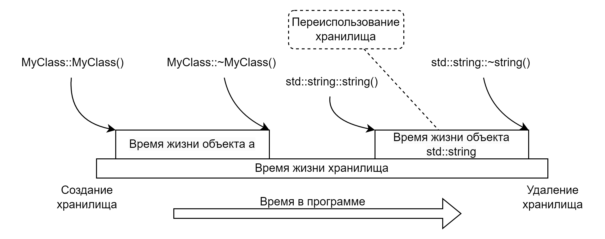
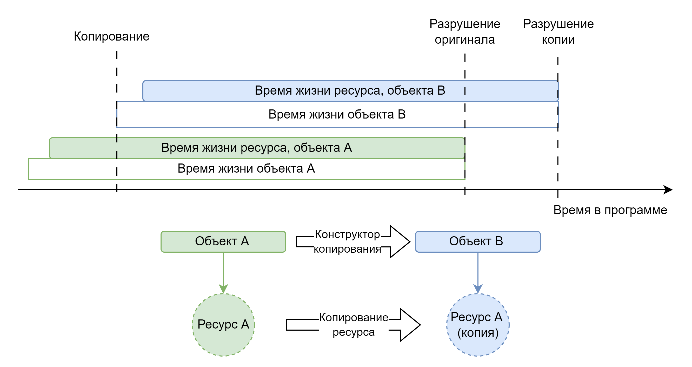
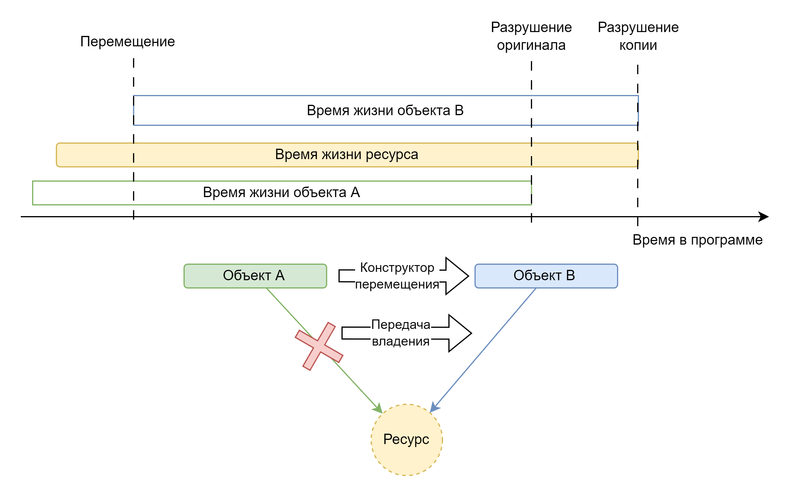
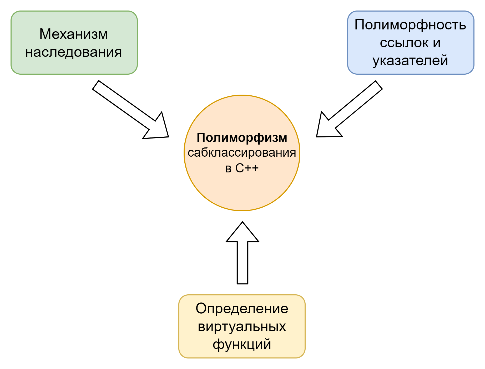
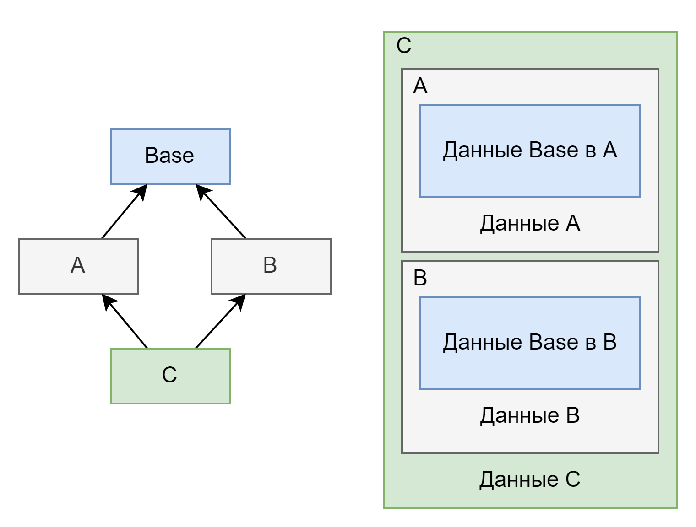
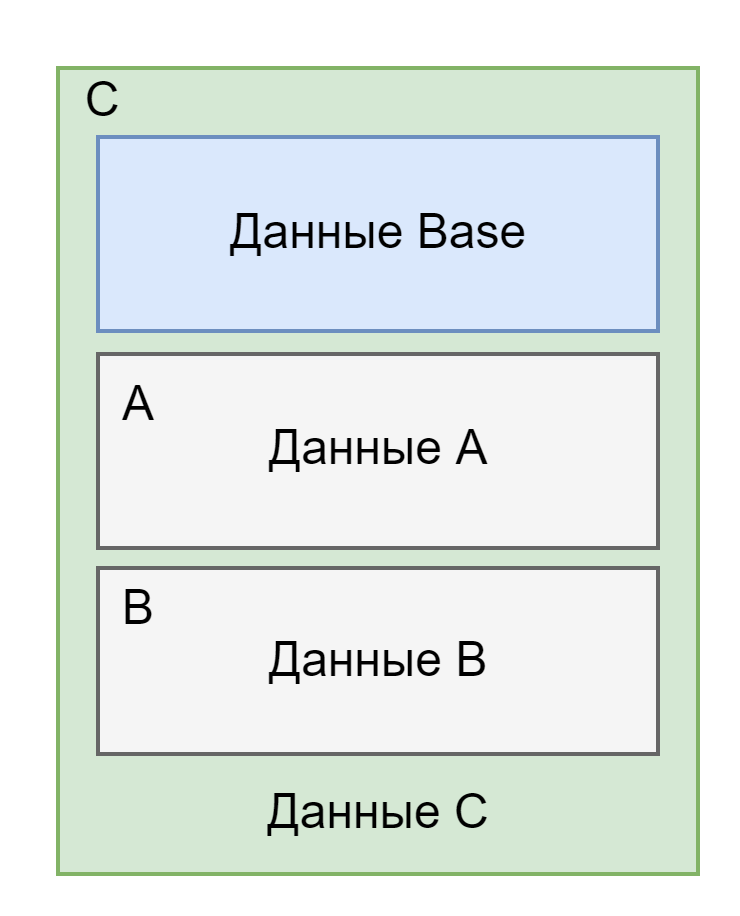

# Глава 3: Классы

В данной главе мы поговорим о семантике пользовательских типов данных в C++ и идиомах, связанных с данной семантикой. Пользовательскими типами данных являются структуры, классы и объединения, но для краткости будем говорить классы, подразумевая все виды пользовательских типов данных.

## Введение в основные семантические конструкции C++

В данном разделе мы ознакомимся с семантикой определения пользовательских типов. Однако сначала требуется погрузится в базовую семантику языка. К такой семантике относится правила передачи аргументов в функцию и инициализация.

### Объявления и определения

Для разных сущностей программы на C++ предъявляются разные требования к становлению определения объявлением. Так C++ кардинально отличается в некоторых аспектах от таких языков как Java, а в каких-то аспектах повторяет С. Можно выделить следующие особенности C++:

* Для определения переменной требуется чтобы ее тип был *полным*. Данное требование объясняется достаточно просто \- компилятор должен знать размер и требования к выравниванию хранилища под такую переменную. Из этого же следует, что составные типы указателей и ссылок являются полными, даже если нижележащий тип не является в данным момент, так как их размер компилятору всегда известен. *Полные типы*, это такие типы для которых уже было введено определение. Тип `void` всегда является *не полным*.  
* В C++ у каждой именованной и использованной в программе (odr-used) сущности должно присутствовать только одно определение. Обратная ситуация называется *odr violation*.  
* Область видимости именованной сущности начинается с момента ее объявления. Этот пункт несет значительные отличия от многих современных языков, таких как Java, C\# или Go. Так как в них используются более мягкие правила видимости (например видно все символы внутри пакета или внутри файла). Исключением из данного правила является область определения пользовательского типа данных, где члены функции и данные видимы во всем теле пользовательского типа.  
* Пользовательские типы данных должны быть определены сразу полностью. Не допускается кусочное определение как с ключевым словом partial в C\#.

### Виды инициализации

В C++ существуют следующие виды инициализации:

* Базовые типы инициализации (в т.ч для локальных переменных)  
  * По умолчанию  
  * По значению  
  * Реферальная  
  * Копированием  
  * Прямая  
  * Списком  
    * Списком с копированием  
    * Прямая инициализация списком  
    * Агрегата  
* Для нелокальных переменных  
  * Статическая  
    * Константная  
    * Нулем  
  * Динамическая  
  * Ранняя динамическая  
  * Отложенная динамическая  
* Статических локальных переменных  
* Членов данных класса

К *локальным* относятся переменные определённые в теле функции и не имеющие спецификаторов класса хранения `static` и `thread_local`. К *нелокальным* относятся переменные объявленные в коде программы вне тела функции.

```c++
// Глобальная
int a;

void function(int b) { // b - локальная
  // Локальная
  int c;
  // Глобальная
  static int d;
  // Глобальная
  thread_local int e;
}
```

#### Интуитивные правила инициализации

Для программистов, которые заинтересованы в развитии C++ как языка программирования, полезно разбираться в видах инициализации. Для всех остальных данную концепцию не обязательно заучивать, а можно понять интуитивно следуя следующим правилам.

##### Первое интуитивное правило

Правило состоит в следующем:
* Если у переменной нет инициализатора то скорее всего хранилище под переменную содержит случайные данные и перед использованием переменную нужно очистить или привести в подобающее состояние.  
* Если же инициализатор есть, но он пустой, то хранилище под переменную было обнулено. Такое состояние переменной может быть желательным (например для `int`) или не желательным.

##### Второе интуитивное правило

В большинстве случаев можно полагаться на следующую последовательность рассуждений:

* Не статические члены данных класса \- инициализируются в конструкторе:  
  * С использованием явного переданного значения  
  * Инициализатора по умолчанию если таковой задан при объявлении  
  * По значению, если член данных упомянут в списке инициализации со скобками  
  * Иначе по умолчанию  
* Статические локальные переменные \- инициализируются при первом вызове функции, которая их содержит  
* Нелокальные переменные (часто называют *глобальные переменные*):  
  * Константы инициализируется во время компиляции и часто содержат свое значение по месту их использования или в константной памяти. Поэтому лучше не брать адрес константных переменных, так как это будет заставлять компилятор аллоцировать под них хранилище в константной памяти.  
  * Иначе хранилище под них аллоцируется в специальном сегменте и инициализируется нулём. Далее, если указан инициализатор, то такие переменные инициализируются также как локальные, но до выполнения функции `main()` или до начала работы потока (для `thread_local`) в *неопределенном порядке*.  
* Локальные переменные инициализируются при определении. Если представить что у каждого типа в C++ есть набор конструкторов, то:  
  * Если не задано инициализатора \- в переменной может быть мусор.  
  * Если задан пустой \- то вызывается *конструктор по умолчанию*.  
  * Если при инициализации передается левостороннее значение этого же типа \- то вызывается *конструктор копирования*.  
  * Если при инициализации передается правостороннее значение этого же типа или приводимого типа  \- то вызывается *конструктор перемещения*.  
  * Если инициализатор это список (в фигурных скобках) значений одного типа \- то вызывается конструктор, принимающий `std::initializer_list<T>` (T \- тип значений в списке).  
  * Иначе вызывается конструктор, принимающий переданный набор параметров или происходит прямая инициализация членов данных.

Из правил инициализации нелокальных переменных следует интересный антипаттерн и предотвращающая его идиома:

* Антипаттерн *Фиаско статической инициализации* (static initialization fiasco).  
  * Неупорядоченность инициализации приводит к тому, что если одна нелокальная переменная ссылается в своем конструкторе на другую, то другая еще может быть не инициализирована. Обычно такое использование заканчивается плачевно.  
* Идиома перевода нелокальных переменных в локальные статические переменные.  
  * Она основана на том, что для локальных статических переменных определен момент инициализации \- при первом проходе определения при первом вызове функции.  
  * Соответственно, переводя инициализацию в случайном порядке в инициализацию при первом использовании, создается невидимый граф зависимостей, который раскрывается во время исполнения.

```c++
// B.hpp
struct B
{
  void foo() { std::printf("%d\n", v); }
  int v;
};
extern B b;

B& get_b();

// A.hpp
struct A
{
  A(B* b) : { b->foo(); }
};
A& get_a();

// Фиаско статической инициализации
// Глобальный порядок инициализации a и b не определен. Что выведет std::printf()?
// A.cpp
A a{&b};
// B.cpp
B b{10};

// Митигация Фиаско статической инициализации
// A.cpp
A& get_a() {
  // g_b всегда инициализируется до g_a
  static A g_a{&get_b()};
  return g_a;
}
// B.cpp
B& get_b() {
  static B g_b{};
  return g_b;
}
```

##### Третье интуитивное правило

Инициализация ссылочного типа может продлить время жизни объекта, используемого для инициализации ссылки. Так происходит в следующих случаях:

* Если ссылочный тип \- это правосторонняя ссылка.  
* Если ссылочный тип \- это левосторонняя ссылка на константный тип.

Тоже самое правило касается создания структурного связывания.

```c++
// Возврат временного объекта
MyClass foo();

// ОШИБКА, иногда, ошибка компиляции
MyClass& dangling_ref = foo(); // Деструктор временного MyClass вызовется на ;

// Временный объект будет жить столько же, сколько живет cl_ref
const MyClass& cl_ref = foo();
// Временный объект будет жить столько же, сколько живет r_ref
MyClass&& r_ref = foo();

// Временный объект будет жить столько же, сколько живут filed_a, filed_b
const auto [filed_a, filed_b] = foo();
```

#### Идиомы инициализации

Непосредственно с инициализацией можно связать две идиомы:

* Предпочитайте инициализацию списком другим видам инициализации.  
  * Данная идиома основана на том, что при инициализации списком отсутствует неявное приведение типов, что помогает отлавливать ошибки.  
* Предпочитайте инициализацию агрегатов с назначенными инициализаторами.  
  * Данная идиома выражает чистую практику \- при инициализации списком довольно легко перепутать какому члену данных соответствует какой элемент списка, использовав назначенные инициализаторы такую ошибку совершить сложно. Также в инициализации списком легко пропустить член данные, что приведёт к его инициализации по значению или по умолчанию, что почти всегда приводит к ошибкам времени выполнения.

С практической точки зрения инициализация открывает путь для еще двух идиом:

* Идиома именованного параметра \- можно использовать агрегат для задания параметров функции по имен, при этом при вызове использовать назначенные инициализаторы.  
* Идиома агрегата строителя \- это реализация шаблона ООП Строитель через агрегат и назначенные инициализаторы.

```c++
void many_argument_function(int a, long b, float c, MyClass d);

struct Params {
  int a;
  long b;
  float c;
  MyClass d;
};

void named_argument_function(Params p);

// Просто передача аргументов
many_argument_function(1, 2, 1.0f, MyClass{10});

// Идиома именованного параметра за счет агрегата Params
named_argument_function({.a = 1, .b = 2, .c = 1.0f, .d = MyClass{10}});
```

```c++
// Идиома агрегата строителя
struct HouseBuilder {
  IRoof* withRoof;
  IWallMaterial* withMaterial;
  IDoor* withDoor;
  IWindows* withWindow;
  IBasement* withBasement;

  House* build() {
    return new House(withRoof, withMaterial, withDoor, withWindow, withBasement);
  }
};

House* myHome = HouseBuilder{
  .withRoof{new MetalRoof{}},
  .withMaterial{new Bricks{}},
  .withDoor{new WoodenDoor{}},
  .withWindow{new GlassWindow{}}
}.build();
```

### Передача аргументов в функции

В синтаксисе C++ **объявление аргумента функции** эквивалентно **объявлению переменной**. С семантической точки зрения вызов функции является точкой инициализации ее параметров, также как инициализация переменной является точкой ее определения.  
```c++
// Инициализация переменной
int a = 10;
void foo(int b);
// Инициализация параметра
foo(10); // => foo(int b = 10);
```
Если объявление параметра назначает ему тип ссылки (левой или правой), того говорят о *передаче параметра по ссылке*. В остальных случаях говорят о *передаче параметра по значению*.
```c++
MyClass a{};
void foo(MyClass b, MyClass& c, MyClass&& d);
// b - передача по значению, через копию a
// с - передача a по ссылке
// d - передача a по ссылке на временный объект
foo(a, a, MyClass{});
```

### Время жизни объектов

Для любого объекта в программе на C++ существует мера, называемая его временем жизни. С точки зрения семантики C++ это время в течении которого валидное с точки зрения компилятора значение объекта занимает свое хранилище. До или после времени жизни хранилище, занимаемое переменной, имеет неопределенное значение.  

```c++
struct MyClass {
  int a;
};
using Storage = union { MyClass c; std::string s; };
// Создаем хранилище
alignas(Storage) char storage[sizeof(Storage)] = {};
// Размещаем в хранилище объект MyClass
MyClass *a = new (storage) MyClass(10);
// Заканчиваем время жизни a
a->~MyClass();
// Переиспользуем хранилище для объекта std::string
std::string *s new (storage) std::string("NyString");
// Заканчиваем время жизни s
s->~std::string();
```



Время жизни объекта часто, но не всегда, связано с его областью видимости. Так локальные переменные, начинают свое время жизни при определении, а заканчивают тогда, когда заканчивается область видимости, в которой они определены. Обычно область видимости, это блок исполнения, обрамляемый фигурными скобками. Поэтому говорят, что закрывающая фигурная скобка (`}`) является самой выразительной конструкцией C++, так как она приводит к завершению некой области видимости, и, соответственно, к завершению времени жизни локальных переменных в этой области видимости и к их разрушению. Именно из этого свойства рождается идиома RAII.

```c++
{
  MyClass a;
  /// код
} // Тут будет вызван ~MyClass() для объекта a

// Как это видит компилятор
{
  *a := alloc_storage(sizeof(MyClass), alignof(MyClass));
  MyClass::MyClass(a);
  /// код
  MyClass::~MyClass(a);
  free_storage(a, sizeof(MyClass), alignof(MyClass));
}
```

### Классы в стиле С

До появления классов в C++, для кода на C, была распространена идиома классов, в стиле C. Такие классы отличаются следующими элементами дизайна:

* Публичные данные доступны через описание класса.  
* Приватны данные скрыты во внутреннем описателе класса.  
* Базовый класс должен располагаться в качестве первого члена данных открытой части, для того чтобы соответствовать правилу алиасинга типов в C
* Методы класса реализуются как свободные функции, первым аргументом которых является указатель на объект

```c++
// Base.hpp
struct Base {
  SomeType baseStateA;
  SomeType baseStateB;
};

// Метод базового класса
int Base_process(Base* self, int a, long b);

// Derived.hpp
struct Derived {
  Base base;

  SomeType publicDerivedStateA;
  SomeType publicDerivedStateB;
};

// Конструктор
Derived* create_Derived(void* (*alloc)(size_t), /* остальные аргументы */)
// Метод
int Derived_process(Derived* self, int a, long b, float c);
// Деструктор
void delete_Derived(void (free)(void*), Derived** object);

// Derived.cpp
struct DerivedImpl {
  Derived publicData;

  SomeType privateDerivedStateC;
};

Derived* create_Derived(void* (*alloc)(size_t), /* остальные аргументы */) {
  DerivedImpl *self = alloc(sizeof(DerivedImpl));
  // Инициализация
  return self;
}

int Derived_process(Derived* self, int a, long b, float c) {
  DerivedImpl *fullSelf = (DerivedImpl*)self;
  // Полный доступ ко внутренним данным
  fullSelf->privateDerivedStateC;
  fullSelf->publicData.publicDerivedStateA;
  fullSelf->publicData.publicDerivedStateB;
  fullSelf->publicData.base.baseStateA;
  fullSelf->publicData.base.baseStateB;
  return 1;
}

void delete_Derived(void (free)(void*), Derived** object) {
  // Де инициализация состояния
  // Возврат динамической памяти
  free(*object);
  // Зануление внешнего указателя
  *object = NULL;
}

// Usage.cpp
Derived *d = create_Derived(malloc, /* ... */);
// Вызов базового класса - за счет правил алиасинга
Base_process(d, 10, 15);
// Вызов метода
Derived_process(d, 10, 15, 1.0f);
// Удаление объекта
delete_Derived(free, &d);
```

## Семантика определения класса

Ранее мы познакомились с синтаксисом определения класса, в котором спецификаторы доступа можно было чередовать. Семантически же все объявления в каждой из секций `private`, `protected`, `public` группируются вместе, так что их порядок семантически не важен.

##### Доступ к членам класса

Спецификаторы доступа `private`, `protected`, `public` задают три вида доступа к членам класса, объявленным в секции с выбранным спецификатором:

* `private` \- доступ только для данного класса, встроенных типов и друзей класса.  
* `protected` \- доступ для данного класса, встроенных типов, друзей класса и классов наследников.  
* `public` \- доступ для всех.

Доступ является семантической конструкцией, поверяемой компилятором через *механизм разрешения имен*. Поэтому пользовательский тип все же может, например вернуть указатель или ссылку на приватный член класса из публично доступного метода, а сторонний код может получить доступ по данному указателю, так как это не проверка разрешения имен во время компиляции.

##### Секция доступа по умолчанию

Важным с точки зрения синтаксиса и семантики является секция по умолчанию \- та что начинается со старта блока объявления:

* Для объявления с ключевым словом `class` секция по умолчанию имеет спецификатор `private`  
* Для объявления с ключевыми словами `struct` и `union` секция по умолчанию имеет спецификатор `public`

##### Типичные виды классов по доступу к членам данных

Среди программистов на C++ сложились негласные договоренности о том, как именно нужно пользоваться классификаторами доступа к членам класса.  
Так:

- Для классов, которые инкапсулируют состояние и поведение, типично все челны данных будут объявлены как `private` (или `protected`, если это базовый класс). Обычно используется объявление типа как `class`. Это обосновывается тем, что внутреннее состояние часто сильно связано с выполняемыми действиями, и внешний наблюдатель не должен вмешиваться или видеть промежуточные/не консистентные результаты работы класса.  
```c++
class MyActionClass {
public:
  void performAction() {
    m_stateA.foo();
    m_stateB.bar();
  }
  // Доступ по константной ссылке, для не возможности изменить состояние из-вне
  const A& getA() const {
    return m_stateA;
  }
private:
  A m_stateA;
  B m_stateB;
};
```
- Для классов, которые переносят данные (типично \- `struct`), все члены объявляются как `public`. Это обосновывается легкостью доступа к данным и простотой конструирования.
```c++
struct MyDataClass {
  std::string name;
  Point3D position;
  Vector3D speed;
  double hitPoints;
};
```

В большинстве случаев вам скажут, что публичных членов данных в классах быть не должно. При этом разрешено объявлять функции получения и/или установки значения таких членов данных.

##### Область видимости имен внутри блока класса

Другим семантически важным элементом является область видимости имен внутри блока класса, а именно \- внутри блока объявления класса нет необходимости, как на уровне пространства имен, предопределять идентификаторы (типы, функции, переменные). Они все доступны вне зависимости от точки использования. А также дополнительным именем, доступным в области блока объявления класса, является имя класса. Оно называется *инжектированным именем класса* (injected class name) и часто удобно для обращения внутри определения, так как, особенно для шаблонных классов, не требуется указывать полный список параметров шаблона.

##### Идиома внедрения имени базового класса

Часто очень удобно обращаться к базовому классу по сокращенному имени, также как это происходит с *инжектированным именем класса*. К сожалению язык не предоставляет такой возможности, поэтому прибегают к данной идиоме. Используя декларацию псевдонима типа вводят тип Base соответствующий полному имени базового типа (с подставлением шаблонных аргументов).

```c++
class MyClass : public some_namespace::some_long_class_name {
  // Сами внедряем сокращенное имя класса как Base
  using Base = some_namespace::some_long_class_name;
public:
  MyClass() : Base() {}

  int foo(int a) {
    return Base::bar() + Base::buz(a);
  }
}
```

## Члены данных пользовательских типов

Члены данных могут быть статическими (объявлены с классификаторами `static` или `thread_local`) и не статическими.  
Объявление членов данных аналогично объявлению переменных. Семантика определения же отличается. Так для обычных переменных задание инициализатора и есть определение, для членов данных же задание инициализатора говорит только о той инициализации, которая будет применена к члену данных по умолчанию, если другого инициализатора не указано в списке инициализации в конструкторе, а объявление \- всегда является определением.

```c++
// Полноценная инициализация a
int a = 10;

struct MyClass {
  // c инициализирован как 12 по умолчанию
  MyClass(float v) : b(v) {}
  // В данном конструкторе "= 11" и "= 12" не на что не влияют
  MyClass(int v) : b{v}, c{v + 1} {}

  // Определение значений по умолчанию
  int b = 11;
  int c = 12;

  // Полноценная инициализация для глобальной переменной MyClass::d
  static int d = 13;
};
```

##### Определение компоновки класса

C++ определяет правила компоновки класса, заданные наследованием и определением членов данных класса. При компоновке учитываются следующие параметры членов данных:

* Порядок определения  
* Байтовый размер  
* Требования к выравниванию

Компоновка класса происходит от первого объявленного члена данных к последнему. При этом, в общем случае, если следующий член данных имеет требования к выравниванию больше, чем у предыдущего, или предыдущий не попадает своим окончанием на границу выравнивания, то добавляются *заполняющие байты*. Заполняющие байты важны для *сравнимости по умолчанию*, о которой мы поговорим позже. Важно что компилятор не обязан инициализировать заполняющие байты значением или инициализировать нулем.
```c++
struct A {
  virtual foo();

  int a;
};
// Struct A:
//    | 0 | 1 | 2 | 3 | 4 | 5 | 6 | 7 |
// 00 |              vptr             |
// 08 |       a       |.....<fill>....|
// sizeof(A) == 16, alignof(B) == alignof(void*) == 8

struct B : public A {
  bool b;
  long long c;
};
// Struct B:
//    | 0 | 1 | 2 | 3 | 4 | 5 | 6 | 7 |
// 00 |              vptr             |
// 08 |     A::a      |.....<fill>....|
// 10 | b |...........<fill>..........|
// 18 |               c               |
// sizeof(B) == 32, alignof(B) == max(alignof(void*), alignof(long long)) == 8
```

###### Подобъекты

После процесса компоновки мы можем говорить о подобъектах, данного объекта. Подобъект это самостоятельный объект, время жизни которого ограничено временем жизни основного объекта, а хранилище для него располагается внутри хранилища основного объекта и может быть нулевого размера, например в случае применения оптимизации пустого базового класса. К подобъектам относятся все нестатические члены данных и все базовые классы данного класса.  
Подобъекты имеют крайне важное значение в ходе конструирования и разрушения объектов класса. При входе в тело конструктора гарантируется, что все подобъекты уже сконструированы, а при входе в тело деструктора гарантируется, что все подобъекты все ещё находятся в рамках своего времени жизни и их деструкторы будут вызваны после завершения деструктора основного объекта.

```c++
struct A {
  int a;
  float b;
};

struct B : public A {
  int c;
  float d;
}

B value;
// Подобъекты value:
int *a = &value.a,
    *c = &value.c;
float *b = &value.b,
      *d = &value.d;
A* base_subobject = &value;
```

###### Компоновка и производительность

Компоновка класса является важным элементом производительности приложений, так как влияет на:

* Объем памяти, занимаемый экземплярами класса  
* Количество экземпляров класса, помещающихся в кэши процессора  
* Локальность членов данных внутри одной кэш линии  
* На заполняющие байты в массивах экземпляров класса

Лишние байты приводят к значительному замедлению программы, так как существующие на данный момент системы ограничены по пропускной способности оперативной памяти больше, чем по скорости работы процессора.  
Пример: На большинстве платформ `int` будет занимать `4` байта, а `bool` \- всего `1`. Если вы определите член данных `int`, а затем `bool`, а затем ещё `int`, то компилятор выделит `12` байт на ваш класс, так как `3` байта будут является **заполнением** между `bool` и вторым (или первым, зависит от платформы) `int`. Вы можете использовать эти `3` байта для других целей, так например добавив ещё `3` `bool`, или превратив `bool` в `int` и работая со всем диапазоном значений.

```c++
struct A {
  int a;
  bool b;
  int c;
};
// Struct A:
//    | 0 | 1 | 2 | 3 | 4 | 5 | 6 | 7 |
// 00 |       a       | b |...<fill>..|
// 08 |       c       |
A array[2];
// Struct A array[2]:
//    | 0 | 1 | 2 | 3 | 4 | 5 | 6 | 7 |
// 00 |       a[0]    | b0|...<fill>..|
// 08 |       c[0]    |       a[1]    |
// 10 | b1|...<fill>..|       c[1]    |
```

##### Порядок инициализации членов данных

Важным для понимания устройства членов данных принципом является требования стандарта C++ о выполнении последовательной инициализации членов данных в порядке их объявления. Это важно, поскольку видимый порядок инициализации в списке инициализации в конструкторе может быть любой, а реальная инициализации будет происходить последовательно от первого объявленного челна данных до последнего.  
```c++
#include <cstdio>
struct Notice {
  Notice(const char* name) : name(name) { std::printf("Notice::Notice() %s\n", name); }
  ~Notice() { std::printf("Notice::~Notice() %s\n", name); }
  const char* name;
};

struct MyClass : public Notice {
  MyClass() : Notice("MyClass::Base") {
    std::printf("MyClass::MyClass()\n");
  }

  ~MyClass() {
    std::printf("MyClass::~MyClass()\n");
  }

  Notice a{"MyClass::a"};
  Notice b{"MyClass::b"};
};

int main() {
  MyClass value;
  return 1;
}
// Вывод программы:
// Notice::Notice() MyClass::Base
// Notice::Notice() MyClass::a
// Notice::Notice() MyClass::b
// MyClass::MyClass()
// MyClass::~MyClass()
// Notice::~Notice() MyClass::b
// Notice::~Notice() MyClass::a
// Notice::~Notice() MyClass::Base
```
В виду этого факта может сложиться такая же проблема как с *Фиаско статической инициализации* при зависимости одного члена данных от другого. Решением этой проблемы часто выступает предупреждение компилятора о разности в списке инициализации и порядке объявления, которое не стоит игнорировать, и даже лучше перевести в разряд ошибок компиляции.

```c++
struct MyClass {
  // a использует не инициализированное b внутри
  MyClass() : b{}, a{&b} {}
  // Инициализируется а, затем b
  A a;
  B b;
};
```

##### Статические члены данных

По своей семантике статические члены данных класса мало отличимы от нелокальных переменных. Существенная разница возникает в случае шаблонных классов, о которых мы поговорим позднее.

## Функции члены пользовательских типов

Как и члены данные, члены функции бывают статическими и не статическими. Нестатические члены функции мы обычно называем *методы*.  
Статические члены функции довольно полезны для элементов общего функционала. Для их вызова, в отличии от методов, не нужен экземпляр класса. Также широкое применение они нашли в реализации шаблона ООП *Фабричный метод*.

### Ключевое слово this

Методы класса требуют экземпляр класса для своего вызова. Данный экземпляр передается функцию автоматически первым неявным параметром, а начиная с C++23 его можно сделать явным используя синтаксис выведенного `this`. В теле методов класса доступно ключевое слово `this` выражающее адрес экземпляра класса, переданного в данный метод.  
Данное ключевое слово необходимо в ряде случаев, но большая часть семантики обращения к членам данным и другим методам не нуждается в использовании `this` так как при использовании имени члена данных или метода `this` подставляется автоматически.

```c++
struct MyClass
{
  int process(A a) {
    my_state += a;
    notify();
    // Компилятор видит как:
    this->my_state += a;
    this->notify();
  }

  // Эквивалентные определения
  int foo() const &;
  int foo(this const MyClass& self);

  // Эквивалентные определения
  int foo() &&;
  int foo(this MyClass&& self);

  // Явная копия объекта
  int foo(this MyClass self);
};
```

###### Выведенное this (C++23)

В том числе следуя за веянием современных языков программирования на использование явного аргумента, представляющего экземпляр класса, в C++23 также появилась эта возможность. Синтаксически это упрощает определение метода благодаря замене нескольких схожих имплементаций с разными спецификаторами CV и ссылочности, на одну имплементацию, где спецификаторы выводятся по правилам выведения типа параметра шаблона.

```c++
struct A {
  // 8 отдельных имплементаций
  B foo() const &;
  B foo() const &&;
  B foo() &;
  B foo() &&;
  B foo() const volatile &;
  B foo() const volatile &&;
  B foo() volatile &;
  B foo() volatile &&;

  // Одна имплементация вместо 8-ми
  template<class Self>
  B foo(this Self&& self) {
    // код
  }
};
```

### Специальные функции члены класса

В C++ большинство сущностей с которыми придется встретиться программисту являются объектами. Для определения как создавать и как разрушать объект соответственно в начале и в конце его времени жизни в C++ вводятся специальные функции члены конструкторы и деструктор. Также в одном ряду с ними стоят оператор присваивания с копированием и с перемещением.  
Время жизни объекта начинается после исполнения конструктора, и заканчивается до непосредственного исполнения деструктора.  

```c++
class MyClass {
public:
  // Конструкторов может быть много, но они должны принимать разные аргументы
  // Конструктор по умолчанию
  MyClass();
  // Конвертирующий конструктор: int -> MyClass
  MyClass(int a);
  // Конвертирующий конструктор может быть помечен как явный
  // explicit MyClass(int a);
  // Простой конструктор
  MyClass(SomeType a, int b);
  // Делегирующий конструктор
  MyClass(SomeOtherType a) : MyClass(a.b) {}
  // Конструктор инициализации из списка
  TAmClass(std::initializer_list<int> 1);
  // Конструктор копирования
  MyClass(const MyClass& other);
  // Конструктор перемещения
  MyClass(MyClass&& other);
  // Деструктор всегда один
  ~MyClass();
  // Деструктор может быть виртуальным
  // virtual ~MyClass();
};
```

#### Деструктор

Это специальный член функция класса, отвечающая за код, выполняемый в конце жизни объекта. Обычно используется для очистки ресурсов, за которые отвечал объект.  
Деструктор \- единственный тип функций в C++ который является `noexcept` по умолчанию.

#### Виды конструкторов

Конструкторы бывают нескольких видов:

* По умолчанию  
* Копирования  
* Перемещения  
* Конвертирующий  
* Делегирующий  
* Конструктор инициализации из списка  
* Обычный конструктор

##### Конструктор по умолчанию

Это такой конструктор, для вызова которого не требуется передавать аргументы. Таким образом это может быть конструктор без списка аргументов или тот, в котором каждому аргументу подставляется значение по умолчанию. Такой конструктор может быть объявлен только один.

##### Конструктор копирования

Это конструктор, принимающий единственным аргументом левую ссылку на на текущий тип класса. Эта ссылка может быть на константный или не константный тип объекта, но обычно выбирается константная версия, чтобы при вызове явно не было возможности изменить объект, копию которого предполагается сделать.

##### Конструктор перемещения

Это конструктор, принимающий единственным аргументом правую ссылку на на текущий тип класса. Эта ссылка может быть на константный или не константный тип объекта, но обычно выбирается не константная версия, так как данный конструктор выражает семантику передачи ресурсов во вновь создаваемый объект.

##### Конвертирующий конструктор

Это любой конструктор, для вызова которого требуется передать только один аргумент. Данный конструктор может быть вызван автоматически при приведении значения, типа единственного аргумента, к типу данного класса. Это может произойти неявно, при инициализации объекта данного класса из объекта типа аргумента, или явно, при использовании приведения в стиле С или `static_cast`. Для того чтобы убрать семантику неявного приведения такой конструктор можно пометить ключевым словом `explicit`.

##### Делегирующий конструктор

Это любой конструктор, который в своём списке инициализации вызывает другой конструктор этого же класса.  
С данным типом конструкторов нужно быть очень осторожным, поскольку объект считается полностью созданным и начавшим время своей жизни в конце выполнения вызываемого конструктора.

##### Конструктор инициализации из списка

Это конструктор, для вызова которого достаточно одного аргумента типа `std::initializer_list<T>`. Данный конструктор выбирается компилятором при инициализации объекта списком значений одинакового типа. Он особенно удобен для типов контейнеров.

##### Обычный конструктор

Это любой другой конструктор не подходящий под описание выше. Обычно в нём реализована особая логика инициализации класса.

#### Операторы присваивания

Операторы присваивания с копированием и с перемещением стоят в одном ряду с конструкторами и деструктором, потому что компилятор может генерировать данные операторы по умолчанию.  
Умолчанием для данных операторов является вызов оператора присваивания с копированием и с перемещением для каждого отдельного члена данных и базового класса. Часто такой вызов превращается в простое копирование памяти оптимизированным методом (с использованием `std::memcpy`).

###### Идиома сравнения с this

Поскольку определение данных операторов не исключает ситуации в которой объект будет присвоен сам себе, часто приходится сравнивать переданный объект и текущий. Это реализуется благодаря сравнению this и адреса аргумента оператора.

```c++
class MyClass {
public:
  // Оператор присваивания с копированием
  MyClass& operator=(const MyClass& other) {
    if (this != &other) {
      // Выполняем копирование
    }
    return *this;
  }
  // Оператор присваивания с перемещением
  MyClass& operator=(MyClass&& other);
};

```

#### Генерация специальных членов функций компилятором

Компилятор может генерировать специальные члены функции как с указания разработчика (с использованием синтаксиса `= default`) так и по умолчанию. Но у этой возможности есть свои ограничения, при выполнении которых созданный компилятором специальный член функция будет помечена как удаленная (`= delete`).  
Для всех специальных членов функций актуально правило, что если они были объявлены или определены пользователем, то они не будет созданы компилятором.

| Тип специальной функции члена | Удален если |
| :---- | :---- |
| Конструктор по умолчанию | Если хотя бы один из нестатических членов данных: <br> Не имеет конструктора по умолчанию, а если не имеет, то не указан инициализатор по умолчанию <br> Является ссылочным типом и не имеет инициализатора по умолчанию <br> Имеет удаленный или недоступный деструктор |
| Конструктор копирования | Если хотя бы один из нестатических членов данных: <br> Является правосторонней ссылкой Не имеет конструктора копирования <br> Имеет удаленный или недоступный деструктор <br> Если есть объявление конструктора перемещения или оператора присваивания с перемещением |
| Конструктор перемещения | Если хотя бы один из нестатических членов данных: <br> Не имеет конструктора перемещения Имеет удаленный или недоступный деструктор <br> Если хотя бы один специальный член функция объявлены пользователем из конструктора копирования, оператора присваивания с копированием, оператора присваивания с перемещением, деструктора. |
| Оператор присваивания с копированием | Если хотя бы один из нестатических членов данных: <br> Не имеет оператора присваивания с копированием <br> Имеет константный не классовый тип <br> Имеет тип ссылки |
| Оператор присваивания с перемещением | Если хотя бы один из нестатических членов данных: <br> Не имеет оператора присваивания с перемещением Имеет константный не классовый тип <br> Имеет тип ссылки <br> Если хотя бы один специальный член функция объявлены пользователем из конструктора копирования, конструктора перемещения, оператора присваивания с копированием, деструктора. |
| Деструктор | Если хотя бы один из нестатических членов данных: <br> Имеет удаленный или недоступный деструктор Если `operator delete()` для данного класса является удаленным или недоступным |

#### Идиомы специальных членов функций

Поскольку правила создания специальных членов функции довольно сложны для понимания были выведены два идиоматических правила. *Правило нуля* и *правило пяти*. Данные правила устанавливают типичные действия программиста в отношении специальных членов функций. Также существует *правило семи*, которое добавляет к правилу пяти отношение к конструктору по умолчанию, операции обмена значениями (swap).

##### Правило нуля

Правило нуля гласит, что сначала при объявлении класса нужно стремиться не объявлять никаких специальных членов функций. Это приводит к тому что компилятор будет генерировать их сам на основании членов данных. Таким классом очень просто пользоваться, а компилятор будет подсказывать когда та или иная функция член будет объявлена удаленной.

```c++
struct DataClass {
  int a;
  long b;
  std::string c;
};
// По умолчанию генерируются:
// DataClass() / DataClass(const DataClass&) / DataClass(DataClass&&)
// / ~DataClass() / DataClass& operator=(const DataClass&) / DataClass& operator=(DataClass&&)
```

##### Правило пяти

Правило пяти гласит, что если потребовалось объявить хотя бы одну специальную функцию член, то объявлять нужно и все остальные. Это приводит к тому, что компилятор не будет генерировать специальные функции члены, а программист должен будет сам подумать над действиями в них, и если ему подходит стандартная генерация \- объявить функцию с модификатором `= default`.

```c++
class MyResource {
public:
  MyResource() {
    // Специальные правила инициализации по умолчанию
  }
  MyResource(const MyResource& other) {
    // Специальные правила копирования
  }
  MyResource& operator=(const MyResource& other) {
    // Используем swap() и MyResource(const MyResource& other)
  }
  MyResource(MyResource&& other) {
    // Перемещение
  }
  MyResource& operator=(const MyResource& other) {
    // Перемещение
  }
private:
  Resource r;
};
```

### Перемещение объектов (C++11)

Мы уже познакомились с конструктором перемещения и оператором присваивания с перемещением. Данные синтаксические конструкции были введены в язык с целью увеличения возможности программиста по управлению временем жизни ресурсов, которыми владеют объекты. Данная возможность была названа *семантикой перемещения*.




###### Историческая справка

До C++11 был только конструктор копирования и оператор присваивания с копированием, что не давало возможности передавать тяжелые ресурсы из объекта с одним временем жизни (например временного значения) в объект с другим временем жизни (например локальную переменную).  
Для типов, которые должны были уметь передавать хранимый ресурс, приходилось конструктор копирования и оператор присваивания с копированием писать так, как сейчас пишут конструктор перемещения и оператор копирования с перемещением, лишая их возможности быть скопированными или определяя специальный метод для копирования (например `Copy()`).  
Синтаксически код, который использовал такие подходы, выглядел непонятно, и в нём можно было легко запутаться. Поэтому в C++11 было принято решение ввести новый синтаксис и семантику.

#### Семантика перемещения

*Перемещение* происходит тогда, когда вызывается *конструктор перемещения* или *оператор присваивания с перемещением*. Перемещаются *ресурсы*, которыми владеет объект. Часто, но не всегда, компилятор может оптимизировать перемещение объекта в целом исключая данную операцию.  
Важно что просто приведение объекта к правой ссылке не вызывает изменения в объекте.  
Возможность для перемещения обычно представляется:

* Когда переменная инициализируется или ей присваивается значение, возвращаемое из функции.  
* Когда переменная инициализируется или ей присваивается временное значение, созданное в результате вычисления выражения (например при приведении объекта с использованием конвертирующего конструктора).  
* Оба случая выше для инициализации параметра функции.  
* Когда переменная инициализируется или ей присваивается значение полученное с использованием *явного перемещения*.

```c++
MyClass foo();
// Перемещение при возврате временного значения
MyClass a = foo();
// Перемещение результат выражения
MyClass b = a + foo(); // MyClass operator+(const MyClass& l, const MyClass& r)

void bar(MyClass c, MyClass d);
// Перемещение при инициализации аргументов
bar(MyClass{}, MyClass{} + MyClass{});
// Явное перемещение
MyClass e = std::move(a), f = static_cast<MyClass&&>(b);
```

##### Явное перемещение

Явное перемещение наступает в случае когда программист трансформирует левостороннее значение (значение у которого есть имя) в правостороннее значение с использованием:

* Функции `std::move()` или `std::forward()`  
* Приведения типа к правосторонней ссылке через `static_cast`.

Обычно используется именно первый вариант, так как `std::move` в своей реализации выполняет второй вариант, но с выводом типов (читай \- получается меньше кода).

##### Только перемещаемые типы

Это такие пользовательские типы данных, которые по тем или иным причинам нельзя скопировать, они называются move-only. Для таких типов основной формой передачи ресурсов является именно перемещение. Данные объекты часто выражают форму уникального владения ресурсом.  
Достигается такое поведение следующими способами:

* Указанием пользовательских конструктора перемещения и оператора присваивания с перемещением с (`= delete`) или без явного удаления конструктора копирования и оператора присваивания с копированием.  
* Наследование от базового класса, у которого явно удалены конструктор копирования и оператор присваивания с копированием (идиома non-copyable mixin).

```c++
class MoveOnly {
public:
  MoveOnly(const MoveOnly&) = delete;
  MoveOnly& operator=(const MoveOnly&) = delete;
  MoveOnly(MoveOnly&& other);
  MoveOnly& operator=(MoveOnly&& other);
};

MoveOnly a;
MoveOnly b = std::move(a);
a = std::move(b);

// Mixin-стиль
struct NonCopyable {
  NonCopyable(const NonCopyable&) = delete;
  NonCopyable& operator=(const NonCopyable&) = delete;
  NonCopyable(NonCopyable&&) = default;
  NonCopyable& operator=(NonCopyable&&) = default;
};

class MyClass : public NonCopyable {};
```

##### Только создаваемые типы

Для некоторых типов важно быть не копируемыми и не перемещаемыми. Такая необходимость связана с семантикой разрабатываемой программы. Для реализации используется такие же методы как и для *только перемещаемых типов*, но удаляются уже все функции копирования и перемещения. Такие типы еще называют *create-only*.

```c++
class CreateOnly {
public:
  CreateOnly(const CreateOnly&) = delete;
  CreateOnly& operator=(const CreateOnly&) = delete;
  CreateOnly(CreateOnly&&) = delete;
  CreateOnly& operator=(CreateOnly&&) = delete;
};
```

### Друзья пользовательского типа данных

Как мы знаем другом пользовательского типа может быть объявлен другой пользовательский тип и свободная функция. На основании данной семантики построены три подхода в индустриальной разработке на C++ метод фабрика, *обмениваемые типы* и *сравниваемые типы*. *Сравниваемые типы* мы рассмотрим чуть позже.

#### Обмениваемые типы (swappable)

Это такие типы, которые реализуют метод `swap()` и он семантически выражает обмен значений между двумя экземплярами данного типа. Самой важной особенностью данного метода является ожидание что для абсолютного большинства типов его можно реализовать не бросающим исключения.  
Другой похожей функцией является `exchange()`, но ее реализуют и используют во много раз меньше чем `swap()`.

##### Идиома специальных членов функций, выведенных из обмена (copy & swap)

Самым приятным в усилиях по имплементации обмена значений (особенно в не бросающем варианте) является тот факт, что такие специальные члены функции как конструктор копирования, оператор присваивания с копированием, конструктор перемещения и оператор присваивания с перемещением можно имплементировать использовав только операции обмена значениями и конструктор по умолчанию.

```C++
class ResourceHolder {
public:
  ResourceHolder(const ResourceHolder& other) {
    // Реализация копирования ресурса
  }
  void swap(ResourceHolder& other) noexcept {
    // Допускаем, что обмениваем на ресурс, а значения ресурсов
    // например указатели
    swap(r, other.r);
  }

  // Вывод присвоения с копированием
  ResourceHolder& operator=(const ResourceHolder& other) {
    swap(ResourceHolder(other));
    return *this;
  }

  // Вывод перемещения
  ResourceHolder(ResourceHolder&& other) {
    // Берем Resource инициализированный по умолчанию как пустой
    swap(other);
  }
  // Вывод присвоения с перемещением
  ResourceHolder& operator=(ResourceHolder&& other) {
    swap(ResourceHolder(std::move(other)));
    return *this;
  }
private:
  Resource r;
};
```

##### Идиоматическое использование обмениваемых типов

Поскольку ожидается, что операция `swap()` не бросает исключений, на ее основании также можно писать и продуктовый код, хорошо защищенный от исключений. Однако, обычно не прибегают непосредственно к методу `swap()` типа, а поступают чуть более широко.  
Типы помимо методов определяют дружественную функцию `swap()`, которая принимает два аргумента данного типа и реализуется через вызов метода. А в месте, где необходим обмен значений каких-то типов, вызов функции `swap()` осуществляется не квалифицированно с предшествующей инжекцией имени `std::swap`. Данный подход позволяет:

* Вызвать свободную функцию конкретного типа, если она определена или  
* Вызвать общую свободную функцию `std::swap`, которая производит обмен через последовательность перемещений.  

Так мы получаем часто используемую точку расширения `swap()` для, во многих случаях, операций, не бросающих исключения.

```c++
class Swappable {
public:
  friend void swap(Swappable& l, Swappable& r) noexcept;
  /// Другие функции и члены данных
};

class Copyable {
public:
  Copyable(const Copyable& other);
  /// Другие функции и члены данных
};

template<class T>
void my_template_function(T& v) {
  T tmp;
  using std::swap;
  // Используем не квалифицированный вызов и ADL
  swap(tmp, v);
}

// Для T = Swappable
void my_template_function<Swappable>(Swappable& v) {
  Swappable tmp;
  using std::swap;
  swap(tmp, v); // Вызывается friend void swap(Swappable& l, Swappable& r) noexcept;
}

// Для T = Copyable
void my_template_function<Copyable>(Copyable& v) {
  Copyable tmp;
  using std::swap;
  swap(tmp, v); // Вызывается std::swap;
}
```

#### Идиома дружественной фабрики

Дружественные фабрики часто встречаются в продуктовом коде на C++. Они являются реализацией шаблона проектирования ООП Фабричный метод или Абстрактная фабрика. Данная идиома использует две семантические конструкции:

* Конструкторы класса, объявленные в `private` и `protected` области видимости, делающие конструирование класса недоступным для кода во вне.  
* Класса фабрики или фабричного метода, объявленного другом класса, для которого конструкторы являются семантически доступными для вызова.

```c++
class MyClass {
protected:
  MyClass(SomeType a, SomeDependency* b);
  // Объявляем фабричный метод другом
  friend MyClass* makeMyClass(SomeType a, SomeDependency* b);
};

// Фабричный метод
MyClass* makeMyClass(SomeType a, SomeDependency* b) {
  return new MyClass(a, b);
}

// Использование
MyClass value(a, b); // Ошибка компиляции
MyClass *ptr = new MyClass(a, b); // Ошибка компиляции
MyClass *p = makeMyClass(a, b); // Используем только фабричный метод
```

### Квалифицированные функции члены пользовательского типа данных

#### Константные методы

Мы уже знакомы с синтаксисом объявления константного метода через квалификатор константности функции или типа выведенного `this`. Семантика данных методов заключается в том, что не один из членов данных нельзя изменить в теле метода, и вызывать можно только другие константные методы.  
Данную семантику ослабляет квалификатор членов данных `mutable`, который позволяет изменять такой член данных в теле константного метода.  
Компилятор C++ автоматически вызывает метод, квалифицированный константно если тип объекта тоже квалифицирован константно или у данного типа нет не константного варианта данного метода. Во всех других случаях вызывается не константный вариант метода.

```c++
class MyClass {
public:
  SomeType action() {
    // Тут доступны все методы и члены данных для модификации
    a.value = 3;
    b = compute() + subCompute();
    return b.internal;
  }

  SomeType compute() const {
    // Для изменения доступны только mutable данные
    a.value = 4;
    b.internal = SomeType{3}; // Ошибка компиляции - не mutable данные
    // Для вызова, доступны только const методы
    SomeType с = subCompute();
    SomeType d = action(); // Ошибка компиляции - не const метод
  }

  SomeType subCompute() const {
    // Код
  }
private:
  mutable State a;
  OtherState b;
};
```

##### Идиома пары константного и не константного метода

Данная идиома говорит о том, что методы доступа к челнам данных или прокси объектов к внутреннему состоянию лучше всего объявлять парами с одинаковым именем, при этом один метод должен иметь, а другой не иметь квалификатор константности. Это помогает реализовать идиому *пропагации константности* (const propagation).  
Значением, возвращаемым из константного метода, типично будет или константная левая ссылка или копия объекта, к которому организуется доступ. А значением, возвращаемым из не константного метода, будет не константная левая ссылка.

```c++
class MyClass {
public:
  InternalState& getState() {
    return s;
  }

  // Возвращая const& на внутреннее состояние мы пропагируем константность
  const InternalState& getState() const {
    return s;
  }

  // Простой & мы сможем вернуть только на mutable член данных
  // Поддержка идиомы interior mutability из Rust
  Data& getData() const {
    return s;
  }
private:
  InternalState s;
  mutable Data d;
};

MyClass a;
const MyClass& b = a;

a.getState(); // Вызывается не const версия
b.getState(); // Вызывается const версия
```

##### Семантика модификаторов ссылочности

С модификаторами ссылочности всё достаточно просто, они указывают какой метод с одним и тем же именем должен быть вызван в случае если экземпляр класса является левым или правым значением.  
Эти модификаторы используются для передачи владения ресурсом в цепочке преобразований. Так, метод квалифицированный правой ссылкой может по значению, а метод, квалифицированный левой ссылкой \- по левой ссылке.  
Данные квалификаторы можно заметить при реализации шаблона ООП Строитель, где все методы назначения будут квалифицированы правой ссылкой, чтобы допускать только полное построение объекта.

```c++
class ResourceHolder {
public:
  // Возвращаем копию ресурса
  Resource shareResource() & {
    Resource copy = r.copy();
    return copy;
  }
  // Если мы временный - возвращаем сам ресурс, а свой ресурс зануляем
  Resource shareResource() && {
    Resource tmp{};
    r.swap(tmp);
    return tmp;
  }
private:
  Resource r;
};
```

#### Идиома nodiscard

Любую функцию можно пометить слева атрибутом `[[nodiscard]]`. Данная идиома применима к функциям членам, результат которых не должен быть проигнорирован пользователем пользовательского типа данных. Обычно название таких пользовательских функций может быть двояко интерпретировано. Например метод `empty()` может очищать значение или проверять, является ли значение пустым. Во втором случае требуется воспользоваться данной видимой чтобы компилятор предупреждал программиста о не использовании возвращаемого значения, что указывает на неверную интерпретацию семантики метода в данном месте использования.  

```c++
class MyCollection {
public:
  [[nodiscard]] bool empty();
};
MyCollection c;
// Корректный вызов - возвращаемое значение используется
if (c.empty()) {
  // код
}
// Программист подумал, что empty() отчищает контейнер
// Не корректный вызов - возвращаемое значение не используется
// Компилятор выдаст предупреждение
c.empty();
```

### Перегрузка операторов

Перегрузка операторов это возможность C++ по связыванию символьных конструкций языка с семантикой, определенной программистом. В некоторых языках, таких как Haskell, функция может любое имя, в том числе и с использованием символов. В же C++ набор символов, определяющих имя функции, ограничен английским алфавитом, арабскими цифрами и нижним подчеркиванием.  
Перегрузка операторов не может повлиять на количество аргументов оператора, его приоритет и ассоциативность, заданных в правилах языка, а только может определить что именно будет происходить при операции. Также перегрузке доступны не все операторы языка.  
Применения перегрузки операторов:

* Пользовательские арифметические типы  
* Синтаксисы встроенных доменных языков (eDLS, embedded Domain-Specific Language)  
* Определение точек расширения

#### Пользовательские арифметические типы

Прежде всего при рассмотрении вопроса о перегрузке операторов для своего класса стоит обратить внимание на то является ли ваш класс арифметическим или он выражает другую семантику. Если ваш случай первый, то идиома **далей как `int`** готовит о том, что не стоит переопределять смысл операций, а их семантику нужно сделать такой же как у встроенного типа `int`.

```c++
class MyMatrix {
public:
  MyMatrix operator+(const MyMatrix& rhs);
  MyMatrix& operator+=(const MyMatrix& rhs);
  MyMatrix operator*(const MyMatrix& rhs);
  MyMatrix& operator*=(const MyMatrix& rhs);
  MyMatrix operator*(double scale);
  MyMatrix& operator*=(double scale);
};
```

##### Типы, похожие на указатель (pointer-like)

Одним из арифметических типов считается тип указателя. Мы будем достаточно часто встречаться с типами, реализующими часть или полный интерфейс указателя. Такие типы называются итераторами, и ма поговорим о них в будущих главах.  
Основой таких типов является специальная семантика оператора обращения по указателю. Она заключается в том, что данный оператор вызывается на возвращаемых объектах до тех пор, пока не вернется тип указателя.

```c++
class MyPointerLike {
public:
  MyPointerLike operator+(std::size_t n);
  MyPointerLike operator-(std::size_t n);
  MyPointerLike& operator++();
  MyPointerLike operator++(int);
  MyPointerLike& operator--();
  MyPointerLike operator--(int);
  MyType& operator*();
  MyType* operator->();
  MyType& operator[](std::size_t n);
};
```

##### Типы, похожие на буль (booleany types)

Это типа для которых имеет смысл проверка сравнимости с значениями `true` и `false`. Обычно такой операцией выбирают семантическую проверку на пустоту, но можно использовать и любую другую операцию, с двумя возможными состояниями.  
Данные типы реализуют оператор приведения к типу `operator bool()`, и оператор логического отрицания `operator!()`.

```c++
class MyBooleanyType {
public:
  bool empty();
  bool operator!() {
    return empty();
  }
  explicit operator bool() {
    return !empty();
  }
};
```

###### Идиома безопасного булево типа (safe bool)

Приведение типа к `bool` не проходит бесследно по двум причинам:

* Так как в C++ определены приведения по умолчанию, поэтому такой тип можно будет сравнить с числовыми  
* Так как после приведения двух разных *booleany типов* к `bool` их становится можно сравнить друг с другом, сравниваться будут не они сами, а приведенные значения. Это происходит в виду того, что для аргументов функций и операторов допустимо одно неявное преобразование

```c++
struct A {
  int a;
  operator bool() {
    return a == 10;
  }
};

struct B {
  int b;
  operator bool() {
    return b == 100;
  }
};

// Ошибка сравнения с числом
if (A{10} < 2) {
  return 1;
}
// Ошибка сравнения с другим booleany типом
if (A{0} == B{10}) {
  return 2;
}
```

Обе проблемы решаются идиомой *безопасного булево типа*. Она заключается в том, что вместо приведения к `bool`, тип приводится к встроенному, но уникальному, *booleany типу*, такому как указатель на член функцию.  
Такие типы не сравнимы друг с другом и не приводятся к арифметическим типам, приводимы к `bool` только в случае явного приведения и использования в конструкции `if`, а также, им требуется два преобразования для булево сравнения.

```c++
class A {
  using bool_type = void (A::*)();
  void true_value() {}

public:
  int a;
  operator bool_type() {
    return a == 10 ? &A::true_value : nullptr;
  }
};

struct B {
  int b;
  operator bool() {
    return b == 100;
  }
};

// Происходит автоматическое приведение void (A::*)() к bool
if (A{10}) {
  return 0;
}
// Ошибка компиляции - 2 не сравнимо с void (A::*)()
if (A{10} < 2) {
  return 1;
}
// Ошибка компиляции - B не сравнимо с void (A::*)()
if (A{0} == B{10}) {
  return 2;
}
```

#### Точки расширения

Это договор между авторами определенной функциональности и ее потребителями, в котором прописано, что часть функционала пользователь может реализовать самостоятельно для своих пользовательских типов. Обычно это часть шаблона **ООП Шаблонный метод**.  
Для реализации *точек расширения* часто используют перегрузку операторов.

##### Сравнимые типы

Сравнимые типы (comparable types) это пользовательские типы данных, которые реализуют операторы сравнения. Это означает что для данных типов существует семантика эквивалентности и, возможно, порядка.  
Реализация оператора меньше (`operator<`) является в стандартной библиотеке C++ точкой расширения. Обычно она используется в упорядоченных контейнерах, о которых мы поговорим позже.

```c++
class Comparable {
public:
  // @ - заменяется на <, <=, >, >=, ==, !=
  bool operator@(const Comparable& other) noexcept;
  friend operator@(const Comparable& lhs, const Comparable& rhs) noexcept;
};
```

###### Вывод операторов сравнения

Начиная с C++20 компилятор может вывести операторы сравнения самостоятельно при явном запросе от программиста с использованием квалификатора `= default`. Эти операторы выводятся на основании последовательного сравнения по членам данных двух экземпляров типа.

```c++
class AutoComparable {
  int a, b;
public:
  // Выводится: this->a < other.a && this->b < other.b
  bool operator<(const Comparable& other) noexcept = default;
};
```

###### Оператор трехстороннего сравнения

Начиная с C++20 был введен оператор трехстороннего сравнения `operator<=>` (spaceship operator), обрамляющий укоренившуюся семантику сравнения двух объектов в виде оператора, а именно, как ранее функции в С, из него возвращается одно из трех состояний (больше, меньше или равно). Основное преимущество использования данного оператора заключается в том, что из него также можно вывести все шесть операторов сравнения.

> [!NOTE]
> **Историческая справка**
>  
> Ранее в языке С сравнимость была организована путем использования функции `std::memcmp()` и `std::strcmp()`, которые как раз возвращали признак сравнения (больше, меньше или равно) в виде положительного, отрицательного числа и нуля.

##### Идиоматическое определение операторов сравнения

До введения `operator<=>` было принято выводить все шесть операторов сравнения из `operator<`.

```c++
class MyClass {
public:
  bool operator<(const Comparable& other) noexcept {
    // Уникально заданное сравнение по порядку
  }
  bool operator<=(const Comparable& other) noexcept {
    return !(other > *this);
  }
  bool operator>(const Comparable& other) noexcept {
    return other < *this;
  }
  bool operator>=(const Comparable& other) noexcept {
    return !(*this < other);
  }
  bool operator==(const Comparable& other) noexcept {
    return !(*this < other || other < *this);
  }
  bool operator!=(const Comparable& other) noexcept {
    return !(*this == other);
  }
};
```

##### Ввод/Вывод в стандартный поток

Мы еще столкнемся со стандартной библиотекой потоков ввода вывода, однако стоит именно сейчас упомянуть, что точкой расширения в данной библиотеке являются операторы:

* Битового сдвига влево `operator<<()` \- для вывода данных в поток  
* Битового сдвига вправо `operator>>()` \- для получения данных из потока

###### Идиома цепочки методов (method chaining)

Данная идиома используется при работе с большинством операторов так как позволяет в одном выражении использовать более одного оператора, однако она также широко используется и с обычными методами. Данная идиома состоит в том, чтобы из метода или перегрузки оператора, возвращать значение левой  (возможно константной) ссылки на текущий объект. Это позволяет сразу после вызова одного метода вызвать следующий на том же объекте.

```c++
struct PrintablePoint {
  float x, y, z;
  // Возврат std::ostream& позволяет продолжить цепочку дальше
  friend std::ostream& operator<<(std::ostream& o, const PrintablePoint& p) {
    return o << "{X: " << p.x << ", Y: " << p.y << ", Z: " << p.z << '}';
  }
};

void foo(const PrintablePoint& p) {
  std::ofstream file{"./point.log"};
  file << "Current position: " << p << '\n';
  // Выражение эквивалентно
  // ((file << "Current position: ") << p) << '\n';
}
```

##### Конвертируемые типы

Конвертируемыми называются такие типы, которые определяют конвертирующие конструкторы или определяют операторы приведения. С точки зрения языка такие типы являются точкой расширения при приведении типов и инициализации.  
Конвертирующие конструкторы \- определяют преобразование в данный тип, а операторы преобразования \- определяют преобразования из данного типа.  
Для обеих конструкций доступен квалификатор функции `explicit`, который не позволяет участвовать данному преобразованию в цепочке неявных преобразований, а разрешает данное преобразование только явно (обычно с использованием оператора `static_cast`).

```c++
class MyCResourceHandler {
public:
  MyCResourceHandler() : r{NULL_RESOURCE} {}
  // Конструктор конвертации
  MyCResourceHandler(Resource resource) : r{resource} {}
  // Оператор конвертации
  operator Resource*() noexcept {
    return &r;
  }
private:
  Resource r;
};

extern "C" Resource init_resource();
extern "C" int emplace_resource(Resource* r);
extern "C" int modify_resource(Resource* r);

// Работа конструктора по умолчанию
MyCResourceHandler a;
// Используется оператор конвертации в Resource*
if (!emplace_resource(a)) {
  // код
}

// Работа конструктора конвертации
MyCResourceHandler b = init_resource();
// Используется оператор конвертации в Resource*
if (!modify_resource(b)) {
  // код
}

void perform_action(MyCResourceHandler h);
// Работа конструктора конвертации - создается временный объект MyCResourceHandler из Resource
perform_action(init_resource());
```

##### Точка расширения для структурного связывания

Нестандартной точкой расширения для C++ является точка, определенная для подключения пользовательского типа к структурному расширению (structured binding). Она не организована через перегрузку операторов хотя сама помогает организации синтаксиса, а не работе типа. Типы, для которых реализована данная точка расширения, называются *похожими на кортеж* (tuple-like types), а самая реализация \- *протоколом кортежа* (tuple protocol).  
Для этого требуется задать специализации двух стандартных метафункций (`std::tuple_size` и `std::tuple_element`) и реализацию одной функции с определенным именем и интерфейсом (свободную или функцию член `get()`). Для примера смотрите данную статью [https\://devblogs.microsoft.com/oldnewthing/20201015-00/?p=104369](https://devblogs.microsoft.com/oldnewthing/20201015-00/?p=104369)

```c++
class MyTuple {
  int a;
  long b;
  float c;

public:
  template<std::size_t I>
  std::tuple_element_t<I, MyTuple>& get();
};

namespace std {
  template<>
  struct tuple_size<::MyTuple>: integral_constant<size_t, 3> {};

  template<>
  struct tuple_element<0, ::MyTuple>
  {
    using type = int;
  };

  template<>
  struct tuple_element<1, ::MyTuple>
  {
    using type = long;
  };

  template<>
  struct tuple_element<2, ::MyTuple>
  {
    using type = float;
  };
}

template<>
std::tuple_element_t<0, MyTuple>& MyTuple::get<0>() {
  return a;
}

template<>
std::tuple_element_t<1, MyTuple>& MyTuple::get<1>() {
  return b;
}

template<>
std::tuple_element_t<2, MyTuple>& MyTuple::get<2>() {
  return c;
}

float foo(MyTuple& t) {
  auto& [a, b, c] = t;
  return a + b + c;
}
```

#### Другие распространенные использования перегрузки операторов

##### Оператор индексирования

Оператор индексирования имеет большое распространение среди пользовательских типов данных, называемых контейнеры. Обычно данный оператор реализует доступ к объектам, хранящимся внутри контейнера.  
У данного оператора есть особенность, он может быть использован с обеих сторон от оператора присваивания, поскольку в канонической форме возвращает левую ссылку на подобъект. Но, так как в момент вызова невозможно понять с какой стороны от оператора присваивания вызван данный оператор, родилась *идиома временного прокси*.

###### Идиома временного прокси

Такой объект возвращается вместо ссылки из оператора индексирования и выражает собой следующую семантику:

* Если данному объекту будет присвоено значение (через оператор присваивания), то объект, на который ссылается данный прокси, нужно создать или обновить  
* В другом случае данный объект через оператор приведения, приводится к ссылке на исходный для чтения данных или вызова методов.

```c++
class MyContainer {
  // Класс временного прокси на элемент, которого может ещё не быть в контейнере
  class ElementProxy {
  public:
    ElementProxy(MyContainer& container, KeyType key) : c{container}, k{key} {}

    // Вызываются, когда operator[] стоит слева от =
    ValueType& operator=(const ValueType& value) {
      return c.emplace(k, value);
    }
    ValueType& operator=(ValueType&& value) {
      return c.emplace(k, std::move(value));
    }

    // Вызывается, когда operator[] стоит справа от =
    operator ValueType&() {
      return c.default_construct_element_at(k);
    }

  private:
    MyContainer& c;
    KeyType k;
  };
public:

  ElementProxy operator[](KeyType key) {
    return ElementProxy{*this, key};
  }
};

MyContainer c;
// Вызывается ValueType& operator=(ValueType&& value)
c[key_of(15)] = value_of("Hello");
// Вызывается operator ValueType&()
SomeType d = c[key_of(17)].data;
```

##### Оператор функционального вызова

В современном C++ большое распространение получили принципы функционального программирования. В том числе для их поддержки, в языке существует возможность определить семантику функционального вызова для любого пользовательского типа данных. Такие объекты называются *функциональными*. О семантике таких типов и местах их применения мы поговорим в 8 главе данной книги.

```c++
class MyCallable {
public:
  int operator()();

  int operator()(int a, int b);

  SomeType operator()(MyCallable other);
};

MyCallable c;
// Вызывается operator()()
c();
// Вызывается operator()(int a, int b)
c(10, 15);
// Вызывается operator()(MyCallable other)
c(MyCallable{});
```

## Семантика наследования

C++ поддерживает такую концепцию ООП как наследование. Наследование определяется синтаксисом списка наследования при определении пользовательского типа данных.

### Особенности имплементации наследования в C++

В C++ если следующие особенности имплементации наследования:

* Квалификация доступа к членам базового класса.  
  * В списке наследования используются ключевые слова `private`, `protected` и `public`  
  * `private` \- `protected` и `public` члены базового класса считаются недоступными для данного класса и внешнего кода, так как если они все были объявлены в секции `private`  
  * `protected` \- `protected` и `public` члены базового класса считаются доступными для данного класса и недоступными внешнего кода, так как если они все были объявлены в секции `protected`  
  * `public` \- `public` члены базового класса считаются доступными для данного класса и внешнего кода  
* Квалификация по умолчанию для разных пользовательских типов  
  * Для `class` по умолчанию используется `private`  
  * Для `struct` по умолчанию используется `public`  
* Возможность множественного наследования

### Компоновка пользовательского типа с наследованием

Наследование влияет на компоновку пользовательского типа так, как если бы каждый базовый класс был бы самостоятельным членом данных, а порядок их объявления совпадал бы с порядком объявления в списке наследования. У этого правила есть исключение, оно называется *оптимизация пустого базового класса* (empty base optimization, EBO).

##### Оптимизация пустого базового класса (empty base optimization)

Данная оптимизация заключается в том, что если базовый класс не содержит ни не статического одного члена данных и не одной виртуальной функции, то его байтовый размер (`sizeof()`) равен единице, а при наследовании он не занимает места в классе наследнике. Такие классы популярны как реализации шаблона ООП Класс примесь (mixin).  
Данная оптимизация породила *идиому сжатой пары*.

###### Идиома сжатой пары (compressed pair)

Данная идиома говорит о том, что если оба или один из элементов пары, является пустым, то можно сэкономить место для его/ их хранения используя оптимизацию пустого базового класса. Это достигается благодаря тому, что класс пары наследуется от первого и второго элемента. Реализацию этой идиомы можно встретить в имплементации стандартной библиотеки, а для общего использования в библиотеке Boost как класс `boost::compressed_pair`.

Данная идиома получила широкое распространение, так как позволяет экономить место на функциональных объектах при дизайне своих классов, таких как сравнители, вычислители хешей, объекты чистой имплементации и mixin объекты.  

```c++
#include <functional>

template <class First, class Second>
class CompressedPair : private First, private Second {
public:
  const First& first() const {
    return static_cast<const First&>(*this);
  }
  const Second& second() const {
    return static_cast<const Second&>(*this);
  }
};

struct MyClass {
  int a,b,c;
  bool operator<(const MyClass& other) const {
    return a < other.a || b < other.b || c < other.c;
  }
};

using Pair = CompressedPair<MyClass, std::less<MyClass>>;
// std::less<MyClass> - функциональный объект без членов данных.
// Его размер в CompressedPair оптимизируется до нуля благодаря EBO
static_assert(sizeof(Pair) == sizeof(MyClass));

bool foo(const Pair& a, const MyClass& b) {
  return a.second()(a.first(), b);
}
```

### Инициализации пользовательского типа с наследованием

В списке инициализации в конструкторе наследующего класса можно вызывать конструкторы базовых классов, для того чтобы определить какая инициализация базового класса соответствует данной. Порядок инициализации подобъектов базовых классов **совпадает с порядком объявления в списке наследования** и не зависит от порядка в списке инициализации конструктора класса, за одним исключением, о котором мы поговорим позже в разделе о полиморфизме.  
Одной интересной особенностью C++ является возможность объявлении об использовании конструктора базового класса, как конструктора наследующего класса. При этом, естественно, члены данных наследующего класса инициализируются по умолчанию. Такие конструкторы называются *наследуемыми конструкторами*.

```c++
struct B : public A {
  // Наследуемый конструктор
  using A::A(int a);
  int b = 10;
};
// Вызов A::A(int a) и инициализация по умолчанию b = 10
B value{10};
```

## Виртуальность функций в C++

Виртуальность нестатических членов функций это одна часть, одного из способов реализации полиморфизма в C++. Виртуальные функции определяются в базовом класса (или его базовом классе и т.д.) с использованием модификатора `virtual`.

#### Полиморфизм

Второй частью данной реализации полиморфизма является полиморфность ссылочных типов и типов указателей. А именно тот факт, что переменной с типом ссылки или указателя на базовый класс можно присвоить значение ссылки или указателя на наследующий класс.  
Вместе с виртуальными функциями полиморфные ссылки и указатели дают возможность реализовать гомогенный вызов интерфейса функции над набором типов, что и определяет наличие полиморфизма.



#### Переопределение и перегрузка функций

Важно понимать что у каждой сущности функции в C++ есть два свойства, ее определяющие, это:

* Тип функции, который зависит от возвращаемого значения, типа аргументов, модификаторов константности и спецификации исключений, а также  
* Сигнатура функции, которая зависит от всего остального, например имени, списков требований и т.д. кроме типа возвращаемого значения.

Детальнее про данные свойства мы поговорим в главе 8.  
Сейчас нам нужно научится различать что:

* Переопределение (overwrite) функции это определение в классе наследнике нестатической функции члена **с такой же сигнатурой**, что и в базовом класса, а  
* Перегрузка (overload) это определение функции **с таким же именем**, но отличающимся ее типом.

##### Переопределение функций

В иерархии наследования допустимы как переопределения функций так и их перегрузки. Для того чтобы случайно не ошибиться при определении переопределения функции в наследующем классе был введен квалификатор `override`, при использовании которого компилятор выдает ошибку времени компиляции, если переопределяемая функции не найдена в иерархии наследования.  
С использованием квалификатора `final` можно указать, что функцию нельзя переопределять в классах, наследующих от данного.  
Так как переопределение оперирует сигнатурой функции, а не ее типом, переопределенные функции не обязаны совпадать по типу возвращаемого значения, однако их типы должны быть *ковариантны* (как например типы указателя на базовый и наследующий классы).

### Понятия языка и идиомы, связанные с наследованием

#### Виртуальный деструктор

Единственной специальной функцией членом, для которой доступна виртуальность это деструктор. Данная возможность реализована в C++ чтобы бороться с проблемой сплайсинга (splicing) при разрушении.

##### Проблема сплайсинга

Проблема сплайсинга возникает в двух случаях:

* Объект наследующего класса присваивают к объекту базового класса  
* Объект наследующего класса разрушают через деструктор базового класса

```c++
class Base {
public:
  ~Base();
};

class Derived : public Base {
public:
  ~Derived();
};

Base *basePtrToDerived = new Derived();
// Копируются только члены данных Base
Base copy = *basePtrToDerived;
// Вызывается только Base::~Base()
delete basePtrToDerived;
```

В любом из данных случаев компилятор не может догадаться о реальном динамическом типе объекта и:

* Копирует/перемещает на все поля наследующего класса, поскольку вызывается оператор копирования/перемещения базового класса, или  
* Разрушает только подобъект базового класса, поскольку вызывается только деструктор базового класса. Оба поведения являются неопределенными (UB) в C++.

Объявляя деструктор базового класса виртуальным мы даем компилятору понять, что динамический тип объекта отличается от статического и у такого объекта требуется вызвать деструктор, соответствующий его динамическому типу.  
К сожалению в языке нет встроенных средств, для того чтобы справиться с проблемой сплайсинга при копировании и перемещении объектов.

```c++
class Base {
public:
  // Виртуальный деструктор
  virtual ~Base();
};

class Derived : public Base {
public:
  ~Derived();
};

Base *basePtrToDerived = new Derived();
// Копируются только члены данных Base - проблема остаётся
Base copy = *basePtrToDerived;
// Полиморфный вызов Base::~Base() приводит к вызову Derived::~Derived()
delete basePtrToDerived;
```

##### Идиома виртуального конструктора

В пару к виртуальному деструктору существует идиома под названием *виртуальный конструктор*. Ничего общего с виртуальным деструктором она не имеет, однако е можно увидеть в некоторых кодовых базах. Состоит она в определении виртуального интерфейса (набора виртуальных функций) конструирования (обычно `create()`) и копирования (обычно `copy()`) из данного объекта. Так имея ссылку или указатель базового класса на объект другого динамического типа можно использовать его в качестве фабрики объектов его же типа по умолчанию или копий данного.

```C++
class Base {
public:
  // Виртуальный конструктор копирования
  virtual Base* copy();
  // Виртуальный конструктор по умолчанию
  virtual Base* default_construct();
  // Виртуальный деструктор
  virtual ~Base();
};

class Derived : public Base {
public:
  // Derived* в виде типа возврата сохраняет ковариантность к Base*.
  // И также позволяет не терять информацию о типе при не полиморфном вызове
  Derived* copy() override {
    return new Derived(*this);
  }
  Derived* default_construct() override {
    return new Derived();
  }

  ~Derived();
};

Base *b = new Derived(); // Оригинальный объект Derived
Base *copy = b->copy(); // Объект копия Derived
Base *defaultConstructed = b->default_construct(); // Новый объект Derived
```

#### Абстрактный пользовательский тип данных

Язык C++ называет абстрактным любой пользовательский тип данных хотя бы одна нестатическая функция член которого объявлена абстрактной, с помощью модификатора `= 0` при объявлении функции. У такой функции все же может быть определение. Обычно оно используется как вариант алгоритма по умолчанию (идиома алгоритма по умолчанию).  
Экземпляры таких классов **нельзя создать**. Они могут быть созданы только как базовые подобъекты, то есть они могут быть только базовыми классами.

```c++
// Абстрактный класс - интерфейс
struct IDrawable {
  virtual void draw(IScreen& s) = 0;
};

struct IMovable : public ITransformable {
  virtual void moveTo(const Point3D& p) = 0;
}
// Не смотря на абстрактность - мы можем задать имплементации метода, по умолчанию.
// Ее также можно использовать из классов наследников
void IMovable::moveTo(const Point3D& p) {
  static_cast<ITransformable*>(this)->translate3D(p.x, p.y, p.z);
}
```

#### Ромбовидное наследование

Так как в C++ разрешено множественное наследование, то возникает проблема, называемая *проблемой ромбовидного наследования*. Она заключается в ситуации, когда два базовых класса данного оба наследуют от одного и того же интерфейса. Эта ситуация является проблемной, так как при приведении к указателю или ссылке на базовый класс не будет понятно по какой иерархии будет производится вызов виртуальной функции. На практике проблема встречается крайне редко, но о ней очень любят спрашивать на собеседованиях.  

```c++
struct Base {};
struct A : public Base {};
struct B : public Base {};
struct C : public A, public B {};
```



В отличии от других языков программирования C++ автоматически не решает какой экземпляр базового подобъекта интерфейса должен быть сохранен, а какой нет. Однако программисту самому предоставляется возможность указать это путем определения виртуального наследования.  
Виртуальное наследования определяется, когда в списке наследования после квалификатора доступа идет ключевое слово `virtual`. У данного типа наследования есть свое правило \- чтобы решить проблему ромбовидного наследования, виртуальное наследование должно быть указано *на каждом уровне наследования*.


```c++
struct Base {};
struct A : public virtual Base {};
struct B : public virtual Base {};
struct C : public virtual A, public virtual B {};
```



#### Идиомы наследования

##### Идиома пустого абстрактного класса

Так как объекты абстрактных классов нельзя использовать никак, кроме как в качестве базового, их оставляют пустыми, не определя членов данных. Пустой абстрактный класс, это наиболее близкое понятие, к понятию интерфейса в языках программирования Java и C\#.

##### Идиома не виртуального интерфейса

Данная идиома предлагает реализации шаблона ООП Шаблонный метод и реализуется следующим образом:

1. Объявляется базовый класс с публичными (`public`) методами, устанавливающими интерфейс.  
2. В базовом классе объявляются защищенные (`protected`) виртуальные методы, определяющие точки расширения основного алгоритма для подклассов данного.  
3. В публичных методах базового класса реализуется общий алгоритм с вызовами защищенных виртуальных методов.  
4. В подклассах задается имплементация виртуальных методов.  
5. Потребитель получает из фабрики указатель на базовый класс, с динамическим типом того или иного подкласса.  
6. Потребитель вызывает методы базового класса, которые в свою очередь вызывают виртуальные методы реализуя алгоритм.

```c++
class HouseBuilder {
public:
  House* build() {
    House* h = new House();
    buildBasement(h);
    buildFloor(h);
    buildWalls(h);
    buildRoof(h);
    return h
  }

  virtual ~HouseBuilder();

protected:
  virtual void buildBasement(House* h) = 0;
  virtual void buildFloor(House h) = 0;
  virtual void buildWalls(House* h) = 0;
  virtual void buildRoof(House* h) = 0;
};

HouseBuilder* makeModernHouseBuilder();
HouseBuilder *hb = makeModernHouseBuilder();
House *h = hb->build();
delete hb;
```

##### Идиоматическое наследование и полиморфизм в C++

Следующий набор эмпирических правил поможет вам писать идиоматичный код с использованием наследования и полиморфизма на C++:

* Предпочитайте композицию наследованию.  
  * Часто наследование несет больше проблем чем пользы, а композиция, в свою очередь, имеет довольно простую модель для программиста. Поэтому проблемы верхне уровневого дизайна в ней заметны лучше, чем при наследовании.  
* Предпочитайте объявлять интерфейсы как абстрактные классы.  
  * Смотри секцию *Абстрактный пользовательский тип данных*  
* Объявляйте деструктор интерфейса публичным виртуальным или защищенным и не виртуальным.  
  * Публичный виртуальный деструктор встраивает в интерфейс возможность управления временем жизни объекта. Это не всегда может быть желательным поведением..  
  * Защищенный не виртуальный деструктор не накладывает ограничения на разрушение наследующего объекта, зато явно выражает, что через данный интерфейс невозможно управление временем жизни.  
```c++
// Интерфейс управления временем жизни
class ILifetime {
public:
  virtual ~ILifetime();
};
// Практический функционал
class AccessOnlyBase {
public:
  virtual int foo(int a, int b);

protected:
  ~AccessOnlyBase() = default;
};

class Derived : public ILifetime, public AccessOnlyBase {
public:
  int foo(int a, int b) override;
  ~Derived();
};

Derived d;
ILifetime *lifetime = &d;
AccessOnlyBase *actions = &d;
actions->foo(1, 3);

// delete a; Ошибка компиляции
delete lifetime;
```
* Наследуйте максимум от одного реального класса и любого количества абстрактных.  
  * В большинстве случаев вам не потребуется реализовывать иерархии абстракции сложнее, так как более сложная иерархия, скорее всего, решает проблему, которая решается другим подходом к дизайну.  

#### Другие выдающиеся примеры для понимания наследования

К таким можно отнести:

* Реализацию паттерна ООП Наблюдатель  
* Реализация паттерна ООП Посетитель

### Типичная реализация наследования как модель для программиста

Для простоты понимания наследования и виртуальности можно представить такую модель реализации:

* В каждом классе, определяющем виртуальные функции, создается дополнительный член данные типа указателя на структуру. Обычно ему дают имя виртуальный указатель \- `virtual pointer` или `vptr` для краткости.  
* Структура, на которую указывает `vptr`, собирается автоматически компилятором. Каждый член данные в ней \- это указатель на тип функции, объявленной в теле класса как виртуальная. В том числе и указатель на виртуальный деструктор, если такой объявлен. Такая структура называется *виртуальной таблицей*.  
* При наследовании от такого класса в классе наследнике появляется подобъект базового класса, который несет в себе поле `vptr`. Данное поле имеет размер и требования к выравниванию, присущие типу указателя на данные.  
* Для класса наследника, если он не абстрактный, т.е. он переопределяет все абстрактные методы базового класса, формируется свой экземпляр виртуальной таблицы, который будет жить все время программы в константной памяти. Данный экземпляр виртуальной таблицы содержит указатели на функции переопределенные в классе наследнике.  
* В ходе конструктора базового класса `vptr` заполняется указателем на экземпляр виртуальной таблицы для базового класса.  
* В конце конструктора класса наследника `vptr` заполняется указателем на экземпляр виртуальной таблицы для класса наследника.  
* При полиморфном приведении указателя или ссылки на класс наследник к базовому классу, получившийся указатель или ссылка указывают на подобъект базового класса в наследнике.  
* Любой вызов виртуального метода базового класса компилятор превращает в непрямой вызов метода из того экземпляра виртуальной таблицы, на который сейчас указывает значение `vptr`.

Пример ручной реализации механизма виртуальных таблиц:
```c++
struct BaseVirtTable;

struct Base {
  // Указатель на виртуальную таблицу
  const BaseVirtTable *vptr;
  // Конструктор класса - Base::Base(int init)
  static Base Construct(int init);
  // Пример виртуальной функции
  /*virtual*/ static int foo(Base* self, int a, int b) {
    return self->data += a + b;
  }
  int data;
};
// Виртуальная таблица класса Base
struct BaseVirtTable {
  decltype(Base::foo) *foo_ptr;
};
// Экземпляр виртуальной таблицы для класса Base
const static BaseVirtTable Base_vt = {
  .foo_ptr = &Base::foo
};
// Конструктор класса Base
Base Base::Construct(int init) {
  return Base{.vptr = &Base_vt, .data = init};
}

struct Derived {
  Base base; // : public Base
  // Конструктор класса Derived
  static Derived Construct(int init1, int init2);
  // Переопределение виртуальной функции
  /*virtual*/ static int foo(Base* base_self, int a, int b) /*override*/ {
    Derived* self = reinterpret_cast<Derived*>(base_self);
    self->more_data += 1;
    return Base::foo(&self->base, a, b);
  }

  int more_data;
};
// Экземпляр виртуальной таблицы для класса Derived
const static BaseVirtTable Derived_vt = {
  .foo_ptr = Derived::foo
};
// Конструктор класса Derived
Derived Derived::Construct(int init1, int init2) {
  Derived d{.base = Base::Construct(init2), .more_data= init1};
  d.base.vptr = &Derived_vt;
  return d;
}

int foo() {
  Base b = Base::Construct(10);
  Derived d = Derived::Construct(25, 25);
  // Полиморфное присваивание
  Base *bd = &d.base;

  // b.foo(15, 21) - Вызов по статическому типу объекта
  int result = Base::foo(&b, 15, 21);
  // d.foo(13, 25) - Вызов по статическому типу объекта
  result *= Derived::foo(reinterpret_cast<Base*>(&d), 13, 25);
  // bd.foo(21, 17) - Полиморфный вызов по динамическому типу объекта
  return result *= bd->vptr->foo_ptr(bd, 21, 17);
}
```

## Идентификация типов во время исполнения

Идентификация типов во время исполнения (Run Time Type Identification, RTTI) \- это один из механизмов языка C++, который позволяет реализовывать следующие возможности:

* Оператор динамического приведения (`dynamic_cast`)  
* Описатель типа (результат оператора `typeid()`)

Данный механизм является отключаемым в целях оптимизации размера или производительности приложения.

### Оператор динамического приведения

Данный оператор реализует две семантики:

1. Приведение вниз (downcast)  
   1. Позволяет получить из типа ссылки или указателя на базовый тип, предполагаемый тип наследник  
   2. Для приведения к ссылке: При неудачном приведении, т.е. когда динамический тип объекта не совпадает с предполагаемым, бросается исключение типа `std::bad_cast`.  
   3. Для приведения к указателю: При неудачном приведении возвращается `nullptr`.  
2. Приведение вбок (sidecast)  
   1. Позволяет привести типы горизонтально в иерархии наследования т.е. если в иерархии наследования есть две ветки и общий интерфейс, то данная операция позволяет привести ссылку или указатель на класс из одной ветки к классу из другой ветки.  
   2. Поведение при неудачном приведении такое же как и при приведении вниз

```c++
struct Base1 {};
struct Base2 {};
struct Derived : public Base1, public Base2 {};

Base1 *b = new Derived();

dynamic_cast<Derived*>(b); // Downcast
dynamic_cast<Base2*>(b); // Sidecast
```

#### Более безопасная реализация динамического приведения в boost::conversion

Библиотека Boost предоставляет минимальные классы обертки над поведением `dynamic_cast`, упрощающие работу с результатами приведения.

#### Другие виды приведения

##### Обычное привидение

Обычное приведение вызывается с использованием оператора `static_cast`. Таким образом можно вызвать любые неявные и явные преобразования, определенные в языке или пользователем для своих типов.

##### Константное приведение

Данное преобразование вызывается с использованием оператора `const_cast`. Такое преобразование мало полезно на практике и часто говорит о плохом дизайне функционала, однако оно полезно в шаблонном метапрограммировании, о котором мы будем говорить позже.

##### Приведение реинтерпретации

Данное преобразование вызывается с использованием оператора `reinterpret_cast`. Оно выражает явное желание программиста увидеть битовое представление одного типа в виде другого типа без преобразований. Оно используется в основном для просмотра байтового представления объектов при приведении к типам `char`, `unsigned char` и `std::byte` и для проброса состояния через С-подобный механизм колбеков в виде `void*`.

##### Приведение бит

Приведение бит организовано функцией стандартной библиотеки `std::bit_cast`. Оно необходимо когда значение одного типа нужно представить другим типом так, чтобы их битовое представление было одинаковым. В отличие от `reinterpret_cast` данное приведение допустимо во время компиляции.

### Описатель типа и оператор typeid()

Другой возможностью RTTI является использование оператора базовой рефлексии `typeid()` который возвращает в рантайме константную ссылку на объект, описатель динамического типа выражения. Данный объект имеет тип `std::type_info`.  
Такие объекты сравнимы и упорядочиваемы. Из объекта можно получить некоторое представление имени типа и уникальный хеш код данного имени.

```c++
const std::type_info& til = typeid(MyType);
const std::type_info& ti2 = typeid(MyType);

assert(&til == &ti2); // Не гарантируется

assert(til == ti2); // Гарантируется

assert(til.hash_code() == ti2.hash_code()); // Гарантируется
assert(std::type_index(til) == std::type_index(ti2)); // Гарантируется
```
