# Глава 5: Динамическая память

В данной главе мы рассмотрим подход C++ к работе с динамической памятью.  

## Куча и стек

В C++ память, используемая программой, разделяется на *статическую*, *локальную для потока* и *динамическую*. В статической памяти, с точки зрения C++, располагаются константы, глобальные переменные и исполняемый код. В памяти, локальной для потока, располагаются переменные, с спецификатором хранения `thread_local`. Остальные данные программы располагаются в динамической памяти.  
В типичных средах исполнения программ существует два различных способа использования динамической памяти. *Стековая память* используется для локальных переменных функции и для работы инструкций возврата из функционального вызова. *Память в куче* используется для временного размещения данных.

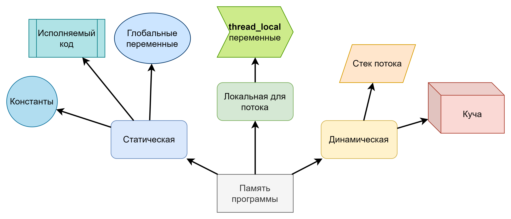

##### Как было в С

С определяет достаточно скудный, но в тоже время и выразительный API управления динамической памятью:

* `malloc()` \- получить блок динамической памяти, заданной длины (аллоцировать).  
* `free()` \- вернуть блок динамической памяти.  
* `aligned_alloc()` \- получить блок динамической памяти, заданной длины с учетом заданного выравнивания.  
* `calloc()` \- получить блок динамической памяти, заданной длины, в заведомо известном состоянии.  
* `realloc()` \- попробовать изменить размер полученного блока.

Данный интерфейс продолжать быть доступным в C++. Также множество реализаций рантайма C++  продолжают полагаться на данный интерфейс, при получении памяти.  
Систему, которая реализует функции работы с динамической памятью в С, называют *глобальным аллокатором кучи*. Данная система представляется стандартной библиотекой С, однако ее можно заменить на стороннюю библиотеку (`dlmalloc`, `tmalloc`), например в задачах:

* Отладки утечек памяти.  
* Профилирования аллокаций.  
* Тонкой настройки потребления памяти.

В задачи глобального аллокатора кучи входит:

* Обработка запросов выделения блоков памяти от пользователя.  
* Запрос памяти от ОС и возврат памяти в ОС или окружение (для встраиваемых систем).  
* Решение задач оптимизации выделений памяти.

##### Динамическая память в C++

С точки зрения языка C++ стек и куча являются **деталями реализации компилятора** для конкретной платформы. Так например в некоторых ARM процессорах доступно два стека, один для последовательности возврата, а другой для локальных данных. Поэтому говорить о том где конкретно располагается хранилище для переменной в динамической памяти не корректно, так как это зависит от реализации и стандарт C++ это не определяет.  
Однако в C++ определены два класса времени существования хранилища переменной *автоматический* и *динамический*. С высокой уверенностью можно говорить, что для большинства реализаций компиляторов C++, переменная, имеющая автоматический класс хранилища \- будет размещена в стековой памяти, а переменная, имеющая динамический класс хранилища \- будет размещена в памяти кучи.  
По аналогии с С, C++ имеет свой *глобальный аллокатор динамической памяти*, однако он соответствует совершенно другим требованиям, о которых мы поговорим позже и открывает другой набор возможностей.

## Управление памятью в библиотеке в стиле С

Так как в C++ продолжают быть доступны функции работы с памятью в стиле С, и продолжается совместимость с библиотеками на языке С, то со временем сложилась практика передачи пользовательских предпочтений по работе с память. Можно выделить следующие стили:

1. Управление глобальным аллокатором С \- никаких специальных действий по передаче управления выделением памяти не производится, вся память продолжает обрабатываться через `malloc()` \+ `free()`.  
2. Управление в стиле С \- поговорим далее.  
3. Управление глобальным аллокатором C++ \- никаких специальных действий по передаче управления выделением памяти не производится, вся память продолжает обрабатываться через операторы `new` \+ `delete`.  
4. Структуры данных, знающие об аллокаторах \- поговорим позже в этой главе.  
5. Полиморфная аллокация \- поговорим позже в этой главе.

Первый способ свойственен библиотекам на чистом С, но он сильно ограничивает область применения библиотеки, так как часто при написании кода на С ожидается большая вовлеченность в ручное управление памятью.  
Второй способ \- наиболее распространенный для С библиотек и, того что называется *С обертками*.  

> [!TIP]
> *С обертки* это библиотеки, которые могут быть написаны на произвольном языке программирования, но они предоставляют С совместимый интерфейс обертку.  

В его рамках в библиотеку при инициализации сессии или при каждом вызове может быть передан указатель на структуру, содержащую как правила указатели на функции, с сигнатурами, соответствующими `malloc()` / `free()`, а, часто, и другим функциям из С интерфейса управления динамической памятью. Данная структура и определяет своим содержанием набор операций по работе с динамической памятью.

```c++
struct MyLibraryAllocator {
  void* (*alloc)(size_t);
  void (*free)(void*);
};

int my_library_init(const MyLibraryAllocator* allocator);

int main() {
  static const MyLibraryAllocator globalAllocator = {
    .alloc = std::malloc,
    .free = std::free,
  };
  my_library_init(&globalAllocator);
  // Код программы
}
```

## Управление сырой памятью в C++

В C++ представлены два подхода к управлению динамической памятью, а если точнее то динамическим хранилищем и временем жизни объектов в данном хранилище. Один подход реализован на уровне синтаксиса и семантики C++, другой на уровне стандартной библиотеки. Первый подход называется *управлением сырой памятью* и реализуется с помощью использования выражений `new` и `delete`.  
*Управление сырой памятью* или *сырое управление памятью* является в современном C++ скоре анти-паттерном разработки, так как второй способ позволяет избежать множества ошибок, возникающих при управлении сырой памятью.

##### Псевдонимы типов и типы связанные с работой с памятью

Как мы уже выяснили ранее, приведение указателя на объект через оператор `reinterpret_cast` к указателю на `char`, `unsigned char`, `std::byte` дает возможность инспектировать байтовое представление объекта в границах `sizeof(obj)`. Данная возможность как раз обусловлена семантикой разделения понятия *объекта*, его *времени жизни* и *хранилища объекта*, так как позволяет заглянуть и проинспектировать содержимое хранилища объекта.  
Вы могли уже не раз наблюдать, что в C++ принято использовать псевдонимы типов при работе с элементами стандартной библиотеки и даже семантикой языка. Наиболее популярными и часто используемыми в данном разрезе типами являются:

* Псевдонимы числовых типов с гарантированной длинной `std::int*_t` и `std::uint*_t`, где `*` выражает минимальное число бит, которые должны помещаться в типе (8, 16, 32, 64, 128).  
* Псевдонимы числовых типов размеров `std::size_t` и `std::ssize_t` используются очень часто для обозначение беззнакового размера или знакового размера чего либо, например оператор `sizeof` возвращает значение типа `std::size_t`.  
* `std::byte` \- новинка C++17 для инспектирования памяти объекта, хороша тем что не допускает арифметических операций, в отличии от `unsigned char`.

Также стоит упомянуть о части стандартной библиотеки `std::numeric_limits`, которая предоставляет данные о разнообразных константах для числовых типов, например минимальное и максимальное значение, минимальный инкремент для типов с плавающей точкой и т.д.

### Выражения new и delete

В индустриальной практике необходимость работать напрямую с выражениями `new` и `delete` возникает крайне редко. Однако при прохождении собеседований вопросы на данную тему задаются часто. Следуя данному тренду мы также разделим данную главу на две части \- вопросы, которые полезны для общей эрудиции и задаются на собеседованиях, и вопросы, которые применимы на практике.

#### Дизайн семантики управления сырой памятью

В данном блоке собраны общие элементы дизайна механизма управления сырой памятью в C++. Основными элементами дизайна являются:

* Работа с сырой памятью в C++ организована через выражения `new` и `delete`.  
* Выражение `new` аллоцирует хранилище и создает объект в нем, для этих целей выражение `new` содержит в своем синтаксисе *инициализатор объекта*, который семантически означает то же, что и *инициализатор переменной*.  
* Выражение `delete` вызывает деструктор объекта, в этот момент вполне возможен полиморфный вызов деструктора, и возвращает хранилище обратно.  
* Формально выражение `delete` содержит две формы `delete` для удаления единичных объектов и `delete[]` для удаление С массивов объектов, почему так рассказано следующем разделе.  
* Выделение памяти выражением `new` происходит через `operator new()`, а освобождение памяти выражением `delete` происходит через `operator delete()`.  
* Для пользовательских типов есть возможность перегружать `operator new()` и `operator delete()` определяя тем самым свой источник хранилищ.

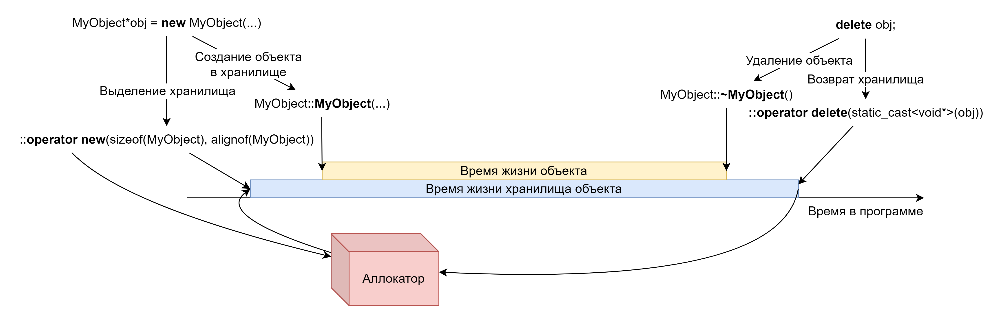

#### Общая эрудиция в отношении управления сырой памятью

##### Алгоритм работы выражений new и new[]

Данные выражения работают следующим образом:

1. Осуществляется поиск функции аллокации `operator new()` и деаллокации `operator delete()`, при этом в форме выражения `::new` перегрузки для типа игнорируются.  
2. Вызывается найденная функция аллокации `operator new()`.  
3. Если не удалось аллоцировать память, а выражение `new` не является не бросающим вариантом, то:  
   1. Выбрасывается исключение `std::bad_alloc`.  
   2. Иначе, если выражение new является не бросающим вариантом, возвращается `nullptr`  
4. Объект конструируется согласно инициализатору  
5. Если при конструировании объекта выбрасывается исключение, то:  
   1. Вызывается функция деаллокации `operator delete()`

```c++
class MyClass {
  // Определения
};

// Код программиста
MyClass *object = new MyClass(/* параметры */);

// Генерируемый компилятором код
void * _object_123_storage = ::operator new(sizeof(MyClass), alignof(MyClass));
try {
  MyClass::MyClass(_object_123_storage, /* параметры */)
} catch (...) {
  ::operator delete(_object_123_storage, sizeof(MyClass), alignof(MyClass));
  // Переброс текущего исключения
  throw;
}
MyClass *object = reinterpret_cast<MyClass*>(_object_123_storage);
```

Тут нужно отметить момент про инициализацию массивов. За исключением явного вылета исключения из `noexcept` функции или функции `main()`, будут вызваны деструкторы всех объектов, элементов массива, которые уже успели сконструироваться.  
При аллокации одного объекта деструктор вызван не будет, так как объект еще не начал время своей жизни.

###### Уловка выделения хранилища выражением new

В C++ определено два неочевидных поведения при работе с динамической памятью:

* Компилятор может объединять вызовы `operator new()` для разных выражений new, если выбранные `operator new()` и `operator delete()` являются стандартными глобальными функциями.  
* Компилятор может запрашивать дополнительное место в хранилище (более чем `sizeof(T)`) для:  
  * Помещения туда информации, определяемой реализацией, или  
  * Выравнивания объекта в хранилище.

```c++
class MyClass {
  // Определения
};

// Код программиста
MyClass *array = new MyClass[10];

// Генерируемый компилятором код
size_t _array_552_implementation_defined_space = ...;
void *_array_552_storage = ::operator new(sizeof(MyClass) * 10
  + _array_552_implementation_defined_space, alignof(MyClass));
size_t _array_552_constructed = 0;
void *_array_552_begin;
try {
  _array_552_begin = _array_552_storage = __init_implementation_data(_array_552_storage);
  for (std::size_t i{0}; i < 10; ++i, ++_array_552_constructed) {
    MyClass::MyClass(_array_552_storage);
    _array_552_storage += sizeof(MyClass);
  }
} catch (...) {
  // Разрушение объектов в порядке, обратном их конструированию
  for (std::size_t i{_array_552_constructed}; i != 0; --i) {
    _array_552_storage -= sizeof(MyClass);
    try {
      reinterpret_cast<MyClass*>(_array_552_storage)->~MyClass();
    } catch (...) {
      std::terminate();
    }
  }
  ::operator delete[](_array_552_begin - _array_552_implementation_defined_space);
  throw;
}
MyClass *array = reinterpret_cast<MyClass*>(_array_552_begin);
```

##### Алгоритм работы выражений delete и delete[]

Данные выражения выполняют два действия:

1. Вызывают деструктор для одного объекта (`delete`), или деструкторы массива объектов (`delete[]`), а затем  
2. Возвращают память через `operator delete()`.

С данным выражением легко ошибиться и вызвать `delete` для С массива объектов. Данное действие легко приводит к утечке ресурсов, так как не будут вызваны деструкторы для всех объектов в массиве.

```c++
class MyClass {
  // Определения
};
MyClass *object = new MyClass(/* параметры */);
// ... использование объекта

// Код программиста
delete object;

// Генерируемый компилятором код
try {
  object->~MyClass();
} catch (...) {
  std::terminate();
}
::operator delete(object, sizeof(MyClass), alignof(MyClass));
```

##### Виды operator new() и operator delete()

Выражение `new` имеет две формы *обычную* и *размещающую*. В случае второй в вызываемые `operator new()` и `operator delete()` можно передать дополнительные параметры.  
Почти все виды `operator new()` и `operator delete()` встречаются в комбинациях набора аргументов размера и/или указателя, значения выравнивания.  
Существуют следующие виды `operator new()` и `operator delete()`:

* Замещаемые \- определяют стандартный аллокатор C++, с интерфейсом выбрасывания `std::bad_alloc` при отсутствии памяти.  
* Замещаемые не бросающие \- определяют стандартный аллокатор C++, с интерфейсом возврата `nullptr` при отсутствии памяти.  
* Не аллоцирующие размещающие \- делают ничего, позволяя *размещать объект в хранилище*.  
* Размещающие с набором аргумент \- позволяют вызывать свои глобальные функции аллокации / деаллокации.  
* Перегрузка для класса \- позволяют перегрузить выделение и возврат памяти для всех объектов конкретного класса.  
* Неразрушающий `operator delete()` \- нужен для указания, что деструктор данного класса всегда вызывается явно.

##### Перегрузка operator new() и operator delete() в пользовательских типах данных

Данная перегрузка встречается редко, и используется в идиоме запрета создания объекта в куче.

###### Идиома запрета создания объекта в куче

Реализуется путем пометки `operator new()` и `operator delete()` для пользовательского типа данных как удаленных `= delete`. При этом в точке вызова выражения `new` возникнет ошибка компиляции.

```c++
class MyObject {
private:
  // Определяем в private секции, чтобы не было доступа из-вне класса и его friend
  void* operator new(std::size_t);
  void* operator new[](std::size_t);
  void operator delete(void*);
  void operator delete[](void*);
  // Добавляем "= delete", если вообще никому нельзя создавать объект в куче
};
```

###### Идиома запрета создания объекта в стеке

Идиома, парная предыдущей. Она использует комбинацию приватного или защищенного конструктора и статического метода, возвращающего сырой или умный указатель на объект.

```c++
class MyClass {
protected:
  MyClass(/* параметры */);
public:
  static MyClass* create(/* параметры */);
  friend MyClass* createMyClass(/* параметры */);
};
```

##### Изменение глобального аллокатора памяти C++

Для изменения глобального аллокатора достаточно в своей программе определить глобальные функции перегрузки `operator new()` и `operator delete()` с сигнатурами замещаемых и, при желании, с сигнатурами замещаемых не бросающих. Так все аллокации памяти в программе будут проходить через данные функции.  
Так крайне не рекомендуется делать в библиотеках.

#### Элементы управления сырой памятью важные на практике

##### Безопасность от выстрела в ногу

Выражение `delete` принимает значение `nullptr` при этом не проводя вызова деструктора или деаллокации памяти.

##### Размещающее выражение аллокации

При использовании управления сырой памятью иногда возникает необходимость создать объект в уже имеющемся хранилище, например в выровненном массиве `char`. Для решения данной задачи используют размещающий вариант выражения new, первым аргументом и единственным аргументом которого выступает указатель на хранилище. При этом C++ возвращает данный указатель не тронутым из `operator new()`.

```c++
alignas(MyClass) storage[sizeof(MyClass)] = {};

// Код программиста
MyClass *object = new (storage) MyClass(/* параметры */);
// Использование object
// !ТРЕБУЕТСЯ - явный вызов деструктора
object->~MyClass();

// Генерируемый компилятором код
try {
  MyClass::MyClass(storage, /* параметры */)
} catch (...) {
  // Неразрушающий operator delete()
  ::operator delete(_object_storage_123, _object_storage_123);
  // Переброс текущего исключения
  throw;
}
MyClass *object = reinterpret_cast<MyClass*>(_object_storage_123);
// ...
```

##### Не бросающий вариант выражения new

В среде без исключений или в коде без исключений для упрощения аллокаций используется размещающий вариант выражения `new` первым, и единственным, аргументом которого является значение `std::nothrow`. В таком случае вместо выброса исключения при недостатке памяти в глобальном аллокаторе вместо исключения выражения `new` вернет `nullptr`.

```c++
class MyClass {
  // Определения
};
MyClass *object = new (std::nothrow) MyClass(/* параметры */);
if (object == nullptr) {
  // Обработка ошибки выделения памяти
}
```

##### Вариант выражения new с произвольным набором аргументов

Вариант размещающего выражения `new` с произвольным набором аргументов часто используются в библиотеках отладочной аллокации, где `new` определяется как макрос, раскрывающийся в коде в выражения `new` с произвольным набором аргументов. Аргументами обычно являются параметры точки исходного кода.

```c++
// debug_new.hpp
#define new new (__FILE__, __LINE__)
// Определяем отладочный operator new()
void* operator new(const char* file, int line, std::size_t size, std::size_t align);

// MyClass.cpp
#include <debug_new.hpp>

class MyClass {
  // Определения
};

MyClass *object = new MyClass(/* параметры */);
// Раскрывается в: MyClass *object = new (__FILE__, __LINE__) MyClass(/* параметры */);
// Вызывает: ::operator new(__FILE__, __LINE__, sizeof(MyClass), alignof(MyClass));
```

## Управление динамической памятью с использованием умных указателей

Умными указателями называют объекты пользовательских типов данных, реализующие интерфейс указателя (pointer-like), при этом семантика таких классов выражает стратегию владения временем жизни объекта, находящегося в динамической памяти под управлением умного указателя.  
Стандартная библиотека C++ предоставляет несколько видов умных указателей, но все они основаны на идиоме RAII.

### Идиома RAII

RAII \- Resource Acquisition Is Initialization, это широко используемый в C++ принцип, при котором **время жизни объекта** напрямую связывается с **временем владения каким-либо ресурсом**. Ресурсом может быть файловый дескриптор, объект в динамической памяти, сокет и т.д. Связь же времени жизни и владения происходит за счет:

* Инициализации ресурса в конструкторе объекта, реализующего RAII.  
  * Например открытие файла или выделение сырой памяти.  
* Деинициализации ресурса в деструкторе того же объекта.  
  * Закрытие файла и возврат сырой памяти.

```c++
class RaiiClass {
public:
  // Инициализация в конструкторе
  RaiiClass(std::string s) {
    resource = open(s);
  }
  int getResource() { return resource; }
  // Деинициализация в деструкторе
  ~RaiiClass() {
    if (resource != INVALID_RESOURCE) {
      close( resource);
    }
  }
private:
  int resource;
};
```

Хорошим примером таких объектов выступают классы из части библиотеки Boost **boost::scope**.

### Умные указатели

Умные указатели \- это *RAII объекты*, выражающие определенную семантику владения объектом в динамической памяти. Всего в стандартной библиотеке предоставляются следующие виды умных указателей:

* `std::unique_ptr`  
* `std::shared_ptr`  
* `std::weak_ptr`  
* `std::inout_ptr_t`  
* `std::out_ptr_t`

Также в C++98 был `std::auto_ptr`. Данный класс выражает тоже, что и `std::unique_ptr`. Он был удален из стандартной библиотеки в C++11.

#### std::unique_ptr

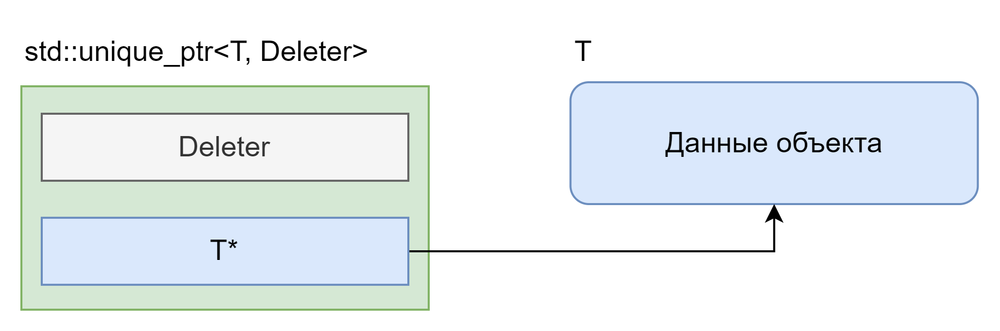

Данный умный указатель выражает *семантику эксклюзивного владения* объектом и его хранилищем. Особенностями дизайна данного класса являются:

* Является зануляемым, с явным освобождением хранимого объекта.  
* Является *типом, похожим на буль* (*booleany тип*).  
* Является *типом, похожим на указатель* (*pointer-like тип*).  
* Является не копируемым объектом.  
* Объект, который отвечает за удаление хранимого указателя, называется *делитер*, можно передавать в конструкторе, а его тип, определяется типом шаблонного параметра. Так что два `std::unique_ptr` с разными типами делитеров \- это разные типы. По умолчанию используется `std::default_delete` который вызывает выражение `delete` на хранимом указателе.  
  * Переопределение делитера часто используется на практике для превращения `std::unique_ptr` в держатель произвольного ресурса, а не только указателя.  
* Обладает возможностью вернуть сырой указатель из\-под владения с использованием метода `release()`.  
* Имеет специализацию для управления массивом объектов, для которой определен `operator[]`. Таким образом `std::unique_ptr` можно использовать как полную замену С указателям.  
* Работает как *полиморфный указатель* \- т.е. `std::unique_ptr` на базовый класс можно сконструировать из `std::unique_ptr` на класс наследник.  
* Предлагается статическая функция `std::make_unique`. Она часто используется вместо вызова конструктора `std::unique_ptr` так как сокращает написание кода.

```c++
class MyClass {
  // Определения
};
// Тип MyClass пишется в выражении два раза
auto from_constructor = std::unique_ptr<MyClass>(new MyClass(/* параметры */));
// Тип MyClass пишется один раз в выражении
auto from_make_function = std::make_unique<MyClass>(/* параметры */);
```

##### Идиома std::unique_ptr как держатель ресурса

Обычно выражается в кодовых базах в том, что программисты, где это возможно, не пишут собственные RAII обертки, а используют `std::unique_ptr`.

```c++
extern "C" int open();
extern "C" void close(int);

// Трюк с хранением держателя ресурса внутри std::unique_ptr
union MyResourceStorage {
  int resource;
  void* ptr_storage;
};

void resource_close(void* resource) {
  MyResourceStorage r{resource};
  close(r.resource);
}

using Resource = std::unique_ptr<void*, decltype(&resource_close)>;

Resource resource_open() {
  MyResourceStorage r{open()};
  return Resource{r.ptr_storage, &resource_close};
}
```

#### std::shared_ptr + std::weak_ptr

Данные два указателя обычно работают в паре при этом каждый используется в своем наборе случаев.

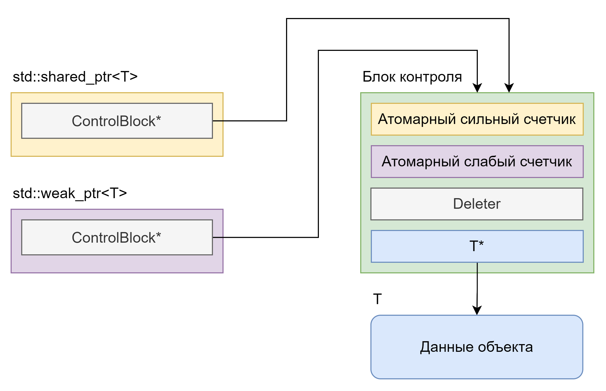

##### std::shared_ptr

Данный умный указатель выражает *идиому владения временем жизни объекта через атомарный подсчет ссылок* на объект. Данная идиома, это вариант *идиомы подсчета ссылок*, для которой **безопасно межпоточное удаление объекта**. Это означает, что при удалении всех экземпляров `std::shared_ptr` ссылающихся на данный объект даже конкурентно из нескольких потоков **объект будет освобожден только один раз**.  
Альтернативой данному указателю для не атомарного подсчета ссылок можно считать `boost::smart_ptr::intrusive_ref_counter` из библиотеки Boost.  
Особенностями дизайна данного класса являются:

* Является *типом, похожим на буль* (*booleany тип*).  
* Является *типом, похожим на указатель* (*pointer-like тип*).  
* Реализация данного класса подразумевает два объекта, расположенных в динамической памяти, контрольный блок и управляемый объект.  
  * Контрольный блок содержит атомарные счетчики ссылок и делитер, который контролирует удаление объекта.  
* Данный класс может адаптировать объект из уникального владения по указателю или `std::unique_ptr`.  
* Предоставляется статическая функция `std::make_shared`, которая сразу создает блок управления и управляемый объект используя только одну аллокацию.  
  * Это удобно когда мы используем только `std::shared_ptr`.  
  * На такой объект не удобно брать `std::weak_ptr`, так как при удалении последнего `std::shared_ptr` деструктор хранимого объекта будет вызван, а память под сам объект **не будет освобождена**, что иногда не является желаемым поведением.
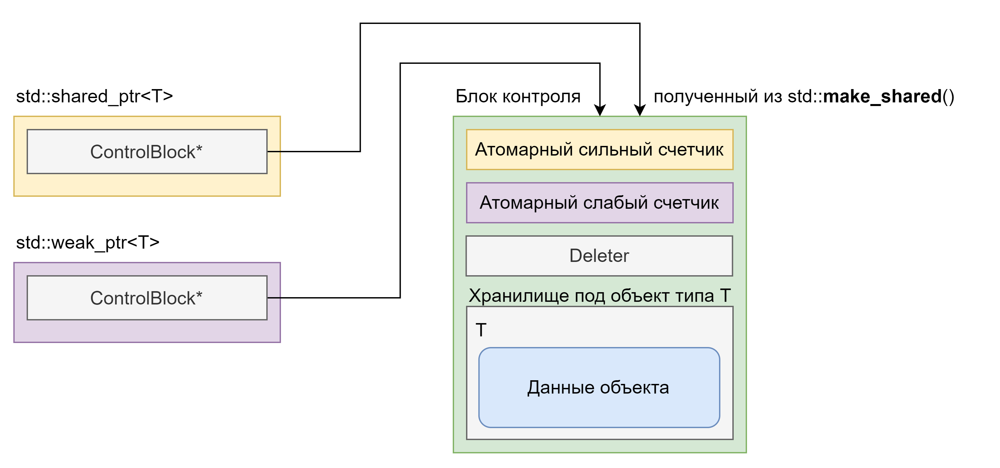
* Уникальной возможностью данного указателя является функция *присоединения к блоку*. Она реализован за счет того, что при конструировании `std::shared_ptr` принимает адаптируемый блок или произвольный указатель. Таким образом можно создавать `std::shared_ptr` на члены данные не прибегая к их хранению в отдельных блоках памяти с отдельными контрольными блоками, а использовать контрольный блок основного агрегирующего класса.
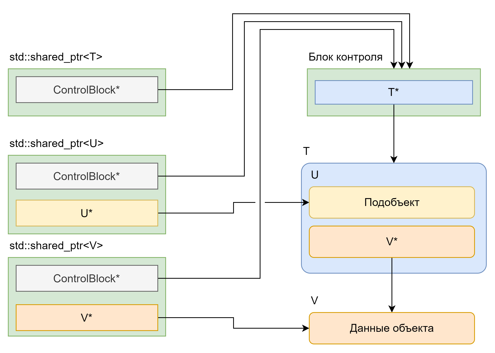
* Работает как *полиморфный указатель*.  
* Предоставляются специальные статические функции `std::*_pointer_cast` для получения результата выполнения соответствующих выражений приведения на указателе, которым владеет `std::shared_ptr`.  
* Для пользовательских типов данных предоставляется возможность указать, что такой тип поддерживает конструирование с управляющим блоком. Для этого нужно публично наследоваться от `std::enable_shared_from_this<имя пользовательского типа>`.  
  * Такому типу будут доступны методы для создания нового `std::shared_ptr` на себя самого. Это бывает очень полезно в сложных доменных областях.  
  * Однако, нужно быть очень осторожным и не вызывать данные методы, если объект не был сконструирован с блоком контроля с использованием `std::make_shared`, так как это приведет к исключению `std::bad_weak_ptr`.
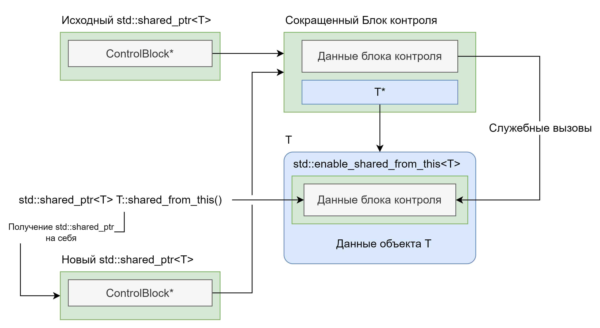

Данным указателем пользуются очень часто, однако это может привести к замедлению старта приложения, а также к *проблеме циклических ссылок*. Данная проблема проявляется в виде утечки памяти при наличии цикла владения объектов. Например если для реализации двунаправленного списка использовать `std::shared_ptr`. Бороться с данной проблемой призван `std::weak_ptr`.

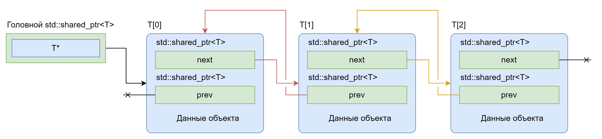

Цикл образуется из-за: `T[0].next -> T[1] && T[1].prev -> T[0]` и `T[1].next -> T[2] && T[2].prev -> T[1]`. При удалении головного `std::shared_ptr` циклы ссылок не дают опуститься счетчикам ссылок до нуля.

##### std::weak_ptr

Это особый тип указателя, который выражает слабое владение по счетчику ссылок. Слабое владение можно повысить по сильного, получив `std::shared_ptr` из `std::weak_ptr` методом `lock()`, однако только пока объект не уничтожен, т.е. есть хотя бы один живой `std::shared_ptr` на данный объект.  
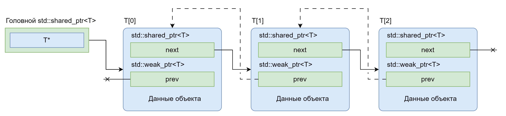
В рамках реализации C++ концепции сильного и слабого владения выражаются в наличии двух счетчиков ссылок в контрольном блоке: один для количества взятых на объект `std::shared_ptr` другой для количества взятых на объект `std::weak_ptr`. Первый отвечает за время жизни объекта. Т.е. за вызов его деструктора (или вызов делитера объекта). А первый и второй вместе за время жизни контрольного блока.
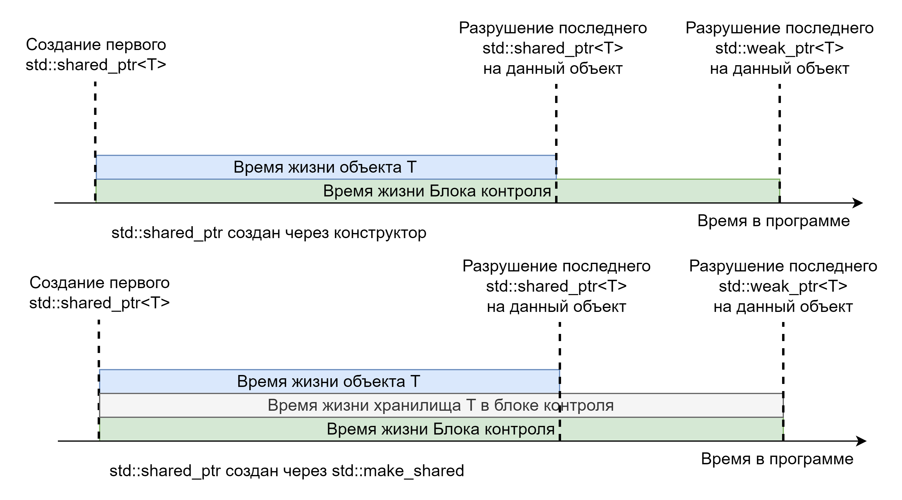

#### Обертки для С функций (C++23)

Последние два умных указателя предложены для взаимодействия с типичным методом реализации ссылочности в С, а именно для параметров, принимающих тип указателя на указатель. Такие параметры обычно используются как только для:

1. Вывода значения \- когда функция будет аллоцировать память и передаст ее в некоторый внешний указатель. Для данного варианта использования подходит `std::out_ptr_t` он оборачивает ссылку на объект `std::unique_ptr` и назначает ему указатель, присвоенный в С функции.  
2. Ввода и вывода значения \- когда функция будет и принимать что-то по указателю и может изменить объект, на который указывает внешний указатель. Для данного варианта использования подходит `std::inout_ptr_t`. Он также оборачивает `std::unique_ptr` давая возможность корректно прочитать и записать в него значение из С.

```c++
// С интерфейс должен оперировать указателями
extern "C" void close(int* value);
extern "C" int open(int** out);
extern "C" int reopen(int** in_out);

std::unique_ptr<int, decltype(&::close)> resource{nullptr, &close};
if (open(std::out_ptr(resource)) != ERR_OK) {
  // Обработка ошибки
}
// resource хранит объект int*
if (reopen(std::inout_ptr(resource)) != ERR_OK) {
  // Обработка ошибки
}
// resource отдал предыдущий объект int* и получил новый
```

### Фабрики и умные указатели

На интервью можно услышать такой вопрос: *Какой умный указатель лучше всего возвращать из фабрики?*  
Тут можно дать такой ответ: В большинстве случаев \- `std::unique_ptr`, так как фабрика может поддерживать кастомный аллокатор для объекта и создавать из него делитер, а `std::shared_ptr` далее сможет адаптировать такой указатель для изменения типа владения объектом. Однако, для проектов, в которых сильно распространено использование `std::shared_ptr` лучше придерживаться единообразного подхода и возвращать также `std::shared_ptr`.

## Интерфейс аллокатора в C++

Для целей создания стандартной библиотеки в стандарте C++ предложен именованный набор требований `Allocator` (Аллокатор).  
> [!TIP]
> В стандарте C++ есть три вида описателей концепций: *именованные требования (named requirement)*, *концепты* и *концепты только для представления (exposition-only)*.  
> Все три сущности задают некоторые правила, которых определенные сущности языка должны придерживаться. Именованные требования являются самым старым способом и более не используются (не добавляются новые). Концепты же добавляются часто.

Аллокатор выражает собой три пары операций:
* Доступ к объекту и взятие адреса.  
* Выделение и возврат хранилища под объекты \- методы `allocate()` / `deallocate()`.  
* Создание и разрушение объекта \- методы `construct()` / `destroy()`.

##### Места применения

Аллокатор используется в коде, который не хочет обременять себя вопросами управления хранилищем и созданием объектов и дает пользователю переопределять подход к данным действиям. С точки зрения программиста можно как писать пользовательские типы, использующие Аллокатор, обычно их называют *осведомленными об Аллокаторе* (allocator aware), так и собственные имплементации аллокаторов для использования в *allocator aware* типах.  
В стандартной библиотеке C++ аллокатором пользуются:

* Контейнеры.  
* Класс строки.  
* `std::allocate_shared` и `boost::allocate_unique` \- для создания объекта, который управляется `std::shared_ptr` или `std::unique_ptr` с использованием аллокатора.  
* `std::make_obj_using_allocator` / `std::uninitialized_construct_using_allocator` \- данные функции вызывают конструкторы объектов, согласно договоренностям о передаче аллокаторов \- не передается / передается первым аргументом / передается последним аргументом.

##### Элементы дизайна

Выдающимися элементом дизайна для Аллокатора является наличие методов и типов, позволяющих определить поведение при копировании, перемещении, и обмене значениями объекта, использующего Аллокатор. В данный интерфейс входят:

* `operator==()` \- должен возвращать `true` только если первый экземпляр Аллокатора может удалить хранилище, выделенное вторым экземпляром аллокатора и наоборот.  
* `is_always_equal` \- член тип, который определяется как `std::true_type` если, `operator==()` всегда возвращает `true`,иначе должен быть `std::false_type`.  
* `select_on_container_copy_construction()` \- метод, предоставляющий копию данного экземпляра Аллокатора для нового экземпляра использующего Аллокатор класса при вызове конструктора копирования.  
* `propagate_on_container_copy_assignment`/`propagate_on_container_move_assignment`/`propagate_on_container_swap` \- член тип, который определяется как `std::true_type` или `std::false_type` в зависимости от того требуется ли экземпляр Аллокатора копировать при присваивании с копированием / перемещать при присваивании с перемещением / обменивать значения при обмене.  
* Метафункция `rebind<U>::other` \- используется для получения Аллокатора другого типа относительно переданного. Является примером идиомы *обертка метафункции* из главы 6.

Также Аллокаторы определяют тип указателя на объект. Как правило Аллокаторы бывают двух видов *с состоянием* и *без состояния*. Вторые обычно можно использовать как пустой базовый класс, применяя *идиому сжатой пары* и *оптимизацию пустого базового класса*. На то, что Аллокатор является аллокатором без состояния явно указывает член тип `is_always_equal`.  

> [!NOTE]
> `std::true_type` и `std::false_type` являются удобными классами, предоставляющими константный статический член данных типа `bool` с соответствующим значением. Эти типы часто используются в метапрограммировании. Мы поговорим об этом, а также о роли *метафункций*, подробнее в главе 6.  

Для использования Аллокатора на практике лучше всего не пользоваться самим интерфейсом объекта аллокатора, а использовать класс обертку `std::allocator_traits` дополняющую возможные недостающие члены типы из реализации Аллокатора.

##### Идиома красивых указателей (fancy pointers)

Данная идиома может реализовываться с использованием имплементаций аллокатора. Для ее реализации требуется определить тип указателя в аллокаторе как некоторый *pointer-like* объект. Так часто делают, например для экономии места, если аллокатор оперирует на буфере известной длины, то все указатели можно представить числами сдвига в данном буфере.  
Такая же логика применима в ситуации использования механизма IPC (Inter-Process Communication) общая память (shared memory). Так как общая память в разных процессах находится по разным абсолютным адресам, то и указатели в ней должны быть не абсолютными, а сдвигами относительно адреса начала блока общей памяти. Такие указатели например реализованы в библиотеке Boost как `boost::interprocess::offset_ptr`.

```c++
template<class T>
class IpcAllocator {
public:
  // fancy-pointer
  using pointer = ipc::offset_ptr<T>;
private:
  void* shared_memory_start;
};

template<class T>
using IpcAllocatorTraits = std::allocator_traits<IpcAllocator<T>>;

IpcAllocator<MyClass> al{init_shared_memory()};
// Выделение хранилища под объект
ipc::offset_ptr<MyClass> object = IpcAllocatorTraits<MyClass>::allocate(al, 1);
// Конструирование объекта
IpcAllocatorTraits<MyClass>::construct(al, object.get(), /* параметры */);
```

##### Функции помощники при реализации аллокатора

Стандартная библиотека определяет следующие функции, которые часто требуются для создания своего аллокатора:

* `std::to_address()` \- позволяет получить сырой указатель из *pointer-like типов*.  
* `std::addressof()` \- позволяет получить адрес объекта, даже если у него перегружен оператор взятия адреса `operator&()`.  
* `std::align()` \- позволяет корректно находить место для объекта в хранилище, согласно его размеру и требованию к выравниванию.

### Готовые реализации аллокаторов в стандартной библиотеке

В стандартной библиотеке C++ уже предоставляются три реализации Аллокатора, каждая для своих нужд.

#### std::allocator

Данный аллокатор используется другими объектами стандартной библиотеки по умолчанию, когда пользователь не предоставил своего аллокатора. Он не имеет состояния, для аллокации использует глобальные `operator new()`, а для возврата глобальный `operator delete()`.  
Данный аллокатор часто используется в качестве базового класса для создания своего аллокатора.

#### std::scoped_allocator_adaptor

Данный аллокатор используется в случае, когда объекты, *знающие об аллокаторах*, вложены друг в друга. Он организует подстановку своего аллокатора, из списка шаблонных аргументов, на каждом уровне вложенности. Это бывает крайне удобно, даже если на каждом уровне вложенности хочется использовать одну и ту же реализацию аллокатор, так как поведение по умолчанию для данного класса, это на больших уровнях вложенности продолжать использовать последний аллокатор в списке шаблонных параметров.

#### std::pmr::polymorphic_allocator

Данный аллокатор отличается от других тем, что он сам не аллоцирует память, а делегирует данное действие и возврат памяти по полиморфному указателю на базовый класс `std::pmr::memory_resource`. Данное поведение позволяет передавать в аллокатор разные типы ресурсов памяти.  
С точки зрения дизайна данная точка расширения переводит типичный дизайн аллокаторов, как элементов типа использующих их объекта (через шаблонный параметр) в полиморфную иерархию. С одной стороны это позволяет единожды реализовать интерфейс аллокатора на стороне стандартной библиотеки, а со стороны программиста реализовывать намного более простой, и главное полиморфный, интерфейс `std::pmr::memory_resource` \- всего три метода `do_allocate()`/`do_deallocate()`/`do_is_equal()`.  
Данный аллокатор в комбинации с некоторыми типами ресурсов памяти очень хорошо подходит для оптимизации потребления памяти в приложениях. Его использование встречается чаще, чем использование собственного аллокатора.

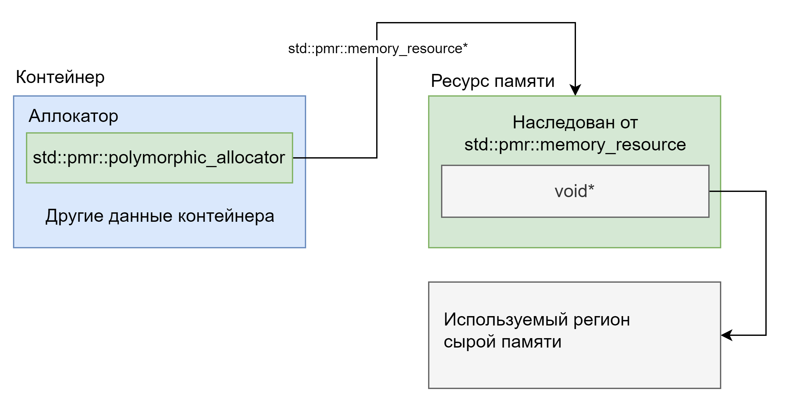

##### Реализации std::pmr::memory_resource в стандартной библиотеке

В стандартной библиотеке C++ предоставляются следующие типы реализации ресурсов памяти:

* `std::pmr::new_delete_resource` \- делегирует работу глобальным операторам `operator new()` / `operator delete()`.  
* `std::pmr::null_memory_resource` \- не может производить выделение памяти, и используется как ограничитель для других ресурсов.  
* `std::pmr::unsynchronized_pool_resource` \- представляет набор блоков памяти разного размера, реализует стратегию подбора минимального необходимого блока под каждое выделение памяти. Принимает в конструкторе ресурс, из которого будут выделяться большие блоки для разбиения по наборам. Предполагает использование только в одном потоке.
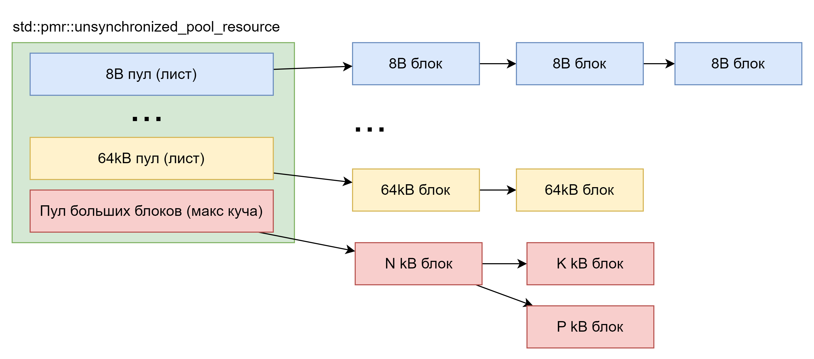
* `std::pmr::synchronized_pool_resource` \- тоже самое, что `std::pmr::unsynchronized_pool_resource`, только безопасен для использования из множества потоков.  
* `std::pmr::monotonic_buffer_resource` \- очень любимый многими ресурс, данный ресурс работает над выданным ему блоком памяти монотонно увеличивая адрес аллокации в блоке, а высвобождение блока происходит только при разрушении ресурса. Если блок переполняется, то данный ресурс делегирует новые запросы в ресурс следующего уровня, обычно это `std::pmr::null_memory_resource` \- если программа не должна выходить за блок памяти, или `std::pmr::new_delete_resource` если такое позволено.
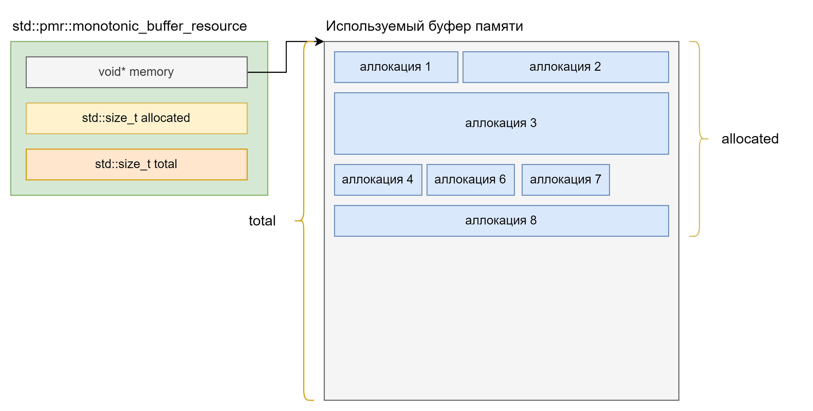

Данный набор ресурсов памяти позволяет реализовывать самые сложные стратегии управления памятью, в том числе и для высокой производительности, например с использованием `std::pmr::monotonic_buffer_resource` и буфера на стеке. Этого можно достичь, за счет того, что для всех ресурсов доступно делегирование к следующему при исчерпании собственной памяти. Следующий ресурс передается через конструктор, что позволяет построить цепочку из ресурсов, делегирующих задачи друг другу.

Например цепочка `std::pmr::monotonic_buffer_resource` + `std::pmr::new_delete_resource` со статическим буфером или буфером в памяти потока, является достойной имплементации стратегии работы с памятью одного HTTP запроса, с условием, что он обрабатывается полностью на одном потоке. Такая стратегия значительно амортизирует накладные расходы на использование динамической памяти для обработки запроса и может подстраивать буфер для `std::pmr::monotonic_buffer_resource` под средние исторические нужды запросов.

## Другие реализации стратегии управления памятью

Во многих приложениях на практике прибегают к реализации более простой стратегии управления динамической памятью, чем более выразительные и мощные парадигмы аллокаторов и полиморфных ресурсов. Данная стратегия называется пул объектов. Она выражается в создании заранее известного количества хранилищ под объекты, которое может расширяться и сужаться со временем.  
Обычно такое хранилище имеет интерфейс `get()`/`put()` для получение и возврата объекта. Хорошая реализация такой стратегии представлена в библиотеке Boost в виде `boost::pool`.

## Алгоритмы работы с хранилищем

Последним элементом стандартной библиотеки который может понадобиться программисту для управления памятью и объектами в ней, являются алгоритмы на хранилищах.  
Они делятся на три типа:

* Алгоритм конструирования `std::construct_at()` реализует размещающий вариант выражения `new`, в том числе применимый в выражениях времени компиляции `constexpr` (в отличии от размещающего `new`, который запрещен в `constexpr` до C++20).  
* Алгоритмы удаления объектов `std::destroy_at()` \- разрушает один объект или С массив, / `std::destroy()` и `std::destroy_n()` \- разрушают набор объектов. Плюсы такие же как у `std::construct_at()`.  
* Алгоритмы неинициализированного хранилища:  
  * `std::uninitialized_copy()` и `std::uninitialized_copy_n()` \- копируют набор объектов и хранилище.  
  * `std::uninitialized_fill()` и `std::uninitialized_fill_n()` \- заполняют хранилище копией объекта.  
  * `std::uninitialized_move()` и `std::uninitialized_move_n()` \- перемещает набор объектов в хранилище.  
  * `std::uninitialized_default_construct()` и `std::uninitialized_default_construct_n()` \- конструирует по умолчанию набор объектов в хранилище.  
  * `std::uninitialized_value_construct()` и `std::uninitialized_value_construct_n()` \- конструирует по значению набор объектов в хранилище.

Данные алгоритмы обычно используются авторами структур данных при их реализации.
