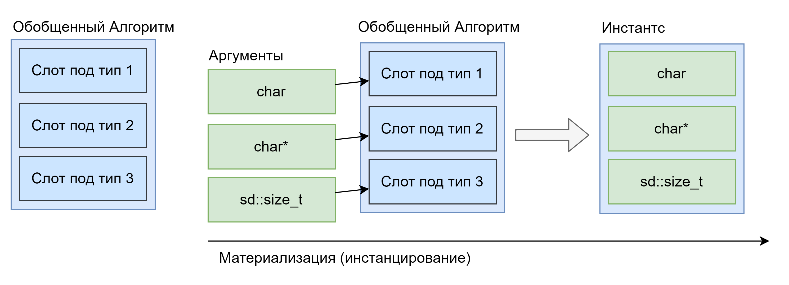
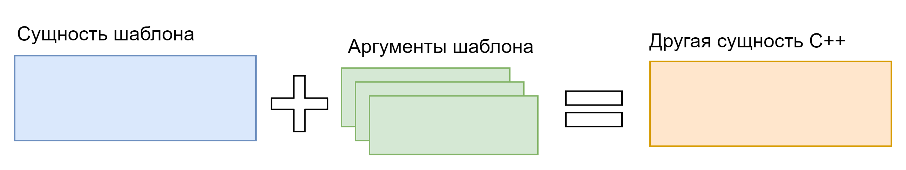
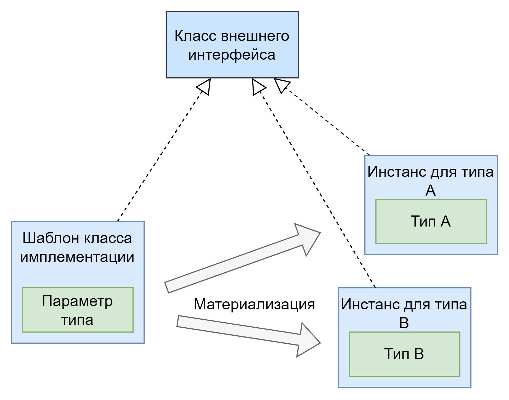

# Глава 6: Шаблоны и Метапрограммирование

Во многих языках программирования находится потребность в реализации полиморфизма несколькими путями, так как некоторый код становится более экспрессивным, поддерживаемым и простым если не стараться использовать везде только один инструмент (проблема “золотого молотка”).  
В данной главе мы поговорим о подходе к реализации обобщенного программирования на C++ под названием шаблоны и метапрограммирование.

## Шаблон как языковое средство

*Обобщенное программирование* выражает стиль написания программ в котором алгоритм исполнения программы пишется без привязывания конкретных типов и не является частью программы пока в ходе сборки программы не выполняется **его материализация**. Для сравнения, обычная функция всегда является материальной и будет присутствовать в конечной программе даже если она никогда не вызывается, такое явление называется *мертвый код* (dead code). Избавления от кода такой функции происходит на этапе оптимизации программы (оптимизация dead code elimination). Материализация обобщенного алгоритма происходит в момент подстановки конкретных типов, этот процесс называют *инстанциацией* или *инстанцированием*.  



Шаблон в C++ это способ реализации обобщенного программирования. В других языках обобщенное программирование реализуется например с использованием `generic` конструкцией языка (сленговое *дженерики*).

### Для каких сущностей можно создать шаблон

Часто можно услышать такие фразы: “этот класс \- шаблонный”, “шаблонный класс”, “это шаблонная функция”. Все они давно прижились в лексиконе программистов на C++, хотя и **не являются корректными** с точки зрения языка, а являются скорее неудачной адаптацией английского языка, и могут сбивать с толку изучающих C++. В C++ **шаблоны являются самостоятельной сущностью**, использовать которую можно с целью получения других сущностей путем *инстанцирования*. По этому мы можем говорить, например, об “определении шаблона для класса” и, по простому, “шаблон класса”.  
В C++ можно определять шаблоны для следующих сущностей:

* Пользовательские типы данных (далее класс / классы),  
* Функций,  
* Псевдонимов,  
* Переменных,  
* Концептов.

### Инстанцирование шаблонов

Шаблоны в C++ явно отличаются от всего другого синтаксиса тем, что имеют дополнительный список аргументов в треугольных скобках `<` `>`, который называется *аргументами шаблона*. В момент инстанцирования в шаблон подставляются его аргументы, многие, но не все, из которых являются типами, и из сущности шаблона создается другая сущность языка (класс, функция, переменная и т.д.).
  
Инстанцирование шаблона может происходить **явно**, и для этого выделен специальный синтаксис, а также **не явно** \- по месту использования шаблона. Первый вариант в основном используется только для управления временем сборки проекта, так как этап инстанцирования шаблонов может занимать значительное время компиляции.  
Второй вариант является намного более популярным. Он настолько удобен, что в типичном проекте можно за всю его жизнь не встретить ни одного явно инстанцированного шаблона.  

```c++
// MyClass.hpp
// Объявление явного инстанцирования
extern template std::vector<MyClass>;

// MyClass.cpp
// Определение явного инстанцирования
template std::vector<MyClass>;
```

Самым простым для понимания вариантом инстанцирования шаблона является использование специального синтаксиса треугольных скобок для перечисления всех аргументов шаблона в точке его использования. Так, например, можно назначить переменной пользовательский тип данных, полученный из шаблона, указав все его шаблонные аргументы или же вызвать функцию, полученную из шаблона, также указав все ее шаблонные аргументы.  
Однако такой способ использования шаблона является слишком многословным, а код, при этом, становится слишком запутанным. Для того, чтобы помочь программисту работать с шаблонами, стандарт C++ требует от компилятора возможности автоматически вывести аргументы шаблона, согласно контексту его использования. Данная возможность называется *дедукцией аргументов шаблона* (TAD, Template Argument Deduction). У нее есть три вида, о которых мы поговорим позже в данной главе.

```c++
template <class T, class U>
auto some_function(T& a, U& b) {
  // Тело функции
}

// Не явное инстанцирование
SomeType c = some_function<std::string, int>(std::string{"hi!"}, 1);
// Не явное инстанцирование с дедукцией аргументов
SomeOtherType d = some_function(std::string{"Hello!"}, 1.0);
// Вывод даст: some_function<std::string, double>
```

## Какое место занимают шаблоны в работе программиста

Вместе с введением шаблонов в C++ стали доступны все три формы полиморфизма:

* Специализированный полиморфизм (ad-hoc polymorphism) \- в варианте перегрузки функций и механизма разрешения имен, о которых мы поговорим в главе 8\.  
* Полиморфизм наследования (subclassing polymorphism) \- через механизм наследования и полиморфных типов указателей и ссылок (глава 3).  
* Параметрический полиморфизм (parametric polymorphism) \- реализуется механизмом шаблонов (данная глава).

Использование шаблонов не является обязательной частью языка. Полиморфизма наследования и даже процедурной парадигмы по отдельности хватит чтобы решить любую задачу. Однако, стоимость такого решения выраженная в человеческом ресурсе для разработки и поддержки может превышать все мыслимые пределы. Мы будем использовать шаблоны не потому, что должны или потому, что их используют все, а поскольку данный подход позволяет сэкономить ресурсы разработки и на практике, в большом количестве случаев, позволяет писать краткий и емкий код.

#### Идиома Утиной типизации

Шаблон в C++ это прежде всего синтаксическая конструкция языка, в отличии например от макросов препроцессора (глава 14), которые к синтаксису C++ отношения не имеют, хотя и способны **генерировать код**. Пока шаблон не инстанцирован он остается синтаксической конструкцией и НЕ присутствует в конечной программе. **На момент определения** шаблон должен быть **синтаксически верным**, а уже в **момент инстанцирования** \- **семантически верным**. Данное правило лучше всего объясняется идиомой *утиной типизации* (duck typing).  
При инстанцировании шаблона его аргументы подставляются во все места их использования в теле шаблона, если семантически такая подстановка является корректной то шаблон создает в программе новую сущность.  

> [!NOTE]
> **Пример**  
> Если бы у шаблона был аргумент типа `Как утка`, а в теле шаблона использовались бы методы `издать_звук()`, `идти()` и `плыть()`. То в такой шаблон можно подставить как тип `Утка`, так и типы `Собака` и `Человек`.  
> Для каждого из представленных типов создается своя сущность, которую выражает шаблон. Однако они все обладают поведением, заложенным в определении шаблона.  

Важным является понимание того, что шаблоны при инстанцировании НЕ генерируют код. Они создают определения сущностей прямо в момент компиляции. Нового C++ кода, записанного в файл с исходным кодом, компилятор не создает, так, как при генерации связанной с рефлексией.

### Список требований к параметрам шаблона и концепты

Как видно из примера выше мы можем подставить в шаблон все, что приведет к его семантической целостности. Однако, нас может не удовлетворять такое поведение C++, так как при написании шаблона мы рассчитывали на какое-то конкретное поведение или свойства его параметров и только семантических проверок может быть недостаточно для подтверждения консистентности верхне уровневой логики работы программы.  
Для решения данной задачи в C++ используются два метода, более старый метод шаблонного метапрограммирования, и новый метод ограничений параметров шаблона. О старом методе мы поговорим позже в данной главе, так как он не потерял свою актуальность для других задач. Новый метод стал возможен благодаря введению синтаксиса выражения `requires`, которое, с точки зрения семантики, предназначено для проверки набора утверждений о параметрах шаблона.  
Из преимуществ нового метода над старым можно выделить два наиболее ярких:

* Требования к параметрам шаблона задаются явным синтаксисом, разобраться в хитросплетении трюков и идиом метапрограммирования программисту среднего уровня было очень затруднительно.  
* Список требований помогает компилятору создавать для пользователя простые и понятные сообщения об ошибках. Для понимания типичная ошибка компиляции в метапрограммирование имеет размер от сотен до тысяч строк, тогда как ошибка из списка требований редко превышает десяток строк.

Для удобства программирования и соблюдения задач модульности кода для набора требований к аргументам шаблона можно задать имя. Такая конструкция языка называется *концептом*.  

```c++
template<class T>
concept Swappable = requires (T& a, T& b) { // Задаём воображаемые параметры
  swap(a, b); // Проверяем что выражение swap(a, b) компилируемо
};

template<class T>
concept Container = requires (T& c) {
  typename T::value_type; // Проверяем что есть вложенный тип value_type
  c.begin(); // Проверяем что выражение c.begin() компилируемо
  c.end();   // Проверяем что выражение c.end() компилируемо
};

// Концепты могут проверять любое константное выражение не только requires
template<class T>
concept CanFitInCacheLine = sizeof(T) < 64 & alignof(T) < 64;
```

Все сказанное можно резюмировать простым определением: наборы требований и концепты являются выражением контракта поведения и свойств для аргументов шаблона.

### Где нужно быть аккуратным при использовании шаблонов

Практика использования шаблонов показала, что все имплементации данного механизма со стороны компиляторов и синтаксис работы с шаблонами страдают набором проблем.

#### Увеличение времени компиляции

Со стороны компилятора обработка инстанцирования шаблонов значительно увеличивает время компиляции, даже с учетом того, что компилятор использует кэш инстанцирования. Объяснение этому обычно лежит в использовании метапрограммирования при написании шаблонов, которое требует множества инстанцирований вспомогательных шаблонов при инстанцировании основного. От разработчиков компиляторов стандартом C++ рекомендуется поддерживать глубину стека инстанцирования не менее `1024`\.  
Данная проблема решается переходом на более новые техники программирования во время исполнения, такие как константное программирование (`constexpr`) и использование списков требований и концептов.  
Другая причина возникновения данной проблемы состоит в крайне большом использовании шаблонов в коде приложения. С данной проблемой можно бороться путем явного инстанцирования шаблонов.

#### Разбухание кода приложения

Данная проблема проявляется в виде увеличения объема кодовых секций и секций статических данных конечного приложения до невероятных объемов, а также увеличением времени линковки программы и объема памяти, требуемой для линковки. В отличии от предыдущей данная проблема вызвана только большим объемом использования шаблонов в кодовой базе, так как при метапрограммировании абсолютное большинство сущностей используются как промежуточные и не попадают в код конечного приложения.  
Кодовые секции увеличиваются так как большое количество общего кода повторяется для многих типов. Секции статических данных увеличиваются из\-за большого количества пользовательских типов данных и их описателей для RTTI.  
К решению данной проблемы можно подступиться двумя путями. Первый путь \- *перевод параметрического полиморфизма в полиморфизм наследования*. Т.е. перенос логики, которую над типами реализуют шаблоны, в логику иерархии классов. Данный подход бывает оправдан и с точки зрения производительности, так как большой объем инструкций процессора в программе приводит к постоянному сбросу кешей инструкций, в результате чего весь код приложения оказывает *холодным* и не эффективно выполняется процессором.  
Второй путь \- реализовать *идиому тонкого шаблона* (thin template). Согласно данной идиоме шаблон разделяют на две части, независимую от параметров и зависимую. Независимую реализуют только один раз (в виде функции, или базового класса) и используют в зависимой части. Это помогает в разы уменьшить объемы генерируемых процессорных инструкций.

#### Линковка сущностей, полученных из шаблонов

Очень важно заметить, что сущности получаемые из шаблонов, являются элементом линковки между юнитами трансляции. А поскольку в каждом юните трансляции шаблон может быть инстанцирован отдельно с одним и тем же набором аргументов то линковщику придется сделать выбор, какую сущность оставить в конечной программе или библиотеке. Обычно неосторожная реализация шаблона (например с использованием макросов в теле шаблона для задач логирования) может привести к тому, что в разных юнитах трансляции будут содержаться похожие, но разные инстанциации одного и того же шаблона. Компилятор и линковщик не несут ответственности за то, какая инстанциация будет выбрана и будет ли выбрана только одна, так как данное поведение программы является *неопределенным*, а сама программа *не согласованной* (ill-formed).

#### Многократное повторение шаблонных выражений

При создании шаблонов часто приходится писать похожие выражения над типами, для того что упростить себе работу были придуманы две идиомы.

##### Идиома типов характеристик (traits types)

Другое название данной идиомы идиома генератора типов (type generator). Данная идиома реализуется с использованием вспомогательного шаблона класса, в котором определяются вложенные типы и функции, которые далее будут использоваться в основном шаблоне, а также там остается код вывода таких типов и функций.

```c++
// Генератор типов для использования в шаблоне контейнера.
// Генерирует реферальные типы из типа значения
template<class T>
struct container_types_trait {
  using value_type = T;
  using pointer_type = std::add_pointer_t<value_type>;
  using const_pointer_type = std::add_pointer_t<std::add_const_t<value_type>>;
  using reference_type = std::add_lvalue_reference_t<value_type>;
  using const_reference_type = std::add_lvalue_reference_t<std::add_const_t<value_type>>;
};
```

##### Идиома определения базового типа

В отличии от имени класса, которое инжектируется в область определения класса и может быть использовано напрямую, без указания шаблонных аргументов, имена базовых классов должны быть указаны полностью, в том числе с шаблонными аргументами, если базовый класс создается из шаблона класса.  
Поскольку использование имени базового класса довольно частая необходимость, согласно данной идиоме в области определения данного класса вводится псевдоним типа на имя базового класса, обычно такой псевдоним носит имя `Base` или `base`.

```c++
template<class A, class B>
class MyClass : public MyLooooooooooongBaseClass<A, const A, B, const B&> {
  // Введение короткого имени базового класса
  using Base = MyLooooooooooongBaseClass<A, const A, B, const B&>;
public:
  MyClass(const A& a) : Base(a) //...
};
```

## Шаблоны C++ на практике

Чтобы максимально эффективно использовать шаблоны C++ нужно не только знать, что по своей сути представляет шаблон, но и набор семантических конструкций, окружающих шаблоны.

### Семантика аргументов шаблона

Аргументами шаблона могут быть:

* Типы. Такой аргумент называется аргументом типа, они будут чаще всего встречаться на практике.  
* Константы структурных типов данных. Такие аргументы часто полезны для шаблонного метапрограммирования, а также для получения размера типа С массива.  
* Имена шаблонов. Данный тип аргументов встречается редко, так как обычно альтернативой становится более простая и устойчивая к ошибкам идиома *обертка метафункции*.

Каждый аргумент шаблона при инстанциации подставляется во все места его использования.

#### Переменное число аргументов шаблона

Помимо одиночных явно указанных аргументов шаблоны могут принимать переменное число аргументов благодаря механизму *пачек параметров шаблона* (parameter packs). Такие шаблоны на сленге называются *вараиадиками* (variadic template).  
Данная возможность была введена в C++11. До этого момента требовалось использовать многословный код перегрузки шаблонов для достижения схожего, но ограниченного по своему объему эффекта.  
Для управления пачкой параметров шаблона в языке используется троеточие (ellipsis). Семантически простое троеточие эквивалентно раскрытию пачки параметров и выражения, ее окружавшего, в список, элементы которого разделены запятыми.  
В C++17 был представлен синтаксис сворачивающих выражений, который позволил применять бинарные операторы к элементам пачки параметров, редуцируя ее до единственного значения.

```c++
template<class T, class ... Args>
void pack_operations(T& value, Args ... args) {
  // Вместо @ можно подставить любой оператор с 2 аргументами
  // Эквивалентно (args1 @ (args2 @ ...(argsN-1 @ argsN)))
  auto right_fold = (args @ ...);
  // Эквивалентно (args1 @ (args2 @ ...(argsN @ value)))
  auto right_fold_with_init = (args @ ... @ value );
  // Эквивалентно((args1 @ args2) @ ...) @ argsN)
  auto left_fold = (... @ args);
  // Эквивалентно ((value @ args1) @ ...) @ argsN)
  auto left_fold_with_init = (value @ ... @ args);
  // Эквивалентно some_variadic_func(argsN, args2, ... , argsN);
  some_variadic_func(args ...); // Распаковка
  // Эквивалентно some_variadic_func(foo<Args1>(args1), ... , foo<ArgsN>(argsN));
  some_variadic_func(foo<Args>(args)...); // Совместная распаковка
}
```

### Дедукция аргументов шаблона

Дедукция аргументов шаблона, это механизм при котором компилятор выводит аргументы шаблона согласно контексту в котором происходит инстанцирование. C++ допускает комбинирование семантики явного указания аргументов шаблона и их дедукции по следующему правилу: пользователь может передать аргументы шаблона, следуя слева направо, остальные аргументы, компилятор будет пытаться дедуцировать.  
Шаблон будет инстанцирован удачно только если все аргументы будут заданы, при этом они могут быть **подставлены пользователем**, **иметь значение по умолчанию** или **является выведенными компилятором**.  
Дедукция аргументов шаблона доступна только для пользовательских типов данных и функций. Для других шаблонов (переменных, псевдонимов и концептов) дедукции нет, а все параметры шаблона должны быть переданы явно пользователем или заданы по умолчанию.

#### Дедукция аргументов шаблона функции (TAD)

Данный вид дедукции наиболее актуален для шаблонов функций, так как его назначение \- вывести аргументы шаблона из значений, переданных как параметры при вызове функции. Однако он также используется и в других контекстах.  
Для функций дедукция производится неявно при вызове функции, или явно, при получении адреса шаблона функции, где переменная имеет тип указателя на функцию, что задает сигнатуру для вывода аргументов шаблона.  
Правила дедукции сами по себе достаточно длинные если их читать или рассказывать. На практике все происходит довольно интуитивно:

* Сравниваются тип значения переданного в функцию и заданный тип аргумента функции.  
* Если тип аргумента функции **описывает** тип переданного значения, то все описатели исключаются из выведенного типа, например `const int &` подставляем в аргумент `const T&`, `const` и `&` съедаются описателями, а для `T` остается только `int`. **Описателями** в данном контексте могут выступать квалификаторы `const` / `volatile`, `&` / `&&` / `*` / `[]`.  

Данный процесс может закончится ошибкой по двум причинам:

* Соответствующее имя аргумента шаблона уже известно, а его значение не совпадает с выведенным. Такое происходит там где ожидается, что два аргумента функции будут иметь одинаковый тип, однако переданных аргументы имеют разный (с учетом снятия **описателей**).  
* Аргумент функции имеет тип, реализующий *невыводимый контекст*. Это иногда удобно для связи типов разных аргументов функции.

##### Другие контексты дедукции

Мы помним, что при передаче значений в качестве аргументов при вызове функции происходит инициализация переменных, задаваемых параметрами функции. Такая же логика используется при инициализации переменных и временного возвращаемого объекта, если их спецификаторы типа содержат ключевое слово `auto`.

#### Дедукция аргументов шаблона пользовательского типа данных (CTAD)

Данный вид дедукции предполагает или полное указание всех аргументов шаблона класса (пользовательского типа данных) пользователем или полное их отсутствие. Т.е. смешивать аргументы, заданные пользователем и дедуцированные нельзя. Однако можно использовать аргументы по умолчанию.  
Данный тип дедукции происходит там, где имя шаблона класса употребляется как тип:

* При определении переменной  
* В выражении `new`  
* Функциональное приведение типа  
* Вывод типа аргумента шаблона, не являющегося типом.

По своей сути данный вид дедукции семантически выражается дедукцией аргументов шаблона функции, примененной к вызову конструктора данного типа. Дополнительно данный вид дедукции использует *гайды дедукции* для улучшения вывода аргументов шаблона из типов значений, переданных в конструктор.

##### Почему это удобно

Данный вид дедукции часто сокращает код, так как не приходится явно писать типы аргументов шаблона, а для типичного шаблона с 3-4 аргументами это дорогого стоит. Данная функциональность компилятора была настолько необходимой, что ранее многие типы, реализуемые через шаблоны классов, создавали свободные функции, вида `make_<имя типа>`, которые используя вывод аргументов шаблона функции задавали аргументы шаблона класса и возвращали сконструированный класс.  
Большим плюсом в использовании **CTAD** являются гайды дедукции. На практике они отлично помогают специфицировать аргументы шаблона класса намного понятнее, чем через использование `make_*` функций.

```c++
std::string a;
MyClass b;
// Без CTAD
std::pair<std::string, MyClass> p{a, b};
// Без CTAD с make_* функцией и TAD
auto p = std::make_pair(a, b);
// С CTAD
std::pair p{a, b};
```

### Задание контракта на время жизни параметра с использованием универсальной ссылки

В контексте вывода аргументов шаблона выделяется одна особенная конструкция, которая помогает делать очень гибкие и краткие интерфейсы на основании шаблонов. Данная конструкция называется *универсальной ссылкой* (universal reverence) или *пересылаемой ссылкой* (forwarding reference).  
У нее есть два варианта:

* Аргумент шаблона типа вместе с параметром функции, типа правой ссылки на шаблонный аргумент (`template<class T> auto foo(T&& v)`).  
* Конструкция `auto&&` в любом месте, кроме как аргумент шаблона класса.

Главной особенностью данной конструкции является то, что благодаря механизму *коллапса ссылок* тип аргумента шаблона и аргумента функции **могут не совпадать**.  
Так функция может принять в данный параметр как левостороннее, так и правостороннее значение. При этом для левостороннего значения тип аргумента функции и шаблона будут **совпадать** (формата `T&`), а для правостороннего значение \- **разниться**, тип аргумента функции будет `T&&`, а аргумента шаблона `T`. Данный факт позволяет внутри шаблона получить информацию о том, **какой категорией значения оперировал вызывающий код**, и продолжать оперировать ей же в вызываемом коде с использованием функции `std::forward` для сохранения категории значения. Это позволяет нам не писать две имплементации одного и того же шаблона функции или метода для обработки правосторонних и левосторонних значений, экономя наши усилия.  

```c++
template<class T>
auto some_function(T&& value) {
  // ...
  // Работаем с value как с левосторонним значением
  // ...
  // Передаем значение по ссылке или через std::move, также как приняли сами
  some_other_function(std::forward<T>(value));
}
```

Функция `std::forward` как раз сохраняет категорию передаваемого значения, принимая аргумент шаблона и аргумент функции, так, как если значение и было временным при назначении параметру функции, то теперь оно имеет имя (имя параметра функции) и является левосторонним, что при передаче далее по коду потребовало бы `std::move`.  
Так универсальные ссылки и `std::forward` вместе помогают не писать два варианта кода \- один для левосторонних аргументов, а другой для правосторонних (и их комбинаций, которых `2^n` по количеству аргументов функции).  
Расширением для функции `std::forward` в стандартной библиотеке стала функция `std::forward_like`, принятая в C++23. Она отлично сочетается с синтаксисом и семантикой *явного параметра объекта* для целей передачи категории значения с текущего класса на члены данные, их методы и параметры.

### Специализации шаблонов

Часто бывает, что для какого либо шаблона требуется ввести специальную обработку определенного набора типов. Для этих целей язык предоставляет программисту возможность указывать *специализации шаблонов*.  
Специализация шаблонов имеет два вида:

* **Полная** специализация \- выполняется путем написания вручную реализации сущности, которую задает шаблон, где все шаблонные аргументы будут известны.  
* **Частичная** специализация \- выполняется путем написания вручную шаблона, который задает часть или все аргументы оригинального шаблона, используя свои аргументы.

Полная специализация доступна для всех шаблонов, частичная специализация доступна только шаблонам классов и переменных. Хоть это и не очевидно, но для **шаблонов функций частичная специализация не разрешена**, так как, она вводила бы коллизии между перегрузкой функций и частичными специализациями, для которой нельзя решить задачу сортировки при выборе перегрузки, о чем мы поговорим в главе 8.

#### Идиома использования только частичных и полных специализаций

Часто приходится видеть следующую картину:

* Объявлен основной шаблон, но не определен.  
* Определены только частичные или полные специализации.  
* Основной шаблон никогда не определяется.

```c++
// Объявление основного шаблона - определения нет
template <class T>
class MyTemplate;
// Специализация для целых чисел
template <Integer T>
class MyTemplate<T> {
  // Определение
};
// Специализация для чисел с плавающей точкой
template <Float T>
class MyTemplate<T> {
  // Определение
};
```

Данная идиома приходит на помощь, когда мы идем в дизайне программы от частных случаев к общим путем реализации функционала шаблона только для ограниченной коллекции типов.

### Идиома доступа к дочернему типу в шаблоне родителе (CRTP)

Большую пользу при использовании шаблонов принесла и продолжает приносить идиома CRTP (Curiously Recurring Template Pattern). Она позволяет написать шаблон класса, одним из аргументов которого является **тип будущего класса наследника** от данного. Таким образом, если наследоваться от данного класса, то в нем будет доступен тип наследника.  
Таким образом реализуются два шаблона программирования *mixin* \- для создания функциональности из имеющихся методов и *декоратор* для добавления оберток вокруг какого-либо интерфейса.

```c++
template<class Derived>
class MyMixin {
public:
  void action() {
    // Доступ к методам Derived из Base класса,
    // так как Derived при инстанциации уже будет заменен на MyClass
    Derived::move();
    Derived::play();
  }
};

// CRTP mixin
class MyClass : public MyMixin<MyClass> {
public:
  void move() { /* ... */ }
  void play() { /* ... */ }
};

MyClass a{};
a.action();
```

## Метапрограммирование

Метапрограммирование в C++ это набор техник для создания типов и вычисления значений во время компиляции. Если говорить о более обобщенном понятии, то метапрограммы, это такие программы, для которых обычные программы являются данными. Основными целями метапрограммирования в C++ можно назвать:

* Получение гарантий относительно работы программы на уровне системы типов языка. Это самая сложно достижимая цель, так как обычно подход к созданию дополнительных гарантий поверх языковых индивидуален для выбранных дополнительных гарантий.  
* Конструирование сложных типов данных, не прибегая к поддержке на уровне языка. Контрпримером является тип `map` из Go, операции которого явно поддерживаются в языке, а не в рамках стандартной библиотеки.  
* Вычисления, проводимые в момент компиляции, в основном с целью оптимизации конечной программы. В пример можно привести оптимальную упаковку данных для дальнейшего доступа во время выполнения.

### Подходы к метапрограммированию

Изначально в C++ был только один подход *шаблонное метапрограммирование*. Данный подход используется и сейчас в целях, которые пока невозможно достичь альтернативными подходами. Другие два подхода, это *списки ограничений и концепты*, а также *программирование константных выражений*.

#### Шаблонное метапрограммирование

Данный подход, за время своего существования, оброс множеством трюков и идиом. Часто можно найти новые способы сделать какую-то задачу и в коде 20+ летней давности. Однако данный подход **более не рекомендуется** применять в активной разработке. Основными его проблемами являются \- очень высокая запутанность как кода, так и ошибок компиляции, а также отсутствие поддержки аналитики происходящего во время компиляции (т.е. такой код нельзя отдебажить). Более новые подходы перекрывают с каждым новым стандартом все больше областей, где раньше было применимо только шаблонное метапрограммирование.  

> [!NOTE]
> На самом деле код шаблонного метапрограммирования использует в большей своей части только три свойства языка: SFINAE, резолюцию имен совместно с выбором перегрузки функции, и использование системы типов C++ как функционального языка программирования.

##### SFINAE

Важной частью не только шаблонного метапрограммирования, но и повседневного использования шаблонов является свойство языка SFINAE (Substitution Failure Is Not An Error, рус. “сфинае”). Данное свойство позволяет исключать *перегрузки шаблонов*, *основные шаблоны* и их *специализации* из *списка кандидатов для выбора перегрузки* (overload set) на основании того, что при подстановке аргументов шаблона его инстанцирование не может быть проведено в виду семантической ошибки, при этом в C++ это не вызывает ошибку компиляции. Детальнее про конструирование и работу с списком перегрузок мы поговорим в главе 8.

###### Примитивное SFINAE

Самым примитивным вариантом SFINAE, можно даже сказать *атомом*, по праву является проверка свойства типа. Она выполняется следующим образом (пример для проверки наличия):

1. Задаются две функции с одним именем (например `test`)  
   1. Одна шаблонная с параметром типа `T`, а второй параметр типа задает по умолчанию массивом как `class = char[sizeof(T::<имя члена данных>)]`. Возвращает структуру с одним полем типа `char` (`struct one`).  
   2. Вторая **variadic** функция возвращает структуру с двумя полями типа `char` (`struct two`).  
2. Задается шаблон класса тестер с одним параметром типа T. В нем объявляется одна статическая константная переменная типа `bool`, которой присваивается значение `sizeof(test(decl<T>())) == sizeof(one)`.

Работает это так, что при составлении набора для перегрузки **variadic** функции идут в очереди проверки позже чем шаблонные функции. Если шаблонную функцию `test` удалось инстанцировать, то `T` точно имеет член данные.

```c++
namespace detail {
  struct one {char a[1];};
  struct two {char a[2];};
  // Вспомогательная функция, которая нужна только ради типа возвращаемого значения
  template<class T> const T & decl();

  // Просматривается перед two test(...)
  // Компилируется только если T::my_member - валидное выражение полного типа
  template<class T, class = char[sizeof(T::my_member)]>
  one test(const T & t);

  // Имеет низкий приоритет просмотра, после всех шаблонных функций, работает как catch-all
  two test(...);
}

template<class T>
struct TestForMyMember {
  // true только если выбрана one test(const T&) перегрузка
  const static bool value =
    sizeof(detail::test(detail::decl<T>())) == sizeof(detail::one);
  //^^^ Использование sizeof позволяет войти в неэвалюируемый контекст -
  //    такой контекст где важны только потенциальная исполнимость на уровне
  //    типов, а не реальная.
};
// Компилируется только если TestForMyMember<T>::value == true
template<class T, class = char[TestForMyMember<T>::value ? 1 : -1]>
int abc(const T &) {
  return 1;
}

struct S {
  int my_member;
};
int compiles(int a, const S & s) {
  return abc(s) + a;
}

// Если удалить далее этого комментария то код компилируется
struct Q {
};
int not_compiles(int a, const Q & q) {
  return abc(q) + a;
}
```

###### Финальная форма SFINAE

Начиная с C++11 программистам больше не приходилось прибегать к ручной реализации SFINAE, как в примере выше, так как появилась стандартная библиотека метапрограммирования и базовой рефлексии `type_traits`.  
Основой для новой волны метапрограммирования явились, представленные в библиотеке `type_traits` *метафункции* и *метафункции базовой рефлексии*.

###### *Метафункции*

Метафункции \- в C++ выражены шаблонами классов, которые в зависимости от свойств своих шаблонных аргумент приобретают или теряют вложенные типы (как правило тип `type`) или константы (как правило константу `value`). Тут уместно упомянуть об идиоме сокращений `_v` & `_t`. Данная идиома выражается в том, что для *метафункций типа* обычно заводится шаблон псевдонима с именем метафункции и суффиксом `_t`, а для *метафункций значения* обычно заводится шаблон переменной с суффиксом `_v`. Это позволяет значительно сократить код при метапрограммировании.  

```c++
// IsInt - метафункция значения
template<class T>
struct IsInt {
  static constexpr bool value = false;
};

template<>
struct IsInt<int> {
  static constexpr bool value = true;
};

// Идиома сокращения _v
template<class T>
constexpr bool IsInt_v = IsInt<T>::value;

// AsReference - метафункция типа
template<class T>
struct AsReference {
  using type = T&;
};

template<class U>
struct AsConst<U&> {
  using type = U&;
};

// Идиома сокращения _t
template<class T>
using AsConst_t = typename AsConst_t<T>::type;
```

Выдающимися мета функциями стали:

* `std::enable_if<bool, T>` \- данная метафункция предоставляет тип `type`, заданный вторым шаблонным аргументом, если первый шаблонный аргумент является константой `true`, иначе тип не предоставляется. Данная функция явно выражает базовый атом SFINAE за счет того, что ее можно напрямую использовать вместо типов (шаблонного аргумента, возвращаемого значения и типов аргумент функции) и она будет вызывать SFINAE в случае подстановки `false`.  
* `std::conditional<bool, T, F>` \- позволяет выбрать один тип из двух на основании `bool` константы.  
* `std::decay` \- выполняет процедуру “разложения” над типом, такую же как при передачи аргумента в функцию (смотри главу 8).  
* `std::invoke_result` \- позволяет получить тип результата вызова функционального типа. Удобна так как производит разрешение вызова над типом.  
* `std::void_t` \- предоставляет *неэвалюируемый контекст* \- такой контекст, где важна только потенциальная исполнимость выражения на уровне системы типов, а не реальная в программе.  
* `std::declval` \- позволяет получить значение любого полного типа для использования в неэвалюируемом контексте.

###### *Оператор decltype()*

В данном контексте уместно рассказать про оператор `decltype()` который тоже является своего рода метафункцией, но уже на уровне синтаксиса языка. Внутри него выполняются правила *неэвалюиремого контекста*, а его результат \- это тип выражения, в нем заключенного. Этот оператор очень полезен на практике. Его применение буквально встречается почти во всем современном шаблонном C++ коде.

###### *Идиома обертка метафункции*

Данная идиома реализуется путем создания пользователем метафункции внутри определения шаблона класса, которая бы выдавала тип данного шаблона, но с шаблонными аргументами, переданными метафункции. Обычно такие метафункции называются `rebind`.  
Данная идиома не ограничивается только функционалом выдачи типа, а может быть использования для любого связанного с аргументами шаблона действия.

```c++
// Замена std::is_same_as и std::is_same_as_v
template<class T, class U>
struct is_same_as {
  static const bool value = false;
};
template<class T>
struct is_same_as<T, T> {
  static const bool value = true;
};
template<class T, class U>
constexpr bool is_same_as_v = is_same_as<T, U>::value;

// Наш основной шаблон класса
template<class Key, class Value>
struct MyMap {
  // Метафункция смены типа ключа с сохранением типа значения
  template<class NewKey>
  struct rebind_key {
    using type = MyMap<NewKey, Value>;
  };
  // Метафункция получения нового типа карты
  template<class NewKey, class NewValue>
  struct rebind {
    using type = MyMap<NewKey, NewValue>;
  };
};

void foo() {
  using Map = MyMap<int, char>;
  // Получим тип с новым типом ключа
  using NewMap = Map::rebind_key<char>::type;
  static_assert(is_same_as_v<NewMap, MyMap<char, char>>);
  // Получим тип с новыми типами ключа и значения
  using OtherMap = NewMap::rebind<float, float>::type;
  static_assert(is_same_as_v<OtherMap, MyMap<float, float>>);
}
```

###### *Идиома типов шаблонных констант*

Данная идиома выражается создании типов, имеющих статическую константу (ее значение доступно во время компиляции) с определенным значением, обычно зависящим от свойств аргументов шаблона. Такие типы являются *метафункциями значения*.  
Основой для всех метафункций значения являются классы `std::integral_constant` и псевдонимы `std::true_type = std::integral_constant<bool, true>` и `std::false_type = std::integral_constant<bool, false>`.  
Большинство метафункций базовой рефлексии позволяют запросить информацию о типе и представлены в виде *метафункции значения*. Большинство из них начинаются как `std::is_\`* и получают информацию о типе, однако есть и набор преобразующих функций, например для того чтобы снять или добавить ссылочность или константность. Детальнее полный набор функций можно увидеть тут [https\://en.cppreference.com/w/cpp/header/type\_traits](https://en.cppreference.com/w/cpp/header/type_traits).

#### Метапрограммирование с использованием ограничений и концептов

Концепты и список ограничений шаблона с позиции метапрограммирования шагнули не далеко от SFINAE. Они скорее позволили выполнять SFINAE намного более понятным образом, чистым синтаксисом и в том числе для шаблонов классов.  
Принцип остается тот же \- шаблон отсеивается из возможного набора, если концепт или требование не выполняются хотя бы для одного аргумента шаблона.

##### Проверки в концептах и ограничениях

В теле определения концепта или выражения списка ограничений можно проверить:

* Наличие вложенных типов.  
* Любые `type_traits` метафункции.  
* Любые выражения на компилируемость, а их результаты на категорию и тип.  
* Любые другие концепты.

Стандартная библиотека C++ предоставляет все *метафункции значения* как концепты, также дополняя большинство современных механизмов из стандартной библиотеки большим объемом концептов (и концептов для экспозиции). Так что программисту можно очень хорошо развернуться при определении своего набора требований к шаблонным аргументам.

#### Метапрограммирование во время компиляции

Данный вариант метапрограммирования основан на новой функциональности языка \- вычисления во время компиляции. Данная функциональность вводится за счет ключевых слов `constexpr` / `consteval` / `constinit` и по своей сути заставляет компилятор выполнить как можно больше (`constexpr`) или весь (`consteval`) код на интерпретаторе C++ во время компиляции.  
Данный подход максимально удобен так как в контексте компиляции нет возможности допустить неопределенное поведение.  
Особое место выделено конструкциям `if constexpr` / `if consteval`. Они позволяют:

* `if constexpr` \- Выбрать ветвь исполнения в зависимости от выражения, вычисленного во время компиляции. Основным не очевидным фактом тут является необходимость обеих ветвей быть синтаксически и семантически корректными.  
* `if consteval` \- Выбрать ветвь в зависимости от того исполняется ли тело функции в контексте времени компиляции или нет.

### Принцип абстракций нулевой стоимости (zero-cost abstractions)

Во многом современный дизайн стандартной библиотеки C++ и сторонних библиотек полагается на принцип абстракций нулевой стоимости (zero-cost abstractions). В его рамках все возможные доказательные операции о коде и его поведении переводятся из времени исполнения во время компиляции так, чтобы в коде времени исполнения данные абстракции даже не фигурировали - не оставалось лишних символов и ассемблерных инструкций.  
Простой пример применения принципа абстракций нулевой стоимости можно найти в библиотеках, реализующих проверку размерности вычислений. Все проверки величин происходят во время компиляции, а сами вычисления во время исполнения настолько же простые, как вычисления над встроенными типами данных (`float`, `double`).  
Метапрограммирование в C++ в том числе используется для достижения дизайна, согласованного с принципом абстракций нулевой стоимости, поскольку код метапрограмм как раз исполняется в момент компиляции.  
Позитивным примером поддержки данного принципа является дизайн рефлексии во время исполнения из C++26. Контрпримером к данному принципу являются такие элементы языка как исключения и RTTI. Они требуют явной поддержи от рантайм библиотеки C++ во время исполнения. Примером прикладного уровня хорошо может выступать задача компиляции регулярных выражений. Если регулярное выражение известно во время компиляции, то его можно преобразовать в конечный автомат во время компиляции. Если библиотека занимается компиляцией регулярного выражения, известного в момент компиляции, во время исполнения, то мы скажем, что в своем дизайне она не придерживается принципа абстракций нулевой стоимости.  

## Стандартные типы, доступные благодаря шаблонам и метапрограммированию

Множество крайне полезных типов стандартной библиотеки C++ полагаются на тот или шаблоны и их свойства.

### Тип std::tuple

Данный тип в C++ является способом задания произвольных **типов произведений**. Он предоставляет интерфейс, позволяющий делать некоторые базовые возможности генерации и рефлексии над кортежами типов. Генерация ярко выражается в возможности совместить два кортежа друг за другом в один с использованием функции `std::tuple_cat()`. Рефлексия же выражается в возможности получения доступа к произвольному элементу кортежа по его порядковому индексу, который должен быть известен во время компиляции, через функцию `std::get()`.  
Данный тип создается как лист в функциональных языках программирования. Чтобы построить кортеж самостоятельно достаточно:

1. Объявить шаблон с переменным числом аргументов типа, первый из которых является членом данными данного шаблона.  
2. Наследоваться в основном шаблоне от него же с остатком списка аргументов (индукционный случай).  
3. Определить частичную специализацию шаблона для последнего оставшегося от списка аргумента типа, где прекратить наследование (терминальный случай).

Так шаблонный движок C++ будет раскручивать последовательность наследования до тех пор, пока не останется только одного аргумента типа. Доступ же к произвольному элементу организуется похожим образом, но за счет наборов индексов (через `std::make_integer_sequence()` / `std::index_sequence`).  
`std::tie()` является полезной функцией, которая создает кортеж ссылок на переданные аргументы функции. Это полезно так как `std::tuple` корректно реализует оператор сравнения. Во времена до структурных связываний именно `std::tie()` использовался для похожих задач, совместно с переменной `std::ignore` для подчеркивания ненужности одного или нескольких элементов.

### Тип std::pair

Данный класс во многом похож на `std::tuple` с двумя типами. Однако он определяет их не рекурсивно, а через члены данные. Этот класс нашел свое применение во многих местах стандартной библиотеки, а особенно в ассоциативных контейнерах для представления пары ключ значение.

### Тип std::variant

Данный тип в C++ является способом задания произвольных **типов сумм**. Такие типы часто называют дискриминирующим объединением (discriminated union) или помеченным объединением (tagged union). В C++ не реализована часть рефлексии для объединения двух вариантов в один с объединением множеств типов, однако поддерживается интроспекция и смена текущего значения, а также *паттерн посетитель*.  
Отдельно стоит отметить, что в стандартной библиотеке выделен тип `std::monostate` который выражает семантику объединения, пустого в данный момент.

### Тип std::optional

Данный тип представляет собой [монаду](https://www.adit.io/posts/2013-04-17-functors,_applicatives,_and_monads_in_pictures.html) **Maybe**. Простыми словами, он реализует два состояния \- пустое и со значение типа. Также предоставляются *монадические* методы (`value_or()`, `and_then()`, `transform()` и `or_else()`) позволяющие производить цепочку операций над значением без явного указания условных выражений `if`. Константа `std::nullopt` используется для выражения пустого состояния.  
Данный тип используется в современных кодовых базах чрезвычайно часто, так как помогает писать чистый и компактный код.  
Интересным моментом является то, что функции получения значения ссылочно квалифицированы, позволяя добиться высокой производительности при использовании данного класса на практике.

### Тип std::expected

Данный тип представляет собой **монаду Error**. Простыми словами, он реализует два состояния \- с ошибкой и со значением. Он также имеет набор *монадических* методов, которые оперируют или над состоянием ошибки, или над состоянием значения, или переводят объект между ними.

### Тип std::reference_wrapper

Данный тип выражает семантику копируемой и пере-назначаемой ссылки. Однако он теряет свойства продления времени жизни временных объектов (как `const T&` или `T&&`). Данный тип хорошо поддержан стандартной библиотекой C++. Для удобной работы с ним предоставляются функции:

* `std::ref()` и `std::cref()` \- для создания объекта `std::reference_wrapper`.  
* `std::unwrap_reference()` и `std::unwrap_ref_decay()` \- для преобразования обратно в обычную ссылку.

## Идиома стирания типа (type erasure)

Данная идиома \- это один из принципов дизайна классов на C++, который исходит из однообразного поведения группы объектов, которое однако можно выразить одним конкретным типом. При создании классов, использующих стирание типа совместно применяются *параметрический полиморфизм* и *полиморфизм наследования*.  
Для этого объявляется единый интерфейс, которым пользуется сам объект со стиранием типа, а классы наследники генерируются путем инстанциации шаблона класса на основании типов переданных, обычно для присвоения, как аргумент функции.



#### Тип std::any

Данный тип выражает контейнер для одного значения любого копируемого типа данных. Для управление контентом предоставляется функция `std::any_cast()` которая работает сродни выражению `dynamic_cast`: в случае если приведение происходит для указателей, то при несовпадении ожидаемого и реального типа возвращается `nullptr`, а если происходит приведение объектов или ссылок, то может быть выброшено исключение `std::bad_any_cast`.

#### Тип std::function

Данный тип выражает семантику хранения одного копируемого *вызываемого объекта*, который имеет интерфейс вызова согласно типу функции, указанного в шаблонном аргументе. Подробнее на вызываемых типах мы остановимся в главе 8.

#### Тип std::move_only_function

Данный тип подобен `std::function`, однако может переносить в себе только перемещаемые объекты.

### Идиома специализации со стиранием типа

В продуктовый кодовых базах на C++ распространен подход, при котором если основной тип шаблона указывается как `void`, то выбирается специализация шаблона, работающая в идиоме стирания типа.  

```c++
template<class T = void>
struct MyClass {
  // Имплементация по умолчанию реализует стирание типа
};

template<Callable T>
struct MyClass {
  // Специализация реализует больший функционал
};
```
