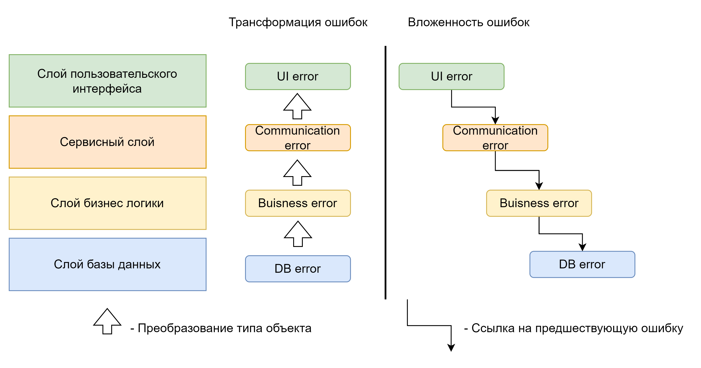

# Глава 7: Обработка ошибок

В данной главе мы поговорим о стратегиях и инструментах обработки ошибочных ситуаций в C++.

## Ошибки в программном обеспечении

Ошибки являются неотъемлемой частью программного обеспечения. Как показывают исследования в области психологии и поведения человека типичный объем внимания предрасполагает к уверенном понимании контекста, содержащего от 5 до 9 элементов. Часто, это только количество слоев о которых должен думать типичный программист на C++. Он может обладать контекстом разрабатываемой системы на очень большом количестве уровней, начиная от бизнес процессов и заканчивая вопросами оборудования. Ввиду этого факта ошибки являются неизбежной реальностью, с которой требуется продолжать работать.  
Однако, программист вполне способен сконцентрировать свое внимание и оценивать алгоритм работы системы на каком-либо уровне в отдельности, а, иногда, и на нескольких соседних уровнях. В этом помогают методики записи и изменения представления информации о системе, например такие как диаграммы потоков данных, последовательностей и классов.  
Разумно разделить все множество ошибок на *непредвиденные* и *обозримые*. Обычно непредвиденные ошибки проявляются в конечном продукте как баги и уязвимости. Процессы, приводящие к устранению таких ошибок, затрагивают множество областей разработки от процесса доставки и планирования деятельности до анализа рисков. Описание данной области выходит далеко за пределы данной книги.

### Обозримые ошибки

Обозримые ошибки встречаются очень часто. Они проявляют себя на каждом уровне абстракции системы. Многие характеристики качества системы происходят именно из ее способности и поведении при обработке обозримых ошибок. Именно на обозримых ошибках мы сконцентрируемся в данной главе.  
Обозримые ошибки представляют собой ситуации которые разработчик системы смог предусмотреть, а значит предложить потенциальное место ветвления алгоритма и перехват потока управления. Они находят свое отражение в API (Application Program Interface) и ABI (Application Binary Interface), и обычно являются неотъемлемой частью контракта.  
Большинству разработчиков удобно представлять системы в виде слоеного пирога, где поток управления идет через некоторые обособленные слои функционала, то приближаясь, то удаляясь от центрального слоя, реализующего логику бизнес процесса. Как следствие такого разделения функционала каждый слой системы может реализовать свой подход к обработке ошибок.  
Такое разделение несет как положительные, так и отрицательные аспекты. Часто обработать ошибку в рамках логики слоя, в котором она возникала, не представляется возможным и приходится прибегать к *процессу проброса ошибок*. Обычно такой процесс идет к логике бизнес процесса, так как такая логика обладает наиболее полным контекстом, особенно если процесс проброса собирал контекст по дороге, и может переключить течение бизнес процесса в альтернативное русло. Можно считать, что на уровне бизнес процессов не существует ошибок, есть только альтернативные исходы, какие-то из которых более желательны чем другие.

#### Исходы не ошибки

На практике не каждое завершение работы алгоритма является ошибкой. Вполне возможны такие результаты работы продолжать действовать с которыми можно и далее. В частности именно такую абстракцию выражает `std::optional`. Другим примером можно привести API работы с файлами, где существует явное состояние конца файла, часто передающееся через те же интерфейсы, что и ошибки работы с файлом.

### Реакция на ошибки

В индустрии сложились определенные, явно выраженные, подходы к организации реакции на ошибки. Сначала нужно упомянуть, что традиционно ошибки делят на те, после которых можно восстановиться (recoverable error, исправимые ошибки) и, те после которых восстановиться нельзя (unrecoverable error, неисправимые ошибки). Данные категории выражают организацию внутреннего состояния модуля, в котором произошла ошибка и обычно означают:

* **Исправимые ошибки** требуют от пользователя модуля определенной реакции при продолжении работы с модулем. Примерами могут являться: повтор операции, перепроверка контракта на стороне клиента модуля, необходимость вызвать функции восстановления.  
* **Неисправимые ошибки** требуют немедленного прекращения работы с модулем и использования альтернативы.

#### Идиома быстрого падения

Данная идиома выражается в том, что система полагается на внешние управляющие компоненты для своего восстановления фактически переводя все ошибки в категорию неисправимых. Ее хорошо описывает принцип **лучше быстро упасть и подняться, чем разбираться, что пошло не так**.  
Естественно в хорошо построенных системах контекст такого падения полностью собирается и анализируется асинхронно, переводя ошибку в разряд непредвиденных. Однако стоит учитывать, что система **должна обладать базовой устойчивостью**, чтобы не возникало ситуации, при которой все последующие запуски приводят только к падениям. Такая ситуация называется *reboot-loop* (петля перезагрузки).

#### Трансформация и вложенность ошибок

Это два альтернативных подхода к каскадной обработке ошибок \- когда ошибка проходит через несколько слоев / модулей.  
**Вложенность ошибок**, это подход, который ведет к высокой наблюдаемости и живучести системы. В его основе стоит сборка контекста ошибки на каждом слое / модуле через который данная ошибка проходит. Это позволяет в точке с достаточным уровнем контекста по месту принять решение о восстановлении. Однако, такой подход применим для систем, все модули которых производится в одной организации, так как такая стратегия требует контроля ее исполнения, иначе в первом же месте, где вложенность будет пропущена, потеряется весь накопленный контекст.  
**Трансформация ошибки** предполагает наличие в слое / модуле функции (в самом общем понимании) соотношения всех ошибок, получаемых данным слоем / модулем от его зависимостей, с ошибками, описанными в самом модуле. Часто такой подход встречается в системах, где преобладает высокий уровень энтропии (big ball of mud архитектура). Данный подход на практике отличается тем, что на его поддержание уходит много сил и ресурсов, а также, это просто скучная работа, ввиду чего функция соотношения всегда неполна, что приводит к потере контекста и значительному ухудшению наблюдаемости системы.



##### Идиома log & throw

Данная идиома помогает справится с проблемными местами подхода *трансформации ошибок*. Она состоит в том, что контекст ошибки передается неявно, через набор записей лога, а каждый слой / модуль при обработке ошибки добавляет свою запись лога с описанием своего контекста. Данная идиома позволяет привести показатели наблюдаемости системы в удовлетворительное состояние, однако ее поддержка также требует значительных затрат ресурсов, так как отслеживание совмещение лога с ошибкой для большой системы является нетривиальной задачей.

### Модель отказов

Отдельно хочется подчеркнуть важность для больших и средних проектов анализа модели отказов, которой должны придерживаться разработчики при реализации системы. Модель отказов задает требования к гарантиям работы системы, окруженной реальным миром. Всего выделяют пять моделей отказов:

* *Авария*. В данной модели, при отказе системы, всем окружающим можно считать, что система более никогда НЕ восстановится в том же формате, с тем же состоянием и данными, как она была до обнаружения отказа.  
* *Авария с восстановлением*. В данной модели, при отказе системы, всем окружающим можно считать, что в обозримом промежутке времени система восстановится с тем же состоянием и данными, которые она имела до наступления отказа.  
* *Пропуск данных*. В данной модели, при отказе системы, всем окружающим нужно считать, что система обладает достаточным запасом отказоустойчивости, для того чтобы списать отказ на обрыв (временный или постоянный) канала связи.  
* *Перехват сообщений*. В данной модели считается, что в коммуникационном канале может содержаться пассивно существующая сущность, способная на чтение и отказ в обработке сообщений от и к рассматриваемой системе.  
* *Произвольное поведение*. В данной модели считается, что в любое время система, или представляющаяся системой, активно противодействующая достижению цели сущность способна на произвольное поведение.

В данном контексте отказ является наблюдаемым сторонними сущностями, взаимодействующими с системой, эффектом невозможности произвести совместное согласованное действие.

## Ошибки в С

Более детальный обзор работы с ошибками в С и C++ был проведен авторами библиотеки `boost::outcome` [тут](https://www.boost.org/doc/libs/1_87_0/libs/outcome/doc/html/alternatives.html) и [тут](https://www.boost.org/doc/libs/1_87_0/libs/outcome/doc/html/motivation.html).  
При работе с ошибками в С используются следующие подходы:

* *Коды возврата*. В данном подходе функции возвращают вместо типа результата тип представляющий код возврата, обычно числовой или перечисление. Результат же функции передается в место, на которое указывает аргументами с типом указателя. Код возврата сравнивают с набором значений, описывающим приемлемые или напротив неприемлемые ситуации и действуют согласно результату сравнения.  
  * Во многих системах коды ошибок приобретают дополнительные свойства, например возможность содержать область ошибки и ее код, а также обладать возможностью трансляции в ошибку другого уровня.  
* *Константы в области определения возвращаемого типа*. В данном подходе в области определения возвращаемого типа определяются константы, обозначающие наличие ошибки. Например `-1`. Часто такой подход приводит к *транзакционному дизайну функции*, при котором наличие ошибки свидетельствует об отсутствии внешне наблюдаемых эффектов.  
* *Установка глобальной переменной*. Обычно применяется совместно с предыдущим пунктом. Данный подход передает код возврата в специально отведенной переменной. Обычно пользуются потокобезопасной переменной `errno`.  
* *Нелокальные переходы*. Данный подход можно встретить достаточно редко. В своей сущности он очень похож на исключения, которые мы обсудим далее. Реализуется данный подход с использованием функций `std::setjmp()`, для определения места обработки нелокального перехода, и `std::longjump()`, для совершения нелокального перехода. При таком переходе поток исполнения перемещается напрямую к месту обработки перехода при этом игнорируются все стек фреймы вложенных вызовов и стек устанавливается в позицию места обработки, поэтому данным подходом исключительно **небезопасно пользоваться в C++**. Можно считать, что это оператор `goto`, способный переносить поток исполнения через границы функций.
```c++
#include <csetjmp>
jmp_buf env;

void riskyOperation() {
  std::unique_ptr resource = { /* ... */ };
  // ...
  if (0 != error) {
    // !ОШИБКА - деструктор resource не вызван
    std::longjump(env);
  }
}

void transaction() {
  if (std::setjmp(env)) {
    // Обработка ошибки
    return;
  }
  riskyOperation();
}
```
* *Ассерты*. Это класс функций, одна из которых представлена макросом стандартной библиотеки `assert()`, которые отвечают за завершение программы при провале проверки условия. Данный подход реализует *идиому быстрого падения* и в последнее время стал очень популярным (assertive-programming).

Несомненно, что в С также можно реализовать и более выразительные стратегии обработки ошибок с трансляцией и монадностью, однако большинство проектов все же придерживаются описанных выше подходов, не вкладывая больший ресурс в обработку ошибок.

## Ошибки в C++

C++ предлагает альтернативу подходу с нелокальными переходами из С под названием *обработка исключений*. Этот механизм опирается на синтаксические конструкции *try-catch* блоков и *механизм обработки исключений во времени исполнения*. Последний, к удивлению разработчиков, не является обязательным в C++. Так например в GCC и Clang присутствует флаг `-fno-exceptions` отключающий генерацию компилятором кода обработчиков исключений для C++ кода.

### Как работает исключение

Общий алгоритм работы механизма исключений в C++ можно описать следующим образом:

1. Исключение возникает в коде при прохождении выражения `throw`.  
   1. Происходит проверка, не выброшено ли сейчас исключение.  
      1. Если уже существует выброшенное исключение, т.е. мы уже находимся в процессе обработки исключения, то вызывается функция `std::terminate()`, приводящая к немедленному завершению программы.  
   2. Иначе, в рамках выражения `throw` устанавливается тип исключения \- в C++ можно “бросать” и “ловить” исключения любого типа. Под него аллоцируется место в куче, и конструируется объект исключения, согласно инициализатору в выражении `throw`.  
2. Начинается процесс *раскрутки стека* и поиска обработчика исключения  
   1. Обработчики исключений `catch` просматриваются в данной функции путем сверки типа исключения с декларируемым обрабатываемым типом.  
   2. Сверка происходит в порядке определения обработчиков, поэтому **очень важно** ставить наиболее общие обработчики, такие как полиморфные и захвата всего, в конец списка обработчиков.  
   3. Если сверка завершается удачно, то переменная, заданная в обработчике, инициализируется из объекта исключения. В данном случае успешность определяется так же как и передача аргумента в функцию.  
   4. Иначе происходит проверка, помечена ли данная функция модификатором `noexcept`.  
      1. Если она помечена, то компилятором был сгенерирован код, вызывающий `std::terminate()`. Данный код вызывается и программа завершается.  
   5. Далее происходит выход из функции, совместно с разрешением (вызовом деструкторов) всех локальных переменных, также как при возврате через выражение `return`.  
   6. Процесс продолжается уже в функции, вызвавшей данную, говорят “следующей в стеке”.  
   7. Если в какой то момент процесс выходит из функции `main()` или функции, переданной на исполнение потоку, то процесс раскрутки завершается вызовом `std::terminate()`.

#### Распространенные ошибки при работе с исключениями

В использовании механизма исключений в C++ можно допустить несколько ошибок.

##### Анти-паттерн “exception-driven control flow”

Дизайн механизма исключений в C++ исходит из основных принципов дизайна языка *“you don’t pay for what you don’t use”*. Следуя этому принципу счастливый путь программы получает приоритет оптимизаций, а несчастливый может платить двойную или более цену за исполнение. В рамках того же принципа общие накладные расходы на работу механизма исключений, испытываемые на всех путях программы оптимизируются со стороны компилятора.  
Так как мы платим, что называется “в тридорого”, за несчастливый исход, использовать механизм исключений для управления потоком исполнения в логике работы программы, а не для обработки исключительных ситуаций и ошибок, является крайне нежелательным подходом.

##### Получение объекта исключения в блоке catch()

В большинстве случаев, получать исключение имеет смысл по *константной левой ссылке*. Это обусловлено отсутствием необходимости копирования, при котором может возникнуть другое исключение и *проблема сплайсинга*. Константность же обусловлена тем, что в большинстве случаев модификация объекта исключения не имеет смысла. Ссылочность также обусловлена тем, что исключения можно принимать полиморфно (по ссылке).

##### Анти-паттерн “щедрый noexcept”

Во многих учебных материалах по C++ пропагандируется подход *“noexcept-by-default”* который говорит, что большинство своих функций программисту требуется помечать как `noexcept` по умолчанию \- “не задумываясь”. Как мы уже рассмотрели, проброс исключения через `noexcept` функцию невозможен за счет вызова `std::terminate()`. У этого правила, однако, существует исключение \- если ВСЕ функции, вызываемые в данной, также помечены `noexcept`, то компилятор не создает обработчика для вызова `std::terminate()`.  
Стоит отметить, что ВСЕ \- в самом прямом смысле слова, в том числе и перегрузки операторов, и конструкторы и деструкторы. Это делает отслеживание "все ли функции помечены как `noexcept`?" крайне трудоемкой задачей.  
На практике оказывается, что многие зависимости, а в том числе и стандартная библиотека, не готовы предоставлять `noexcept` интерфейсы, даже для казалось бы простых операций. Данный факт, совместно со следованием принципу *“noexcept-by-default”* насыщает программу очень большим количеством обработчиков `std::terminate()` в самых неожиданных местах. Это приводит к плохой оптимизации размера кода, а, иногда, в случае встраиваемых функции, и к плохой оптимизации производительности.  
Для того чтобы избежать данной проблемы в своем коде:

* Используйте функции минимального размера и оператор `noexcept()` для пометки функции как `noexcept` на основании реальной проверки кода компилятором. Особенно такая практика актуальна при написании шаблонов.  
* Стремитесь к реализации кода без исключений, особенно для специальных членов функции.

##### Модификатор noexcept в специальных функциях членах

Конструкторы в ходе обработки исключений выделяются тем, что время жизни объекта не начинается, пока конструктор не выполняется до конца. Однако, для целей консистентности подведения, все сконструированные подобъекты данного будут разрушены, согласно порядку инициализации, как в деструкторе.  
Деструктор, с точки зрения обработки исключений, это самая уникальная функция C++, так как если все остальные функции по умолчанию помечаются как `noexcept(false)`, то деструктор любого класса помечен как `noexcept(true)`, и его явно нужно помечать как `noexcept(false)`, если требуется поддержать поведение с раскруткой стека. В большинстве случаев это приводит к неожиданному для программиста вызову `std::terminate()`. Специально для деструкторов и поддержки идиомы RAII в стандартной библиотеке определена функции `std::uncaught_exceptions()`, которая дает представление, вызывается ли деструктор во время раскрутки стека или в нормальном состоянии и принять решение о возможном выбросе исключения.  
Как мы обсудим далее хоть метод `swap()` и не является специальным, но является очень широко распространенным, а контракт данного метода предполагает наличие на нем модификатора `noexcept(true)`.  

#### Хорошие практики работы с исключениями

##### Идиома локализованной обработки

Согласно данной идиоме обработка исключений может быть сосредоточена в одном месте кода, свободной функции или методе класса, в которых собрано множество блоков обработки `catch()` и определено свое поведение для каждого типа исключений. Во всех же остальных *try-catch* блоках стоит перехватывать все с использованием `catch(...)` и отправлять на обработку в такую функцию.  
Это возможно благодаря двум вещам, синтаксисе переброски текущего исключения `throw;` и стандартным функциям работы с исключениями:

* `std::current_exception()` \- доступ к текущему исключению, в виде класса `std::exception_ptr`,  
* `std::rethrow_exception()` \- запуск исключения из `std::exception_ptr`.

Данная идиома хорошо работает в кодовых базах с большим количеством определенных типов исключений, а также, где исключений много у какой-то зависимости. Она помогает держать код обработки сосредоточенным, а обработку единообразной, и не загрязнять код множественными большими блоками *try-catch*.

##### Использование стандартных исключений

Стандартная библиотека уже предоставляет несколько классов исключений, связанных единым базовым классом `std::exception`, которые обычно закрывают все нужды программиста, так как предоставляют хранилище для одного элемента строкового типа. Из отдельных реализаций можно выделить:

* `std::logic_error` и его подклассы, обычно используются для обозначения нарушения контракта аргументов функции.  
* `std::runtime_error` и его подклассы, используются для всего остального.

Расширять `std::exception` самостоятельно имеет смысл тогда, когда помимо одной строки данных хочется также поместить в объект дополнительные данные.

##### Идиома контекста ошибки

Контекст ошибки это набор данных о ее происхождении и состоянии программы на момент ее создания. Эта информация крайне важна для таких характеристик системы как стоимость поддержки, устойчивость к сбоям и скорости внесения изменений. В C++ на момент стандарта C++23 не предоставляет общего механизма хранения данных о контексте ошибки. Однако предоставляются множество способов получения контекста.

###### Контекст происхождения ошибки

Простейшим вариантом является получение информации о месте возникновения исключения, путем конструирования объекта исключения с использованием значений макросов и переменных:

* `__FILE__`, макрос, предоставляющий имя текущего файла,  
* `__LINE__`, макрос, предоставляющий номер текущей строки,  
* `__func__`, переменная, предоставляющая имя текущей функции,  
  * `__PRETTY_FUNCTION__` и `__FUNCTION__` \- платформенно зависимые варианты `__func__` с большим количеством деталей.

Начиная с C++20 в стандартной библиотеке был представлен более удобный и переносимый способ получения данной информации в виде класса `std::source_location` и функции `std::source_location::current()`. Часто можно увидеть, что в функции, которая будет выбрасывать исключение одним из аргументов по умолчанию является именно аргумент, с типом `std::source_location`, инициализируемый функцией `current()`.  
Начиная с C++23 в стандартной библиотеке появились классы `std::stacktrace` и `std::stacktrace_entry`, которые выражают собой описание цепочки вызовов, начинающийся с `main()` или главной функции потока и заканчивающийся текущей функцией, расположенные в порядке от последнего к первому. Ранее такую информацию можно было получить только платформно-зависимыми методами.

###### Контекст состояния программы и идиома вложенных исключений

Стандартная библиотека C++ также поддерживает распространенный способ сбора контекста состояния программы в виде вложенных исключений. По своей сути, это всего лишь односвязный список из исключений, который можно обработать последовательно и получить данные с каждого уровня абстракции. Наибольшую пользу такой подход приносит, если на каждом уровне исключения хранят структурированный набор данных о контексте на данном уровне.  
Класс `std::nested_exception` реализует элемент списка исключений. В большинстве случаев его не придется использовать напрямую, так как построение списка происходит за счет функции `std::throw_with_nested()`, а разворачивание списка за счет функции `std::rethrow_if_nested()`.

```c++
void createNested() {
  try {
    throw std::runtime_error("Outer error");
  } catch (...) {
    std::throw_with_nested(std::logic_error( "Inner error"));
  }
}

void printException(const std::exception& e, int level = 0) {
  std::cerr << std::string(level, ' ') << e.what() << '\n';
  try {
    std::rethrow_if_nested(e);
  } catch (const std::exception& nested) {
    printException(nested, level + 1);
  }
}
```

### Другие варианты обработки ошибок

Помимо подходов к работе с ошибками из С и исключений в стандартной библиотеке C++ также представлены еще два подхода `std::expected` и `std::error_category`. Также стоит упомянуть о таких частях библиотеки Boost как `boost::outcome` и `boost::leaf`.

#### std::expected (C++23)

Данный класс выражает собой монаду Error. Простыми словами, он содержит внутри или результат исполнения или ошибку и предоставляет функции для продолжения вычислений над обоими состояниями. Монадический интерфейс данного класса достаточно прост (`<T, E>` эквивалентно `std::expected<T, E>`, а `=>` обозначает задание функции):

* `value_or()`: `<T, E>, U =>` `T` или `U` \- переход в область значений,  
* `error_or()`: `<T, E>, U =>` `E` или `U` \- переход в область ошибок,  
* `and_then()`: `<T, E>, T => U =>` `U` или `<T, E>` \- трансформация значения с выходом в область значений,  
* `transform()`: `<T, E>, T => U =>` `<U, E>` или `<T, E>` \- трансформация значения внутри монады,  
* `or_else()`: `<T, E>, E => U =>` `<T, E>` или `U` \- трансформация ошибки с выходом в область ошибок,  
* `transform_error()`: `<T, E>, E => U =>` `<T, E>` или `<T, U>` \- трансформация ошибки внутри монады.

```c++
std::expected<int, std::string> parseInput();
auto result = parseInput()
              .transform([](int x) { return x * 2; })
              .transform_error([](const std::string& e) { return "Error: " + e; });
```

#### std::error_category (C++11)

Данная модель улучшает подход с кодами ошибок и добавляет ему функционала, доступного только в C++. Обычно она используется в C++ API, которое оборачивает С библиотеки. Нужда в данном инструменте появилась исходя из того, что для многих платформенных функций переиспользуются общие коды ошибок, однако в зависимости от части платформы, они могут означать разное, а также для того чтобы унифицировать обработку системных ошибок на разных платформах с точки зрения C++ кода. Любой, кто читал вывод Linux MAN, мог для раздела 2 заметить секцию ERRORS в описании каждой функции, разъясняющую какой общий код для чего используется. Ранее данная часть стандартной библиотеки распространялась как `boost::system`.  

```c++
class MyCategory : public std::error_category {
public:
  const char* name() const noexcept override { return "MyCategory"; }
  std::string message(int ev) const override {
    switch (ev) {
      case 0: return "Success";
      case 1: return "Invalid input";
      default: return "Unknown error";
    }
  }
};

const std::error_category& myCategory() {
  static MyCategory instance;
  return instance;
}
```

Основными элементами дизайна данной библиотеки являются:

* `std::error_category` \- Базовый класс для создания синглтона категории. Категории задают преобразование кода ошибки в строку и отношения между классами `std::error_code` и `std::error_condition`. Пользователь может задавать свои категории ошибок наследуюсь от данного класса. При этом стандартная библиотека предоставляет следующие категории:  
  * `std::generic_category` \- представляет категорию кодов ошибок, как они определены в стандарте POSIX. Такие ошибки часто передаются через `errno`.  
  * `std::system_category` \- представляет системные ошибки текущей ОС и их соотношение с `std::generic_category`.  
  * `std::iostream_category` \- категория ошибок для библиотеки iostream.  
  * `std::future_category` \- ошибки стандартных фьюч.  
* `std::errc` \- перечисление, задающие константы, соотносящиеся с кодами ошибок POSIX для `errno`.  
* `std::error_code` \- основной прикладной класс для работы с кодами ошибок. Предназначен для передачи кода ошибки, зависимого от платформы.  
* `std::error_condition` \- похож на `std::error_code`, однако выражает собой ошибку, независимую от платформы. Ее можно сравнить с полученным кодом `std::error_code`. Таким образом можно также достичь сравнения кодов ошибок между категориями, так как `std::error_condition` выражает нечто общее, а `std::error_code` нечто частное.

```c++
std::error_code ec = make_error_code(std::errc::permission_denied);
std::error_condition cond = std::errc::permission_denied;
// Сравнение между категориями
if (ec == cond) {
  // Обработка
}
```

#### boost::outcome и boost::leaf

`boost::outcome` предоставляет множество классов для всесторонней обработки ошибок, а `boost::leaf`, максимально простой интерфейс для управления ошибками с:

* `leaf::result<T>` \- как классом легковесного результата, включающего ошибку со стертым типом.  
* `leaf::try_handle_some` \- как функцию выполнения кода и обработки ошибок, похожую на *try-catch* блок, однако без исключений.

```c++
#include <boost/outcome.hpp>
namespace outcome = BOOST_OUTCOME_V2_NAMESPACE;

outcome::result<int> computeValue() {
  if (fail()) {
    return outcome::failure(std::errc::invalid_argument);
  }
  return 42;
}

#include <boost/leaf.hpp>

leaf::result<int> parseData() {
  if (auto err = validate()) {
    return err; // Автоматическая упаковка
  }
  return 42
}
```

## Гарантия поведения при исключениях (exception safety)

Важной частью написания профессионального программного кода на C++ является понимание и принятие во внимание возможности функции завершить свое исполнение не только посредством возврата через выражение `return`, но и при вызове любой другой функции, кроме помеченных как `noexcept`, благодаря механизму исключений.  
Данный факт заставляет задуматься о гарантиях, которые может предоставить код при неожиданном прохождении по не счастливому пути. На основании коллективного опыта разработки на C++ были составлены следующие категории, на которые можно классифицировать поведение функции при возникновении исключения в ее коде или пробросе исключения через нее при раскрутке стека:

* *Без гарантии исключений* \- валидность состояния программы не гарантируется, а в ходе проброса может произойти все что угодно. Такой код, к большому сожалению, появляется довольно часто. Это самая слабая гарантия исключений. Она является результатом неопытности или спешки в написании кода.  
* *Базовая гарантия исключений* (basic exception guarantee) \- валидность программы гарантируется, ресурсы программы не утекают, а инварианты класса или окружения сохраняются.  
* *Сильная гарантия исключений* (strong exception guarantee) \- предоставляет все тоже, что и базовая гарантия, однако добавляется также откат состояния программы до момента перед вызовом функции (откат транзакции).
```c++
void updateInTransaction(std::vector<MyClass>& collection, MyClass value) {
  std::vector<MyClass> nextCopy = collection; // Копирование
  nextCopy.emplace_back(std::move(value));    // Операция над копией
  if (validate(nextCopy)) {                   // Валидация копии
    swap(nextCopy, collection);               // Обмен без возможности ошибки
  }
}
```
* *Гарантия работы без исключений* \- гарантируется, что функция не бросает исключений. Такие функции используются для имплементации других уровней гарантий. Обычно они помечены как `noexcept`.

Ортогональным к категориям поведения является термин *нейтральность к исключениям* (exception neutral) \- гарантирована внутренняя обработка всех исключений, выбрасываемых в данной функции, исключения из вызываемых же функций пробрасываются далее как есть. Такие функции придерживаются одной из категорий поведения, из перечисленных выше.

### Техники достижения строгой гарантии исключений

Основой для достижения работы без исключений являются гарантии, предоставляемые специальными членами функциями. Так ожидается, что для абсолютного большинства типов можно произвести операцию обмена значениями `swap()` **без исключений**. На основании данной операции можно легко построить конструктор перемещения без исключений и оператор присваивания с перемещением без исключений.  
Имея данный строительный блок на его основании реализуются следующие подходы:

* *Copy & Swap* \- внутренние значения копируются для проведения манипуляций, далее обновленные значения обмениваются со старыми.
```c++
class Config {
  std::map<std::string, std::string> data;
public:
  Config(const Config& other) { /* ... */ }
  void swap(Config& other) noexcept { /* ... */ }

  void update(std::string key, std::string value) {
    Config updated = *this;
    updated.emplace(std::move(key), std::move(value));
    if (updated.validate()) {
      swap(updated);
    }
  }
};
```
* *Транзакционный дизайн* \- изменения в состоянии накапливаются и не применяются до точки, в которой становится понятно, что исключительная ситуация не произошла.  
* *Использование RAII и не бросающих деструкторов* \- часто данные отката сохраняются объектами, реализующими идиому RAII, благодаря которой происходит постепенный откат действий в случае выброса исключения.

## Windows Structured Exception Handling (SEH)

Данная функциональность платформы Windows требует отдельного рассмотрения. Она является довольно старым механизмом на границе современных C++ исключений и кодов возврата. Поддерживается только на платформе Windows. На POSIX платформах большую часть данного функционала реализуют сигналы ОС.  
Особенностями данного механизма является:

* Он доступен для С и C++.  
* C++ исключения вызывают деструкторы и перехватываются в `__except`, а SEH исключения деструкторы не вызывают при компиляции с флагом `/EHsc` и вызывают при компиляции с флагом `/EHa`.  
* Синтаксис универсального перехвата `catch(...)` перехватывает SEH исключения.

SEH исключения представляют собой набор кода возврата и данных состояния исполнения. Они предназначены в том числе для обработки невалидных операций ОС (таких как доступ по инвалидному адресу) и процессора (таких как деление на ноль).  
Для того, чтобы перехватить данный вид исключений вводятся ключевые слова `__try`, `__except`, `__finally`. По своему синтаксису их использование напоминает *try-catch* блок. Однако использовать совместно можно только `__try` и `__except` или `__try` и `__finally`. При этом:

* `__try` \- открывает блок обработки SEH исключений.  
* `__except` \- позволяет обработать SEH исключение через функцию фильтрации по коду возврата и данным о контексте.  
* `__finally` \- добавляет блок действий при очистке.

Также есть ключевое слово `__leave`, которое позволяет перейти напрямую к  концу блока `__try`.  
Дополнительный функции при работе с SEH исключениями:

* `RaiseException()` \- вызвать SEH исключение из программного кода.  
* `GetExceptionCode()` \- получить код возврата из текущего SEH исключения.  
* `GetExceptionInformation()` \- получить доступ к детальному описанию текущего SEH исключения.  
* `AbnormalTermination()` \- доступно только в `__finally`, проверяет выполняется ли `__finally` нормально или в режиме исключения.
