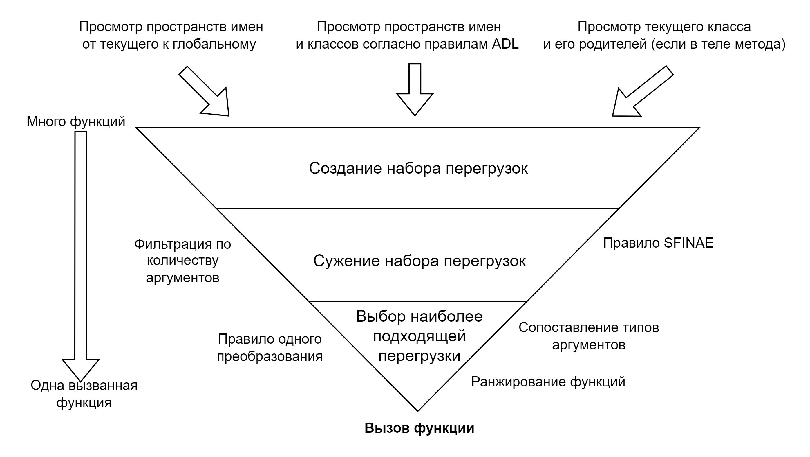
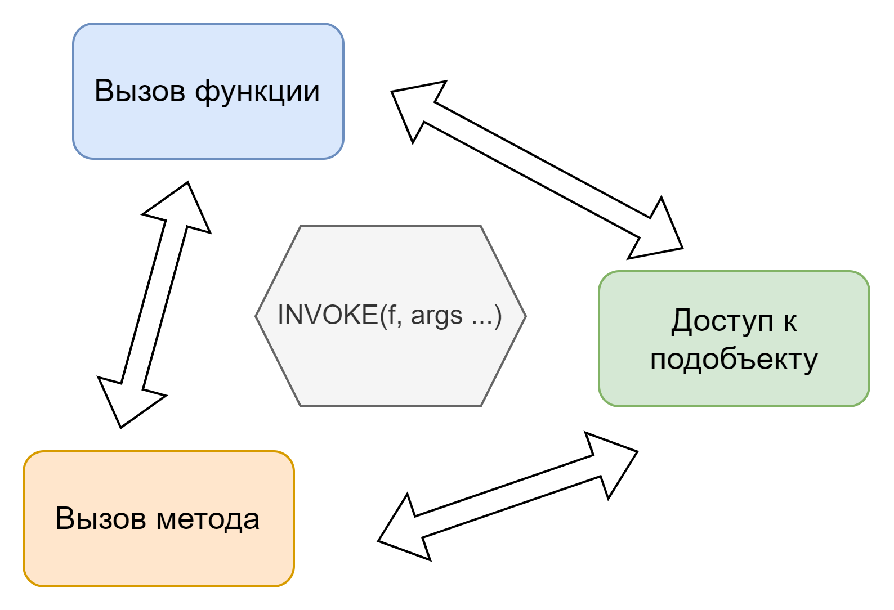

# Глава 8: Функциональный C++

В данной главе мы поговорим о процедурной и функциональной сторонах C++.

## Функции

C++ перенял у своего прямого предка С процедурную парадигму, а также указатели на функции, как объекты первого класса (first-class citizen) с добавлением ссылок на функции. Однако C++ допускает одно очень важное изменение, а именно возможность определять множество функций с одним именем, но разным набором параметров. Данная возможность называется *перегрузкой функции* (overloading).  
Для допущения возможности перегрузки функций в языке потребовался механизм, который определял бы какую из перегрузок требуется вызывать в зависимости от переданных аргументов. Данный процесс называется *разрешением перегрузок* (overload resolution).  
Каждая функция обладает двумя свойствами:

* *Тип функции* \- это свойство определяет место функции в системе типов, и именно из него можно построить ссылку или указатель. Однако объектов типа функции в C++ не существует (также как и объектов типа `void`). C++ не оперирует данными, представляющими функцию, как это могут делать другие языки программирования. Тип функции включает:  
  * Тип возвращаемого значения,  
  * Набор типов аргументов (после “разложения”),  
  * Квалификацию исключений,  
  * А для нестатических членов функций, еще и квалификаторы CV и реферальности.  
* *Сигнатура функции* \- данное свойство введено для отождествления с ним функции во время *разрешения перегрузок*. Оно включает в себя:  
  * Имя функции,  
  * Набор типов аргументов (после “разложения”),  
  * Пространство имен, в котором определена функция, или  
  * Имя класса для функций членов, а также квалификаторы CV и реферальности, и завершающий список требований, или  
  * Имя класса для не шаблонных функций друзей и завершающий список требований.

#### Разложение аргументов функции

Сигнатура и тип функции зависят не напрямую от списка аргументов, как он определен в коде, а от списка, прошедшего процедуру разложения (function argument decay). Данная процедура состоит из четырех шагов:

1. Последовательный набор типов параметров составляется из написанных программистом объявлений параметров.  
2. Типы массивов и функций приводятся к типу указателя на первый элемент и указателю на функцию.  
3. У каждого типа удаляются CV квалификаторы верхнего уровня, так как если бы над типом была вызвана метафункция `std::remove_cv()`.  
4. К списку добавляются факты наличия вариативности и упаковок параметров.

Процедура разложения важна, так как учитывает натуральные преобразования, которые проходят типы аргумент при вызове функции.

### Вызов функции

Основной особенностью функции в C++ является то, что ее можно “вызвать”, т.е. передать поток управления внутрь тела функции. С точки зрения семантики языка вызовы функций делятся на:

* *Квалифицированные* \- когда в синтаксисе используется частично или полностью квалифицированное имя функции, включая пространства имен и/или классы, в которых данная функция определена,  
* *Неквалифицированные* \- когда в синтаксисе используется только имя функции, без дополнительных квалификаторов.

```c++
int foo(int a);

namespace some {
namespace other {

float foo(float a);

} // namespace other
} // namespace some

// Квалифицированный вызов
::some::other::foo(1.0);

// неквалифицированный вызов
foo(1);
```

В обоих случаях производится процесс создания *набора перегрузок* (overload set) из которого благодаря разрешению перегрузок происходит выбор конкретной функции для вызова. Однако неквалифицированный вызов добавляет в процесс составления набора перегрузок дополнительный правила. Такие правила называются *просмотр, зависимый от аргументов* (ADL, Argument Dependent Lookup).

#### Семантика передачи аргументов

Сейчас мы понимаем, что передача аргументов в функцию, это не что иное, как инициализация объектов, объявленных как параметры функции. Ввиду этого мы поговорим о двух вещах - договоре о вызовах и идиоматической передаче аргументов.

##### Договор о вызовах функции

Договор о вызовах (calling convention) это определение на уровне ABI платформы как именно происходит передача аргументов функции в функции при вызове. От этого договора зависит:

* Какие регистры процессора свободны для использования, а для каких нужно сохранять состояние.  
* Где передается адрес или значение аргумента, прямо в регистре или на стеке.  
* Порядок передачи аргументов, часто несколько в регистрах, остальные в стеке.  
* Как передавать результат.

В большинстве случаев вам предстоит столкнуться с [x86 Itanium ABI](https://itanium-cxx-abi.github.io/cxx-abi/abi.html). Одним неудачным следствием повсеместного использования компиляторами данного ABI является необходимость передавать *нетривиально разрушаемые объекты*, такие как например `std::unique_ptr<T>` как адреса на стеке, ввиду чего в большинстве случаев передачу `std::unique_ptr<T>` на самом деле приводит к двойному разыменованию указателя \- сначала на адрес `std::unique_ptr<T>` на стеке, потом на значение, которое хранит `std::unique_ptr<T>`.  
Основные проблемы для программистов возникают тогда, когда код под одну и ту же платформу скомпилирован с использованием разных договорах о вызовах. Такое возможно например при использовании бинарных поставок библиотек. Решаются такие проблемы явным указанием договора о вызовах при объявлении функций. Однако основная сложность заключается в том чтобы понять “что вообще происходит?”, так как поведение кода и возникающие ошибки становится максимально сложно понять и отладить.

##### Идиоматическая передача аргументов функции

В C++ принято выделять два стиля передачи аргументов функции, *передача по значению* и *передача по ссылке*. Очевидно, что для того чтобы *передать по значению* аргумент должен быть декларирован как **тип значения**, а для *передачи по ссылке*, аргумент должен иметь **ссылочный тип**.  
На практике сложились следующие подходы к выбору стиля передачи аргументов:

* Если значение аргумента будет скопировано или перемещено в функции во внутреннее хранилище, то объект стоит принимать *по значению*. Это объясняется тем, что пользователь функции сможет выбрать как инициализировать объект, копией или перемещением, в отличие от ситуации, когда мы принимал бы аргумент по ссылке, делая выбор способа создания копии за пользователя.  
```c++
struct PassByReferenceWithCopy {
  // Вынуждены предоставлять 2 метода вместо одного для потребления левых и правых значений
  void set(const std::string& value) {
    s = value;
  }
  void set(std::string&& value) {
    s std::move(value);
  }

  std::string s;
};

struct PassByValueWithCopy {
  // Достаточно одного метода
  void set(std::string value) {
    s std::move(value);
  }
  std::string s;
};

std::string a, b, c, d;

PassByReferenceWithCopy pbr;
pbr.set(a);             // Вызывается void set(const std::string& value)
pbr.set(std::move(b));  // Вызывается void set(std::string&& value)

PassByValueWithCopy pbv;
pbv.set(c);             // Вызывается void set(std::string value)
pbv.set(std::move(d));  // Вызывается void set(std::string value)
```
* Простые и встроенные типы всегда передаются *по значению*. Это сделано для лучшей оптимизации, за счет выделения регистров, а не памяти в стеке, под такие типы.  
* Сложные объекты для чтения, передаются по *левой константной ссылке*. Тут все просто, мы могли бы передать указатель, однако это менее удобно, и требует проверки на `nullptr` на стороне кода функции.  
* Лучше избегать `out` и `inout` аргументов, которые передаются по *левой не константной ссылке*. В C++ есть множество замен таким аргументам, например тип `std::pair` в совокупности со структурным связыванием.  
* Используйте в интерфейсе функции *правую не константную ссылку*, когда крайне важно показать, что функция полностью потребляет состояние объекта и оставляет его в состоянии *moved-from*, которое может быть не валидным.  
```c++
class ConnectionPool {
public:
  // API показывает, что Connection будет полностью
  // потреблено на нашей стороне и владение им нужно передать
  void put(Connection&& c) {
    // Возвращаем с в пул соединений
  }
};
```
* Применение *правых константных ссылок* \- в большинстве случаев решено всякого смысла.

### Перегрузка функций

C++ во многом обязан своей лаконичностью кода именно возможности перегрузки функций. Данная возможность по своей сути позволяет реализовать *ad-hoc полиморфизм* на уровне перегрузок функций. Другой стороной *ad-hoc полиморфизма* в C++ являются операторы для встроенных типов данных.

#### Вызов перегруженной функции

Процесс вызова перегруженной функции достаточно объемен и имеет несколько не интуитивных для понимания моментов. Если упростить то все происходит в три этапа:

1. Создание *набора перегрузок*, в зависимости от контекста вызова функции,  
2. Сужение *набора перегрузок*, за счет проверки набора условий (например совпадения количества аргументов),  
3. Выбор наиболее подходящей перегрузки из оставшегося набора.



Такой процесс происходит во время компиляции при любом вызове функции, даже если она имеет уникальное имя для всей программы.

##### Не интуитивные правила C++ при вызове функций

###### Правило одного неявного преобразования

Данное правило распространяется на все аргументы функции, кроме неявного аргумента объекта (`this`) в нестатических функциях членах. Оно проявляется на 2 и 3 этапах и говорит о том, что для подбора и ранжирования функций допускается производить одно или ноль *неявных преобразований* типа для **каждого** аргумента.  
Такие преобразования производятся на основании списка встроенных *неявных преобразований*, таких как `int` в `float`, а также набора конструкторов и операторов преобразований объектов, не помеченных как `explicit`.

```c++
struct CanBeInt {
  // Оператор приведения
  operator int() { /* ... */ }
};

struct CanStartAsFloat {
  // Конструктор приведения
  CanStartAsFloat(float f) { /* ... */ }
};

void foo(int a);
// Вызовется operator int() - поиск foo() завершился успешно на void foo(int a)
foo(CanBeInt{});

void bar(CanStartAsFloat a);
// Вызовется CanStartAsFloat::CanStartAsFloat(float f)
// - поиск bar() завершился успешно на void bar(CanStartAsFloat a)
bar(1.0f);
```

###### Правило SFINAE

Оно выполняется на первом этапе. При поиске перегрузок для всех найденных шаблонов функции производится процесс вывода шаблонных аргументов (TAD). Если он завершается успешно то из шаблона синтезируется объявление функции и добавляется в набор перегрузок. Однако если вывод шаблонных аргументов завершается ошибкой, функция не синтезируется и не вызывает ошибку компиляции, что и приводит к работе механизма SFINAE.

```c++
// ... - работает как catch-all, так как имеет самый низкий приоритет при разрешении имен
void foo(...);
void foo(std::string a, std::string b);

template<Integral T>
T foo(T a, T b) {
  /* ... */
}

// Момент вызова - при компиляции происходит процесс разрешения перегрузок
foo(std::string{}, std::string{});
/*
 * Приблизительный алгоритм работы разрешения перегрузок внутри компилятора:
 * 1. После просмотра по имени в набор попадают и "void foo(...)" и "T foo(T a, T b)" и "void foo(std::string a, std::string b)"
 * 2. Инстанцируем "T foo(T a, T b)" с std::string
 *  2.1 ОШИБКА инстанциации std::string не удовлетворяет концепту Integral
 *  2.2 Правило SFINAE: выкидываем "T foo(T a, T b)" из набора перегрузок
 *  2.3 "void foo(...)" - проходит по количеству аргументов
 *  2.3 "void foo(std::string a, std::string b)" - проходит по количеству аргументов
 * 3. В наборе остались "void foo(...)" и "void foo(std::string a, std::string b)"
 *  3.1 Сортируем набор по приоритету: [ "void foo(std::string a, std::string b)", "void foo(...)" ]
 *  3.2 Просматриваем набор в порядке приоритета, сначала "void foo(std::string a, std::string b)"
 *  3.3 "void foo(std::string a, std::string b)" подходит под типы аргументов - функция для вызова найдена!
 */
```

###### Правило ADL

Данное правило работает на первом этапе. Данное правило очень полезно для C++ однако не встречается в других языках программирования. В его основе лежит желание свободно писать перегруженные операторы в коде также, как и встроенные операторы, не прибегая к явному вызову `a.operator>>(b)` вместо `a >> b`.  
Со временем данному правилу нашлись и другие применения, в частности как очень удобный интерфейс расширения для библиотек, полагающихся на шаблоны. В стандартной библиотеке такой точкой расширения, помимо `operator<<()` и `operator>>()`, является функция `swap()`. Применение этого правила часто можно заметить в библиотеках сериализации, наряду с спецификацией форматера, обычно путем частичной или полной специализации шаблона.  
Правило по своей сути является крайне простым \- помимо обычного поиска имени, как для переменных, поиск имени вызванной функции будет также производиться в пространствах имен и классах, связанных с типами параметров функции и параметрами шаблона. Такое расширение насчитывает более десятка правил инспектирования для разных типов аргументов, наиболее полезным из которых можно считать поиск функции в пространстве имен, окружающем тип аргумента. Как раз туда инжектируются функции, определенные в теле класса и помеченные как `friend` (такие как `swap()`).

```c++
// serde.hpp
namespace serde {

template<class T>
std::string do_serialize(const T& value) {
  // Имплементация сериализации по умолчанию
  // Например для простых или std:: типов
}

template<class T>
std::string serialize(const T& value) {
  // Используем ADL просмотр имени "do_serialize" как точку расширения для сериализации
  // Пространство имен, в котором определен тип T будет добавлено к просмотру при разрешении перегрузок
  return do_serialize(value);
}

} // namespace serde

// MyClass.hpp
namespace my_library {
  struct MyClass {

    friend static std::string do_serialize(const MyClass& o) {
      // Имплементация сериализации MyClass
    }
  };
  // Определение "std::string do_serialize(const MyClass& o)" автоматически инжектируется в my_library
} // namespace my_library

// code.cpp
#include <MyClass.hpp>
#include <serde.hpp>

MyClass с{}
serde::serialize(с);
// Так как шаблон инстанцируется в "serde::serialize<my_library::MyClass>(c)" то "my_library" добавляется для просмотра
// Благодаря ADL просмотр "do_serialize()" в "serde::serialize()" находит "std::string do_serialize(const MyClass& o)"
```

#### Другие контексты разрешения перегрузок

В случае если переменная, параметр функции или возвращаемое значение типа указателя или ссылки на функцию, инициализируются из имени функции, опционально предвоенное оператором взятия адреса, такая конструкция называется *адресом перегруженного набора* (address of an overload set), то также как и для вызова происходит процесс поиска наиболее подходящей функции. Однако правилом одного неявного преобразования при этом прибегают.

```c++
// Перегрузки foo()
int foo(int a, int b);
std::string foo(std::string a, std::string b, std::string c);

// Для инициализации func_ptr происходит разрешение перегрузок
int (*func_ptr)(int, int) = &foo; // Выражение "&foo" называется "адрес перегруженного набора"
```

#### Реализация перегрузки функций

На уровне символов в конечном приложении или библиотеке отсутствует понятие перегрузки, однако есть видимость, о которой мы поговорим в 14 главе, так как же C++ реализует перегрузку?  
Для этого все известны компиляторы придумали процесс под названием манглинг имен (name mangling), который преобразует тип функции и ее имя в имя С символа, по которому данную функцию можно вызвать. Манглинг уникален для каждого компилятора, а бывает, что и для каждой версии компилятора, поэтому никогда не стоит полагаться на конкретные имена C++ функций. На практике можно увидеть манглинг имен используя утилиты командной строки `nm` и `objdump`, а для деманглинга, их вывод можно пропускать через утилиту `c++filt`.  
Для управления манглингом можно использовать блоки языковой линковки `extern “C”`. Функции, использующие C++ в своем теле, но предоставляющие сигнатуру и тип в С стиле, не будут подвержены манглингу, в виду чего такие символы можно будет найти по имени, например в динамической библиотеке.

## N-арная диспетчеризация

Говоря о функциях нельзя не остановиться на вопросе *связывания* (binding) и *диспетчеризации* (dispatch) так как всем языкам программирования приходится так или иначе столкнуться с решением данных задач. Детальная статья по теме данного раздела [https\://www\.learncpp.com/cpp-tutorial/early-binding-and-late-binding/](https://www.learncpp.com/cpp-tutorial/early-binding-and-late-binding/)

#### Связывание

Связывание определяет когда именно будет известен конкретный код, который будет вызван. Связывание является свойством имплементации компилятора. В C++ можно выделить *раннее связывание* (early binding) и *позднее связывание* (late binding).  
Раннее связывание проявляется в ассемблерном коде как прямой вызов функции по имени ее символа, и происходит, например, когда мы явно вызываем функцию или когда компилятор производит оптимизацию де\-виртуализации.  
Позднее связывание проявляется в ассемблерном коде как косвенный вызов функции, обычно через ее адрес. Так происходит при вызове функции по указателю или при вызове виртуальной функции.

#### Диспетчеризация

Диспетчеризация определяет как языком выбирается функция для *полиморфного вызова*. Языки программирования поддерживают разные виды диспетчеризации, она бывает **одинарной**, **двойной** или **множественной**.  
В C++ явно определен механизм выбора метода при полиморфном вызове \- таблицы виртуальных функций. Данный механизм реализует *одинарную диспетчеризацию*, поскольку таблица используется только для одного полиморфного типа.  
В данном аспекте C++ проявляется свою силу, как язык не препятствующий программисту. Хоть “из коробки” синтаксисом поддерживается только одинарная диспетчеризация, C++ не препятствует и дает все средства для реализации двойной и множественной диспетчеризации.

##### Двойная диспетчеризация

Примеры, для чего может быть нужен механизм двойной диспетчеризации ([ссылка](https://en.wikipedia.org/wiki/Double_dispatch#Use_cases)):

* Сортировка коллекции полиморфных элементов,  
* Алгоритмы коллизий многих видов сущностей,  
* Алгоритмы обработки рисования объектов с пересечением или наложением,  
* Очереди задач для исполнителей с разными возможностями, обобщенный планировщик задач,  
* Обработка множества событий во множестве компонент.

В самом простом варианте данная задача реализуется двумя способами:

1. В каждом из типов объектов реализуется обработчики для всех других типов.  
   1. Основным аргументом против этого способа служит квадратичный рост количества методов для обработки.  
```c++
struct Box;
struct Circle;
struct Triangle;

struct Box {
  bool intersect(Box& b);
  bool intersect(Circle& c);
  bool intersect(Triangle& t);
};

struct Circle {
  bool intersect(Box& b);
  bool intersect(Circle& c);
  bool intersect(Triangle& t);
};

struct Triangle {
  bool intersect(Box& b);
  bool intersect(Circle& c);
  bool intersect(Triangle& t);
};

template<class A, class B>
bool intersect(A& a, B& b) {
  return a.intersect(b);
}

Box b;
Circle c;
Triangle t;

intersect(b, c); // Box::intersect(Circle& c)
intersect(c, t); // Circle::intersect(Triangle& t)
intersect(t, b); // Triangle::intersect(Box& b)
```
2. Используется оператор `dynamic_cast` для уточнения конкретного типа аргумент и выбора функции на основании конкретных типов.  
   1. Данный способ позволяет допускать не отслеживаемую компилятором ошибку, при которой программист забывает добавить обработчик нового типа.
```c++
struct Box;
struct Circle;
struct Triangle;

struct Shape {
  virtual bool intersect(Shape& other);
};

struct Box : public Shape {
  bool intersect(Shape& other) override {
    if (Box* b = dynamic_cast<Box*>(&other); b != nullptr) {
      // Коллизия Box с Box
    } else if (Circle* c = dynamic_cast<Circle*>(&other); c != nullptr) {
      // Коллизия Box с Circle
    } else if (Triangle* t = dynamic_cast<Triangle*>(&other); t != nullptr) {
      // Коллизия Box с Triangle
    }
  }
};

struct Circle {
  bool intersect(Shape& other) override {
    if (Box* b = dynamic_cast<Box*>(&other); b != nullptr) {
      // Коллизия Circle с Box
    } else if (Circle* c = dynamic_cast<Circle*>(&other); c != nullptr) {
      // Коллизия Circle с Circle
    } else if (Triangle* t = dynamic_cast<Triangle*>(&other); t != nullptr) {
      // Коллизия Circle с Triangle
    }
  }
};

struct Triangle {
  bool intersect(Shape& other) override {
    if (Box* b = dynamic_cast<Box*>(&other); b != nullptr) {
      // Коллизия Triangle с Box
    } else if (Circle* c = dynamic_cast<Circle*>(&other); c != nullptr) {
      // Коллизия Triangle с Circle
    } else if (Triangle* t = dynamic_cast<Triangle*>(&other); t != nullptr) {
      // Коллизия Triangle с Triangle
    }
  }
};

Box b;
Circle c;
Triangle t;

b.intersect(c);
c.intersect(t);
t.intersect(b);
```

Намного более надежный и во многом более производительный способ реализации двойной диспетчеризации утилизирует *шаблон ООП Посетитель* (visitor). Он состоит из следующих шагов, на примере решения задачи коллизий для одного набора типов:

1. Задать интерфейс для набора типов, требующий метод `visit()`, потребляющий объект посетителя.  
2. Определить типы из набора, каждый из которых наследуется от интерфейса.  
3. Задать интерфейс посетителя, который перегружает функцию посещения, обычно `operator()()`, для каждого конкретного типа из набора.  
4. Определить метод `visit()` для каждого типа из набора как вызов функции посещения с ссылкой на себя (`visitor(*this)`).  
   1. Данный шаг позволяет статически связать метод, вызываемый в посетителе по конкретному типу объекта.  
5. Использовать два последовательных посетителя для диспетчеризации сначала по одному, а потом по второму полиморфному аргументу.

```c++
#include <cstdio>

struct SpaceObjectVisitor;

struct SpaceObject
{
  virtual void Visit(SpaceObjectVisitor & visitor) = 0;
};

struct Asteroid : public SpaceObject {
  void Visit(SpaceObjectVisitor & visitor) override;
};

struct Spaceship : public SpaceObject {
  void Visit(SpaceObjectVisitor & visitor) override;
};

struct Planet : public SpaceObject {
  void Visit(SpaceObjectVisitor & visitor) override;
};

struct SpaceObjectVisitor
{
  virtual void operator()(Asteroid & obj) = 0;
  virtual void operator()(Spaceship & obj) = 0;
  virtual void operator()(Planet & obj) = 0;
};

void Asteroid::Visit(SpaceObjectVisitor & visitor) {
  visitor(*this);
}

void Spaceship::Visit(SpaceObjectVisitor & visitor) {
  visitor(*this);
}

void Planet::Visit(SpaceObjectVisitor & visitor) {
  visitor(*this);
}

struct DoubleVisitor {
  virtual void operator()(Asteroid& first, Asteroid& second) = 0;
  virtual void operator()(Asteroid& first, Spaceship& second) = 0;
  virtual void operator()(Asteroid& first, Planet& second) = 0;
  void operator()(Spaceship& first, Asteroid& second) {
    operator()(second, first);
  }
  virtual void operator()(Spaceship& first, Spaceship& second) = 0;
  virtual void operator()(Spaceship& first, Planet& second) = 0;
  void operator()(Planet& first, Asteroid& second) {
    operator()(second, first);
  }
  void operator()(Planet& first, Spaceship& second) {
    operator()(second, first);
  }
  virtual void operator()(Planet& first, Planet& second) = 0;
};

struct MultipleDispatch
{
  template <class FirstType>
  struct SecondDispatch final : public SpaceObjectVisitor
  {
    SecondDispatch(DoubleVisitor& dv_, FirstType& first_)
    : dv{dv_}, first{first_} {}

    void operator()(Asteroid & second) {
      dv(first, second);
    }
    void operator()(Spaceship & second) {
      dv(first, second);
    }
    void operator()(Planet & second) {
      dv(first, second);
    }

    DoubleVisitor& dv;
    FirstType& first;
  };

  struct FirstDispatch final : public SpaceObjectVisitor
  {
    FirstDispatch(DoubleVisitor& dv_, SpaceObject& second_)
    : dv{dv_}, second{second_} {}

    void operator()(Asteroid & first) {
      SecondDispatch<Asteroid> sd{dv, first};
      second.Visit(sd);
    }
    void operator()(Spaceship & first) {
      SecondDispatch<Spaceship> sd{dv, first};
      second.Visit(sd);
    }
    void operator()(Planet & first) {
      SecondDispatch<Planet> sd{dv, first};
      second.Visit(sd);
    }

    DoubleVisitor & dv;
    SpaceObject & second;
  };

  void operator()(DoubleVisitor& dv, SpaceObject & first, SpaceObject & second) {
    FirstDispatch fd{dv, second};
    first.Visit(fd);
  }
};

struct CollideVisitor final : public DoubleVisitor {
  void operator()(Asteroid& first, Asteroid& second) {
    std::printf("A -> A : BUMMMM!!!\n");
  }
  void operator()(Asteroid& first, Spaceship& second) {
    std::printf("A -> S : Change course immediately!\n");
  }
  void operator()(Asteroid& first, Planet& second) {
    std::printf("A -> S : Activate planet defense!\n");
  }
  void operator()(Spaceship& first, Spaceship& second) {
    std::printf("S -> S : Start docking\n");
  }
  void operator()(Spaceship& first, Planet& second) {
    std::printf("S -> P : We are arriving to destination\n");
  }
  void operator()(Planet& first, Planet& second) {
    std::printf("P -> P : Good day for apocalypse\n");
  }
};

int main() {
  CollideVisitor cv{};
  MultipleDispatch md{};
  Spaceship Souz{}, Apollo{};
  Asteroid a3982{}, a2911{};
  Planet Earth{}, Mars{};
  md(cv, Souz, a2911);
  md(cv, Souz, Apollo);
  md(cv, Souz, Earth);
  md(cv, a3982, a2911);
  md(cv, a3982, Earth);
  md(cv, Earth, Mars);
  return 0;
}

// A -> S : Change course immediately!
// S -> S : Start docking
// S -> P : We are arriving to destination
// A -> A : BUMMMM!!!
// A -> S : Activate planet defense!
// P -> P : Good day for apocalypse
```

##### Множественная диспетчеризация

Таким же образом как и двойную, можно организовать и множественную диспетчеризацию, однако код такой реализации будет слишком большим. Вместо этого можно воспользоваться методом стандартной библиотеки `std::visit()`, который принимает набор `std::variant` и посетитель, который должен имплементировать методы посещения по декартовому произведению типов, хранящихся в переданных `std::variant`.  
Реализации стандартной библиотеки оптимизируют `std::visit()` лучше, чем вариант, написанный самостоятельно, так что именно данный способ рекомендуется к использованию для двойной и множественной диспетчеризации.

```c++
struct Circle {};
struct Square {};
using Shape = std::variant<Circle, Square>;

// Visitor для обработки пересечений
struct IntersectVisitor {
  void operator()(const Circle& a, const Circle& b) const;
  void operator()(const Circle& c, const Square& s) const;
  void operator()(const Square& a, const Circle& b) const;
  void operator()(const Square& a, const Square& b) const;
};

Shape shape1{Circle{}}, shape2{Square{}};
// Множественная диспетчеризация
std::visit(IntersectVisitor{}, shape1, shape2);
```

## Функциональная парадигма в C++

C++ является многопарадигмальным языком программирования, помимо процедурной и объектно ориентированной парадигмы он также, хоть и частично, поддерживает функциональную парадигму. Для этого в языке вводятся инструменты синтаксиса (лямбды), семантики (функциональные объекты) и средства стандартной библиотеки. О семантике мы уже поговорили, о синтаксисе, поговорим чуть позже, а сейчас разберем инструменты стандартной библиотеки.

### std::invoke и std::apply

В стандарте C++ определена операция *INVOKE(f, args…)* для того, чтобы единообразно подходить к нескольким типам операций. Такими операциями являются:

* Вызов функции.  
* Вызов функции члена, поверх указателя, ссылки или `std::reference_wrapper` на экземпляр класса.  
* Получение доступа к члену данных по указателю на член данные, поверх указателя, ссылки или `std::reference_wrapper` на экземпляр класса.



Функция `std::invoke()` реализует операцию *INVOKE(f, args…)* на практике. Функция `std::invoke_r` позволяет дополнительно указывать тип возвращаемого значения, а не выводить его неявно, как в `std::invoke()`.  

```c++
void print_message(const std::string& msg) {
  std::cout << "Функция: " << msg << std::endl;
}

struct MyClass {
  void method(const std::string& msg) {
    std::cout << "Метод класса: " << msg << std::endl;
  }
  int data = 42;
};
MyClass obj;

// Вызов обычной функции
std::invoke(print_message, "Привет из функции!");
// Вызов метода класса
std::invoke(&MyClass::method, obj, "Привет из метода!");
// Вызов лямбды
std::invoke([]() {
  std::cout << "Лямбда: Привет из лямбды!" << std::endl;
});
// Доступ к члену класса
std::cout << "Подобъект класса: " << std::invoke(&MyClass::data, obj);
```

Функция `std::apply()` реализует `std::invoke()` поверх функционального объекта и кортежа `std::tuple()` в качестве набора аргумент. Данная функция является крайне полезной при написании шаблонного кода, в котором абстрагируются вызовы самих функций.

### Семейство функций std::bind

Данное семейство функций реализует **Каррирование** в C++, т.е. получение из одной функции другую с меньшим числом аргументов, путем связывания параметров.

* `std::bind` \- это старая функция, которой **сейчас не пользуются**, так как появились лямбды. Она позволяет связать аргументы с определенными позициями в вызове. Для соотнесения позиции используется `std::placeholders::_*`.  
* `std::bind_front` / `std::bind_back` \- более современные варианты `std::bind`, которые позволяют зафиксировать список аргументов сначала, или с конца.  
* `std::optional` / `std::expected` \- Монады Maybe и Error. А также другие монады от сообщества.

## Функциональные объекты

*Функциональные объекты* в C++, это такие пользовательские типы данных, для которых перегружен оператор функционального вызова `operator()()`. Функциональный вызов такого объекта приводит к вызову перегруженного оператора.  
Кандидаты в набор перегрузок при этом набираются только из членов функций `operator()()`, так как перегрузка этого оператора свободной функцией семантически запрещена. Другими словами объем *набора перегрузок* значительно снижен для такого вызова. Эту особенность очень часто используют в современном дизайне стандартной библиотеки, особенно для библиотеки промежутков (ranges и constrained algorithms, смотри главу 9).  
В стандартной библиотеке представлено множество готовых функциональных объектов, в основном как шаблонов классов.  
Самыми значимыми при этом являются:

* `std::function` / `std::move_only_function` \- обертки для любого функционального объекта или указателя на функцию.  
  * `std::function` \- требует от хранимого функционального объекта *быть копируемым*.  
  * `std::move_only_function` \- может работать с *только перемещаемыми* функциональными объектами.  
  * Обе обертки являются владеющими, т.е. выражают то, что называется *семантикой значения* (value semantics). В C++26 появится `std::function_ref`, которая является не владеющей ссылкой на любой *вызываемый объект* (callable).  
* `std::mem_fn` \- полезная обертка, которая превращает вызов оператора `operator->*()` над объектом и указателем на член функцию, синтаксис которого очень специфичен, в простой вызов с параметрами объекта и аргумент члена функции.  
* `std::hash` \- данный объект используется как точка расширения в контейнерах и алгоритмах, имплементирующих хеш-таблицы.  
  * Обычно именно `std::hash` является аргументом шаблона по умолчанию для контейнера, которому требуется функциональный объект вычислитель хеша.  
  * Данный шаблон нужно специализировать для своего типа, чтобы он смог стать ключом в хеш-таблице.  
  * `std::hash` не является самым удобным объектом для вычисления хеша, так как не поддерживает комбинирование хеша из нескольких полей структуры. Обычно для этого используют `boost::hash_combine()`.  
  * `std::hash` также недоступен для нескольких важных компонент стандартной библиотеки, таких как `std::pair` / `std::tuple`. Для хеширования этих классов можно использовать `boost::hash`, однако его интеграция в контейнеры затруднена.  
* `std::less` \- данный объект используется как точка расширения в контейнерах и алгоритмах, имплементирующих логарифмическую сложность работы, такие как сортировка и древовидные структуры данных.  
  * Обычно именно `std::less` является аргументом шаблона по умолчанию для контейнера, которому требуется функциональный объект, реализующий сравнение.  
  * Также как `std::hash` данный шаблон нужно специализировать для своего типа, чтобы он смог стать ключом в древовидной структуре.  
  * Принадлежит к группе функциональных объектов, отражающих операторы и имеет их свойства.  
* *Функциональные объекты, отражающие операторы*. Каждый тип объектов из данного набора вызывает описываемый им оператор в рамках вызова `operator()()`. Например `std::plus` вызывает `operator+()`. Отличительной особенностью данных объектов является реализация *идиомы прозрачного выполнения оператора*, для `std::less`, она называется *“идиома прозрачного сравнения”*.  
  * Данная идиома реализуется благодаря тому, что для объекта `operator()()` делается шаблонным, а не фиксированным. Благодаря этому можно сравнивать не только объекты основного типа, но и объекты разных типов.  
  * Для того, чтобы показать, что функциональный объект придерживается данной идиомы при его определении следует завести публичный тип `is_transparent`.  
  * Для объектов операций из стандартной библиотеки “прозрачные” перегрузки получаются путем использования `void` в качестве параметра шаблона.  
  * Контейнеры и алгоритмы понимают идиому прозрачного выполнения оператора и меняют свой интерфейс так, чтобы например поиск мог быть организован не только по типу ключа, но и по другому типу, сравнимому с данным.  
```c++
struct MyNonTransparentLess {
  // Оператор operator()() определен жестко
  bool operator()(const MyClass& lhs, const MyClass& rhs) noexcept {
    // Сравнение только двух экземпляров MyClass
  }
};

struct MyTransparentLess {
  // Признак прозрачности для того, кто будет нас использовать
  using is_transparent = void;

  // Оператор operator()() определен мягко и допускает все типы,
  // удовлетворяющие концепту ConvertibleTo<MyClass>
  template<ConvertibleTo<MyClass> U>
  bool operator()(const MyClass& lhs, const U& other) noexcept {
    // Сравнение MyClass и произвольного типа
  }
};
```
* `std::identity` \- функция идентичности, используется в качестве функции преобразования по умолчанию в алгоритмах на основании промежутков.  
* `std::not_fn` \- данный функциональный объект обертка в основном используется для создания предикатов \- функциональных объектов, которые вызываются для сопоставления и поиска значений в алгоритмах и структурах.  
  * Его основная цель \- делегировать вызов в оборачиваемую функцию и инвертировать результат применив `operator!()`.  
  * Данный объект задумывался для получения двух критериев из одного функционально объекта.

## Лямбды

Кажется, что самым важным аспектом современного программирования на C++ в разрезу функций стал синтаксис и семантика лямбда выражений. Семантически лямбда выражение создает функциональный объект, с `operator()()`. Данный оператор перенимает свойства, заданный синтаксисом лямбда выражения.  
С точки зрения дизайна языка с введением лямбда выражения программисты получили простой способ создания *функциональных объектов* со свойствами *замыканий*. Напомним, что основным свойством замыкания является **возможность захвата контекста**, в котором замыкание было создано. В C++ контекстом являются имена, типы и категории значений любых выражений. Ранее для этих же целей использовали локальные классы с перегруженным вручную `operator()()`, однако для них действует ряд ограничений, например, таких как невозможность определять шаблоны функций, а код с их использованием получается многословным и запутанным.  
Если суммировать сказанное выше: при встрече с лямбда выражением компилятор создает новый безымянный тип функционального объекта со свойствами замыкания и возвращает результатом выражения экземпляр объекта данного типа.  
Неименованность типа лямбды подразумевает, что для назначения объекту, возвращаемого лямбда выражением, имени нет возможности указать имя типа, а следовательно он всегда должен быть только выведен с использованием `auto`.

```c++
int foo(MyClass& a, std::string b, int c) {
  std::string local = b + " " + std::to_string(c);

  // Код программиста
  auto lambda = [=, &a, internal = std::move(local)](int d) -> std::string {
    // ...
    return b + a.value + " " + std::to_string(d) + " " + internal;
  };

  // С точки зрения компилятора
  struct {
    std::string operator()(int d) const {
      // ...
      return b + a.value + " " + std::to_string(d) + " " + internal;
    }
    std::string b;
    MyClass& a;
    std::string internal;
  } lambda{ .b = b, .a = a, .internal = std::move(local)};
}
```

### Семантика синтаксических секций лямбда выражения

Отдельно разберем семантику каждого блока лямбда выражения, так как совместно они объединяют они представляют добрую часть семантики всего языка C++. Именно благодаря своей семантической выразительности лямбды получили широкое распространение в современных кодовых базах.  
Блоки мы будем рассматривать в порядке их появления в синтаксисе. Мы опустим рассмотрение блоков атрибутов, так как лямбда здесь семантически ничем на отличается от объявления обычной функции.

#### Блок захвата

Данный блок обрамляется квадратным скобками `[` и `]` и должен присутствовать всегда. Он семантически выражает свойства замыкания, присущие лямбдам, благодаря тому, что определяет какие элементы контекста и как сохраняются в объекте лямбды.  
Блок захвата может:

* Быть без захвата. Это самый простой вариант при котором из контекста лямбда выражения не захватывается ничего. Зато при использовании данного варианта открывается дополнительная “суперспособность” лямбд \- лямбда с пустым блоком захвата имеет неявное преобразование в указатель на функцию с типом аргумент и возврата, соответствующим указанным в лямбда выражении. Таким образом достигаются следующие свойства  
  * Лямбды выступают замещением возможности определения локальных функций (в смысле полноценных функций внутри функций), которая отсутствует в C++.  
  * Такие лямбды можно передавать в качестве колбеков в С код.  
* Содержать правило захвата по умолчанию. Данное правило выражает то, как имена, явно не перечисленные в блоке захвата будет захвачены при их упоминании в теле лямбды.  
  * Можно выбрать захватывать по ссылке или по значению (приводит к копированию).  
  * Захват по ссылке часто приводит к *повисшим ссылкам* (dangling references), поэтому на практике не допускается в рамках соглашения о кодировании в проекте.  
* Содержать правило захвата объекта, при определении лямбды в методе. Данное правило отличается только синтаксисом (`this` \- захват по ссылке, `*this` \- захват по значению).  
* Содержать захват конкретного имени. Такой захват позволяет задать правило для конкретной сущности.  
* Содержать инициализацию. Это особый тип захвата так как он позволяет создавать новые переменные.  
  * В основном используется для того, чтобы перемещать значения в лямбду вместо копирования. Данное действие называется идиомой перемещения в лямбду.

Для программиста можно представить такую модель: все, что захватывается лямбдой, становится членами данными объекта лямбды, с соответствующими именами. Именно поэтому они доступны в теле лямбды.

#### Блок аргументов шаблона (C++20)

Данный блок обрамляется треугольными скобками `<` и `>` и является опциональным. Он используется для определения параметров шаблона для `operator()()` и списка требований к аргументам шаблона. Данный блок по своей синтаксису и семантике эквивалентен таковому у обычной функции.  
Стоит уточнить, что для лямбд более предпочтителен *синтаксис сокращенного шаблона функции* (abbreviated function template).

#### Блок аргументов

Данный блок обрамляется круглыми скобками `(` и `)` и является опциональным. Он используется для определения набора параметров лямбда функции и их имен. Данный блок по своей синтаксису и семантике эквивалентен таковому у обычной функции. Он поддерживает:

* Обычные определения аргументов,  
* Аргументы сокращенного шаблона функции с опциональными концептами,  
* Пачки параметров,  
* Явный определитель объекта (deduced this, explicit object member function) \- при этом объект, это экземпляр типа лямбды.

#### Блок спецификаторов

Данный блок позволяет модифицировать свойства `operator()()`. Лямбды поддерживает следующие модификаторы

* `mutable` \- Для типов лямбд `operator()()` по умолчанию объявляется константной функций членом. Данный модификатор снимает константность и позволяет модифицировать объекты, захваченные в замыкание по значению.  
  * Например так можно реализовать простейший объект генератор бесконечной последовательности, который с каждым вызовом увеличивает счетчик во внутреннем состоянии на единицу.  
  * Данное свойство позволяет продолжить идиому перемещения в лямбду и далее переместить хранимое значение. Данный подход активно используется в асинхронности на модели future-promise.  
* `constexpr` (C++17) и `consteval` (C++20) \- Обозначают лямбду как функцию для исполнения во время компиляции.  
* `static` (C++23) \- Обозначают лямбду как статическую функцию член создаваемого типа лямбды, что является несовместимым с не пустыми списками захвата или модификатором `mutable`.  
* `noexcept` \- Если указан, то следует последним. Помечает лямбду как не бросающую исключения.

#### Определение возвращаемого значения

Тип, возвращаемый лямбдой по умолчанию выводится компилятором и не требует дополнительного определения. Впрочем иногда требуется определить его самостоятельно. Для этого используется синтаксис *определения типа в конце функции* (trailing return type). Также можно явно контролировать вывод используя в качестве типа возврата `auto` или `decltype(auto)`.

#### Определение замыкающего списка требований к параметрам шаблона

Данный блок является опциональным и ничем не отличается от такового у обычного шаблона функции.

#### Блок тела

Данный блок обрамляется фигурными скобками `{` и `}` и является обязательным. Он ничем не отличается от такового у обычной функции или функции члена.

### Идиомы с лямбдами

Лямбды в C++ являются семантически сильным элементом языка и позволяют делать многое используя только данный синтаксис. Все же стоит выделить несколько идиоматических подходов к использованию данного инструмента.

#### Идиома IILE

IILE расшифровывается как Immediately Invoked lambda Expression и реализуется путем немедленного вызова, объекта, получаемого из лямбда выражения, без присвоения ему имени.  
Данная идиома используется для выделения отдельной области внутри функции (вместо простого блока `{}`), а также для инициализации сложных типов.

```c++
const auto precomputed = [](std::vector<MyClass>& data, int limit) {
  auto filtered = std::ranges::remove_if(data, [=](MyClass& v) { return v,value < limit; })
  std::ranges::sort(filtered, [](MyClass& l, MyClass& r) { return l.value < r.value; });
  return to<std::vector>(filtered);
}(static_data, 1500); // Вызов по месту определения - IILE
```

#### Lambda is a declaration

Лямбда выражение является определением, что позволяет использовать его в рамках проверок в списке требований к типам шаблона. Иногда это очень удобно для проверки сразу множества связанных выражений.

```c++
template<class T>
concept ConvertibleDotProduct = requires(T&& a, T&&b) {
  [&]() {
    auto r = a.x * b.x + a.y * b.y;
    r.toFloat();
    r.toInt();
    r.toDouble();
  }
}
```

#### Идиома универсального колбека

Свойства лямбды позволяют использовать один и тот же синтаксис для создания функциональных объектов, которые используются как колбеки в C++, и указателей на функции, которые используются как колбеки в С. Это делает синтаксис лямбды универсальным.

```c++
// C - стиль
void register_callback(void (*handler)(int));
// C++ - стиль
void register_callback_cxx(std::function(void(int)) handler);

auto signal_handler = [](int signal) {
  safe_log_signal(signal);
  request_gradual_terminate();
};

register_callback(signal_handler); // Возможно за счет конвертации в "void (*)(int)"
register_callback_cxx(signal_handler);
```

#### Идиоматический шаблон ООП Посетитель

Во многих кодовых базах можно встретить шаблон класса с названием `overloaded`. Обычно он позволяет, за счет синтаксиса объявления переиспользования методов базовых классов и пачки аргументов шаблона создать класс, который наследуется от нескольких типов лямбд и предоставляет все их `operator()()`. Это делает данный класс отличным примером посетителя для `std::variant`. Со временем именно данный подход стал приоритетным, тем не менее мы все еще ждем шаблона класса `overloaded` в стандартной библиотеке.

```c++
template<class ... Ts>
struct overloaded : Ts ... {
  using Ts::operator()...;
};

std::variant<int, std::string> value = "hello"s;

std::visit(overloaded{
  [](int value){ /* ... */ },
  [](std::string value){ /* ... */ }
}, value);
```

#### Несколько примеров интересных гаджетов из синтаксиса лямбд

```c++
// Генератор
auto iota = [n = 0]() mutable { return n++; }

iota(); // => 0
iota(); // => 1
iota(); // => 2
```

```c++
// Композиция функций
auto compose = [](auto f, auto g) {
  return [f = std::move(f), g = std::move(g)](auto ... args) { return f(g(args...)); };
};

auto squared = [](auto x) { return x * x; };
auto increment = [](auto x) { return x + 1; };
auto func = compose(increment, squared); // (x^2) + 1

func(2.0); // => 5.0
func(4); // => 17
```
