# Глава 9: Алгоритмы и Структуры данных

В данной главе мы поговорим про структуры данных и алгоритмы, которые предоставляются стандартной библиотекой C++.

## Дизайн алгоритмов и структур данных в стандартной библиотеке C++

В стандартной библиотеке C++ можно найти базовый набор структур данных для решения большинства задач, встречающихся программисту. Предоставляются сбалансированные бинарные деревья поиска, хеш таблицы, массивы, очереди и списки. Стандартная библиотека C++ заметно отличается от других языков отделением алгоритмов обработки данных от структур данных и построением между ними дополнительного слоя абстракции, так чтобы структуры и алгоритмы можно было комбинировать.  
На данный момент C++ прошел две итерации дизайна средств, предоставляемых для обработки данных: схему контейнер-итератор-алгоритм и библиотеку промежутков. Схему контейнер-итератор-алгоритм можно назвать выделяющимся, на фоне стандартных библиотек других языков программирования, аспектом дизайна стандартной библиотеки C++, тогда как библиотека промежутков \- это инструмент концептуально похожий на такие механизмы как LINQ в C\# и Streams API в Java.

### Схема контейнер-итератор-алгоритм


Все структуры данных в стандартной библиотеке соответствуют понятию *контейнера* как некой коллекции элементов. Каждый контейнер определяет как именно можно произвести обход его элементов с использованием понятия *итератор*. *Алгоритмы* в стандартной библиотеке оперируют над последовательностями, заданными парами итераторов. Таким образом происходит разделение ответственности, позволяющее выгодно комбинировать свойства хранимых в контейнерах данных, например последовательность и упорядоченность, с операцией \- алгоритмом, и обрабатываемой подпоследовательностью данных, заданной итераторами.  
Проще всего данную схему понять на примере массива известного размера:

* Массив будет выполнять роль контейнера своих элементов,  
* Пара указателей на элементы массива \- будет задавать последовательность элементов для обработки,  
* Алгоритм сортировки \- будет выполнять роль операции.

```c++
MyClass array[10] = { /* ... */ };  // Контейнер
MyClass *begin = &array[0];         // Итератор начала промежутка
MyClass *end = &array[0] + 10;      // Итератор конца промежутка - не указывает на настоящий объект,
                                    // а как бы на "псевдо-объект" после конца контейнера
void sort(void *first, void *last, size_t size,
          int (*compare)(const void* l, const void* r)); // Алгоритм
// Сортировка полу-открытого промежутка [begin, end)
sort(begin, end, sizeof(MyClass), MyClass::compare);
```

Соединяя данные элементы вместе мы получим возможность отсортировать любую подпоследовательность внутри массива. По отдельности ни один из элементов (массив, пара указателей и алгоритм) данным свойством не обладали, однако вместе обладают.  
Контейнеры сами по себе и итераторы в комбинации с алгоритмами возымели большой успех без применения полной схемы так как являются довольно гибкими абстракциями. О их преимуществах мы поговорим в разделах данной главе.

#### Недостатки схемы контейнер-итератор-алгоритм

Данная схема долгое время была единственным подходом для обработки данных, если не считать простые циклы, который в C++ доступен “из коробки” и успела проявить свои недостатки.  
В данной схеме для последовательного применения набора операций к последовательности, что часто является желаемым поведением при обработке данных, требуется выполнять их друг за другом, даже если последующие операции отбрасывают результаты предыдущих. Ленивое выполнение в данном подходе не поддерживается.  

```c++
std::vector<int> data(1024, 0);
std::iota(begin(data), end(data), 1);
// Модифицируем по месту
auto working_range_end = std::remove_if(begin(data), end(data), [](int v) { return v % 2 == 0; });
std::vector<int> squared;
// Модификации выводятся в отдельную последовательность
std::transform(begin(data), working_range_end, std::back_inserter(squared), [](int v) { return v * v; });
```

Не все алгоритмы способны работать эффективно по месту, без выполнения копирования, поэтому иногда приходится жертвовать производительностью всего решения и выполнять копирование данных. Для некоторых сред и задач это может быть неприемлемо.  
Код, который получается при использовании данной схемы многословен, что приводит к его плохой читаемости и часто даже использование двух или трех алгоритмов подряд уже ставит других программистов в тупик.  
Для того чтобы закрыть данный недостатки была разработана библиотека промежутков.

## Контейнеры

Термин контейнера, введенный в C++, покрывает довольно большой объем структур данных изучаемых в информатике. Все контейнеры объединяет то, что они представляют собой сущность для манипуляции коллекцией других сущностей \- своих элементов.  
Следующие аспекты дизайна присущи всем контейнерам:

* Контейнер определяется как шаблон класса и зависит от типа хранимого объекта. Т.е. все контейнеры для разных типов объектов - это тоже разные пользовательские типы данных, т.к. они являются интинцами шаблона класса контейнера.
* В C++ контейнеры **не являются** полиморфными, в отличии от коллекций в Java, и хранят конкретный тип объектов по месту, а не ссылки на объекты в куче. В частности это позволяет точно подсчитать объем памяти, занимаемый всеми данными контейнера, как самими объектами так и служебными структурами.  
  * Очень важно для себя зафиксировать, что хранилищем под объект и временем жизни объекта распоряжается именно контейнер.
  * Из-вне можно либо передать объект внутрь контейнера через присваивание `operator=()` либо сконструировать объект уже внутри контейнера, через методы, вызывающие конструктор над внутренним хранилищем.
  * Изъять же объект из контейнера, получится только скопировав или переместив через `operator=()`. Тут есть некоторые послабления, для контейнеров, основанных на нодах, о которых мы расскажем далее в этой главе.
  * Альтернативой такому поведению может быть например хранение в контейнере `std::unique_ptr` или `std::shared_ptr` на объект.
* Контейнеры определяют свои итераторы.  
  * Итераторы позволяют обойти все элементы контейнера от начала и до конца по одному.  
  * Разные контейнеры дают разную гарантию, относительно того после каких операций над контейнером полученные итераторы остаются корректными или инвалидируются. Это очень похоже на проблему висячих ссылок.  
  * Итераторы, полученные от одного экземпляра контейнера не применимы в другом экземпляре контейнера.  
  * Разные контейнеры дают разные гарантии на то в каком порядке будет произведен обход элементов через итераторы.  
  * Разные контейнеры предоставляют различные возможности по обходу своих элементов. При этом основными классами таких возможностей являются:  
    * Последовательный одноразовый обход из начала контейнера в конец;  
    * Обход с произвольным перемещением к следующему или предыдущему элементу;  
    * Обход с произвольным перемещением на N элементов к началу или к концу;  
  * Каждый контейнер предоставляет объект конечного итератора  
    * Данный итератор не указывает на какой-то конкретный элемент контейнера и его **нельзя разыменовывать**.  
    * Он используется:  
      * Для определение признака достижения конца при обходе контейнера.  
      * Для определения признака пустоты, например когда не удалось найти элемент в контейнере.  
      * Для определения закрытого интервала, включающего все элементы контейнера: вместо *\[итератор на первый, итератор на последний\]* передают *\[итератор на первый, конечный итератор)*.  
  * Иногда предоставляет итератор “перед началом”, который можно использовать для определения достижения конца последовательности при обходе из конца в начало.  
* Контейнеры не производят внутренней синхронизации в отношении многопоточного исполнения программы.  
* Контейнеры предоставляют строгую гарантию исключений для всех своих операций.  
* Контейнеры придерживаются *идиомы распространения константности* (const propagation).  
  * Переменные, имеющие константно квалифицированный тип контейнера (значения, ссылки или указателя) возвращают только константный доступ к своим элементам. Тем самым константность контейнера распространяется на его элементы, так, как будто они являются его членами данными.  
  * Данная идиома является противоположной идиоме *внутренней изменяемости* (interior mutability) в Rust.  
* Все контейнеры в стандартной библиотеке являются *знающими об аллокаторе* (allocator aware).  
  * Тип аллокатора передается как один из аргументов шаблона.  
  * Контейнер обрабатывает объект аллокатора при копировании и перемещении.  
  * Контейнеры принимают объекты аллокаторов в своих конструкторах.  
  * Контейнеры используют аллокаторы для выделения памяти под хранимые объекты и служебные структуры.  
* В стандартной библиотеке C++ в пространстве имен `std::pmr` предопределены псевдонимы типов шаблонов контейнеров, которые в качестве аллокатора используют полиморфный аллокатор `std::pmr::polymorphic_allocator`.  
* Контейнеры, основанные на алгоритмах, такие как деревья и хеш таблицы, принимают типы функциональных объектов для выполнения требуемых операций, как аргументы шаблона.  
* Некоторые контейнеры предоставляют методы, которые имеют те же имена, что и алгоритмы из стандартной библиотеки. Это более эффективные имплементации алгоритмов, чем те, которые могут быть представлены для контейнера с использованием интерфейса итераторов и алгоритмов. Обычно они лучше используют служебные данные структуры, выражаемой контейнером.  
* Контейнеры типично содержат несколько общих псевдонимов типов и методов, которые можно назвать интерфейсом контейнера:  
  * Псевдоним `value_type` \- выражает тип хранимого значения,  
  * Псевдоним `allocator_type` \- выражает тип используемого аллокатора,  
  * Псевдоним `size_type` \- выражает тип размера контейнера,  
  * Псевдоним `difference_type` \- выражает тип разности итераторов контейнера,  
  * Псевдоним `reference` \- выражает тип левой ссылки на хранимое значение,  
  * Псевдоним `const_reference` \- выражает тип константной левой ссылки на хранимое значение,  
  * Псевдоним `pointer` \- выражает тип указателя на хранимое значение,  
  * Псевдоним `const_pointer` \- выражает тип указателя на константное хранимое значение,  
  * Псевдоним `iterator` \- выражает тип итератора, используемого в контейнере,  
  * Псевдоним `const_iterator` \- выражает тип итератора, используемого в контейнере, на константную версию хранимых значений,  
  * Метод `get_allocator()` \- получить ссылку на объект аллокатора в данном экземпляре контейнера,  
  * Метод `begin()` \- получить итератор на первый элемент в контейнере,  
  * Метод `cbegin()` \- получить константный итератор на первый элемент в контейнере,  
  * Метод `end()` \- получить объект конечного итератора,  
  * Метод `cend()` \- получить объект константного конечного итератора,  
  * Метод `empty()` \- позволяет проверить контейнер на пустоту,  
  * Метод `size()` \- позволяет получить количество элементов в контейнере на данным момент (кроме односвязного списка),  
  * Метод `max_size()` \- позволяет получить максимальное поддерживаемое количество элементов в контейнере (на практике не используется никем).  
  * Метод `clear()` \- разрушает все элементы в контейнере, не всегда приводит к высвобождению всей используемой памяти,  
  * Метод `swap()` \- реализует идиому Swappable объектов.

Стандартная библиотека С++ предоставляет следующие типы контейнеров:

* Непрерывные (continuous)  
* Последовательные (sequenced)  
* Ассоциативные (associative)  
* Неупорядоченные ассоциативные (unordered)  
* Адаптеры контейнеров (container adapters)  
* Не владеющие обертки

### Непрерывные контейнеры

Непрерывные контейнеры реализуют структуры данных элементы которых располагаются в памяти непрерывно один за другим. Благодаря данному свойству непрерывные контейнеры обеспечивают константный произвольный доступ по порядковому номеру или индексу элемента.

##### std::array

Это простейший контейнер, являющийся заменой С массиву. Гарантируется, что все элементы массива являются членами данными объекта `std::array`, также как и для С массива. Данное свойство приводит к тому, что все элементы должны быть сконструированы при конструировании объекта `std::array`, что накладывает некоторые ограничения на используемые в нем типы. Данное свойство хорошо сочетается с инициализацией списком.  
Размер данного контейнера задается во время компиляции с использованием числового параметра шаблона. Размер является частью типа `std::array` и его нельзя изменить во время исполнения.  
`std::array` поддерживает интерфейс кортежа, что дает ему возможность быть декомпозированым с использованием структурного связывания.

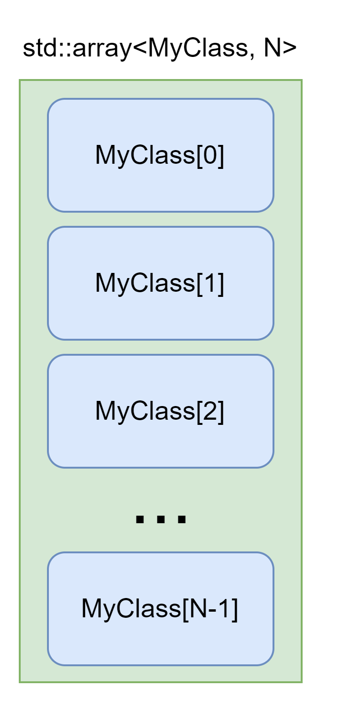

#### std::bitset

Так как минимально адресуемым элементом в C++ является байт то `std::array` ограничен по размеру элемента и даже `bool` будет занимать в нем один байт. Это не очень эффективно для хранения списка бит, поэтому в стандартной библиотеке представлен контейнер `std::bitset`.  
Это контейнер битов, размер которого задан во время компиляции числовым параметром шаблона. Все биты являются непосредственной частью объекта `std::bitset`.  
Данный контейнер **не реализует итераторов**, чем отличается от большинства контейнеров, однако предоставляет класс прокси ссылки на единственный бит.  
Выгодным преимуществом данного контейнера являются оптимизированные битовые операции:

* `test()`, `all()`, `any()`, `none()`, `count()`, `set()`, `reset()`, `flip()`;  
* Операторы: `&,|,^,>>,<<,&=,|=,^=,~,<<=,>>=`.

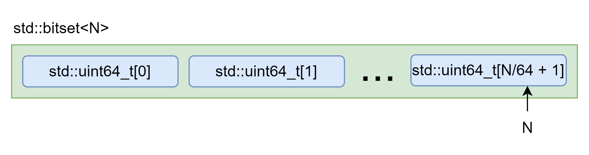

#### std::vector

Данный контейнер является наиболее популярным в C++. Он представляет из себя массив динамической длины. `std::vector` является легким объектом и хранит свои элементы в памяти, полученной от аллокатора. Это первый контейнер, в котором элемент можно вставить в произвольное место набора. Он отличается тем, что:

* Потребляет больше памяти, чем сумма размеров имеющихся элементов, так как обеспечивает дополнительные места для будущих элементов.  
  * Сократить объем используемой памяти позволяет метод `shrink_to_fit()`.  
  * Вместимость вектора не уменьшается при удалении элементов из него.  
* Вставка элемента в конец (методы `push_back()` \- с присвоением, и `emplace_back()` \- с конструированием по месту) занимает амортизированную константу по количеству элементов в контейнере.  
  * Данное свойство реализуется за счет стратегии роста объема памяти для элементов. Выделяемый объем растет по экспоненциальному закону, обычно доступное место удваивается при исчерпании.  
* Вставка в начало, или любое другое место \- занимает линейное время.

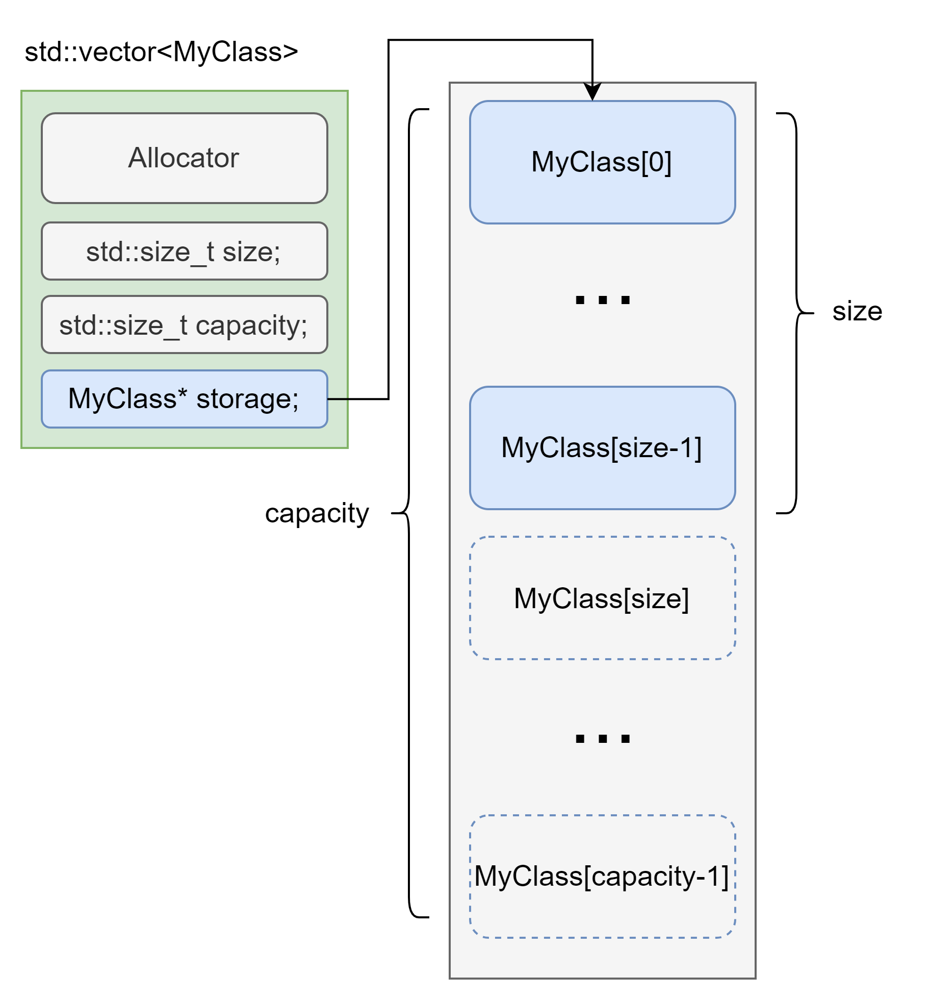

###### Идиома erase \+ remove

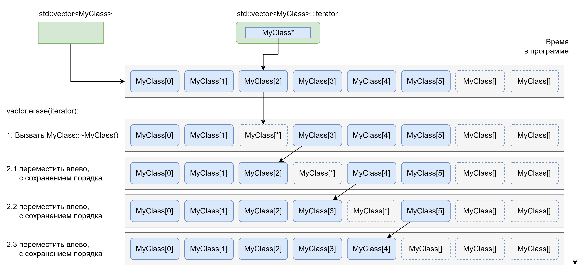

Данная идиома описывает корректный подход к удалению набора объектов из вектора. Для этого используют стандартные алгоритмы `std::remove` и `std::remove_if`, которые разделяют последовательность на две части по совпадению значения (`std::remove`) или по критерию (`std::remove_if`) в комбинации с методом `erase()` для вызова деструкторов удаляемых объектов.  
Данная идиома так как является частым источником ошибок нашла свое отражение в свободной функции `std::erase()`, реализующей данную идиому.

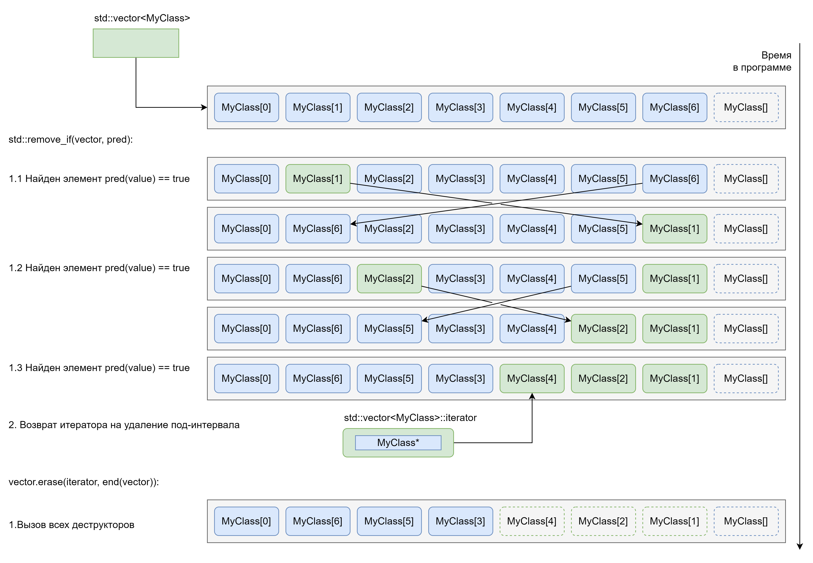

###### Идиома пре-аллокации хранилища вектора

Во многих случаях можно совершить обоснованное заключение сколько элементов может находиться в векторе после обработки данных. Для того чтобы не вовлекать механизм автоматического расширения хранилища при известном планируемом количестве элементов пользуются методом `reserve()` для того чтобы пре-аллоцировать внутреннее хранилище, чтобы оно смогло вместить как минимум заданное количество элементов. Во многих случаях позволяет значительно снизить накладные расходы для выполняемого алгоритма.

```c++
std::size_t totalCount = readCount();
std::vector<MyClass> instances;
instances.reserve(totalCount);
for (auto i : readInstances()) {
  instances.emplace_back(std::move(i));
}
```

##### Специализация std::vector\<bool\>

Также как и `std::bitset` для `std::array`, специализация `std::vector<bool>` является эффективной реализацией хранения битовых значений, в данном случае с возможностью изменения их количества во время исполнения программы.  
В отличии от `std::bitset` данная специализация реализует итераторы, с возможностью итерировать по каждому биту, но не предоставляет отдельных, оптимизированных методов для битовых операций, балансируя на этом фоне гибкостью применения стандартных алгоритмов над итераторами.

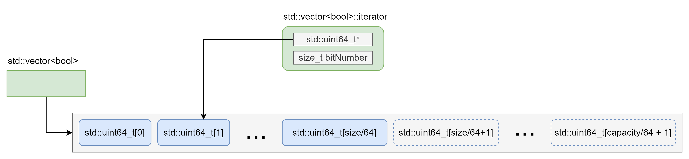

#### std::basic_string

Неожиданно для себя можно обнаружить, что строки в C++ также являются контейнерами последовательностей символьных типов. Данный контейнер похож на `std::vector` для символьных типов, однако он дает дополнительные гарантии:

* Последний элемент всегда является нулевым значением (нуль терминатором), но не учитывается в размере данного контейнера.  
* Шаблон принимает тип `char_traits`, позволяющие определять операции сравнения символьных значений, в том числе реализовывать коаллисинг. Т.е. если у вас есть тип, похожий на символьный, то реализовав `char_traits` вы сможете использовать его в C++ строках `std::basic_string`.

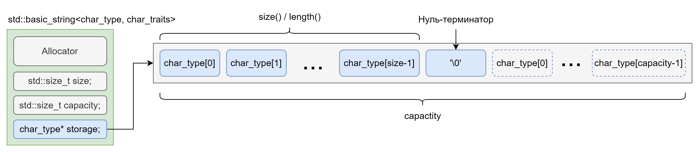

Помимо функционала итераторов над значениям символьных типов класс строки предоставляет и члены функции, специфичные для строк, такие как:

* `c_str()` \- получить представление данных в виде нуль терминированной С строки.  
* `operator+=()` или `append()` \- функционал, похожий на класс `StringBuilder` в других языках программирования, реализующий эффективное расширение вместимости хранилища строки.  
* `operator+()` \- конкатенация строк,  
* `replace()` \- замена подстроки по паре итераторов, или индексам.  
* Семейство методов `find_*()` \- поиск позиции вхождения символа или подстроки, начиная сначала или с конца.  
* `compare()` \- сравнивать подпоследовательности и строки, используя правила из установленного типа `char_traits`.  
* `starts_with()` \- проверка на соответствие префикса.  
* `ends_with()` \- проверка на соответствие суффикса.  
* `contains()` \- поиск вхождения.  
* `substr()` \- создание копии подстроки.

Данный шаблон имеет псевдонимы для всех символьных типов:

* `std::string` как `std::basic_string<char>` \- наиболее популярный вариант использования,  
* `std::wstring` как `std::basic_string<wchar_t>` \- второй по популярности, в основном на платформе Windows и при программировании графических интерфейсов.  
* `std::u8string` как `std::basic_string<char8_t>`  
* `std::u16string` как `std::basic_string<char16_t>`  
* `std::u32string` как `std::basic_string<char32_t>`

Последние три псевдонима используются для представления UTF строк, однако C++ **не поддерживает “рунное” представление** таких строк, как например Golang. Это означает, что длина строки считается не по количеству символов, а по количеству элементов символьных типов. Например для UTF-8 один символ может иметь длину от 1 до 4 `char8_t` элементов. Тоже касается и аспекта сравнения символов, они сравниваются не в Unicode код-поинтах, а поэлементно. Однако гарантируется, что `std::wstring` при работе с `wchar_t` имеет достаточный размер для представления одной руны в одном `wchar_t` для текущей системной кодировки. Таким образом если важна работа именно с рунами, то требуется произвести смену кодировки строки на текущую системную, а представления на `wchar_t`.

##### Copy-on-write (COW) строки

До C++11 многие стандартные библиотеки реализовывали оптимизацию, при которой копирование строки выполнялось только при записи. Данная оптимизация очень плохо приживалась в многопоточном режиме работы, в виду чего ее реализацию в стандартных библиотеках запретили начиная со стандарта C++11.  
> [!NOTE]
> Это один из немногих примеров когда комитет по стандартизации C++ согласился сломать ABI стандартной библиотеки (для чего кстати, были введены в*страиваемые пространства имен*).  
> Многие контейнеры могут быть значительно улучшены если не сохранять их ABI, однако в последние годы комитет по стандартизации C++ негативно относится к таким предложениям и выдвигает целостность ABI как одну из ключевых целей для развития языка.

##### Оптимизация малых строк

Начиная с C++11 на смену COW строкам пришла другая оптимизация Short String Optimization (SSO). Данная оптимизация позволяет хранить элементы строки прямо в самом объекте `std::basic_string` (как `std::array`) до определенного размера, и только при его достижении переходить к модели хранения в динамической памяти (как у `std::vector`).  
Данная оптимизация выполняется на уровне реализации стандартной библиотеки и поэтому количество элементов, хранимых внутри строки зависит от вендера компилятора и стандартной библиотеки, которыми вы пользуетесь.

```c++
template<SymbolType Char, class Allocator>
struct MySSOString : public Allocator {
  union {
    struct {
      Char* storage;  // Верхний байт любого указателя обычно пустой,
                      // так как адресуются только 47-56 бит
      std::size_t size;
      std::size_t capacity;
    } heap_string;    // Представление данных когда строка расположена на куче

    struct {
      bool is_sso;    // Используем не пустоту как признак оптимизации
      // Располагаем хранилище строки прямо внутри себя
      Char data[(sizeof(Char*) + 2 * sizeof(size_t) - 1) / sizeof(Char)];
    } sso_string;     // Представление данных когда строка SSO оптимизирована
  } data;
};
```

### Последовательные контейнеры

Последовательные контейнеры предоставляют доступ к своим элементам не гарантируя, что они размещаются непрерывно в памяти.

#### std::deque

Deque расшифровывается как double-ended queue \- двусторонняя очередь. Основным свойством данного контейнера является возможность дешево (за константу) вставить элемент в начало и конец контейнера. Это достигается за счет внутренней структуры, не предполагающей последовательного хранения элементов. Такая структура обычно приводит к большим, по сравнению с вектором, накладным расходам на доступ к конкретному элементу (2 разыменования указателя вместо одного в векторе).

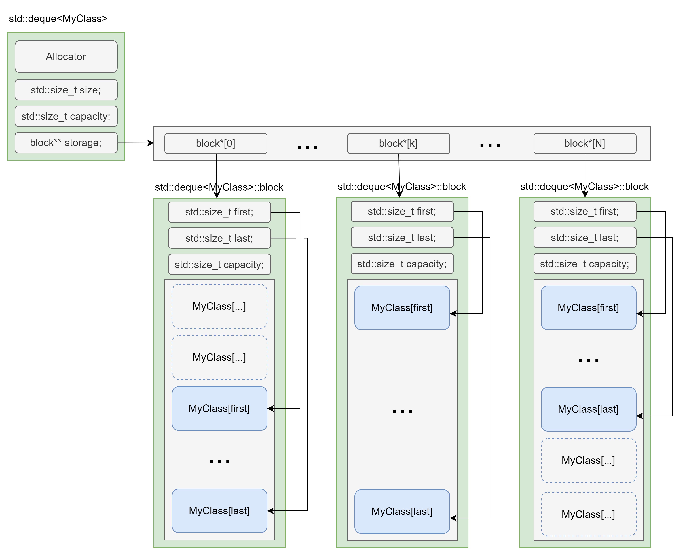

#### std::forward_list

Данный контейнер реализует односвязный список. Каждый элемент данного контейнера хранится в своем отрезке памяти, благодаря чему ссылки, указатели и итераторы на элементы **не инвалидируются вплоть до удаления** элемента.  
Итераторы в данном контейнере гарантируют только последовательный доступ из начала контейнера в конец. Данный факт не позволяет применить многие стандартные алгоритмы к данному контейнеру. Поэтому данный контейнер предоставляет реализации наиболее присущих ему алгоритмов как методы:

* `merge()` \- слияние отсортированных списков,  
* `splice_after()` \- перенос последовательности из другого списка,  
* `remove()` / `remove_if()` \- удаление элементов,  
* `reverse()` \- обращение порядка элементов в списке на противоположный,  
* `unique()` \- удаление повторяющихся последовательных элементов (по значению или по критерию),  
* `sort()` \- эффективная сортировка списка (обычно сортировка слиянием).

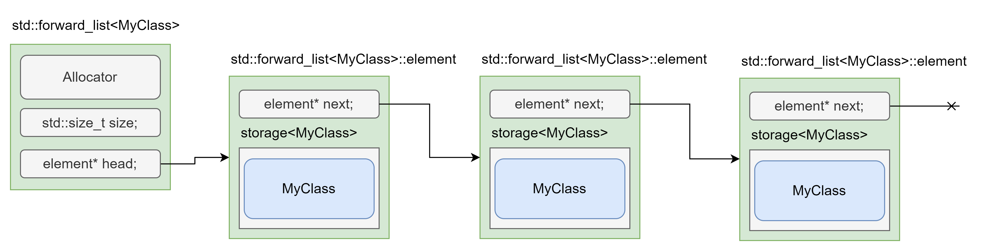

Данный контейнер можно на практике использовать как список долговременного хранения сущностей, на которые активно берутся ссылки и указатели, а затем освобождать их все сразу, удаляя контейнер. Это позволяет реализовывать простейшие стратегии работы с памятью. Многие алгоритмы обработки данных могут быть построены достаточно эффективно на основании данного контейнера.

```c++
std::forward_list<MyClass> storage;
using MyClassAccessor = std::forward_list<MyClass>::iterator;

std::map<std::string, MyClassAccessor> indexedByName;
std::unordered_map<std::size_t, MyClassAccessor> indexedById;
std::multimap<DateTime, MyClassAccessor> indexedByCreateAt;

storage.emplace_front(/* ... */);
auto emplaced = storage.begin();

indexedByName.emplace(emplaced->name, emplaced);
indexedById.emplace(emplaced->id, emplaced);
indexedByCreateAt.emplace(emplaced->createAt, emplaced);
```

#### std::list

Данный контейнер реализует двусвязный список. Преимущества данного контейнера такие же как и у `std::forward_list` и он решен недостатка однонаправленного прохода, так как элементы связаны в обе стороны, что позволяет применять к содержимому намного больше стандартных алгоритмов.  
Эффективные методы, реализующие алгоритмы также поддержаны для данного контейнера.

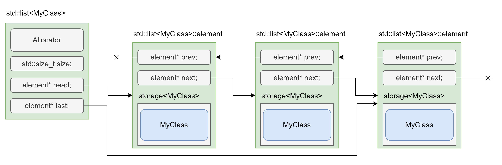

### Ассоциативные контейнеры

Ассоциативные контейнеры представляют коллекцию элементов, свойствами которой является:

* Вставка, удаление, поиск элемента за логарифмическую сложность (O(logN)).  
* Каждый элемент хранится в своем отрезке памяти.  
* Порядок обхода элементов через итераторы определен отношением порядка для типа элемента.

Типичной имплементацией для ассоциативных контейнеров служит структура данных красно-чёрное дерево. Все ассоциативные контейнеры принимают в качестве аргумента шаблона функциональный объект, используемый для сравнения элементов и установления отношения порядка. По умолчанию используется `std::less`, который применяет `operator<()`, что позволяет выступать ключом в ассоциативных контейнерах любому типу, реализующему `operator<()`.  
В стандартной библиотеке предоставляются четыре ассоциативных контейнера:

* `std::set` \- выражает собой упорядоченный набор неизменяемых элементов.  
  * Хранимый элемент является ключом.  
* `std::map` \- выражает собой словарь.  
  * Определяется тип ключа и элемента.  
  * Упорядочивание производится по ключу.  
  * Данные хранятся как `std::pair<const Key, T>`, что приводит к иммутабельности ключа.  
* `std::multiset` \- тоже, что и `std::set`, но допускает повторяющиеся элементы.  
* `std::multimap` \- тоже, что и `std::map`, но допускает повторяющиеся по ключу элементы.

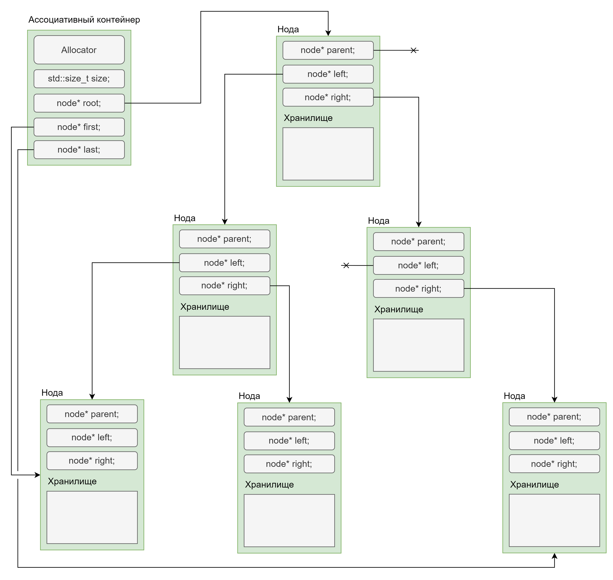

Ассоциативные контейнеры предоставляют ряд уникальных методов поиска среди своих элементов с гарантированной логарифмической сложностью:

* `count()` \- подсчет количества элементов, с совпадающим ключом.  
* `find()` \- поиск первого элемента с совпадающим ключом, возвращает итератор.  
* `contains()` \- проверка признака нахождения элемента в контейнере по ключу.  
* `equal_range()` \- поиск всех элементов, расположенных последовательно, для которых ключ совпадает с заданным, возвращает два итератора.  
* `lower_bound()` \- поиск первого элемента контейнера, который не меньше (больше или равен) заданного ключа, возвращает итератор.  
* `upper_bound()` \- поиск первого элемента контейнера, который строго больше заданного ключа, возвращает итератор.

Комбинация методов `equal_range()` / `lower_bound()` / `upper_bound()` \- позволяет использовать ассоциативные контейнеры как контейнеры промежутков.  
Если искомый элемент не найден в данном контейнере, то возвращается объект конечного итератора `end()`.  
Все ассоциативные контейнеры реализуют интерфейс сплайсинга через метод `merge()`, который эффективно переносит данные данные со слиянием из одного экземпляра контейнера в другой.

##### Контейнеры базирующиеся на нодах (node-based)

Данные контейнеры называют базирующимися на нодах (node-based). Так как каждый элемент контейнера выделен в памяти отдельно и совмещен с управляющими данными. Пока элементы находятся в контейнерах изменение их значения запрещено, для `std::set` полностью, для `std::map` \- значения ключа, так как такое изменение привело бы к не консистентности структуры данных нарушив порядок хранения.  
Для того, чтобы изменить данные в этих контейнерах используются методы:

* `extract()` \- для изъятия ноды из контейнера, после чего доступно ее редактирование,  
* `insert()` \- для вставки ноды в контейнер.

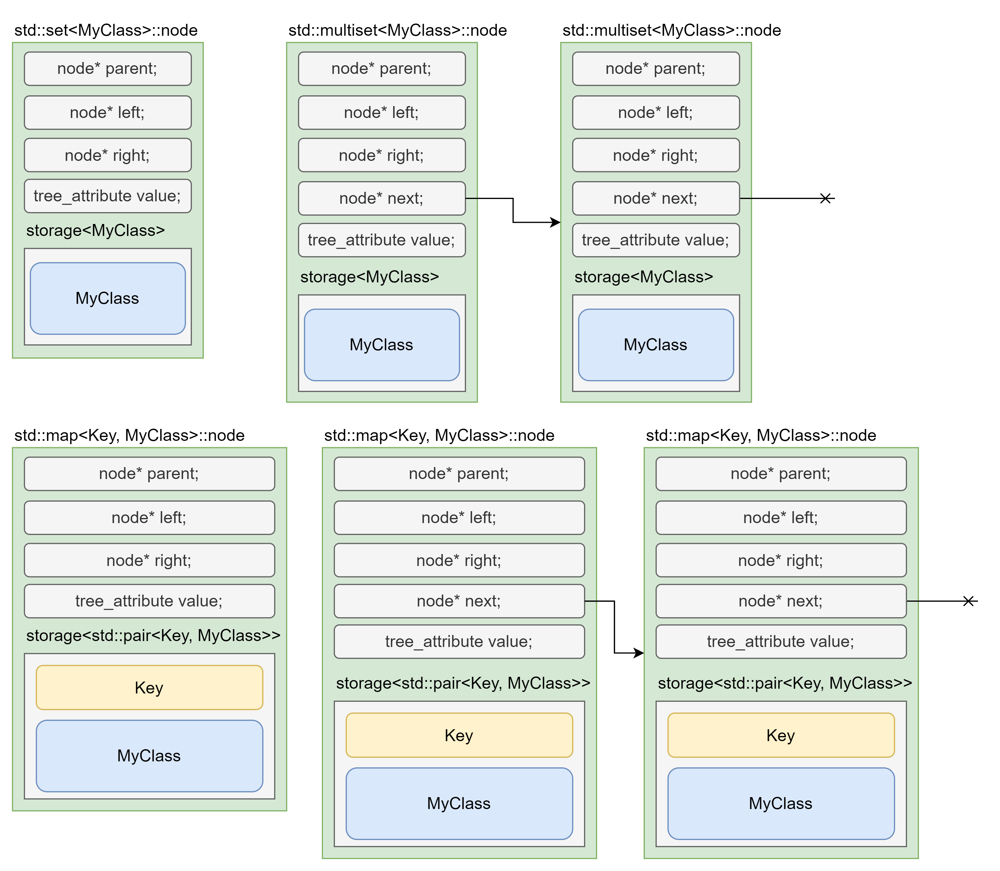

###### Идиома пред-создания ноды

Данная идиома используется в местах, где объекты вставляются в контейнеры, с большим числом элементов. Сначала объект вставляют во временный контейнер, а затем, в большой уже в виде ноды.

```c++
std::map<Key, MyClass> many_element_container;

void insert(Key key, MyClass value) {
  if (many_element_container.size() < 128) {
    many_element_container.emplace(std::move(key), std::move(value));
  } else {
    decltype(many_element_container) tmp_container;
    auto [iterator, emplaced] = tmp_container.emplace(std::move(key), std::move(value));
    // Или
    auto node = tmp_container.extract(iterator);
    many_element_container.insert(std::move(node));
    // Или
    many_element_container.merge(tmp_container);
  }
}
```

##### Прозрачное сравнение в ассоциативных контейнерах

Ассоциативные контейнеры для операций поиска используют предоставленный в шаблонном параметре функциональный объект, называемый компаратором. Изначально методы поиска элемента могли выполнять только сравнения к точным типом ключа (для `std::set` тип ключа и тип элемента одинаковы).  
Данное свойство не является удобным во многих ситуациях. Самая простая из них \- в качестве ключа использовать тип `std::string`, а для поиска константу `char[]`. Это довольно распространенный сценарий и он работал ранее на основании неявного конструирования объекта `std::string` из С строки, что использует больше памяти чем нужно, но для сравнения этих объектов вообще не нужно создавать C++ строку из С строки, поскольку операция сравнения над ними уже определена.  
Для поддержки сравнения между неодинаковыми, но сравнимыми типами, в ассоциативные контейнеры была введена идиома прозрачного сравнения. Теперь если компаратор определяет псевдоним типа с именем `is_transparent` то контейнер может принять в функции поиска любой тип, который компаратор сможет сравнить с типом ключа в контейнере, другими словами, для которого в компараторе есть перегрузка `operator()()`.

```c++
struct MyNonTransparentLess {
  // Оператор operator()() определен жестко
  bool operator()(const MyClass& lhs, const MyClass& rhs) noexcept {
    // Сравнение только двух экземпляров MyClass
  }
};

struct MyTransparentLess {
  // Признак прозрачности для того, кто будет нас использовать
  using is_transparent = void;

  // Оператор operator()() определен мягко и допускает все типы,
  // удовлетворяющие концепту ConvertibleTo<MyClass>
  template<ConvertibleTo<MyClass> U>
  bool operator()(const MyClass& lhs, const U& other) noexcept {
    // Сравнение MyClass и произвольного типа
  }
};

struct OtherClass {
  explicit operator MyClass() const {
    /* ... */
  }
};

std::set<MyClass, MyNonTransparentLess> nonTransparent;
nonTransparent.find(MyClass{});    // Ok
nonTransparent.find(OtherClass{}); // Ошибка find определен как "find(const MyClass&)"

std::set<MyClass, MyTransparentLess> transparent;
nonTransparent.find(MyClass{});    // Ok
nonTransparent.find(OtherClass{}); // Ok - find определен как "template<class U> find(U&&)"
```

##### std::map и operator\[\]\(\)

У контейнера `std::map` задана не интуитивная семантика использования `operator[]()`. При использовании оператора индексации если объекта, соответствующего заданному ключу, в контейнере не существовало, то такой будет сконструирован по умолчанию. Так, что необдуманное использование `operator[]()` приводит к засорению контейнера пустыми объектами, особенно это критично для простых типов данных, инициализация по умолчанию которых может приводить к любому значению.  

##### Операции множеств в std::set

В отличии от `std::bitset` и таких языков как Python, где оптимальные операции над множествами являются методами классов в C++ был выбран другой подход \- отдельные методы для множеств **НЕ предоставляются**, вместо них представлены стандартные алгоритмы, которые оперируют **на любых сортированных последовательностях**.  
Таким образом не важно, были ли отсортированы элементы `std::vector` или для хранения был использован `std::set` \- обе эти последовательности можно пересечь (`std::set_intersection()`) / объединить (`std::set_union()`) / вычесть (`std::set_difference()`) / симметрично вычесть (`std::set_symmetric_difference()`) друг с другом и проверить на вхождение подпоследовательности одной в другую (`std::includes()`).  
Тут мы уже можем наблюдать одну из сильных сторон *схемы контейнер-итератор-алгоритм* \- итераторы абстрагируют конкретный способ хранения элементов от исполняемого алгоритма.

### Неупорядоченные ассоциативные контейнеры

Неупорядоченные ассоциативные контейнеры представляют коллекцию элементов, свойствами которой является:

* Вставка, удаление, поиск элемента выполняются за амортизированную константу (O(1)).  
* Каждый элемент хранится в своем отрезке памяти.  
* Порядок обхода элементов через итераторы НЕ определен.

Типичной имплементацией для ассоциативных контейнеров служит структура данных хеш таблица. Все неупорядоченные ассоциативные контейнеры принимают в качестве аргумента шаблона два функциональных объекта, один используется для вычисления хеша ключа (по умолчанию `std::hash`), другой для проверки на равенство (по умолчанию `std::equal_to`).  
В стандартной библиотеке предоставляются четыре неупорядоченных ассоциативных контейнера, по аналогии с ассоциативными контейнерами:

* `std::unordered_set` \- неупорядоченный `std::set`,  
* `std::unordered_map` \- неупорядоченный `std::map`,  
* `std::unordered_multiset` \- неупорядоченный `std::multiset`,  
* `std::unordered_multimap` \- неупорядоченный `std::multimap`.

Также как и ассоциативные контейнеры, неупорядоченные контейнеры:

* Являются контейнерами, *базирующимися на нодах*.  
* Предоставляют возможность сплайсинга (метод `merge()`).  
* Имплементируют идиому прозрачного сравнения, только вместо компаратора прозрачным должен быть объект, вычисляющих хеш (называется *хешер*).  
* `std::unordered_map` имеет ту же особенность `operator[]()`, что и у `std::map` (доступ приводит к вставке).  

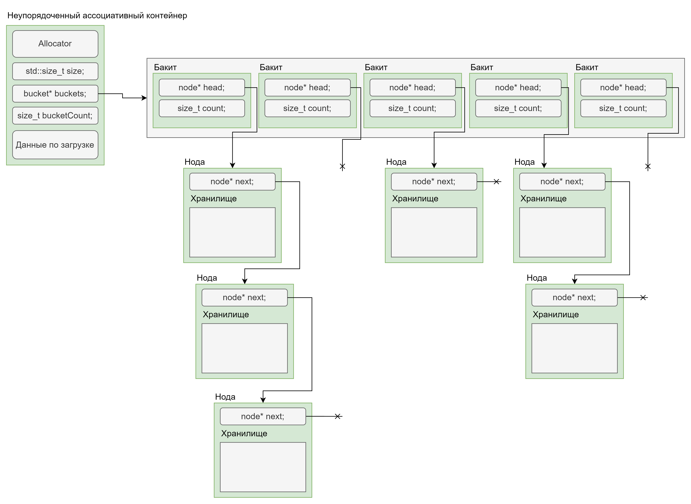

Есть также и отличия:

* Итераторы в неупорядоченных контейнерах являются однонаправленными, а в ассоциативных они двунаправленные.  
* Доступны итераторы по отдельным бакитам контейнера.  
* Итераторы инвалидируются, если вставка приводит к пере-хешированию (указатели и ссылки не инвалидируются).  
* Методы поиска `lower_bound()` и `upper_bound()` не доступны, так как они полагаются на отношение порядка.  
* Операции над множествами **не доступны** как стандартные алгоритмы и их нужно писать самому.
* Доступен интерфейс управления хешированием:  
  * `bucket_count()` \- текущее количество бакитов,  
  * `max_bucket_count()` \- максимально количество бакитов, поддерживаемое имплементацией.  
  * `bucket_size()` \- получить данные о количестве элементов в конкретном баките.  
  * `bucket()` \- получить информацию о том к какому бакиту относится ключ.  
  * `load_factor()` \- получить данные о среднем количестве элементов в баките во всем контейнере.  
  * `max_load_factor()` \- получить или установить пороговое значение для среднего количества элементов в баките, при котором происходит пере-хеширование.  
  * `rehash()` \- выполнить принудительное пере-хеширование, операцию при которой структура хеш таблицы приводится в состояние при котором: `load_factor() < max_load_factor()`  
  * `reserve()` \- создать внутренние структуры для как минимум заданного количества элементов.

### Специализированные адаптеры контейнеров

С точки зрения дизайна стандартной библиотеки есть контейнеры, которые самостоятельно реализуют стратегию хранения элементов, и есть адаптеры контейнеров, которые поверх некого нижележащего контейнера реализуют поведение той или иной структуры данных. В других языках, то что в C++ представлено адаптером контейнера может быть представлено самостоятельной сущностью. Адаптеры контейнеров принимают как один из аргументов шаблона тип нижележащего контейнера.  
Адаптеры контейнеров представлены:

* `std::stack` \- реализация структуры данных LIFO.  
  * Из особенностей: следующий элемент доступен по ссылке через метод `top()`, а метод `pop()` не возвращает ничего.  

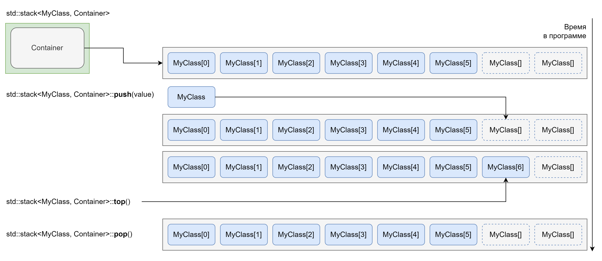

* `std::queue` \- реализация структуры данных FIFO.  
  * Из особенностей: следующий элемент доступен по ссылке через метод `front()`, а метод `pop()` не возвращает ничего.  

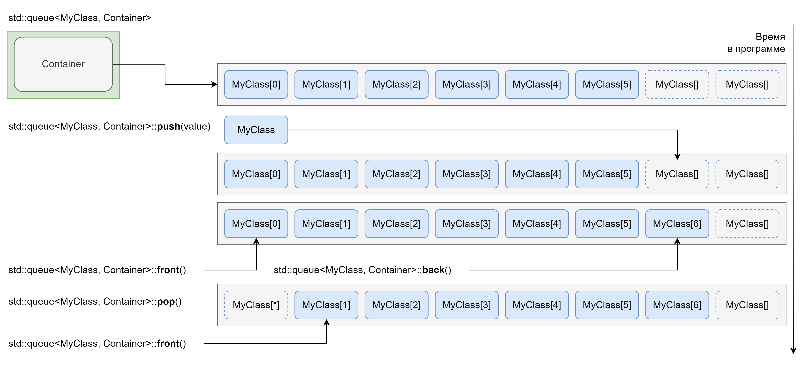

* `std::priority_queue` \- очереди с приоритетом.  
  * Реализуется через построение кучи над элементами контейнера.  
  * Принимает компаратор как параметр шаблона.

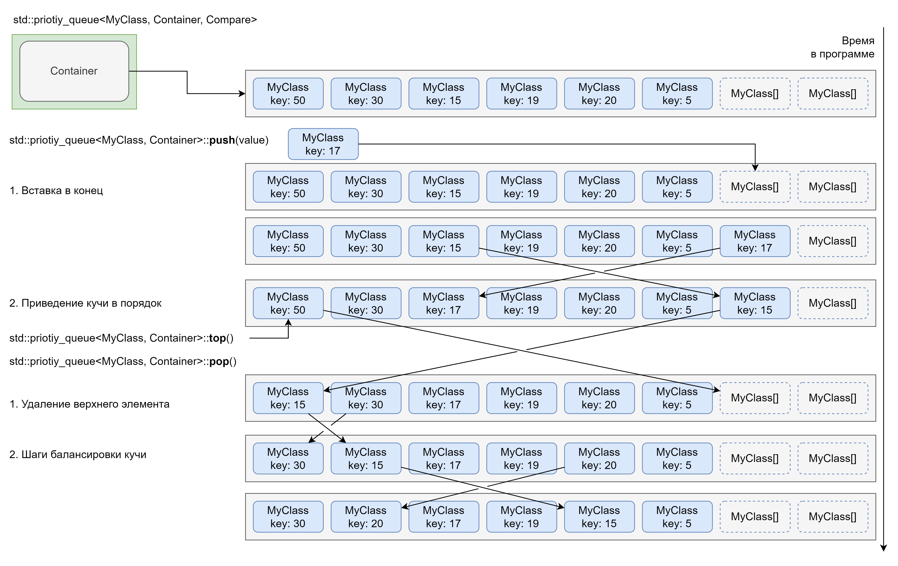

#### Плоские ассоциативные контейнеры (C++23)

Начиная с C++23 мы получили в свое распоряжение набор и четырех новых адаптеров контейнеров, которые связаны одной идеей: ассоциативные контейнеры часто не так производительны, как простой поиск в отсортированном массиве из\-за не локальности данных, их плохой кешируемости в кешах процессора. Поэтому в кодовых базах часто можно было заметить реализацию или использование “плоских” (flat) вариантов ассоциативных контейнеров, которые “под капотом” хранили и отрабатывали отсортированный вектор элементов. Именно такие адаптеры и были представлены для общего пользования:

* `std::flat_set` / `std::flat_multiset` \- реализация интерфейса `std::set` / `std::multiset` поверх одного последовательного контейнера.  

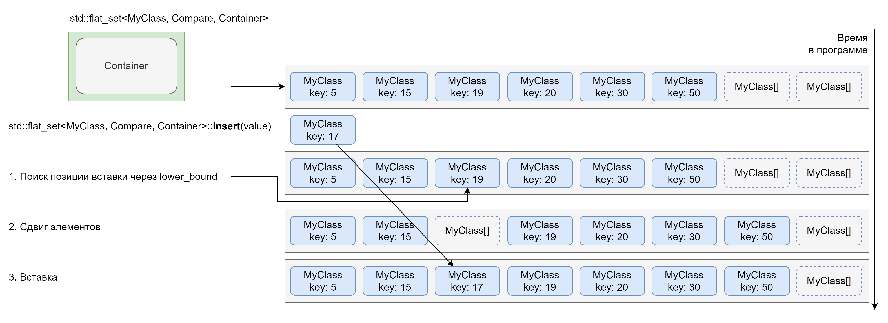

* `std::flat_map` / `std::flat_multimap` \-  реализация интерфейса `std::map` / `std::multimap` поверх двух последовательных контейнеров, один с ключами, а второй со значениями.  
  * Контейнеры при этом синхронизированы \- ключу соответствует значение с тем же индексом в контейнере значений, что и ключ в контейнере ключей.

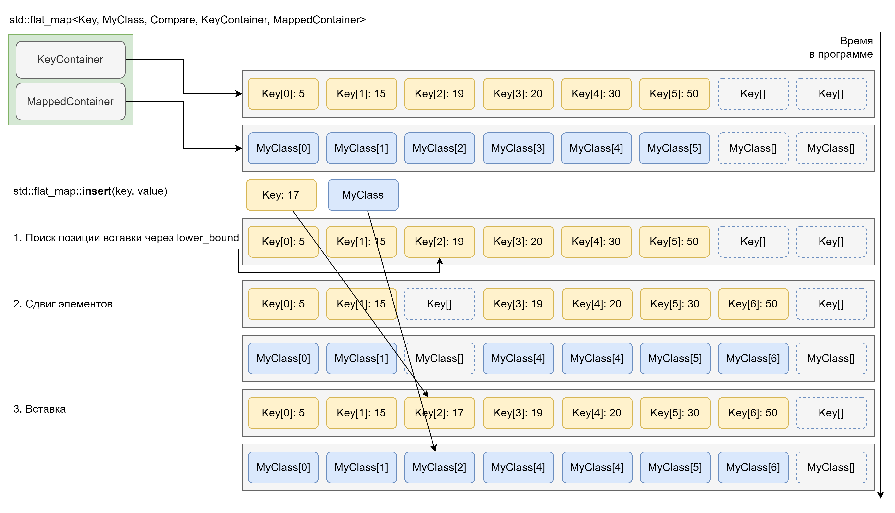

### Другие типы контейнеров

На данный момент мы рассмотрели все типы контейнеров, представленные в стандартной библиотеке, все же они не покрывают всего множества и разнообразия структур данных, а также подходов к реализации понятия контейнера.  
Рассмотрим несколько видов контейнеров и где можно найти их имплементации:

* Интрузивные контейнеры (`boost::intrusive`). Можно заметить, что все контейнеры стандартной библиотеки “оборачивают” хранимые элементы в свои управляющие структуры и используют интерфейс аллокатора для их создания, однако это не всегда желательное поведение. Контейнеры, которые отдают тип, реализующий метаданные элемента, для наследования или агрегации называются интрузивными. Могут возникать следующие причины использования таких контейнеров:  
  * Желание выделять память под элемент лишь однажды или нежелание использовать механизм аллокаторов.  
  * Возможность вставки элемента в несколько разных контейнеров одновременно (например в дерево и хеш таблицу) без копирования и без сохранения итераторов во втором контейнере.  
  * Каждый контейнер наделяется свойствами базирующегося на нодах.  

```c++
class MyClass {
public:
  intrusive::list::metadata& get_list_metadata() {
    return m_list_data;
  }

  intrusive::tree::metadata& get_tree_metadata() {
    return m_tree_data;
  }

  const std::string& get_name() {
    return m_tree_data;
  }

private:
  intrusive::list::metadata m_list_data;
  intrusive::tree::metadata m_tree_data;
  std::string m_name;
};

// Создаем объект только один раз
MyClass *object = new MyClass("Hello!");

// MyClass::get_list_metadata - для доступа к метаданным
intrusive::list<MyClass> list{&MyClass::get_list_metadata};
// Вставляем объект в list
list.push_front(*object);

// MyClass::get_name - для получения доступа к ключу, MyClass::get_tree_metadata - для доступа к метаданным
intrusive::map<std::string, MyClass> map{&MyClass::get_name, &MyClass::get_tree_metadata};
// Вставляем тот же объект в map
map.insert(*object);
// Результат: Один и тот же объект в двух разных контейнерах

// Объект не удаляется, а просто вынимается из контейнера
list.extract(*object);
```

* Контейнеры с двойной ассоциацией (`boost::bimap`). Данный тип контейнеров похож на `std::map`, однако реализует индексацию как элементов по ключу, так и ключей по элементу. Такой контейнер часто пригождается в ситуациях необходимости обратного поиска.  
* Циклические буферы (`boost::curcular_buffer`). Данные контейнеры применяются в высокопроизводительных системах и в работе с оборудованием. Они фактически являются очередями FIFO над фиксированным отрезком памяти.  
* Многоиндексный контейнер (`boost::multi_index_container`). Данный тип контейнеров используется для задач, когда один и тот же набор данных может быть по разному проиндексирован, например отсортирован по значениям и по частоте использования.  
* Контейнеры с оптимизацией малых длин (`boost::small_vector`, `boost::static_string`). Данные контейнеры реализуют оптимизацию малых длин, также как SSO для строк, для заданного во время компиляции количества элементов.  
* Графовые структуры данных (`boost::graph`). Отдельным направлением работ в информатике являются графы, структуры данных их реализующие и эффективные алгоритмы на графах. Все же графы и пути их обхода также можно интерпретировать в качестве контейнеров и итераторов.  
* Дисковые структуры данных (`sqlite`). Помимо структур, располагаемых в оперативной памяти часто требуется эффективная работа с данными на диске. В этом аспекте помогает библиотеки встроенных баз данных, такие как `SQLite` для B+ деревьев и `leveldb` для SSTable.

### Выбор контейнера для решения задачи

Нет сомнения что перед программистом на C++ будет постоянно вставать вопрос \- какой контейнер применить в данной задаче. Здесь часто ссылаются на *идиому almost always vector* (почти всегда вектор), которая говорит, что для подавляющего большинства задач с точки зрения хранения данных стоит предпочитать вектор, а остальные контейнеры использовать только тогда, когда это даст явно измеримые преимущества над вектором, например по производительности и удобству использования.

## Не владеющие обёртки

Помимо контейнеров, владеющих своими элементами стандартная библиотека C++ предоставляет набор шаблонов классов, которые не владеют своими элементами, но позволяют выполнять некоторые наборы операций.  
Такими не владеющими обертками являются:

* `std::basic_string_view` \- Обёртка над непрерывной знаковой последовательностью, не предоставляющая интерфейса изменения элементов последовательности.  
  * Основное назначение: Добавляет строковые методы из класса `std::basic_string` для С строк и любых последовательностей символьных типов, например `std::vector<char>`.  
  * Как и у `std::basic_string` есть псевдонимы для всех символьных типов:  
    * `std::string_view` (`char`), `std::wstring_view` (`wchar_t`), `std::u8string_view` (`char8_t`), `std::u16string_view` (`char16_t`), `std::u32string_view` (`char32_t`).  
  * Добавляет суффикс строковых констант `_sv`, применяя который синтаксис сравнения со строковой константой становится более производительным, безопасным и понятным.  
* `std::span` \- Обёртка над непрерывной последовательностью любых типов, предоставляющая возможность модификации элементов. Имитирует интерфейс `std::array`.  
  * Используется для передаче при обработке под последовательностей данных.  
* `std::mdspan` \- Обёртка над непрерывной последовательностью любых типов, предоставляющая возможность модификации элементов, имитирующая многомерный C массив.  
  * Может использоваться для смены схемы доступа к одному и тому же нижележащему плоскому массиву (`row major` против `column major` доступ).

## Итераторы

Итераторы получили распространение как самостоятельный шаблон дизайна в отрыве от контейнеров, так как они могут представлять не только перечисления элементов в памяти, но и, например, в потоке ввода/вывода, файлов и папок на файловой системе, найденных подвыражений в регулярных выражениях.  
Широкому распространению итераторы также обязаны:

* Библиотеке стандартных алгоритмов, построенной на приеме последовательностей, определяемых итераторами.  
* Ленивым вычислением значений, что позволяет представлять итератором бесконечные последовательности данных.  
* Легкости комбинации итераторов, например для декорирования итератора функциональным преобразованием результата или склейки двух последовательностей.  
* Легковесности имплементации.

В стандартной библиотеке выделена под библиотека итераторов, в которой определены полезные типы итераторов, не связанные с контейнерами и операции над ними, а, начиная с C++20, в нее добавляются концепты, определяющие возможность итерирования (обхода) по последовательности, которые в том числе используются для библиотеки промежутков.

### Категории итераторов в стандартной библиотеке

Все итераторы разделяются подходом к дизайну стандартной библиотеки C++ на шесть категорий, в зависимости от типов операций и гарантий, которые предоставляет имплементация итератора:

* Итератор ввода (input iterator) \- только увеличиваемый итератор, пригодный для единственного прохода и способный “прочитать” значение заданного типа из представляемой последовательности.  
* Итератор вывода (output iterator) \- только увеличиваемый итератор, пригодный для единственного прохода и способный записать значение заданного типа в представляемую последовательность.  
* Однонаправленный итератор (forward iterator) \- умеет тоже, что итератор ввода и пригоден для многоразового прохода.  
* Двунаправленный итератор (bidirectional iterator) \- умеет тоже, что однонаправленный итератор и пригоден для уменьшения (прохода в обратную сторону).  
* Итератор случайного доступа (random access iterator) \- умеет тоже, что двунаправленный итератор и способен к переходу на любую величину отступа от текущего элемента за константное время.  
* Непрерывный итератор (contiguous iterator) \- умеет тоже, что итератор случайного доступа и предоставляет гарантию, что адреса элементов последовательности расположены непрерывно в оперативной памяти.

Итераторы являются типами, *похожими на указатель* (pointer-like) и большинство их операций реализованы через перегрузку операторов.  

### Имплементации итераторов в стандартной библиотеке

В стандартной библиотеке C++ помимо итераторов в контейнерах встречаются следующие имплементации итераторов:

* `std::regex_iterator` / `std::regex_token_iterator` \- итераторы по найденным включениям регулярного выражения и по совпавшим под-выражениям.  
* `std::back_insert_iterator` / `std::front_insert_iterator` / `std::insert_iterator` \- итераторы вывода, позволяющие вставлять в новые элементы в контейнер.  
  * Частым расширениям в кодовых базах является `emplace_back_iterator` для вставки с конструированием.  
* `std::istream_iterator` / `std::ostream_iterator` / `std::istreambuf_iterator` / `std::ostreambuf_iterator` \- итераторы для библиотеки потоков ввода/вывода, которые позволяют извлекать из потоков и записывать в потоки объекты.  
* `std::directory_iterator` / `std::recursive_directory_iterator` \- итераторы по файлам и каталогам на файловой системе из стандартной библиотеки работы с файловой системой.

Примечательной внешней библиотекой, определяющей много различных видов и типов итераторов является `boost::iterator`.

### Общие функции для работы с итераторами

В шаблонном коде, а иногда и просто для легкости восприятия кода с использованием итераторов вместо  вызова операторов часто применяют свободные функции из стандартной библиотеки. Такие функции стараются работать со всеми категориями итераторов и выдают более понятные ошибки, чем применение операторов:

* `std::advance()` \- увеличивает или уменьшает итератор на заданное число шагов. Обновляется значение переданного итератора.  
* `std::distance()` \- позволяет рассчитать расстояние между двумя итераторами.  
* `std::next()` \- возвращает итератор увеличенный на заданное число шагов.  
* `std::prev()` \- возвращает итератор уменьшенный на заданное число шагов.

## Алгоритмы

Алгоритмы это последний элемент схемы контейнер-итератор-алгоритм, который реализует алгоритм обработки данных потребляя итераторы в качестве определителей последовательностей. Некоторые алгоритмы могут быть выполнены только на определенных категориях итераторов. Алгоритмы делятся на два типа: модифицирующие последовательность по месту, и требующие итератора для записи получаемого результата.  
Всего в стандартной библиотеке представлено около 140 алгоритмов, поэтому на практике крайне рекомендуется пользоваться справочником, таким как cppreference.com для детального изучения того, на что способны те или иные алгоритмы. Тут же мы перечислим их широкие категории алгоритмов:

1. Серийной обработки,  
2. Поиска,  
3. Копирования и перемещения,  
4. Обмена,  
5. Преобразования,  
6. Создания (генерации),  
7. Удаления,  
8. Изменения порядка,  
9. Семплирования,  
10. Разбиения,  
11. Сортировки,  
12. Бинарного поиска,  
13. Операций над множествами,  
14. Операций слияния,  
15. Реализации структуры данных кучи,  
16. Минимума/максимума,  
17. Лексикографического сравнения,  
18. Перестановок,  
19. Числовые (свертки и частичные свертки).

Ещё больше различных алгоритмов с теми же принципами дизайна представлено в библиотеках `boost::algorithm` и `boost::string_algorithm`.

### Стратегии выполнения алгоритмов

Начиная с C++17 для многих алгоритмов стали доступны версии, которые принимают дополнительный параметр \- стратегию выполнения. Этот элемент дизайна стандартных алгоритмов позволяет эффективно использовать свойства конкурентности и параллелизма на уровне конкретного алгоритма. К C++20 в стандартной библиотеке были доступны для использования четыре стратегии выполнения:

* `std::execution::sequenced_policy` \- простое последовательное выполнение без возможности использования конкурентности или параллелизма.  
* `std::execution::parallel_policy` \- выполнение, рассчитанное на ускорение за счет параллелизма, обычно за счет пула потоков.  
* `std::execution::unsequenced_policy` \- выполнение, рассчитанное на ускорение за счет конкурентности, обычно за счет агрессивной векторизации вычислений.  
* `std::execution::parallel_unsequenced_policy` \- выполнение, рассчитанное на ускорение за счет конкурентности и параллелизма.

## Промежутки и Сдержанные алгоритмы

В C++20 мы получили библиотеку промежуток в составе стандартной библиотеки. Данная библиотека привносит два раздельных типа функционала, сами промежутки и сдержанные алгоритмы (constrained algorithms).

### Сдержанные алгоритмы

Данные алгоритмы призваны улучшать удобство использование стандартных алгоритмов за счет:

* Принятия в качестве аргументов полностью контейнеры и любые промежутки, что значительно увеличивает читаемость кода.  
* Возврат большего количества данных из алгоритмов. Данный пункт закрывает несколько проблем с уже имеющимися алгоритмами, поменять результат возврата которых невозможно из\-за возможности поломки ABI.  
* Все сдержанные алгоритмы являются `constexpr`, хотя их прародители из обычных алгоритмов могут быть еще не переведены в разряд `constexpr`.  
* Поддержка “проекций” \- функционального объекта для трансформации данных в последовательности перед применением алгоритма к конкретному элементу. Это позволяет значительно сократить синтаксис.  
* Алгоритмы представлены экземплярами функциональных объектов, а не свободными функциями, что несколько увеличивает скорость компиляции за счет упрощения *разрешения перегрузок*.

Все алгоритмы имеют такие же названия, как и их стандартные варианты и располагаются в пространстве имен `std::ranges`.

### Библиотека промежутков

Данная часть стандартной библиотеки создана как альтернативный схеме контейнер-итератор-алгоритм дизайн обработки данных. Промежутки поддерживают:

* Простой синтаксис задания последовательной обработки данных, на ряду со Streams из Java и Linq из C\#.  
* Ленивую обработку данных, а за счет этого минимизацию копирования объектов и потребления памяти.  
* Некоторые заключения о пустоте промежутка, выводимые во время компиляции с использованием списка требований и системы типов, которые помогают проектировать потоки данных обнаруживая ошибки при компиляции.

Библиотека промежутков предоставляет два строительных блока:

* Представления \- это объекты с которых начинается обработка данных, они определяют выходную последовательность. На момент C++20 введено пять представлений:  
  * `std::ranges::subrange` \- получается из контейнера или двух итераторов.  
  * `std::ranges::empty_view` \- представляет пустую последовательность.  
  * `std::ranges::single_view` \- представляет последовательность из одного элемента.  
  * `std::ranges::iota_view` \- представляет конечные и бесконечные числовые последовательности.  
  * `std::ranges::basic_istream_view` \- представляет последовательность объектов в потоке ввода.  
* Адаптеры промежутка \- представляют собой всевозможные операции, которые можно применять к представлению или промежутку, для получения нового промежутка. На момент C++23 определены 22 адаптера промежутков.
