# Глава 10: Конкурентность и Параллелизм

В данной главе мы поговорим о подходах к конкурентности и параллелизму в C++ и их поддержки в стандартной библиотеке.

## Конкурентность и Параллелизм

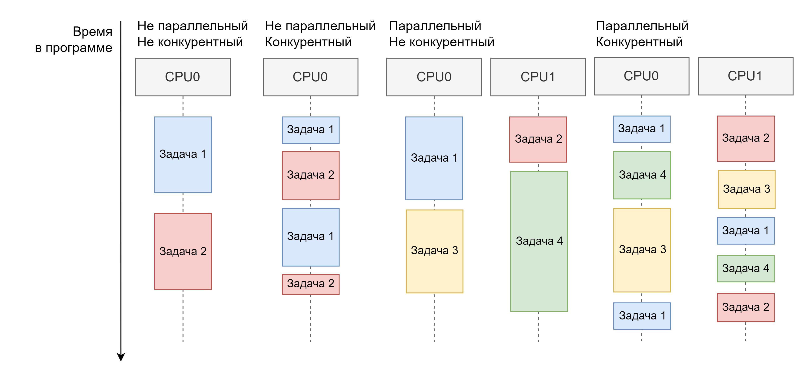

Под **конкурентностью** программы мы понимаем способность перемежевывать разные задачи при её исполнении. Под **параллелизмом** мы будем понимать возможность программы выполнять несколько задач в один и тот же момент времени. Программы могут использовать или не использовать как конкурентность так и параллелизм для достижения своих задач. Конкурентность и параллелизм проявляются в разных языках программирования по-разному. Они выражены различными элементами языкового дизайна  и дизайна стандартных библиотек.  
Программисты  вольны использовать конкурентность и параллелизм для достижения целей обозначенных функциональных требованиях к программе.  

### Конкурентность на уровне ОC

Конкурентности логичнее всего начинать с уровня абстракции операционной системы. На уровне операционной системы  обычно вводится две единицы конкурентного исполнения задачи и потоки. Первые мы обычно называем *программами*, а последние мы называем *потоками* операционной системы.  

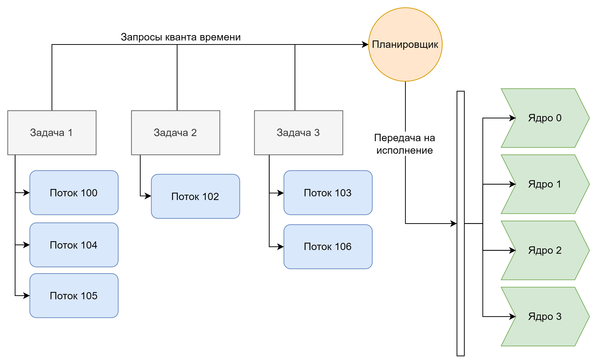

В типичной операционной системе присутствует компонент под названием *шедулер* или *планировщик*. Он отвечает за установку порядка выполнения задач и потоков. Алгоритм планировщика обычно является частью имплементации ядра операционной системы, при этом платформенные библиотеки позволяют производить тонкую настройку параметров алгоритма планировщика. Операционные системы придерживающиеся стандарта POSIX обычно дают возможность изменить алгоритм планировщика как после рестарта операционной системы так и во время исполнения.

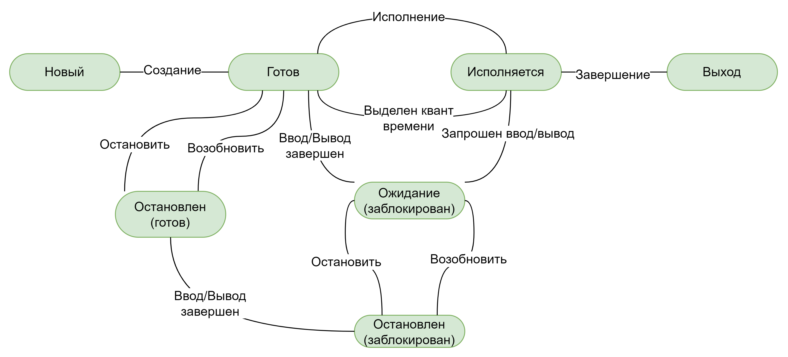

#### Конкурентное выполнение процессов

Конкурентным может быть исполнение процессов даже на системах с одним центральным процессором. Конкурентность исполнения задач на уровне ядра операционной системы реализуется за счет **превентивной** или **добровольной** передачи управления планировщику. Превентивная передача управления осуществляется за счет прерывания таймера процессора. В момент прерывания контроль автоматически переходит в пространство ядра где операционная система может выполнить код планировщика для смены текущей задачи. Добровольная передача управления операционной системе происходит за счет  выполнения системного вызова со стороны программы.  

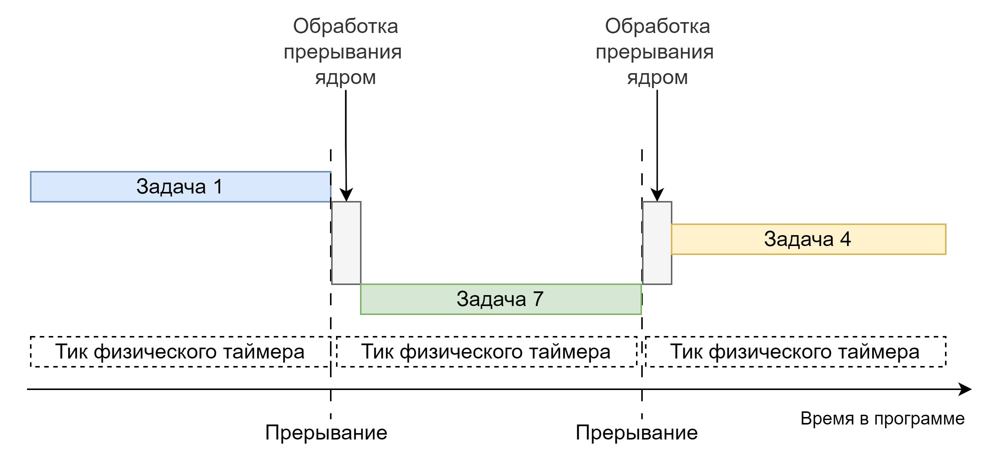

Конкурентное исполнение задач в операционной системе затрагивает как пространство ядра так и пространство пользователя. Обычная задача пространства ядра операционной системы заключается в обработке прерываний внешних устройств.  
Конкурентность, как свойство операционной системы, не гарантируется всеми существующими операционными системами. Многие операционные системы поддерживают только добровольную передачу управления.

#### Параллельное выполнение процессов

На уровне операционной системы параллельное выполнение процессов организуется за счёт того что аппаратная платформа имеет множество центральных процессоров или множество ядер одного центрального процессора. Компонентом отвечающим за параллельное выполнение всё также служит планировщик задач.  
При возможности параллельного выполнения задач принято говорить о том, что операционная система обладает свойством многозадачности. Многозадачность, по принципу ее реализации принято делить на **вытесняющую** и **кооперативную**. Вытесняющая многозадачность работает за счет превентивной передачи управления, а кооперативная многозадачность за счет добровольной передачи управления операционной системе.

### Конкурентность и параллелизм на уровне процессора (CPU)

Следующему уровню для обсуждения конкурентности и параллелизма логично считать центральный процессор. Современные центральные процессоры обладают множеством архитектурных решений позволяющем ускорить их работу.

* **Конкурентность**
  * Конвейерная обработка машинных инструкций
  * Суперскалярность
  * Гиперпоточность (Simultaneous multithreading (SMT))
  * Внеочередное исполнение машинных инструкций
  * Single Instruction Multiple Data (SIMD) наборы инструкций
  * Специальные наборы инструкций процессора
* **Параллелизм**
  * Многоядерные системы
  * Non-Uniform Memory Access (NUMA) системы
  * Сопроцессоры

#### Конкурентность

Конкурентность выполнения на уровне центрального процессора обеспечивается за счет конвейерной обработки машинных инструкций, суперскалярности, внеочередного исполнения машинных инструкций, SIMD и специальных наборов инструкций процессора.  

##### Конвейерная обработка машинных инструкций

Конвейерная обработка машинных инструкций \- это специальный механизм центрального процессора который за один такт встроенного генератора частоты позволяет выполнить несколько действий по  обработке нескольких машинных инструкций. Данную одновременную обработку называют *конвейером инструкций*. Обычный конвейер инструкции содержит этапы:

1. Получения инструкции  
2. Декодирования  
3. Получения аргументов инструкции  
4. Исполнения инструкции  
5. Записи результатов инструкции в память

Для разных инструкций все эти этапы могут выполняться одновременно как на этапы конвейера.

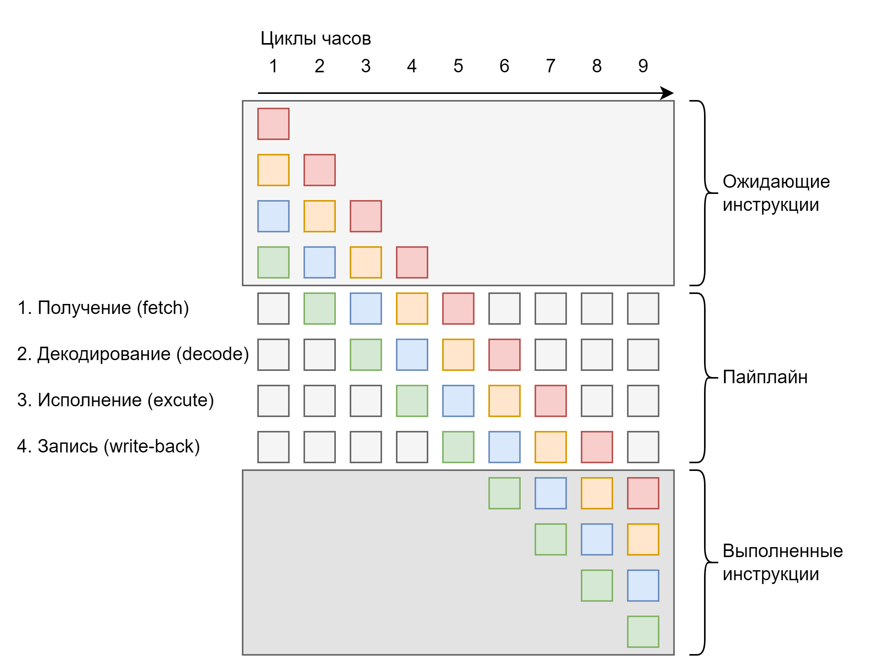

##### Суперскалярность

Суперскалярность \- это механизм в архитектуре процессора который позволяет выполнить несколько инструкций затрагивающие разные вычислительные модули процессора за один такт генератора частоты. Такое возможно за счет того, что современный центральный процессор содержит большое количество блоков исполнения в том числе и дублирующихся блоки исполнения на одном ядре. Под блоками исполнения здесь понимаются блоки математических и булевых вычислений, вычислений операций  с плавающей точкой, а также другие, более сложные блоки.

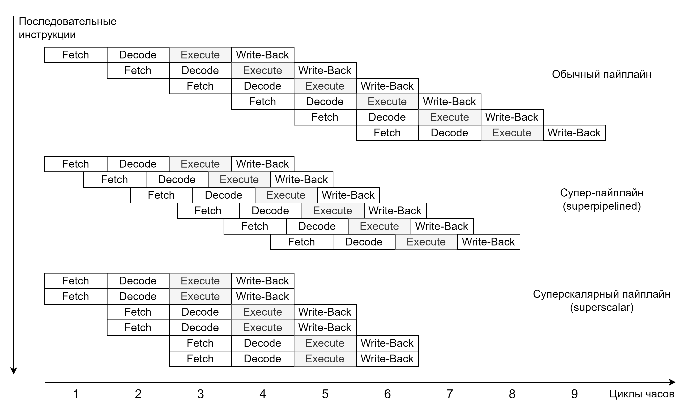

##### Гиперпоточность (Simultaneous multithreading (SMT))

Гиперпоточность сочетает механизмы конвейерной обработки инструкции и суперскалярности с модулем сохранения состояния регистров для эмуляции одновременной работы двух и более потоков на одном физическом ядре центрального процессора.

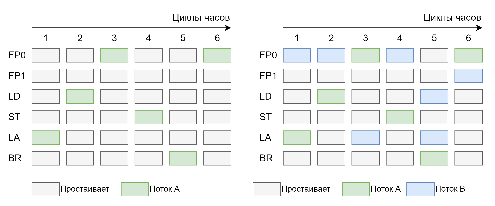

##### Внеочередное исполнение машинных инструкций

Современные центральные процессоры являются достаточно сложными машинами, которые способны оценить как долго данные, необходимые для исполнения инструкции, будут находиться в заблокированном или недоступном состоянии. Ядро центрального процессора может принять решение исполнять другую инструкцию в очереди, для которой все данные уже готовы. При этом порядок наблюдаемых внешних эффектов, таких как запись память и прямой ввод/вывод остаётся упорядоченными за счет очереди  записи. Этот механизм мы называем внеочередным исполнением машинных инструкций.  

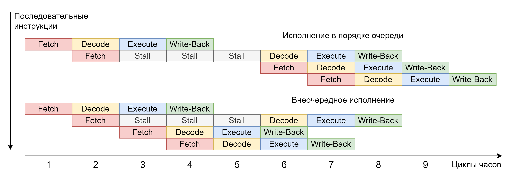

##### Single Instruction Multiple Data (SIMD) наборы инструкций

Уже достаточно давно в архитектурах команд центральных процессоров появились наборы инструкций, позволяющие обрабатывать множество элементов данных одинаковым способом или же выполнять одно и тоже действие над несколькими элементами данных, например сложить четыре числа с плавающие точкой с другими четырьмя числами с плавающей точкой. Такие инструкции называются SIMD.  
С точки зрения разработчика C++ для использования SIMD-инструкций обычно предлагаются два подхода \-  или положиться на оптимизации, которые выполняет компилятор, или писать код используя функции, явно преобразующиеся в инструкции процессора.  
Первый подход обычно называется векторизацией циклов и выполняется компилятором автоматически на достаточно высоких уровнях оптимизации.  
Второй подход требует или определение функций со стороны компилятора, мы называем их интрензиками, или использование сторонней библиотеки с явными вставками на ассемблере. Начиная с C++26, стандартная библиотека стала содержать универсальный набор функций SIMD в пространстве имен `std::simd`. Это было сделано для унификации различных имплементаций интринзиков у вендеров компиляторов.  

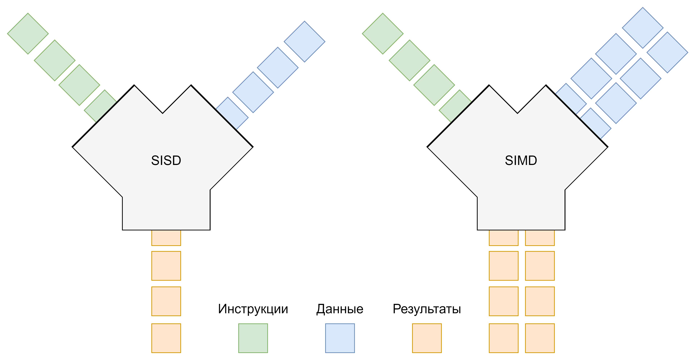

Программирование, с использованием SIMD опирается на принципы, несколько отличные от привычного нам программирования. В основном, это несколько подходов, которые позволяют экономить циклы при обработке данных с последовательным похожими значениями и битовые манипуляции. Работа с SIMD требует от программиста отдельной подготовки и наращивания опыта.

```c++
float a[4] = {1.0f, 2.0f, 3.0f, 4.0f};
float b[4] = {5.0f, 6.0f, 7.0f, 8.0f};
float res[4];

__m128 vec_a = _mm_loadu_ps(a); // Загружаем массив a в SIMD-регистр
__m128 vec_b = _mm_loadu_ps(b); // Загружаем массив b в SIMD-регистр
__m128 vec_res = _mm_add_ps(vec_a, vec_b); // Складываем векторы

_mm_storeu_ps(res, vec_res); // Сохраняем результат в массив
// res теперь гез содержит {6.0f, 8.0f, 10.0f, 12.0f}
```

##### Специальные наборы инструкций процессора

Отдельного внимания с точки зрения конкурентного исполнения достойны и специальные инструкции процессора (микрокод). Специальные инструкции отвечают за сложные задачи, такие как кодирование и декодирование звука и видео или криптографические операции. В наборе команд процессора они представлены одной или несколькими инструкциями хотя каждая из этих инструкций может быть исполнена не за один цикл как обычная или SIMD инструкция, а за сотни, а иногда и тысячи циклов.  
Это объясняется тем, что данные инструкции не реализованы в физической структуре процессора, а созданы на основании микрокода, который типично располагается в модуле постоянной памяти процессора. Микрокод содержит инструкции, которые исполняются после подачи питания, алгоритмы предсказания ветвления и исполнения специальных наборов инструкций.  

#### Параллелизм

##### Многоядерные системы

Параллелизм на уровне процессора достигается за счет множественности структур вычислительных ядер заложенных в физический дизайн процессора. Однако это не единственный механизм который требуется реализовать процессору для того, чтобы множество ядер работали одновременно. Также требуются кеши разных уровней, которые могут как принадлежать как одному, так и нескольким ядрам одновременно и физические компоненты, реализующие протоколы синхронизации кэшей, необходимые для поддержания правил взаимодействия параллельных потоков исполнения друг с другом.

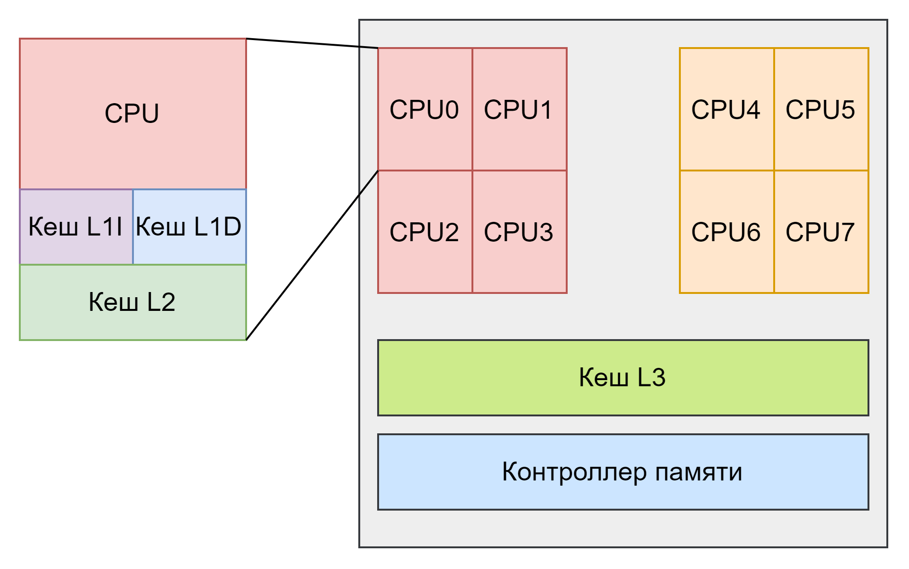

##### Non-Uniform Memory Access (NUMA) системы

С точки зрения платформы, однако, существуют и системы где помимо множества ядер центрального процессора может быть и множество процессоров на одной плате, что приводит к необходимости разделять между ними доступ к оперативной памяти. Такие платформы называются платформами с неоднородным доступом к памяти или Non-Uniform Memory Access (NUMA) системы.

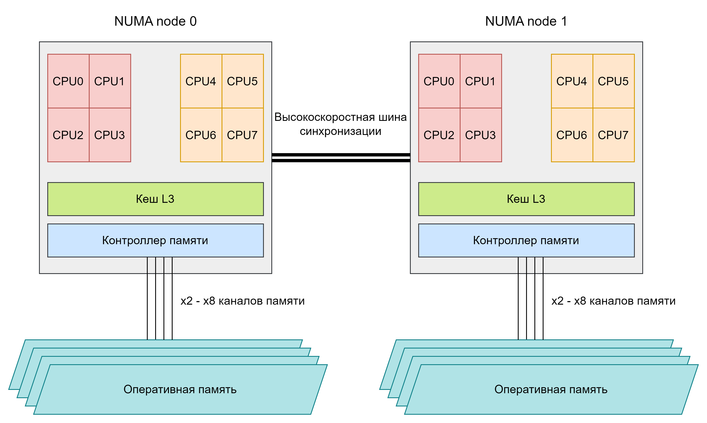

##### Сопроцессоры

Отдельным элементом, реализующим параллелизм в современных процессорах, являются сопроцессоры. Как ни странно они ещё и самые старые элементы современных процессоров так как зародились еще на первых персональных компьютерах. Простейшим сопроцессором можно считать **сопроцессор по обработке операции с плавающей точкой который** в большинстве современных процессоров является уже частью ядра.  
В современных компьютерах самым известным сопроцессором является **графический процессор** или GPU. Однако это не единственный сопроцессор так как к сопроцессорам можно отнести, звуковую и сетевую карты. Такой сопроцессорный дизайн часто можно встретить в игровых консолях, где управление сопроцессором может выполняться не как отдельным устройством на плате, а в рамках набора инструкции центрального процессора.

В детали сопроцессорных технологий можно окунуться в [данной статье](https://ar5iv.labs.arxiv.org/html/1907.06948).  

## Поддержка конкурентности и параллелизма в C++

### Модели поддерживаемые стандартом

В данный момент все C++ существуют несколько программных моделей для поддержания концепции конкурентности и параллелизма:

* Конкурентность и параллелизм алгоритмов  
* Параллелизм потоков исполнения  
* Параллелизм задач  
* Конкурентность сопрограмм (coroutines)  

#### Конкурентность и параллелизм алгоритмов

Первой и самой простой моделью можно считать конкурентность и параллелизм стандартных алгоритмов. Для каждого стандартного алгоритма существует перегрузка принимающая первым параметром стратегию исполнения алгоритма. В зависимости от данной стратегии алгоритму разрешено быть только последовательным (`std::seq`), конкурентным (`std::unseq`), параллельным (`std::par`) или конкурентным и параллельным одновременно (`std::par_unseq`). В данном случае под конкурентностью  понимается возможность не последовательной обработки элементов данных предоставленных в алгоритм, а под параллелизмом принимается концепция **map-reduce**.

```c++
// Последовательное выполнение (по умолчанию)
std::transform(std::execution::seq, src.begin(), src.end(), dst.begin(), [](int x) { return x * 2; });
// Векторизованное (но последовательное) выполнение
std::transform(std::execution::unseq, src.begin(), src.end(), dst.begin(), [](int x) { return x + 1; });
// Параллельное выполнение (без векторизации)
std::transform(std::execution::par, src.begin(), src.end(), dst.begin(), [](int x) { return x / 2; });
// Параллельное + векторизованное выполнение
std::transform(std::execution::par_unseq, src.begin(), src.end(), dst.begin(), [](int x) { return x * x; });
// Сортировка с параллельным выполнением
std::sort(std::execution::par, dst.begin(), dst.end());
```

#### Параллелизм потоков исполнения

В данной модели мы оперируем потоками исполнения операционной системы. Сами порождаем и завершаем их исполнение.  
Стандартная библиотека C++ предоставляет два объекта для взаимодействия с потоками операционной системы `std::thread` и `std::jthread`. Об этих класса создают новый поток исполнения операционной системы и представляют разные взгляды на то сколько должен жить обрабатываемый ими поток.  
Общим элементом интерфейса являются методы `joinable()` и метод `join()`. Первый используется для проверки того, можно ли присоединить поток текущему, то есть завершился ли поток на который ссылается данный объект или нет. Второй для того чтобы присоединить поток, то есть гарантировать, что все действия в потоке были завершены до момента после завершения функции `join()`.  
Альтернативой присоединенному состоянию является состояние отсоединенное, которое достигается путем вызова метода `detach()`. В данном состоянии поток может выполняться сколько угодно долго вне зависимости от деструктора библиотечного объекта.  
Другим общим аспектом дизайна данных классов является интерфейс принятия задачи на исполнение. Задача принимается в виде вызываемого объекта и набора аргументов к его оператору вызова. При этом вызываемым объектом может быть любой объект как указатель на функцию или функция, так и функциональный объект. Результат, возвращаемый из вызываемого объекта, полностью игнорируется и не передается в вызывающий поток. Однако не игнорируется исключение которые могут быть выброшены из переданной функции. Если исключение было выброшено из переданной функции то будет вызвано `std::terminate()`, что приводит к необходимости быть осторожным с функциями которые передаются на исполнение в данные классы.  
Эти два класса имеют различное поведение с точки зрения гарантий по завершению потока исполнения при вызове деструктора объектов.  
`std::thread` представляет модель в которой поток должен быть или уже завершён к моменту разрушения объекта или же должен быть отпущен для завершения задачи в асинхронном, относительно деструктора потока, режиме с использованием метода `detach()`. Иначе в деструкторе `std::thread` будет вызвана функция `std::terminate()`.  
`std::jthread` же автоматически вызывает метод присоединения `join()` в своём деструкторе и дожидается завершение исполнения потока.  
Отличительной особенностью класса `std::jthread` является то, что его можно остановить. Точнее послать запрос на остановку исполнения, который будет передан в функцию исполнения потока через специальный класс `std::stop_token`, который передается как первый аргумент для переданных на исполнение поток функции. Функция может выбрать реагировать на переданные запрос или нет таким образом она может либо скооперироваться с тем кто хочет её остановить либо проигнорировать эти запросы в зависимости от текущих исполняемых задач.  
Так как C++ стал поддерживать многопоточность на уровне языка и стандартной библиотеки только в C++11 то на более ранних версиях стандарта нам требуется воспользоваться сторонними библиотеками для написания многопоточного кода. Так для C++98 в библиотеке Boost предоставляется класс заполнитель `boost::thread`.  

##### Локальное для потока хранилище \- Thread local storage (TLS)

Создание нового потока операционной системы в программе автоматически инициализируются набор переменных которые были помечены квалификатором хранения `thread_local`. Таким образом мы можем получить *локальные для потока singleton-переменные*. Обычно инициализация TLS процесс который занимает некоторое время, так как требуется вызвать несколько функций, зависимых от платформы, для создания в памяти пространства под переменные, а также установить состояние текущего потока для указания на данное хранилище и инициализацию переменных.

##### Инициализация статических данных свободная от гонок

На практике помимо инициализации переменных в локальном хранилище потока часто требуется обезопасить инициализацию статических переменных или выполнить действие безопасно для группы потоков. Как мы уже проходили потокобезопасная инициализация статических переменных гарантируется для локальных статических переменных объявленных в функции, так как они инициализируются при первом вызове такой функции.  
Иногда этого недостаточно и, для того чтобы синхронизировать многопоточную инициализацию какого-то действия, используют комбинацию из инструментов стандартной библиотеки `std::once_flag` и `std::call_once`. Последняя позволяет вызвать функцию только один в раз многопоточно безопасным режиме, а `std::once_flag` является оптимизированным с точки зрения платформы потокобезопасным флагом.

#### Параллелизм задач

В отличие от модели потоков параллелизм задач основан не на физическом исполнении на каком-либо отдельном потоке, а на необходимости достижения цели выполнения набора задач в порядке следования их зависимостей по данным или по времени. В языках программирования обычно для этого вводится набор методов для коммуникации задач друг с другом.  
Одним из таких методов является модель *future-promise*. В данной модели существуют два объекта. **Future** \- своего рода описатель будущего результата. Этот объект говорит, что “возможно через какое-то время я могу отдать тебе результат исполнения”. А **promise** \- это парный объект, так сказать другая сторона канала, в которую можно поместить объект являющийся результатом или ошибку.  
Данная модель хорошо известна во множестве языков программирования таких как C\# или JavaScript. Обычно её экспрессивность выражается в возможности сопрягать получение результата со следующими действиями. Так например можно ожидать сразу несколько результатов и когда все они будут готовы выполнить над ними всеми некоторые действия.  
Стандартная библиотека C++ предоставляет объекты `std::future` / `std::promise` которые выражают данную модель. Они **являются одноразовым каналом между потребителем результата и его производителем** через который можно передать любой объект или исключение. Классы `std::future` / `std::promise` являются шаблонами и могут передавать через себя только тот тип данных, который указан аргументом шаблона. Дополнительной возможностью является то, что через этот канал можно передать исключение. Именно исключением передается то, что вычислить результат было невозможно или вычисление результата закончилось ошибкой.  
В данный момент стандартная библиотека не предоставляет расширенных средств для того чтобы поддерживать сложные шаблоны составления зависимых задач (`when_all()`, `then()` etc.). С этим хорошо справляется сторонние библиотеки.  

```c++
std::promise<int> prom;
std::future<int> fut = prom.get_future();

auto task = [](std::promise<int> p) {
  p.set_value(42);
};

std::jthread thread(task, std::move(prom));
// Текущий поток заблокируется, пока не будет результата
auto result = fut.get();
```

##### Асинхронное исполнение

Поскольку `std::future` и `std::promise` выражают лишь канал передачи данных, а не способ асинхронного исполнения, их можно использовать для любых механизмов, которые реализуют асинхронное исполнение в том числе и для потоков. Однако для большего удобства в стандартной библиотеке представлены две обёртки над данным каналом.  
Функция `std::async()` позволяет обернуть функциональный объект для исполнения с определенной стратегией. Стратегией отложенного исполнения `std::launch::deferred` или со стратегией асинхронного исполнения `std::launch::async`.  
Стратегия отложенного исполнения `std::launch::deferred` оборачивает вызов функции в момент когда потребуется её значение тем самым позволяя как бы добавить к каналу возможность вызвать функцию наполняющую этот канал в момент когда потребуется значение результата.  
Стратегия асинхронного исполнения `std::launch::async` заставляет задачу действительно исполнится асинхронно и получить результат вне зависимости от того потребуется он или нет. Обычно это происходит за счет того, что в стандартной библиотеке используется *набор потоков* (thread pool) для выполнения задач.  

```c++
auto deferred_future = std::async(std::launch::deferred, []{
  return 42;
});
auto async_future = std::async(std::launch::async, []{
  return 3.14;
});

// Вызов отложенной задачи
int deferred_result = deferred_future.get();
// Асинхронная задача уже выполняется
double async_result = async_future.get();
// Выбор стратегии исполнения на усмотрение стандартной библиотеки
auto mixed_future = std::async(std::launch::deferred | std::launch::async, []{
  return std::vector{1, 2, 3};
});
```

Второй обёрткой является функциональный класс `std::packaged_task` который очень похож на `std::function`, но оборачивает вызов функции в пару `std::future` и `std::promise`. Этот объект можно использовать для создания своих собственных очередей исполнения задач и способов их исполнения как строительный блок.

```c++
std::packaged_task<int(int, int)> task([](int a, int b) {
  return a + b;
});

std::future<int> result = task.get_future();
std::jthread thread(std::move(task), 2, 3);
int value = result.get(); // value == 5

// Или асинхронное выполнение через std::async
auto async_task = std::packaged_task<int()>([]() { return 42; });
auto async_result = async_task.get_future();
std::thread(std::move(async_task)).detach();
int async_value = async_result.get(); // async_value == 42
```

#### Конкурентность сопрограмм (coroutines)

Последней добавленной стандарт моделью поддержки конкурентного исполнения стали корутины. В C++ используются *stackless* асимметричные корутины. Это означает, что код корутины хоть и похож на обычную функцию, но отличается тем что при исполнении не изменяется стек выполнения. В большинстве случаев стек исполнения будет меняться внутри кода который обслуживает исполнение корутины.  

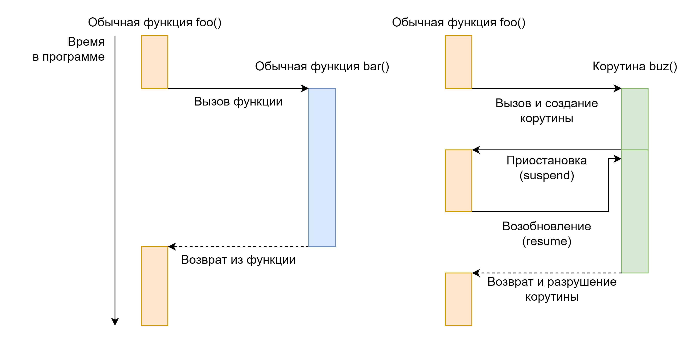

Корутины в C++ могут вызывать как обычные функции так и корутины. При этом асинхронное выполнение продолжается именно если вызвана какая-либо другая корутина или объекты, которые поддерживают ожидание на себе. Вызывая обычную функцию мы знаем, что она полностью завершится к моменту выхода из неё, а соответственно если внутри вызываемой функции также была вызвана корутина то полная цепочка вызова этой корутины должна завершиться ранее чем мы вернемся в свою корутину.  

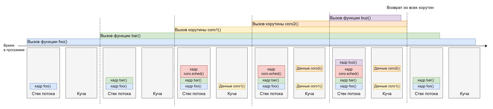

Так как мы привыкли изображать себе последовательность вызовов как стек можно сказать что корутина \- это пустое пространство в стеке. То есть корутина не требует новой кадр стека при этом все её зависимости, если они также корутины могут занять её место и вызывать последующие функции, но возвращаясь из них мы всё равно вернёмся к исполнению корутины, которая была последней.  
Дизайн корутины в C++ отличается тем, что у объектов которые владеют корутинами есть много методов для расширения. Это было сделано для того чтобы можно было реализовать разные подходы к проигрыванию корутины. Такой подход сделал интерфейс корутины достаточно сложным для понимания с первого взгляда, но очень гибким и выразительным.  

```c++
std::generator<int> generate_numbers(int start, int end) {
  for (int i = start; i <= end; ++i) {
    co_yield i;
  }
}

auto nums = generate_numbers(1, 5);

std::vector<int> result;
for (auto num : nums) {
  result.push_back(num);
}
// result == {1, 2, 3, 4, 5}
```

В большинстве случаев программисту не будет требоваться углубляться в интерфейс корутины так как программист будет использовать какую-либо библиотеку, которая отвечает за создание объектов обрабатывающих выполнения корутин. На данный момент в стандартной библиотеке таких объектов нет, но они предполагаются в будущих стандартах.  

Детально по теме корутин выступил Андреас Вайз с докладом в двух частях:
* [https://www.youtube.com/watch?v=J7fYddslH0Q](https://www.youtube.com/watch?v=J7fYddslH0Q) - о данных корутины
* [https://www.youtube.com/watch?v=qfKFfQSxvA8](https://www.youtube.com/watch?v=qfKFfQSxvA8) - о потоке управления корутинами

### Детали имплементации стандартной библиотеки

#### std::thread

В имплементации стандартной библиотеки для текущего подарка доступные четыре специальные функции. Они позволяют:

- `std::this_tread::yield()` \- вернуть исполнение в планировщик операционной системы  
- `std::this_tread::get_id()` \- получить уникальный идентификатор потока  
- `std::this_tread::sleep_for()` \- заставить поток уснуть на определённое время  
- `std::this_tread::sleep_until()` \- заставить поток уснуть до определенного момента.  

#### std::future vs std::shared_future

Помимо объекта `std::future` в стандартной библиотеке также представлен объект `std::shared_future`. Если проводить аналогию, то `std::future` выражает уникальное владение, так же как `std::unique_ptr`, а `std::shared_future` выражает совместное владение результатом, так же как `std::shared_ptr`.  
Однако здесь выражается не только семантика владения, но и **семантика возможности ожидания результата**. Так на `std::future` ожидать результата может только **один** поток, а на `std::shared_future` ожидать результата может **любое количество** потоков. Так же как и для `std::shared_ptr` существует инициализация из `std::unique_ptr` для `std::shared_future` существует инициализация из `std::future`.  

```c++
std::promise<int> prom;
std::future<int> fut = prom.get_future();
std::shared_future<int> shared_fut = fut.share();
auto task = [](std::shared_future<int> shared) {
  int val = shared.get();
  return val * 2;
};

std::future<int> res1 = std::async(std::launch::async, task, shared_fut);
std::future<int> res2 = std::async(std::launch::async, task, shared_fut);

prom.set_value(42);
int rl = res1.get();
int r2 = res2.get();
```

## Другие популярные модели конкурентности и параллелизма

Стандарт C++ периодически обновляют и вводят новые модели поддержки конкурентности параллелизма. Но всё же намного больше таких моделей поддерживается сторонними библиотеками и мы уже можем использовать их на практике.  
Рассмотрим:  

* Модель цикла событий (event-loop)  
* Виды потоков  
* Корутины  
* Виды параллелизма задач  
* Модель акторов  

### Модель цикла событий (event-loop)

Одной из первых но своего рода выдающихся моделей конкурентности стала модель цикла событий. В данный момент она применяется например в пользовательских интерфейсах а также высокопроизводительных серверах которые ограничены не с **вычислительной стороны** (compute bound), а со стороны выполнения **операций ввода-вывода** (io-bound).  
В данной модели мы разделяем выполняемую работу на **отдельные события**, а точнее на **реакцию на данные события**. Опыт работы в языке JavaScript подчёркивает, что модель цикла событий хорошо ложится на параллелизм задач особенно если есть явная поддержка на уровне языка, такая как разделение корутины на отдельные участки, выполняемые по событию.  

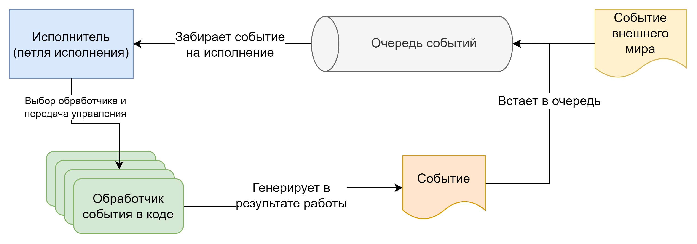

Если же поддержки со стороны языка недостаточно то обычно данная модель приводит к дроблению кода на множество функций колбеков. Такую ситуацию часто называют *callback hell* так как невозможно предсказать когда определенная часть года будет выполнена.  
Популярной библиотекой для использования модели циклов событий в общем её смысле является `libuv`.  
Обычно в этой модели также требуется переписывание таких примитивов как, доступ на чтение и запись к файлам, сокетам и другим примитивам операционной системы, а также переписывание примитивов синхронизации или запрет на их использование. Это объясняется тем, что цикл событий не должен прерываться на системных вызовах или останавливаться на блокировках, а должен переходить к обработке следующего события.  

### Потоки

Помимо модели потоков которые поддерживают стандарт C++ есть ещё два направления которые логично рассмотреть.  
Первое из них \- это потоки, которые мы можем создать используя API платформы на которой исполняется наш код. Обычно такие потоки можно подвергать тонкой настройке. Из примеров тонкой настройки можно выделить: размер стека для потока; то на каком процессорном ядре должен исполняться поток (данное свойство называется *cpu affinity*). Для того, чтобы полностью представить себе возможности платформенных можно изучить описание POSIX библиотеки `pthread`.

```c++
pthread_t tid;
pthread_attr_t attr;
struct sched_param sp;

pthread_attr_init(&attr);
pthread_attr_setinheritsched(&attr, PTHREAD_EXPLICIT_SCHED);
// Пример явной настройки алгоритма Round-robin шедулинга для потока
pthread_attr_setschedpolicy(&attr, SCHED_RR);
sp.sched_priority = sched_get_priority_max(SCHED_RR);

pthread_attr_setschedparam(&attr, &sp);
pthread_create(&tid, &attr, thread_func, NULL);
```

#### Зеленые потоки

Отдельным вариантом реализации потоков исполнения считаются так называемые “зелёные потоки” (green threads). Зелёные потоки не оперируют потоками операционной системы, а сохраняют состояние исполнения самостоятельно в пространстве пользователя. Это помогает избежать накладных расходов при переключении между зелёными потоками, таких, которые присутствуют при переключении между обычными потоками операционной системы. Например сбрасывание кэшей процессора или таблицы трансляция адресов. Так же как и обычные потоки зелёные потоки содержат собственный стек. Если проводить сравнение с современными языками программирования то наиболее близкой к концепции зелёных потоков является концепция goroutine в языке программирования Golang.  
В библиотеке Boost представлен класс Boost Fiber который реализует концепцию зелёных потоков.

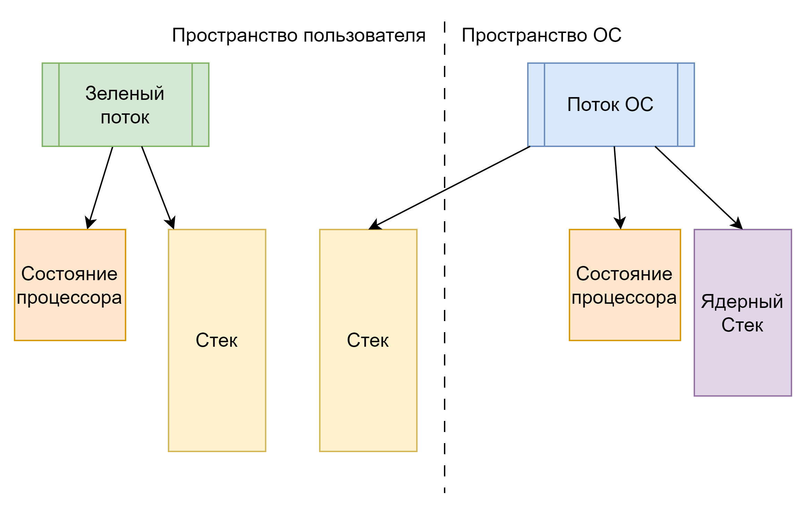

### Корутины

Как мы уже упомянули в стандарте C++ используется *stackless* асимметричные корутины. Но существуют и другие варианты исполнения корутин. Так например библиотека `boost::cobalt` дает возможность создавать простые корутины исполняемые на текущем потоке. А библиотека `boost::coroutine2` даёт возможность создавать *stackfull* корутины, более близкие к концепции зелёных потоков.  
Помимо этого в данный момент в стандартной библиотеке не хватает даже простых классов, описывающих исполнение корутины. Сейчас мы можем использовать библиотеку `cppcoro`, которая предоставляет множество готовых классов для обработки корутин. Также стоит отметить, что у асинхронных фреймворков таких как `boost::asio` есть свои имплементации классов для обработки корутин.  

### Параллелизм задач

#### Экзекуторы

> [!NOTE]
> Данный параграф посвящён обобщенному понятию экзекуторов, а не конкретному функционалу стандартной библиотеки C++ про индустриальное использование которого в данной книге не хватает материалов. Авторы приветствуются (смотрите TODO.md в репозитории книги)

Важным в концепции параллелизма задач направлением в современной разработки является обобщенное исполнение. Обобщённое исполнение предполагает возможность выполнения произвольного алгоритма на различных негомогенных исполнителях, таких как аппаратный ускорители помимо центрального процессора, многопроцессорные системы, а также кластерные компьютеры.  
Помимо аппаратных платформ исполнения также можно выделить и программные концепции которые способны исполнять произвольные алгоритмы. Примерами таких программных концепций являются: пулы потоков и очереди задач. Каждый пул и очередь могут иметь свои свойства, например гарантировать последовательность обработки задач в очереди, тем самым добиваясь возможности синхронизации между задачами.  
Все эти программные и аппаратные исполнители можно объединить общей категорией которую называют executors. Этот программный шаблон можно заметить как в кодовых базах, так и в большинстве асинхронных фреймворков. Он абстрагирует потенциальный исполнитель для задачи. В данный момент существует несколько конкурирующих предложений по включению экзекуторов в стандартную библиотеку C++.

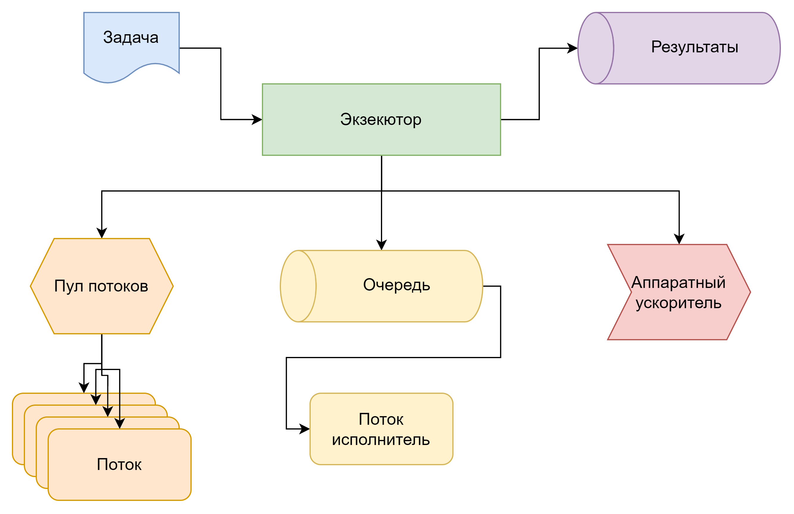

#### Модель продолжений

Как мы уже ранее упоминали модель future-promise показывает свою выразительную силу возможности получить результат и произвести его дальнейшую обработку. В данный момент в стандартной библиотеке C++ мы не получаем возможности произвести дальнейшую обработку результата некоторым автоматическим способом. Но с этим нам помогают сторонние библиотеки.  
Одной из таких сторонних библиотек является библиотека `portable_concurrency` [https://github.com/VestniK/portable_concurrency](https://github.com/VestniK/portable_concurrency). На её примере мы разберем общие черты модели выполнения задач, которая получила название *модель продолжений* (continuation model).  
Данная модель состоит из нескольких аспектов. Первым аспектом можно выделить возможность присоединить к Future обработчик результата который выполнится в тот момент когда результат будет готов. Обычно выражается методами `then()` / `next()`. Вторым аспектом данной модели является возможность ожидать выполнения набора Future полностью или частично. Обычно выражается методами `when_all()` / `when_any()`. Третьим аспектом обычно является возможность отпустить ожидания результата для его полного асинхронного выполнения (метод `detach()`) или явная отмена ожидания результата. Стоит подчеркнуть, что последний аспект невозможно реализовать со стандартными `std::future` так как при разрушении `std::future` есть вероятность отменить выполнение задачи.  
Помимо аспектов самой модели также библиотеки её реализующие часто прибегают к использованию экзекуторов как абстракции для выполнения присоединенных задач.  

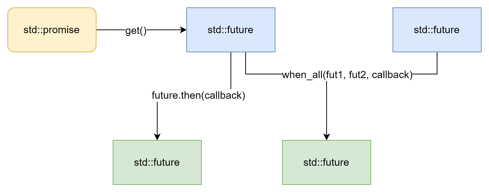

### Модель акторов

Модель акторов представляет из себя смесь между тем как определяется исполнение задач и их исполнителями, а также того как принято обрабатывать данные.  
Актор выражает собой некоторого исполнителя, который может сделать фиксированную задачу. Помимо того, что актор способен выполнить задачу, он также способен получить задачу на исполнение, то есть может иметь некую очередь задач, которые он должен выполнить.  
Готовый результат исполнения задачи актор может передать другим акторам, а в ходе выполнения задачи актор может ставить новые задачи другим акторам.  

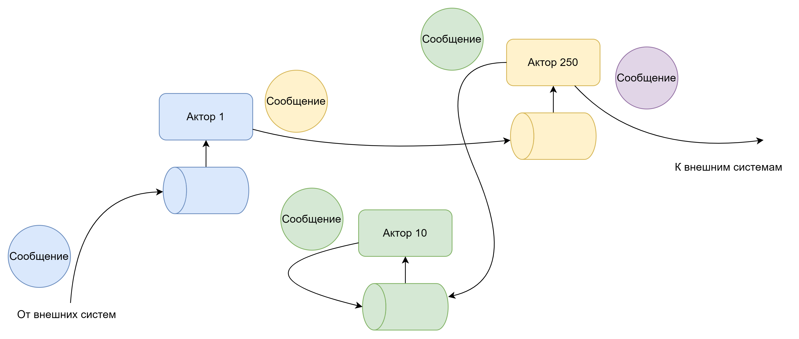

Таким образом деля алгоритмы исполнения программы на акторов мы позволяем себе сконцентрироваться на изоляции отдельных элементов данных у конкретных исполнителей, что позволяет более натурально рассуждать о безопасности многопоточного кода. Очень часто модель акторов применяют в областях где требуются большие гарантии безопасности, таких как авиационная, медицинская и банковская сферы.  
Популярной библиотекой для реализации кода на модели акторов является [библиотека CAF](https://github.com/actor-framework/actor-framework).
