# Глава 11: Синхронизация доступа к памяти

В данной главе мы поговорим о модели памяти языка C++ и примитивах синхронизации параллельного доступа

## Исполнение многопоточной программы

До C++11 язык C++ поддерживал только **однопоточное исполнение**. Это означает, что абстрактная машина, описываемая стандартом языка, для которой компиляторы строят свои модели оптимизаций, имела только один конкурентный исполнитель. Все расширения многопоточного исполнения поддерживались исключительно со стороны конкретных платформ и компиляторов.  
Начиная с C++11 в язык было введено понятие **многопоточного исполнения**. В системе с многими исполнителями первым вопросом встает задача по формализации того, как эффекты выполнения разных исполнителей проявляются друг для друга. C++ справляется с данной задачей используя наборы формальных отношений, определенные над выражениями языка. Всего таких отношения четыре:

1. “Упорядочено до” (sequenced before)  
2. “Синхронизируется с” (synchronizes with)  
3. “Межпоточно происходит до” (inter-thread happens before)  
4. “Происходит до” (happens-before)

Также стоит отметить, что здесь мы говорим о состоянии одной программы. C++ на данный момент не определяет никакой формальной модели, описывающей взаимодействия многих программ друг с другом, помимо окружения программ, которые мы проходили ранее.

### Порядок выполнения выражений и отношение “Упорядочено до”

Задание формальной модели исполнения начинается с однопоточного исполнения. Мы должны знать как соотносятся друг с другом выполнения различных выражений. Хоть и кажется, что программа на C++ выполняется сверху-вниз, но это не так, поскольку мы имеем дело с оптимизирующими компиляторами, которые могут переупорядочить инструкции, описанные пользователем, согласно **правилу “as-if”** (смотри главу 1). Помимо компиляторов на современных процессорах мы также имеем дело с **выполнением инструкций вне порядка** (out-of-order execution), что также усложняет понимание происходящего человеком.  
Отношение “Упорядочено до” вводит набор правил, согласно которому выражения и под-выражения исполняются в программе. Данное отношение имеет более 20 правил исполнения, в которые включены приоритет операторов, инициализация и другие конструкции языка.  
Само по себе *исполнение выражения* содержит две стадии:

1. Вычисление результата выражения \- возможное создание объекта результата выражения  
2. Начало реализации **побочных эффектов** (side effects) выражения

Как мы помним **правило “as-if”** распространяется именно на последовательность выполнения побочных эффектов, что и связывает абстрактную машину C++ с реальной программой.  

“Упорядочено до” это транзитивное попарное отношение между *исполнениями выражений* при котором:  

* Если А “Упорядочено до” Б, то выполнение А заканчивается до того как начинается выполнение Б  
* Если А НЕ “Упорядочено до” Б И Б НЕ “Упорядочено до” А то:  
  * Или А и Б *не упорядочены* \- что означает возможность их пересекающегося выполнения,  
  * Или А и Б *неопределенно упорядочены* \- что означает полное выполнение одного выражения до другого, но без гарантии какого именно и гарантии стабильности выбора

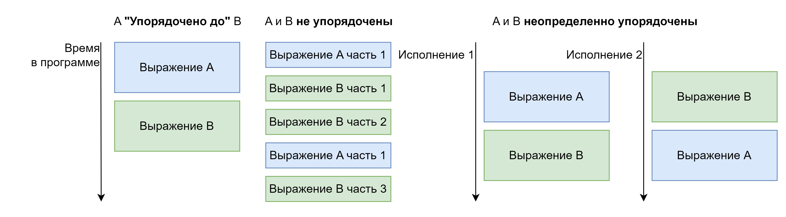

#### Явный запрет переупорядочивания

Помимо знания правил языка в контроле последовательности выполнения программы программисту помогают некоторые средства стандартной библиотеки. Так как для обработки сигналов ОС в стандарте языка отведено специальное место мы получили хороший инструмент для контроля нежелательных оптимизаций со стороны компилятора в виде функции `std::atomic_signal_fence()` которая явно запрещает переносить определенные виды инструкций через точку своего вызова. О видах инструкций мы поговорим позже в данной главе.  

> [!TIP]
> Обработка сигналов получила такое специальное место в стандарте, поскольку её реализация обычно полагается на прерывание текущего вызова функции прямо по середине ее исполнения и создание нового стекового фрейма.  
> Обработка сигнала согласно стандарту C++ **крайне ограничена**, так например нельзя аллоцировать память и можно использовать только ограниченный набор функций стандартной библиотеки и платформы, для которых это явно помечено в документации.

### Гонки данных

Следующим этапом в формализации модели исполнения является решение задачи по определению порядка исполнения **между потоками**. Такой порядок исполнения рассматривается в двух плоскостях: **плоскость исполнения** и **плоскость данных**.  
Сначала логичнее рассмотреть именно **плоскость данных**, так как от обмена или не обмена данными зависит реальная продуктивность конкурентных исполнителей, поскольку современные системы сильно зависят от иерархии памяти и являются *ограниченными по памяти* (memory-bound).  
Для конкурентной обработки данных стандартом C++ определено понятие **гонки данных**. Гонка данных случается в момент, когда два или более конкурентных исполнителей модифицируют и читают одно и тоже место в памяти. При этом об одновременности речи здесь не идет так как гонка данных фиксирует лишь факт коллизии модификаций и чтения.  
Гонки данных **не происходит**, если:

* Одно и тоже место в памяти читается **разными** исполнителями и **никогда не модифицируется**.  
* Модифицируются и читаются **разные места** в памяти.  
* Все модификации и чтения ограничены **одним исполнителем**.  
* Модификации и чтения происходят над **атомарными примитивами**.  
* Между модификациями и чтениями есть отношение **“Происходит до”**.

**Гонка данных является неопределенным поведением (UB)**. А это означает, что компилятор может оптимизировать вокруг гонок данных так, как будто их не существует.

#### Отношение “Синхронизируется с”

В плоскости данных элементом задающим формальный порядок исполнения является отношение “Синхронизируется с”. Данное отношение установлено между **атомарными переменными** и **некоторыми функциями стандартной библиотеки**. Оно выражает собой момент, когда некоторые данные были **записаны в память одним** исполнителем, а затем **прочитаны другим** исполнителем.  

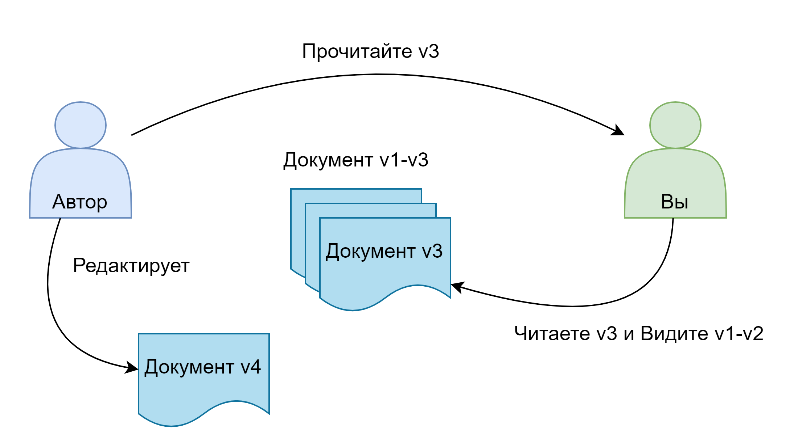

Данное отношение хорошо описывается аналогией версий какого-либо документа. Так если автор документа сказал вам, чтобы вы прочитали третью версию, то вы будете обладать всей актуальной информацией для третьей версии, а также потенциально для второй и первой версии. При этом автор мог продолжать работать над более новыми версиями документа, пока вы читали свою, но поскольку больше между вами не было обмена информацией, вы не можете узнать содержимое более новых версий документа.  
Из данной аналогии можно подчеркнуть два момента:

1. Передается не только обособленное значение (версия), но и весь окружающий его контекст (документ)  
2. Синхронизация наступает от факта получения конкретного значения (конкретно третья версия)

##### Функции, имеющие свойства “Синхронизируется с”

Именно используя данную модель в стандарте определяются множество функций межпоточной синхронизации.  
Так:

* Метод `lock()` для любого класса мьютекса “Синхронизируется с” методом `unlock()` для этого же экземпляра класса  
* Функция `std::atomic_thread_fence()` “Синхронизируется с” собой и действиями над атомарными переменными, согласно заданной модели синхронизации  
* Потоки, исполняющие функцию `std::call_once()` “Синхронизируется с” потоком, выполнившим колбек и имеют глобальный порядок друг между другом на момент выхода из `std::call_once()` (т.е. проходят через очередь)  
* Поток, потенциально порожденный функцией `std::async()` “Синхронизируется с” потоком, вызвавшим данную функцию  
* Поток, вызвавший метод join() для экземпляров классов `std::thread` и `std::jthread` “Синхронизируется с” концом исполнения потока, который данные экземпляры классов представляют  
* Поток, порожденный экземпляром `std::thread` или `std::jthread` “Синхронизируется с” потоком, сконструировавшим данный экземпляр класса  
* Функции установки и получения глобальных обработчиков `std::set_new_handler()` / `std::get_new_handler()`, `std::set_terminate()` / `std::get_terminate()`, `std::pmr::set_default_resource()` / `std::pmr::get_default_resource()` \- синхронизируется по парно  
* Установка значения в `std::promise` синхронизируется с получением значения из метода get() для связанного объекта `std::future` / `std::shared_future`  
* Установка обработчика сигнала через функцию `std::signal()` “Синхронизируется с” последующим выполнением установленного обработчика

### Отношение “Межпоточно происходит до”

Вернемся к **плоскости исполнения** программы. Отношение “Межпоточно происходит до” устанавливает как связываются друг с другом исполнения выражений **между потоками**.  
Исполнение выражения А “Межпоточно происходит до” исполнения выражения B, если:

* А “Синхронизируется с” B  

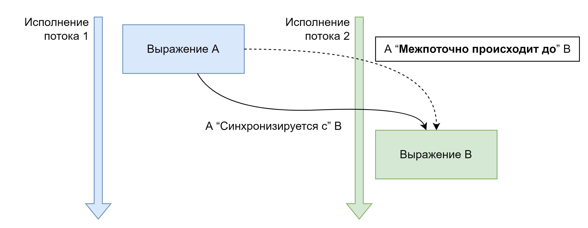

* А “Синхронизируется с” C, при этом C “Упорядочено до” B  

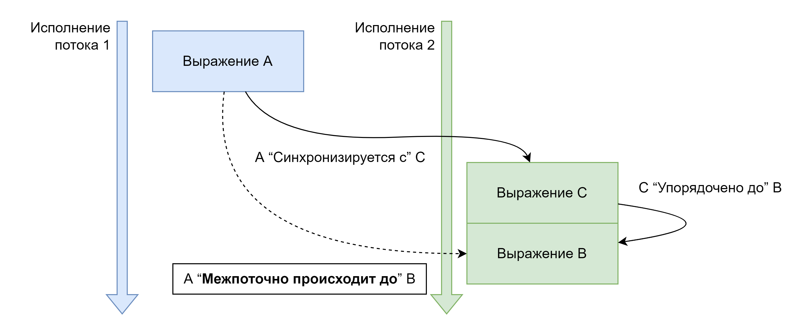

* А “Упорядочено до” C, при этом C “Межпоточно происходит до” B  

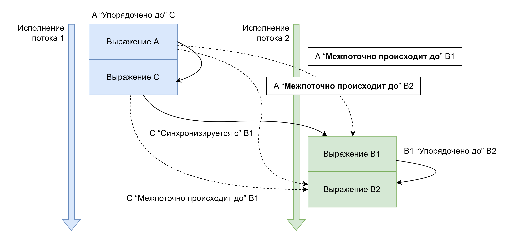

* А “Межпоточно происходит до” C и C “Межпоточно происходит до” B

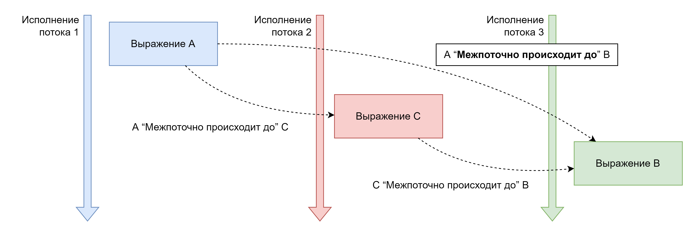


Последнее правило очень важно, так как позволяет нам рассуждать о порядке исполнения **среди множества потоков**.

### Полный порядок выражений в программе и отношение “Происходит до”

Мы подошли к заключительному этапу формализации порядка исполнения. Отношение **“Упорядочено до”** позволило нам определить последовательность операций **в одном потоке**. Отношение **“Синхронизируется с”** определило правила **обмена данными между потоками**. Отношение **“Межпоточно происходит до”** позволило рассуждать про последовательность **исполнения между потоками**. Последнее отношение **“Происходит до”** связывает **два произвольных исполнения выражений в программе**.  
Исполнение выражения А “Происходит до” исполнение выражения B, если:

* А “Упорядочено до” B (в одном потоке)  
* А “Межпоточно происходит до” B (между потоками)  
* А “Происходит до” C и C “Происходит до” B (транзитивность)

Как видно данное отношение является обобщением трех предыдущих отношений.

### Правила доступа к volatile объектам

Исторически сложилась практика при которой объекты, квалифицированные как `volatile` использовались, как атомарные переменные (в С, а также в других языках). Стандарт C++ **не поддерживает такую парадигму** и отводит данному квалификатору лишь роль по запрета кэширующих оптимизаций над значением, **не создавая гарантии атомарности**.  
Обычно такие значения используются или для взаимодействия с устройствами, например отраженными в память, или для передачи данных между обработчиком сигналов ОС и программой.

## Примитивы синхронизированного доступа

Явным эффектом *гонки данных* является не консистентное поведение программы. Обычно это поведение вызвано тем, что оперативная память загрязняется значениями, не имеющими смысла. Например при гонке данных на целом числе какие-то его байты могли записаться от одной записи, а какие-то от другой, что ведет к созданию нового числа, не являющегося результатом какой-либо операции. Все тоже самое может происходить и с **указателями**, что приводит к **произвольному доступу в память или на исполнение** и с любыми другими данными программы.  

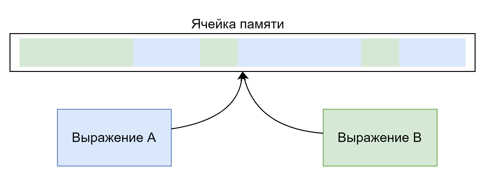

Мы можем наблюдать гонки данных в отсутствии отношений “происходит до” между операциями, следовательно самым простым способом избежать гонок данных является введение формального отношения для упорядочивания операций над памятью. Именно с этим нам помогают примитивы синхронизированного доступа (синхронизации).

### Атомарные переменные

Простейшим примитивом синхронизации является атомарная переменная.  
В C++ все атомарные переменные **консистентны**. Это значит, что вне зависимости от того как мы используем атомарную переменную, она всегда будет иметь только те значения, которые являются результатами операций программы, и никогда значения, являющиеся результатами гонок данных. Это свойство и называют **атомарностью**.  
Атомарные переменные в C++ сохраняют свои свойства только **между потоками одной программы**. Для межпрограммной атомарности, обычно в общей памяти, используются платформенные библиотеки. Являются элементом синхронизации - т.е. упорядочивают не только свои данные, но и данные окружающего контекста.

#### Базовое представление об атомарности

Об атомарности имеет смысл говорить только в системах, где существуют параллельные исполнители. Атомарность в компьютерах достигается благодаря тому, что параллельные исполнители, в лице процессорных ядер, соблюдают протоколы для обеспечения корректности записи и чтения данных в оперативной памяти.  
Атомарность выражается специальными инструкциями процессора. Она достигается инструкциями ожидания синхронизации и сброса / изменения очереди записи. При использовании атомарных переменных **не создается “атомарная память”** - компилятор генерирует атомарные инструкции, а к памяти предъявляются **требования выравнивания**.

```assembler
movl $42, %eax              # Простая загрузка значения в регистр
lock xaddl %eax, (%ebx)     # Атомарное сложение и обмен (exchange-and-add)
lock cmpxchgl %ecx, (%edx)  # Атомарное сравнение и обмен (CAS)
mfence                      # Барьер памяти (full memory fence)
lock incq (%rsi)            # Атомарный инкремент (х86-64)
lock xchg %rax, (%rdi)      # Атомарный обмен значениями
pause                       # Оптимизация для spin-loop
```

Для лучшего понимания того, как именно гарантируется атомарная инструкция нам стоит рассмотреть порядок выполнения инструкции в современном CPU. Так:  

1. Инструкция попадает из кеша инструкций в сборщик инструкций (декодер).  
2. Декодер передает задачу на сбор аргументов инструкции сборщику аргументов.  
  2.1 Сборщик аргументов потребляет данные из кеша данных (вплоть до вычитки из оперативной памяти). На данном этапе может произойти задержка инструкции  
  2.2 Сборщик аргументов передает данные в регистры, располагающиеся внутри регистрового файла.  
3. Декодер отсылает инструкцию на исполнение в вычислительное ядро.  
4. Вычислительное ядро потребляет данные в файле регистров для произведения вычислений.  
5. Вычислительное ядро записывает результаты в память не напрямую, а через очередь обратной записи. Она может хранить некоторое количество горячих данных непосредственно рядом с вычислительным ядром.  
6. Сборщик аргументов может забирать данные для новых инструкций непосредственно из очереди обратной записи.

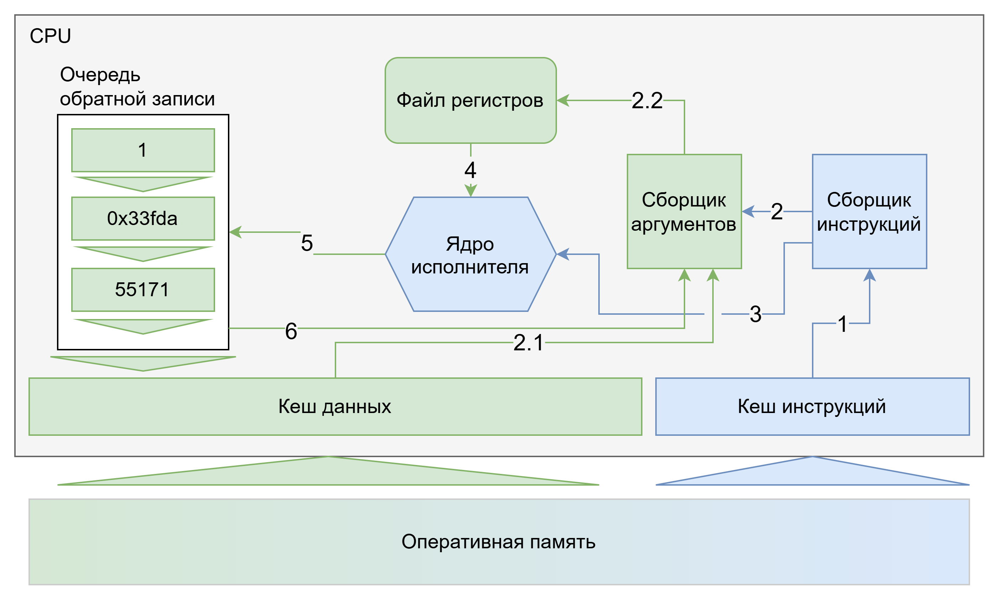

В разрезе атомарных инструкций мы оперируем именно составом очереди обратной записи и кеша данных для достижения синхронизации представления данных в памяти между несколькими ядрами CPU.  

Первым компонентом атомарности является реализация работы с кешами в процессоре. В современности почти все устройства с которыми вам предстоит работать будут получать и записывать память не по одной ячейке, а блоками. Такие блоки обычно называются **кэш линии**, так как по размеру совпадают с количеством памяти в, располагаемой в одной строке кэша процессора.  
Данные, которые располагаются в одной линии кэша всегда обрабатываются вместе, даже если запрашиваются разными потоками. Поэтому говорят о ситуации истинного (true sharing) и ложного разделения данных (false sharing):

* **Ложное разделение** данных наступает когда два не связанных логически элемента данных располагаются в одной кэш линии, приводя к замедлению не вызванному настоящими действиями программы, а только синхронизацией состояния.  

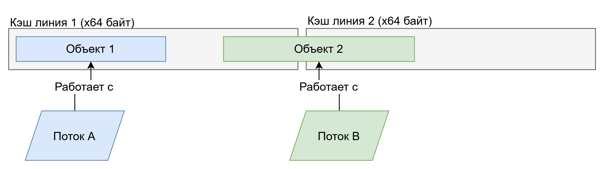

* **Истинное разделение** данных наступает когда два элемента данных связаны логически друг с другом, и обрабатывая один из них мы получаем ускорение в обработке другого так как кэш линия уже будет находится “под рукой” у процессора.

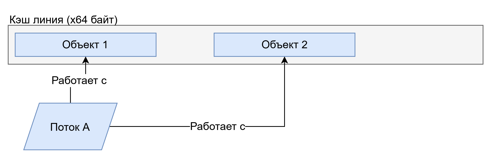

Стандартная библиотека C++ предоставляет возможность узнать размер промежутка между элементами в памяти для недопущения ложного разделения (`std::hardware_destructive_interference_size`) и размер промежутка памяти, в котором происходит истинное разделение (`std::hardware_constructive_interference_size`).  
Типичный процессор сейчас имеет несколько уровней кэшей, где:

* Кэш 3 уровня \- делится между всеми ядрами на чипе, самый большой по объему, самый медленный по скорости  
* Кэш 2 уровня \- делится между несколькими ядрами в блоке, средний по размеру и по скорости  
* Кэш 1 уровня \- типично используется только для одного ядра, самый маленький по размеру и самый быстрый для доступа

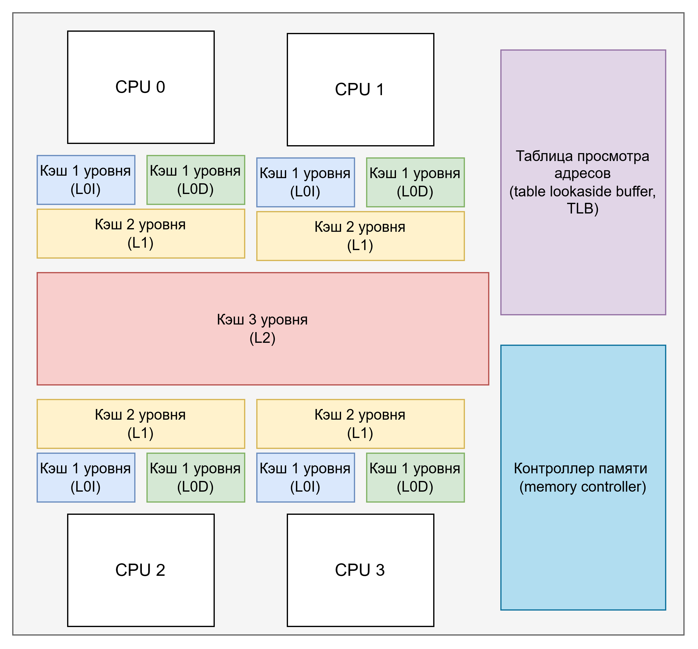

Все эти уровни кэширования подвержены необходимости синхронизации между ядрами процессора, выполняющими доступ к одним и тем же физическим адресам в оперативной памяти. Для синхронизации используется т.н. **протокол синхронизации кэшей**. Протокол синхронизации кэшей различается для каждого процессорного семейства однако в общем доступе есть хорошая модель описания протокола синхронизации под названием MOESI.  
В данной модели кэш линии имеют 5 состояний:

* Modified \- ядро владеет кэш линией эксклюзивно, и она “грязная” \- отличается от таковой в оперативной памяти  
* Owned \- ядро владеет кэш линией НЕ эксклюзивно, и она “грязная”  
* Exclusive \- ядро владеет кэш линией эксклюзивно, и она “чистая”  
* Shared \- ядро владеет кэш линией НЕ эксклюзивно, и она “чистая”  
* Invalid \- кэш линия не является актуальной

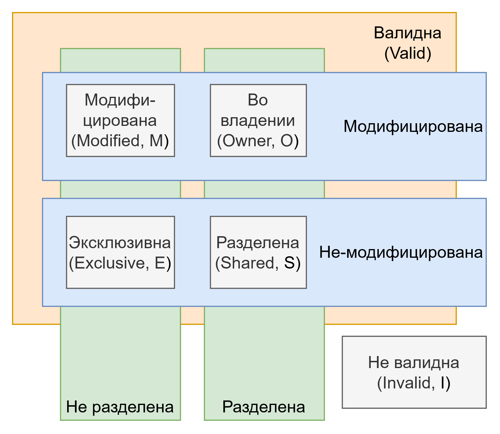

Ядра коммуницируют друг с другом по специальной высокоскоростной шине на кристале и определяют кому сейчас принадлежит кэш линия и кто должен или может её обновить в оперативной памяти.  
Вторым компонентом атомарности служат инструкции, вызывающие сбрасывание и редактирование очереди записи процессора. Они позволяют явно вызвать инвалидацию кэш линий, и реализацию атомарной записи.

#### Порядок памяти (memory order)

В рамках дизайна атомарных переменных в C++ была введена абстракция **порядка доступа к памяти** (memory order). Данная абстракция дает возможность программисту указать как **операция над атомарной переменной** влияет на видимость результатов **других операций** в потоках, использующих **одну и ту же** атомарную переменную. Это второе свойство атомарных переменных в C++ \- они способны упорядочивать окружающий их не атомарный доступ в память, вводя отношения “Происходит до” между ними.  
Всего введены четыре модели порядка:

* Расслабленный порядок (relaxed)  
* Порядок получения-выпуска (acquire-release)  
* Порядок потребления-выпуска (consume-release) - **Удален в C++26**  
* Порядок последовательной консистентности (sequential consistency)

При этом порядок потребления-выпуска к C++26 является устаревшим и мы не будем его рассматривать.  
Для передачи порядка в методы атомарных переменных можно передать значения перечисления `std::memory_order` как аргументы для определения того, какой порядок должен быть у конкретной операции, а часто и у части операции.

##### Общая модель ячейки памяти

При рассмотрении порядка памяти каждую **ячейку памяти** стоит рассматривать как некоторую **очередь**, в которую можно **записать** значение и из которой значение можно **прочитать**. Стоит представлять, что каждый поток имеет **свой флажок** в этой очереди, отмечающий **какое последнее значение он прочитал**.  
При чтении поток получает из очереди **не следующее значение**, а то значение, которое он должен получить согласно отношению между этим потоком, и всеми потоками, записавшими в очередь после значения, отмеченного флажком данного потока.  
При записи значение просто складывается в конец очереди.  
Если рассматривать данную модель, то отношения порядка памяти определяют, **что прочитает** какой-либо поток из ячеек, в которые писал данный поток, **прочитав из ячейки с атомарной переменной**.

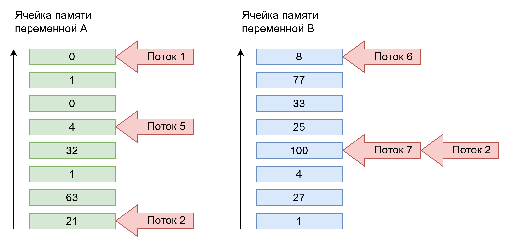

##### Расслабленный порядок (relaxed)

Выражается значением `std::memory_order::relaxed`. При использовании данного порядка мы говорим компилятору, что не заинтересованы в выстраивании отношения окружающих операций с операциями над атомарной переменной, а хотим использовать только первое свойство атомарных переменных, их консистентность.  
Это самый простой и производительный порядок, так как он приводит к созданию простейших атомарных инструкций при компиляции, которые типично не приводят к ожиданиям в процессоре.  
Такой порядок может быть использован для:

* Атомарных счетчиков  
* Резервирования тикетов (или например мест в массиве)  
* Создания идентификаторов

##### Порядок получения-выпуска (acquire-release)

Выражается значениями `std::memory_order::acquire`, `std::memory_order::release` и `std::memory_order::acq_rel`. Данный порядок выражает **модель отправитель-получатель**. Поток выполняющий чтение / чтение-запись атомарной переменной со значениями `std::memory_order::acquire` / `std::memory_order::acq_rel` “Синхронизируется с” последним потоком, выполнившим запись / чтение-запись со значениями `std::memory_order::release` / `std::memory_order::acq_rel`.  
Тем самым получатель \- получает значение атомарной переменной, записанной отправителем, и ему доступны как минимум все значения, что отправитель записал до записи атомарной переменной. Данный порядок не гарантирует ничего относительно взаимодействий с третьим потоком, речь идет только о **попарной синхронизации** (1-to-1 коммуникация потоков).  

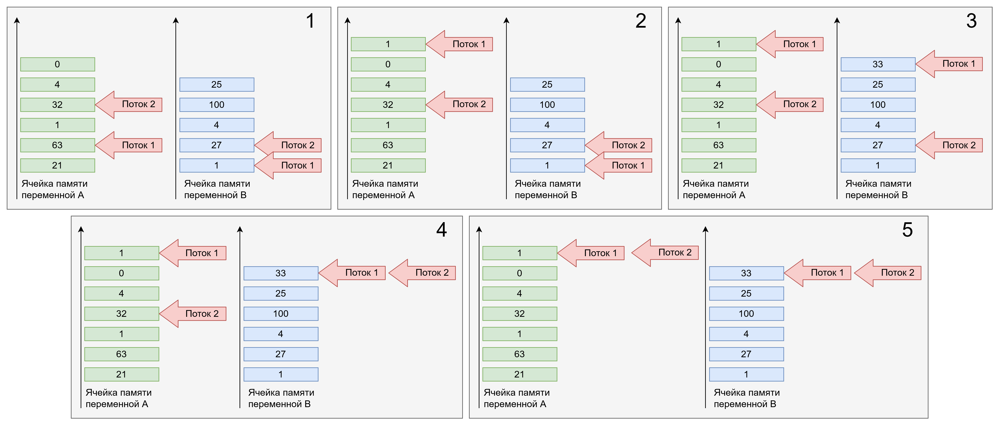

Разберем, что происходит на модели очереди:  

1. Начальное состояние.  
2. Поток 1 записывает не атомарно `1` в `A`.  
3. Поток 1 записывает атомарно с `std::memory_order::release` значение `33` в `B`.  
4. Поток 2 атомарно читает с `std::memory_order::acquire` значение `33` в `B`.  
5. Флажок потока 2 теперь не может находиться в переменной `A` ниже, чем флажок потока 1 находился, во время записи в ячейку `B`. Гарантируется, что поток 2 уже никогда не увидит пропущенные значения `4` и `0`.

Данная модель обычно используется в двух вариантах:  

* В первом есть поток читатель и поток писатель. Писатель использует `std::memory_order::release` для отправки значений. Читатель использует `std::memory_order::acquire` для получения значений.  

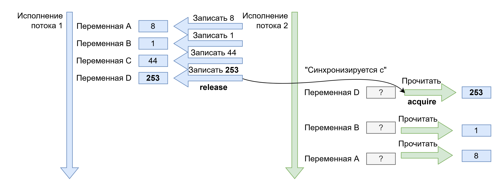

* Во втором варианте все взаимодействующие на одной атомарной переменной потоки являются читателями и писателями одновременно. Это происходит благодаря тому, что для атомарных переменных доступны **операции одновременного чтения-записи**. В этом случае все потоки используют `std::memory_order::acq_rel`.

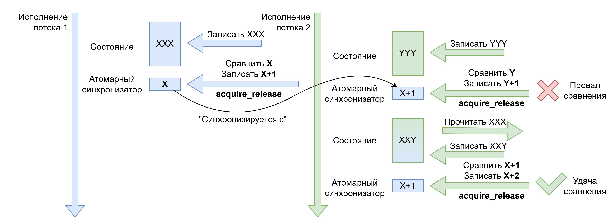

Данный порядок является средним по производительности, так как приводит к необходимости синхронизации обозримого объема данных между потоками. Он обычно используется для:  

* Создания очередей сообщений.  
* Структур данных *без ожидания* (lock-free).  
* Уникального владения ресурсом.

##### Порядок последовательной консистентности (sequential consistency)

Выражается значением `std::memory_order::seq_cst`. Это самая тяжелая с точки зрения оптимизаций модель. Она предполагает тотальный порядок действий в программе вокруг данной атомарной переменной. В виду этого использование этого порядка при операциях приводит к долгим остановкам процессора, а часто и к сбросу кэша, что занимает длительное время.  
Основой данной модели, в отличии от других, является полный порядок. Это означает, что любые два потока в программе выполняя произвольные чтения атомарной переменной должны будут согласиться в каком порядке она приобретала значения.  
Проще всего это понять на разборе следующей ситуации \- если какой-то поток уже увидел значение, записанное другим потоком, то третий поток не сможет увидеть значение, записанное раньше, чем то, что прочитал первый. Если мы вернемся к модели ячейки очереди и флагов, то при использовании последовательной консистентности все потоки программы будут делить один и тот же флаг.  

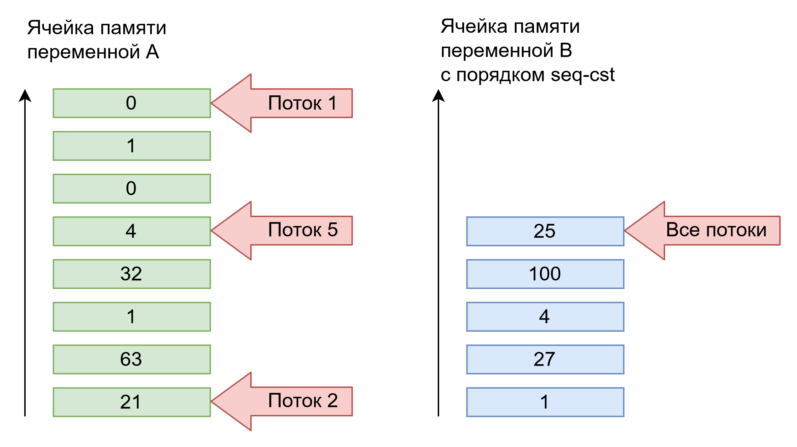

Данный порядок используется во всех операциях **по умолчанию**, если программист не указал другого порядка, так как он выражает самую строгую модель синхронизации, и программист волен тем самым ослаблять используемую модель.  

В основном используется для:  

* Простых задач атомарности, где **не доказано наличие проблем с производительностью**. Т.е. начинать работу с атомарными переменными всегда нужно именно с порядка последовательной консистентности.  
* Явной полной синхронизации, например в начале или в конце выполнения какого-либо алгоритма.

### Атомарные переменные в стандартной библиотеке

#### std::atomic_flag

Первым атомарным примитивом является `std::atomic_flag`. Это простейшая атомарная конструкция, которая является гарантированно атомарной на любой платформе. Остальные атомарные переменные являются атомарными только если это позволяет платформа, под которую производится компиляция.  
Данный объект реализует всего три метода:

* `clear()` \- явная установка флага в false  
* `test_and_set()` \- устанавливает флаг в true и получает предыдущее значение (первая наша read-modify-write, RMW операция)  
* `test()` \- возвращает текущее значение флага

Данный примитив применим для создания простейшего spin-lock, мьютекса, с активным ожиданием у потоков благодаря которому можно реализовать более сложные модели синхронизации.

#### std::atomic

Данный шаблон класса определяет как атомарную любую конструкцию тривиального типа данных (без пользовательских или удаленных специальных функций членов). На самом деле атомарными будут только те типы данных, которые укладываются в определенный размер, который зависит от платформы и для которых на данной платформе есть атомарные инструкции или типы данных. Для типов данных большего размера имплементация будет создавать мьютексы, на основании которых эмулировать атомарность. Понять является ли инстанциация шаблона по настоящему атомарной помогает метод `is_lock_free()`.  
Также на некоторых платформах для атомарности переменной требуется её выравнивание в памяти по границе адресов, поэтому имплементация может быть не всегда атомарной. Для проверки, что для данной платформы и типа всегда будет производиться только настоящие атомарные операции используется статическая переменная член `is_always_lock_free`.  
Для любого типа поддерживаются следующие атомарные операции:

* `store()` \- атомная установка значения  
* `load()` \- атомарная загрузка значения  
* `exchange()` \- атомарный обмен значения, с возвратом предыдущего значения  
* `compare_exchange_week()` / `compare_exchange_strong()` \- атомарная проверка и условная установка плюс чтение, так называемые *compare-and-swap (CAS)* операции

Для типов целых чисел, чисел с плавающей точкой и указателей также доступны следующие операции чтения-записи:

* `fetch_add()` / `operator+=()` / `operator++()` / `operator++(int)` \- атомарно увеличивает значение переменной, возвращая предыдущее  
* `fetch_sub()` / `operator-=()` / `operator--()` / `operator--(int)` \- атомарно уменьшает значение переменной, возвращая предыдущее  
* `fetch_max()` \- находит и устанавливает максимальное значение, возвращая предыдущее  
* `fetch_min()` \- находит и устанавливает минимальное значение, возвращая предыдущее  
* `fetch_and()` / `operator&=()` \- выполняет атомарный побитовый И, возвращая предыдущее  
* `fetch_or()` / `operator|=()` \- выполняет атомарный побитовый ИЛИ, возвращая предыдущее  
* `fetch_xor()` / `operator^=()` \- выполняет атомарный побитовый исключающее ИЛИ, возвращая предыдущее

##### Compare-and-swap (CAS) операции

В интерфейсе `std::atomic` присутствуют две операции, которые не имеют не атомарного аналога `compare_exchange_week()` / `compare_exchange_strong()`. Данные операции сверяют с текущее значение атомарной переменной с предоставленным пользователем (`expected`), если они одинаковы, то в атомарную переменную записывается новое значение (`desired`), предоставленное пользователем, и возвращается истина. Иначе, возвращается ложь и текущее значение атомарной переменной возвращается пользователю через аргумент, с которым происходило сравнение (`expected`).  

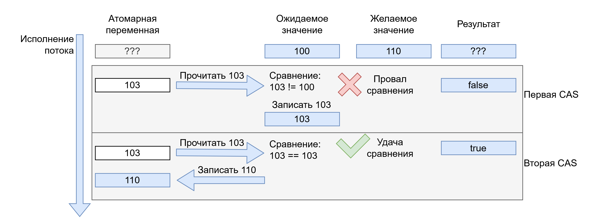

Для понимания этой операции можно представить себе игру, в которой вожатый знает кто-должен быть следующий (вожатый \- атомарная переменная). Каждый ребенок подходит и спрашивает “Я следующий?” (`expected`), вожатый ему отвечает:

* Нет следующий “Вася” \- это не удача.  
* Да следующий ты, назови “кто будет следующим, после тебя?” (`desired`) \- это удача.

Данные операции принимают два аргумента порядка, один **для удачного исхода** и один **для неудачного**. Это сделано для того, чтобы не платить за синхронизацию данных, в случае если произошла неудача.  
Именно данные операции используются для построения lock-free / wait-free / obstruction-free алгоритмов.  
Данная операция существует в двух вариантах `week` и `strong`. Они предназначены для того, чтобы не пессимизировать производительность для некоторых платформ для которых отсутствуют настоящие CAS операции или они реализованы через 2 инструкции. Версия `strong` не может отказать, т.е. вернуть `false` если значение `desired` совпадает с текущим значением переменной, версия `weak` \- может отказать. Версия `strong` предназначена для гарантированного поведения за счет пессимизации производительности, версия `weak` \- для допущения странного поведения, за счет отсутствия пессимизации.

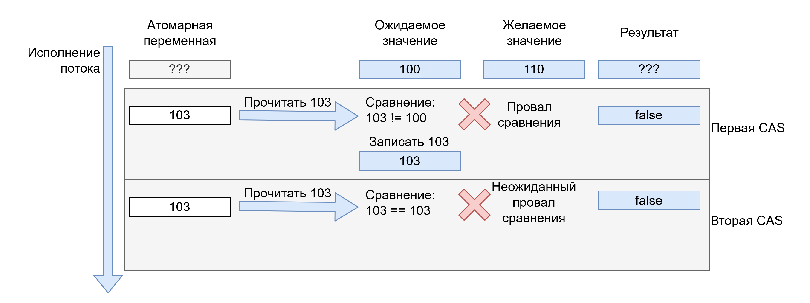

##### Интерфейс нотификации

Начиная с C++20 мы получили в распоряжение интерфейс ожидания изменения значения для атомарной переменной. Ранее этот интерфейс был только у `std::condition_variable`. Данный интерфейс содержит три метода:

1. `wait()` \- ставит текущий поток на ожидание, пока значение переменной не сравняется с ожидаемым.  
2. `notify_one()` \- отправляет сигнал для пробуждения для сравнения только одного ожидающего потока.  
3. `notify_many()` \- отправляет сигнал для пробуждения для сравнения всех ожидающих потоков.

```c++
std::atomic<int> value{0};

std::thread([&]() {
  value.wait(0, std::memory_order::seq_cst);
}).detach();

std::thread([&]() {
  value.store(1, std::memory_order::rel);
  value.notify_one();
}).detach();

std::thread([&]() {
  value.store(2, std::memory_order::rel);
  value.notify_all();
}).detach();
```

Особенности данного интерфейса мы рассмотрим в при рассмотрении `std::condition_variable`.

##### Перегрузки для умных указателей

Начиная с C++20 мы получили две перегрузки шаблона для умных указателей `std::unique_ptr` и `std::shared_ptr`. Хоть эти классы и **не тривиальные**, но имплементация старается воздержаться от использования мьютексов для достижения настоящей атомарности.  
До C++20 для `std::shared_ptr` было возможно использовать набор свободных функций для атомарной работы.

#### std::atomic_thread_fence

Данная вспомогательная функция помогает тонко настраивать объемы данных, которые синхронизируются атомарными операциями с порядками получения-выпуска и последовательной консистентности. Они определяют дополнительные инструкции, которые могут быть вставлены в код для сброса или ожидания сброса данных.

```c++
std::atomic<int> x = 0;
std::atomic<int> y = 0;
int rl, r2;

auto thread1 = std::thread([&] {
  x.store(1, std::memory_order_relaxed);
  std: :atomic_thread_fence(std::memory_order_release);
  rl = y.load(std::memory_order_relaxed);
});

auto thread2 = std::thread([&] {
  r2 = x.load(std::memory_order_relaxed);
  std: :atomic_thread_fence(std::memory_order_acquire);
  y.store(1, std::memory_order_relaxed);
});
```

#### std::atomic_ref

Начиная с C++20 данный шаблон класса предоставляет обертку, добавляющую интерфейс атомарных операций, как для `std::atomic` для любого не атомарного типа. При этом атомарность гарантируется между любыми экземплярами `std::atomic_ref`, ссылающиеся на один и тот же промежуток в памяти (адрес и длину).  

### Мьютексы

Вторым, но наиболее используемым классом примитивов синхронизации являются мьютексы. Имя мьютекс происходит от английского **mutual exclusion** \- что означает **взаимное исключение**. Мьютексы предоставляют возможность организовать секцию кода где действует принцип взаимного исключения исполнителей, обычно \- только один исполнитель может находиться в секции пока не исполнит ее до конца.  
С точки зрения стандарта C++ поток, захватывающий мьютекс, “Синхронизируется с” потоком, последним освободившим мьютекс.  
Стандартная библиотека C++ предоставляет несколько видов мьютексов для различных целей.

#### std::mutex

Данный класс выражает собой основную идею мьютекса. Он позволяет создать секцию кода между вызовами `lock()` / `try_lock()` и `unlock()` где действует принцип взаимного исключения. Такую секцию может исполнять только один поток операционной системы.  
При вызове метода `lock()` поток будет заблокирован до тех пор, пока ему не выпадет очередь заблокировать мьютекс (в таком случае говорят о взятии или захвате мьютекса). Далее поток, заблокировавший мьютекс обязан его разблокировать, вызвав метод `unlock()`, иначе все потоки, ожидающие на мьютексе будут заблокированы навечно. Важной особенностью мьютексов является требование, чтобы мьютекс **освободил именно тот поток, который его захватил**. Метод `try_lock()` предоставляется для того, чтобы не ожидать освобождения мьютекса, а сразу вернуться из метода со статусом \- удалось ли заблокировать мьютекс или нет.  
Обычно внутренняя организация имплементации `std::mutex` достаточно хороша \- используются очереди ожидания и системный примитивы для эффективного сна потоков.

##### Проблемы блокировок и их решения

Класс ситуаций, когда поток оказывается навечно заблокированным называется **“блокировка насмерть” или dead-lock**. Такие блокировки являются согласно стандарту C++ **неопределенным поведением** и программист не должен их допускать. Есть всего несколько наиболее часто возникающих проблем, приводящих к dead-lock. Далее мы разберем когда они возникают и как решаются.

###### Забытое освобождение

Первая проблема, когда поток, заблокировавший мьютекс не освободил его. Для этой проблемы есть два решения:

1. Использовать RAII обертку `std::lock_guard` для того чтобы освободить мьютекс при любом пути выполнения программы.  
2. Вместо `std::mutex` использовать `std::timed_mutex`, который добавляет методы `try_lock_for()` / `try_lock_until()` для того чтобы можно было устанавливать таймаут ожидания захвата мьютекса.

###### Самоблокировка

Вторая проблема проявляется когда поток, уже захвативший мьютекс пытается захватить его повторно. В таком случае поток будет ждать пока сам же и освободит мьютекс. Обычно, это следствие непродуманного дизайна структур данных, защищенных внутри мьютексом. Данная проблема также называется **“однопоточный dead-lock”**. Для того чтобы его избежать можно использовать имплементацию мьютекса `std::recursive_mutex`, который позволяет захватывать себя множество раз одному и тому же потоку.  
Данный мьютекс подвержен проблеме забытого освобождения намного больше обычного мьютекса, так как его нужно освободить ровно столько раз, сколько он был захвачен. Поэтому был также введен `std::recursive_timed_mutex`.  
Данное семейство мьютексов лучше не использовать, так как необходимость его использования обычно является аспектом не самого лучшего дизайна который стоило бы переработать так, чтобы рекурсивная блокировка не понадобилась бы.

###### Взаимо-блокировка

Третья проблема проявляется когда два и более потоков пытаются захватить в каком-то порядке два и более мьютексов. Если порядок захвата не одинаков, то может получиться, что часть мьютексов уже захвачена одним потоком, а часть другим, что приводит к неминуемому ожиданию в обоих потоках. Данная проблема также называется **“N-поточный dead-lock”**.  
Данная проблема имеет три решения:

1. Функция `std::try_lock()` позволяет попробовать заблокировать набор мьютексов в порядке, в котором они были переданы в функцию. Её проще всего использовать, когда можно отсортировать объекты, к которым принадлежат мьютексы. Таким образом пользователь сам предоставляет единый порядок блокировки, что избегает ситуацию взаимо-блокировки.  
2. Функция `std::lock()` применяет **алгоритм избегания блокировок** для произвольного набора мьютексов. Ее нужно использовать, когда весь набор мьютексов неизвестен или не может быть упорядочен, или разный, но пересекающийся на каждом потоке.  
3. Класс `std::scoped_lock` можно использовать как `std::lock_guard` для множества мьютексов, который захватывает их с использованием `std::lock()`.

#### std::shared_mutex

Иногда при дизайне системы становится понятно, что принцип взаимного исключения является слишком строгим в отношении требований к системе. Тогда на помощь приходит **модель совместного или эксклюзивного владения**. Такой тип мьютексов принято называть *мьютексами чтения-записи* (read-write mutex, RW mutex, RW lock).  
В данной модели ресурсом можно обладать или совместно, тогда он доступен только для чтения всем владеющим, или эксклюзивно, тогда ресурс будет доступен для чтения и записи, только одному владеющему, остальные должны будут ждать.  
В стандартной библиотеке C++ данную модель выражает класс `std::shared_mutex`. Обычные методы `lock()` / `try_lock()` / `unlock()` \- блокируют и разблокируют мьютекс в эксклюзивном режиме, а методы `lock_shared()` / `try_lock_shared()` и `unlock_shared()` \- блокируют разблокируют мьютекс в совместном режиме.  
Для того, чтобы решать проблему самоблокировок этот мьютекс предоставляет вариант `std::shared_timed_mutex`.  
RAII обертка `std::lock_guard` будет брать данный мьютекс в эксклюзивном режиме, а для совместного режима предлагается обертка `std::shared_lock`.

#### Стратегии работы RAII оберток

Отдельно стоит отметить RAII обертку для работы с любыми типами мьютексов `std::unique_lock`. Она позволяет более гибко выполнять блокирование мьютекса при создании. В частности поддерживаются 3 стратегии:

1. Стратегия `std::defer_lock` \- не берет мьютекс при создании `std::unique_lock`. Его можно взять потом, методами `lock()` / `try_lock()` / `try_lock_for()` / `try_lock_until()` или с использованием функций `std::lock()` / `std::try_lock()`.  
2. Стратегия `std::try_to_lock` \- вместо `lock()` в конструкторе у мьютекса вызывается метод `try_lock()`. Проверить владение можно через метод `owns_lock()`.  
3. Стратегия `std::adopt_lock` \- позволяет не вызывать никаких методов в конструкторе. Это сделано для того, чтобы адаптировать уже существующее владение мьютексом и освободить его как RAII обертка.

## Другие шаблоны блокировки и ожидания

Помимо примитивов синхронизации стандартная библиотека C++ предоставляет еще несколько подходов к работе по синхронизации. Явно можно выделить два подхода:

1. Использование специализированных примитивов синхронизации. Сюда относятся примитивы семафоров, защелок и барьеров.  
2. Ожидание блокировки с уведомлением. В данном подходе рассматриваются условные переменные.

#### Семафоры

В C++20 мы получили несколько новых примитивов синхронизации доступа, реализующих более сложные стратегии синхронизации чем мьютексы. Семафоры призваны создать критическую секцию, внутри которой может находится как максимум N параллельных исполнителей. Такая секция может быть создана, если например есть буфер фиксированной длины, где для каждого вошедшего в секцию потока выделяется один элемент.  
Семафор реализует модель банки с шариками \- приходишь, должен взять из банки шарик и держать пока не уйдешь. Уходишь положил шарик в банку. Всего шариков в банке изначально фиксированное число. Также если ты уходишь то можешь передать кому-то из оставшихся свой шарик, чтобы он положил его в банку когда уйдет. Именно последним семафор отличается от мьютекса \- **взявший семафор поток не обязан его отпускать, если за него это сделает кто-то другой**.  
Семафор представлен в стандартной библиотеке шаблоном класса `std::counting_semaphore`, параметром которого является максимальное число параллельных исполнителей. Предоставляется также псевдоним типа `std::counting_semaphore<1>` \- `std::binary_semaphore`. На семафорах легко построить другие примитивы синхронизации.  
Методы семафора выполняют следующие операции:

* `release()` \- увеличивает внутренний счетчик на единицу и разблокирует тех, кто ждет взятия семафора.  
* `acquire()` / `try_acquire()` / `try_acquire_for()` / `try_acquire_until()` \- уменьшает внутренний счетчик на единицу, или встает на ожидание если счетчик равен нулю.

Семафор можно инициализировать любым состоянием от `0` и до указанного в шаблоне.

#### Защелка и Барьер

Также в C++20 мы получили барьер `std::barrier` и защелку `std::latch`.  
Барьер реализует модель синхронизации для групп потоков известной длины. Его можно представить как примитив, ответственный за `reduce` часть в парадигме `map-reduce`, так как пришедшие к барьеру потоки ждут пока придут все потоки из группы, а когда все потоки прибыли \- есть возможность выполнить колбек для данной группы. После того как все ожидаемые потоки прибыли они все просыпаются и продолжают свое исполнение, а барьер восстанавливается в состояние ожидание новой группы из N потоков.  
Методы барьера:

* `arrive()` \- сигнализирует барьеру, что очередной поток из группы прибыл.  
* `wait()` \- останавливает текущий поток до момента, когда прибудут все потоки из группы.  
* `arrive_and_wait()` \- совмещает `arrive()` и `wait()`.  
* `arrive_and_drop()` \- данный метод позволяет обозначить, что поток прибыл в данную группу, но начиная со следующей группы потоков нужно будет ожидать на один меньше.

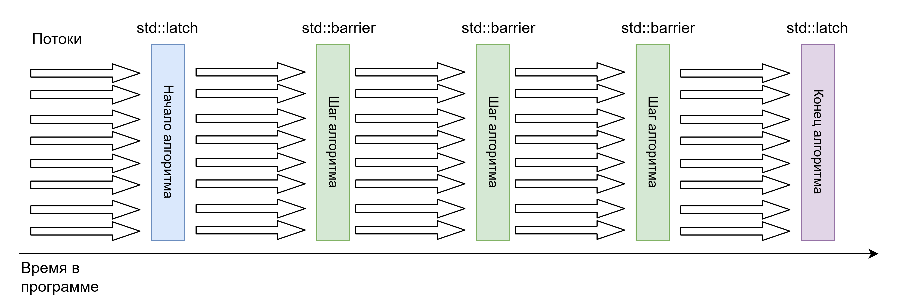

Защелка является по своей сути одноразовым барьером. Её обычно используют для синхронизации в начале или конце выполнения объема работ, а посередине используют барьер.  
Методы защелки:

* `count_down()` \- аналог метода `arrive()` у барьера  
* `try_wait()` \- предоставляет способ проверить, сработала ли защелка без блокировки  
* `wait()` \- аналог метода `wait()` у барьера  
* `arrive_and_wait()` \- аналог метода `arrive_and_wait()` у барьера

Защелки и барьеры получили широкое распространение в драйверах устройств, а также, в распределение работы между потоками с использованием парадигмы `map-reduce`.

#### Условные переменные

Часто в дизайне многопоточной программы нам бы хотелось иметь возможность проверить некоторый набор условий, которые требуют синхронизации, до начала блокировки или больших действий с данными, так как это делается например в POSIX вызове `poll()` для файлов и дескрипторов.  
Решить эту задачу можно по разному. Самым простым решением является атомизация переменных, отвечающих за условие (например размер контейнера), что приводит к возможности проверить их без блокировок. Однако такая проверка приводит к необходимости проверить значение ещё раз после блокировки, так как между изначальной проверкой и взятием мьютекса мог пройти не ограничено долгий промежуток времени (time-of-check vs time-of-action). Такая двойная проверка условия считается **анти-паттерном под названием double-checked locking**.  

```c++
std::atomic<MyClass*> instance{nullptr};
std::mutex instance_mutex;

if (instance.load(std::memory_order_acquire) == nullptr) {
  std::lock_guard lg{instance_mutex};
  // Повторная проверка
  if (instance.load(std::memory_order_acquire) == nullptr) {
    instance.store(new MyClass(), std::memory_order_release);
  }
}

MyClass* ptr = instance.load(std::memory_order_acquire);
```

Другим способом решения задачи является **ожидание до наступления сложного условия** на примитиве синхронизации. Именно такую схему реализуют **условные переменные**. `std::condition_variable` позволяет реализовать ожидание некоторого условия для данных, защищенных `std::mutex`, тогда как `std::condition_variable_any` \- работает с любым блокируемым типом.  
Работая с условными переменными мы получаем возможность дождаться нотификации от кого-то из\-вне, чтобы поток пробудился и продолжил выполнять свои действия. Так:

* В методах `wait()` / `wait_for()` / `wait_until()` поток предоставляет элемент синхронизации и функциональный объект для проверки условия. Вызывая данные методы поток засыпает до тех пор, пока условие не будет выполнено, а элемент синхронизации не будет захвачен.  
  * Это означает, что после выполнения метода гарантируется \- захваченный элемент синхронизации и выполненное условие.  
  * Поток просыпается для выполнения попытки проверки условия и захвата или после явной нотификации от другого потока или случайно (обычно, если потоку выдала квант времени ОС, такое просыпание называется спорадическим).  
* Методы `notify_one()` и `notify_all()` позволяют пробудить один или сразу все ожидающие на данной условной переменной потоки.  
  * Эти методы может вызвать только тот поток, который модифицировал данные, указанные в условии, захватив общий примитив синхронизации.

```c++
std::mutex mu;
std::condition_variable cv;
bool ready = false;

std::thread([&]() {
  std::unique_lock ul{mu};
  cv.wait(ul, [&]{ return ready; });
  process_data();
}).detach();

prepare_data();
{
  std::lock_guard lg{mu};
  ready = true;
}
cv.notify_one();
```

Таким образом условные переменные:

- Работают в паре с примитивами синхронизации.  
- Добавляют возможность проверять сложные условия для продолжения работы.

##### Пропуск нотификации

Важным аспектом работы с `std::condition_variable` является предоставление условия проверки ожидания так как не редка ситуация при которой уведомление от другого потока могла произойти ранее, чем ожидающий поток встал на ожидание. В этом случае без проверки условия остается надеется только неожиданное пробуждение потока системой (spurious wake-up).

## Передача сообщений

Последним распространенным подходом к синхронизации является передача сообщений. Она своего рода избегает синхронизации, совмещая разделяемое состояние с данными в сообщении, к которым может обращаться только поток, обрабатывающий сообщение. Данный подход стал очень популярен в последние годы, так как упрощает проектирование разделяемого доступа (пример каналы в Golang).  
В стандартной библиотеке нет примитивов, которые бы помогали эффективно (эффективнее чем очередь с мьютексом) передавать сообщение между потоками. Поэтому мы обычно используем сторонние библиотеки.  
Всего существует два распространенных вида очередей сообщений:

* Эффективная очередь со сном и блокировками на основании контейнера очереди и условной переменной. Такую очередь можно написать самому на основании примитивов из стандартной библиотеки.  
* Не блокирующие очереди на основании **lock-free списков**. Такую очередь написать самому корректно почти невозможно и обычно используются уже готовые имплементации такие как `Boost::lockfree`.  
  * По образу нагрузки lock-free очереди отличаются эффективной имплементацией и бывают:  
    * SP/SC \- один поток создатель и один потребитель.  
    * SP/MC \- один создатель, много потребителей.  
    * MP/SC \- много создателей, один потребитель.  
    * MP/MC \- много создателей, много потребителей.
